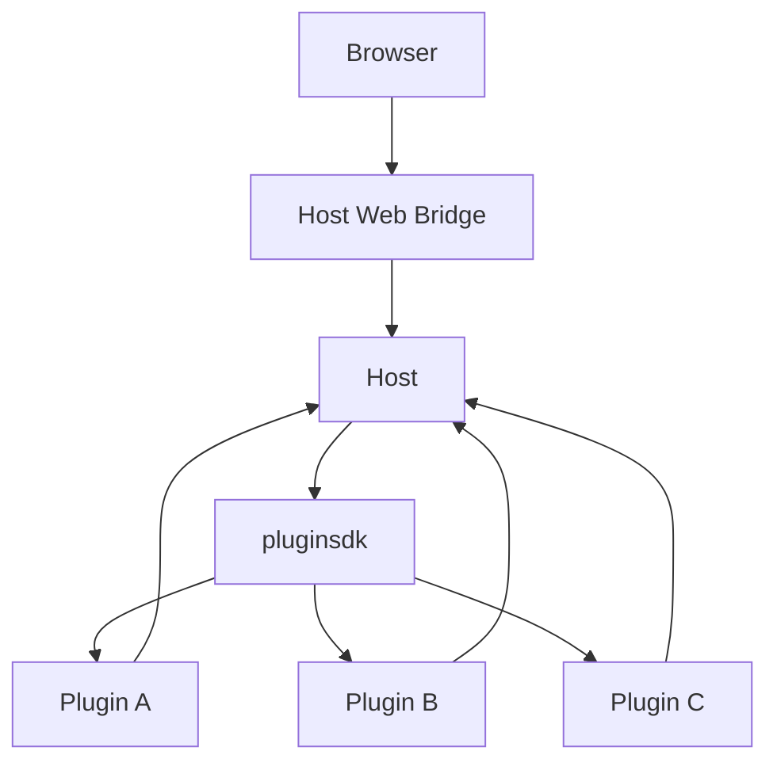
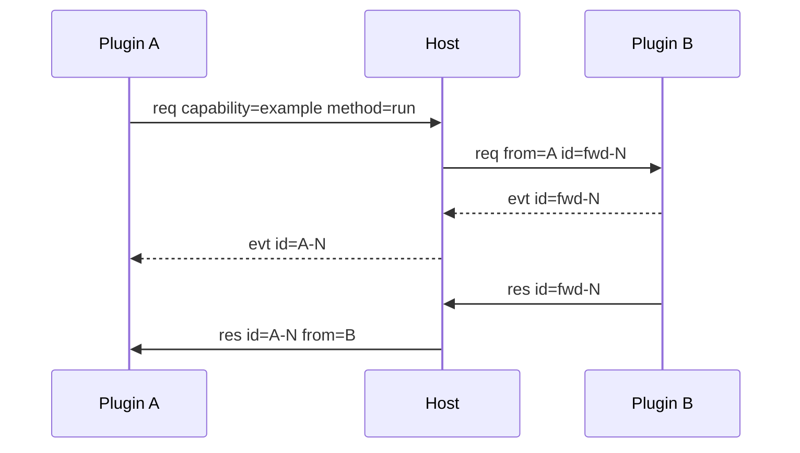

# ARCHITECTURE

LiteAgent 采用 Host 薄内核加进程外 Plugin 的结构。Host 只负责平台能力。Plugin 提供业务能力，并通过统一 Frame 与 Host 通信。

## 1. 总体结构



Plugin A、Plugin B 和 Plugin C 只是结构示例。项目不指定插件种类，也不要求所有插件组成某个固定产品。

## 2. 平台模块

| 模块 | 职责 | 非职责 |
|---|---|---|
| `protocol` | Frame 编解码、版本和错误码 | 业务数据 |
| `pluginsdk` | 注册、Call、Event、插件 UI 驱动接口 | 页面布局 |
| `internal/host` | Plugin Instance、执行上下文、Frame 路由、pending 和外部 Call 入口 | 业务策略 |
| `internal/plugin` | Manifest 发现和 autostart 排序 | 运行业务 |
| `internal/webui` | Shell、Mount Bootstrap、静态资源和 Browser Bridge | 插件业务状态 |
| `cmd/liteagent-server` | 组装 Host 与 WebUI，管理 HTTP 生命周期 | 业务实现 |

`plugins/` 是扩展层。插件能力、数据模型和 UI 由各自目录定义。

## 3. Frame 路由



路由键是 `(capability, method)`。`from` 由 Host 注入，只用于溯源。插件名不参与路由。

执行上下文提供第二层调度。它把 Capability 绑定到 Plugin Instance。无上下文调用进入默认实例，有上下文调用进入绑定实例。Plugin Instance 不改变插件身份。

## 4. 扩展模型

Plugin 自己决定三件事：

- 提供哪些 Capability；
- 如何保存业务状态；
- 哪些 Component 负责前端展示。

Host 不读取插件业务状态。Host 只装载静态资源，并把 Call、State、Command 路由到正确目标。

```text
Plugin Manifest      静态声明
Plugin Runtime       业务执行
Plugin Component     业务展示
Plugin Storage       业务持久化
```

这四部分都属于插件。项目整体文档只定义它们与 Host 的接口。

## 5. WebUI 组成

```text
Host WebUI
├── Host Shell
├── Slot Registry
├── Component Loader
├── Settings Renderer
└── Browser Bridge

Plugin Web Component
├── setData(state)
├── runCommand(command, payload)
├── connectedCallback()
└── disconnectedCallback()
```

Component 由插件拥有。Host 只负责装载和连接。Component 的业务状态契约写在插件文档中。

## 6. 消息边界

Host 只理解平台字段：

```text
id
type
from
context_id
capability
method
payload
error_code
error_msg
```

`payload` 对 Host 不透明。插件方法 payload、Fact、View State 和业务错误由插件文档定义。

## 7. 目录映射

| 契约 | 位置 |
|---|---|
| Frame | `protocol/` |
| 插件 SDK | `pluginsdk/` |
| Host 路由 | `internal/host/` |
| WebUI | `internal/webui/` |
| Manifest | `internal/plugin/` |
| 平台文档 | `docs/` |
| 插件契约 | `plugins/<name>/` |

## 8. v1 范围

v1 面向本机浏览器，允许多个页面同时连接。暂不实现多用户、远程访问、跨设备同步、插件市场和任意第三方代码沙箱。

Plugin Instance 和执行上下文已具备基础注册、绑定和调用传播。调度配额、在线迁移和实例状态恢复暂不实现。
