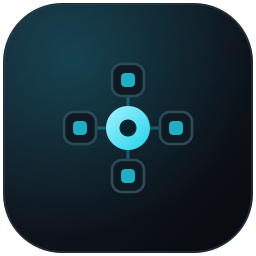
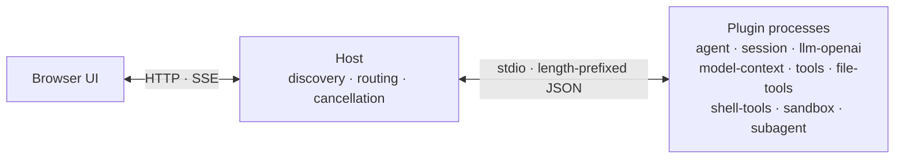
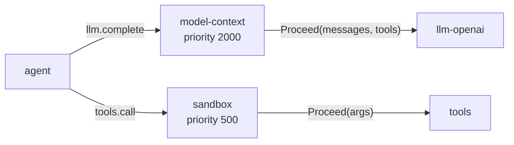

<div align="center">
  
  <h1>LiteAgent</h1>

  <p><b>A process-isolated plugin runtime for coding agents.</b><br>
  One Go binary. Nine plugins. No frontend build step.</p>

  <p>
    
    
    
    
  </p>

  <p>
    <a href="README.zh-CN.md">简体中文</a> ·
    <a href="#quick-start">Quick start</a> ·
    <a href="#how-it-works">How it works</a> ·
    <a href="#plugins">Plugins</a> ·
    <a href="#documentation">Docs</a>
  </p>
</div>

LiteAgent runs a coding agent as a set of cooperating processes. A small host discovers plugins, routes calls between them, and owns cancellation. Models, sessions, tools, context assembly, permissions and subagents are plugins — each in its own OS process, each replaceable on its own.

## Why LiteAgent

- **Isolation you can rely on.** Every plugin is a separate executable, and the wire between them is a 4-byte length prefix plus JSON. A broken tool kills its own process; the host reports `plugin_down` instead of taking the agent down with it.

- **Calls address capabilities, not vendors.** The routing key is `capability.method`. `llm-openai` is simply one implementation of `llm`; the orchestrator never learns the provider's name.

- **Middleware is a plugin, not a branch.** Context compaction and permission checks attach to the call chain with a `priority` and a `Proceed()`. Remove the plugin and the hop disappears — no dead code left in the kernel.

- **Sessions you can replay.** Every turn is an append-only JSONL fact log. The UI is a projection of it, compaction appends a summary rather than deleting messages, and `model-context.inspect` shows exactly what the model saw on any step.

## Quick start

Requires **Go 1.25+**.

```bash
git clone https://github.com/Alphazer01214/my-go-lite-agent.git
cd my-go-lite-agent

go build ./cmd/liteagent-server
./liteagent-server
```

Open <http://127.0.0.1:2333>, then configure `llm-openai` in the plugin center (top right) → click its graph node → Settings. Models from different providers can live in one catalog.

Environment variables work too (they apply to the default model entry):

```bash
OPENAI_BASE_URL=https://api.deepseek.com/v1 \
OPENAI_API_KEY=sk-... \
OPENAI_MODEL=deepseek-chat \
./liteagent-server
```

Build a distributable layout — server, plugin binaries and manifests, incrementally:

```bash
./scripts/build.sh                          # or: powershell -File scripts/build.ps1 -Verify
cd dist && ./liteagent-server
```

Set `LITEAGENT_HTTP_ADDR` to change the listen address. Plugins are discovered next to the binary, then under the current directory.

## How it works

Every call is a frame over stdio. Plugins never talk to each other — the host is the only router.



The interesting part is what the host does between two plugins. Consumers register for a method with a priority; the host picks the highest one, and `Proceed()` hands the (possibly rewritten) payload to the next hop.



That is how context compaction and permission checks are implemented: not as kernel branches, but as plugins on the chain. A consumer that isn't running is a hop that doesn't happen — the call goes straight to the provider. The host itself stays around 2.8k lines: manifest discovery, a route table keyed by `capability.method`, pending-call bookkeeping, cancellation, and a browser bridge.

Sessions are the other half of the design. `session` writes one JSONL file per conversation, where every turn, step, model request header and tool result is a separate fact. Streaming deltas never enter the log; the final assistant message is the source of truth. Reloading the page rebuilds the UI from facts, and compacting a conversation appends a summary that shadows old messages instead of removing them.

## Plugins

| Plugin | Responsibility |
|---|---|
| `agent` | Turn loop: context → model → tools → facts |
| `session` | Append-only fact log, workspaces, chat UI |
| `model-context` | System prompt, token budget, deterministic compaction |
| `llm-openai` | OpenAI-compatible streaming adapter |
| `tools` | Tool registry and dispatch |
| `file-tools` | Read, write, patch, search inside the workspace |
| `shell-tools` | Process execution with tree cancellation |
| `sandbox` | `allow` / `confirm` / `modify` / `deny` on tool calls |
| `subagent` | Delegates a self-contained task to a child session |

Optional pieces can be stopped without touching code: without `tools` the agent just talks, without `model-context` it sends the raw transcript, without `sandbox` calls run unguarded. The platform has no hard interception layer — absence means passthrough.

## Write a plugin

A plugin imports only `pluginsdk`. No frame loop, no stdio plumbing.

```go
package main

import (
	"context"
	"encoding/json"

	"github.com/tomori/my-go-lite-agent/pluginsdk"
)

func main() {
	p := pluginsdk.NewPlugin("hello")
	p.Register("hello", "ping", pluginsdk.NewHandler(
		func(ctx context.Context, req *pluginsdk.Request) (json.RawMessage, error) {
			return json.RawMessage(`{"pong": true}`), nil
		},
	))
	if err := p.Serve(); err != nil {
		panic(err)
	}
}
```

Add a `plugin.json` with `name`, `entry`, `provides` and `autostart`, and the host picks it up on the next scan. The SDK handles registration, dispatch, `Call`, cancellation (including a cancel that arrives before its request) and write serialization.

## Status

v0.1. Nine plugins are implemented, and the suite has 345 test functions. Multi-session UI, streaming with cancellation, permission confirmations and subagent delegation all work. Web tools, interactive terminals and background shells are designed but not shipped. The interface is currently Chinese-only, and APIs may change before 1.0.

## Documentation

| Document | Contents |
|---|---|
| [Architecture](docs/en/architecture.md) | Host, plugins, routing, pipeline, Web UI |
| [Wire protocol](docs/en/protocol.md) | Frames, cancellation, host methods, error codes |
| [Plugin development](docs/en/plugin-dev.md) | Package layout, SDK, components, testing |
| [Design notes](docs/design/) | Composition model, plugin designs, long-session performance *(Chinese)* |
| [Full index](docs/README.md) | Everything else *(Chinese)* |

## Contributing

Issues and pull requests are welcome. Run `go test ./...` before sending a patch; `scripts/build.ps1 -Verify` also runs vet and the frontend tests.

## License

No license file has been added yet.
