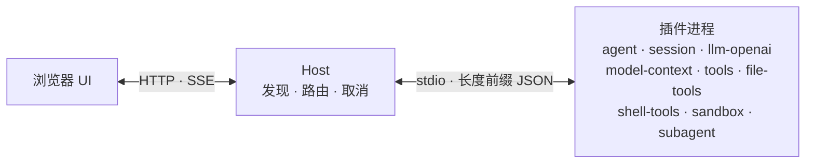
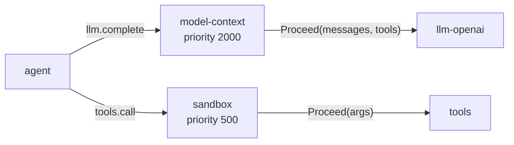

<div align="center">
  
  <h1>LiteAgent</h1>

  <p><b>进程隔离的 coding agent 插件运行时。</b><br>
  一个 Go 二进制，九个插件进程，零前端构建。</p>

  <p>
    
    
    
    
  </p>

  <p>
    简体中文 ·
    <a href="README.md">English</a> ·
    <a href="#快速开始">快速开始</a> ·
    <a href="#工作原理">工作原理</a> ·
    <a href="#插件">插件</a> ·
    <a href="#文档">文档</a>
  </p>
</div>

LiteAgent 把 coding agent 拆成一组协作进程：一个薄内核负责发现插件、在插件之间路由调用、管理取消；模型、会话、工具、上下文组装、权限、子代理都是插件——各自独立进程，各自可替换。

## 为什么是 LiteAgent

- **隔离是结构性的。** 每个插件都是独立可执行文件，进程之间是一条「4 字节长度前缀 + JSON」的帧。工具崩了只死自己的进程，Host 返回 `plugin_down`，不会把 agent 一起带走。

- **按能力寻址，不按厂商寻址。** 路由键是 `capability.method`。`llm-openai` 只是 `llm` 的一个实现，编排层从不知道供应商叫什么。

- **中间件是插件，不是分支。** 上下文压缩和权限裁决挂在调用链上，带 `priority` 和 `Proceed()`。把插件停掉，这一跳就消失，内核里不会留下死代码。

- **会话可以回放。** 每个 Turn 都是一条条追加到 JSONL 的事实。UI 是它的一次投影；压缩只追加摘要，不删消息；`model-context.inspect` 能还原某一步模型实际看到了什么。

## 快速开始

需要 **Go 1.25+**。

```bash
git clone https://github.com/Alphazer01214/my-go-lite-agent.git
cd my-go-lite-agent

go build ./cmd/liteagent-server
./liteagent-server
```

打开 <http://127.0.0.1:2333>，在 **插件中心 → 点击 llm-openai 节点 → 设置** 里填一个 OpenAI 兼容端点即可。不同供应商的模型可以放在同一个目录里。

也可以用环境变量（只作用于默认模型那一条）：

```bash
OPENAI_BASE_URL=https://api.deepseek.com/v1 \
OPENAI_API_KEY=sk-... \
OPENAI_MODEL=deepseek-chat \
./liteagent-server
```

打可分发目录——服务端、插件二进制和 manifest，增量构建：

```bash
./scripts/build.sh                          # 或：powershell -File scripts/build.ps1 -Verify
cd dist && ./liteagent-server
```

监听地址用 `LITEAGENT_HTTP_ADDR` 覆盖；插件目录先找可执行文件旁，再找当前目录。

## 工作原理

每次调用都是 stdio 上的一帧。插件之间从不直连，Host 是唯一的路由器。



真正有意思的是 Host 在两个插件之间做的事。消费者按 priority 注册到某个方法上，Host 选优先级最高的一个，`Proceed()` 把（可能被改写的）payload 交给下一跳。



上下文压缩和权限确认就是这样实现的：不是内核里的分支，而是链上的插件。消费者没在运行时，这一跳直接不存在，调用落到 Provider 上。Host 本身保持在 2.8k 行左右：manifest 发现、`capability.method` 路由表、pending 记账、取消、浏览器桥。

另一半设计是会话。`session` 为每个会话写一个 JSONL 文件，turn、step、模型请求头、工具结果各是一条事实。流式增量不进日志，最终 assistant 消息才是真源。刷新页面时 UI 从事实重建；压缩会话只是追加一条摘要，用 shadow range 遮住旧消息，原文仍在。

## 插件

| 插件 | 职责 |
|---|---|
| `agent` | Turn 循环：上下文 → 模型 → 工具 → 事实 |
| `session` | 追加式事实日志、Workspace、聊天 UI |
| `model-context` | system prompt、token 预算、确定性压缩 |
| `llm-openai` | OpenAI 兼容的流式适配器 |
| `tools` | 工具注册与分发 |
| `file-tools` | Workspace 内的读、写、补丁、搜索 |
| `shell-tools` | 进程执行与进程树取消 |
| `sandbox` | 工具调用上的 `allow` / `confirm` / `modify` / `deny` |
| `subagent` | 把一件自包含的任务委派给子会话 |

可选件停了也不用改代码：没有 `tools`，agent 就只聊天；没有 `model-context`，它发送原始 transcript；没有 `sandbox`，调用直通。平台没有强制拦截层——缺席即放行。

## 写一个插件

插件只 import `pluginsdk`：不写帧循环，不碰 stdio 管道。

```go
package main

import (
	"context"
	"encoding/json"

	"github.com/tomori/my-go-lite-agent/pluginsdk"
)

func main() {
	p := pluginsdk.NewPlugin("hello")
	p.Register("hello", "ping", pluginsdk.NewHandler(
		func(ctx context.Context, req *pluginsdk.Request) (json.RawMessage, error) {
			return json.RawMessage(`{"pong": true}`), nil
		},
	))
	if err := p.Serve(); err != nil {
		panic(err)
	}
}
```

再配一个含 `name`、`entry`、`provides`、`autostart` 的 `plugin.json`，下次扫描就会被 Host 挂上。注册上报、请求分发、`Call`、取消传播（包括 cancel 早于 req 到达的乱序）、写锁串行化都由 SDK 处理。

## 状态

v0.1。九个插件已实现，345 个测试函数覆盖；多会话 UI、流式输出与取消、权限确认、子代理委派都可以正常使用。Web 工具、交互式终端、后台 shell 已有设计但尚未发布。界面目前只有中文，1.0 之前 API 仍可能变化。

## 文档

| 文档 | 内容 |
|---|---|
| [架构](docs/en/architecture.md) | Host、插件、路由、流水线、WebUI |
| [线协议](docs/en/protocol.md) | 帧、取消、Host 方法、错误码 |
| [插件开发](docs/en/plugin-dev.md) | 包结构、SDK、组件、测试 |
| [设计稿](docs/design/) | 组合方案、插件设计、长会话性能 |
| [完整索引](docs/README.md) | 其余全部文档 |

英文版核心文档在 `docs/en/`，中文文档在 `docs/`。

## 参与

欢迎 issue 和 PR。提交前跑 `go test ./...`；`scripts/build.ps1 -Verify` 会加上 vet 和前端测试。

## 许可证

仓库尚未添加 LICENSE 文件。
