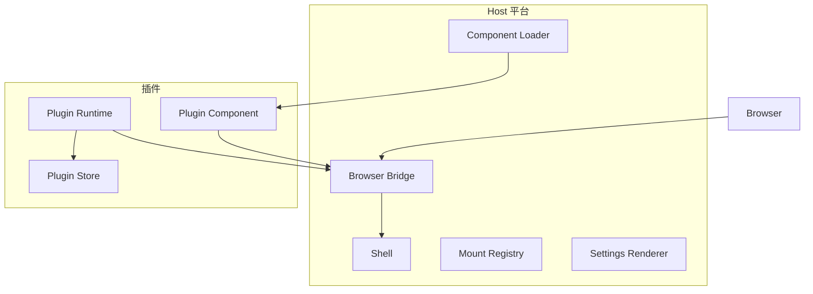
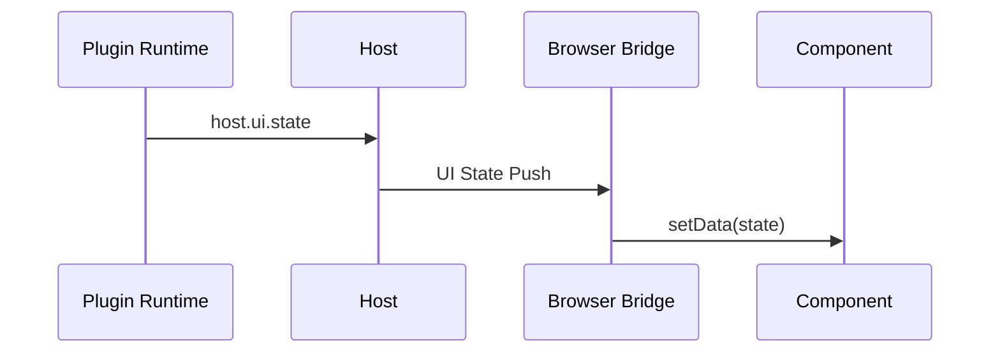
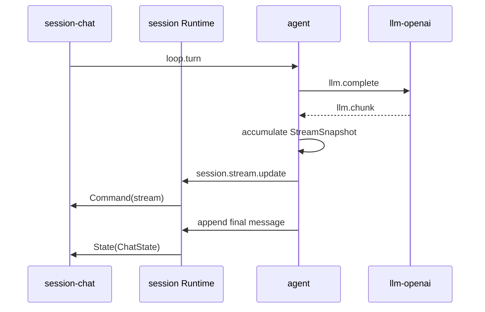

# WebUI 实现交接

> 状态：已废止
> 取代者：[docs/platform/webui.md](../../platform/webui.md)
> 说明：四片式 WebUI 平台契约已收进 WebUI 平台文档。UI Push 的单连接模型、Manifest 结构与三个 Component 的样例都已过时。

**日期**：2026-10-14
**分支**：`webui`
**状态**：Browser Call 与 UI Push 已完成，准备进入管理面。
**范围**：WebUI 挂载、渲染和通信。`Plugin Runtime` 驱动与首个插件组合也在交接范围内。

---

## 1. 会话结论

本次讨论已经确认以下边界。

1. Host 只提供平台壳，不实现业务面板。
2. Plugin Runtime 拥有业务状态，Plugin Component 只负责展示。
3. Plugin Runtime 驱动自己拥有的 Component。
4. LLM delta 只是临时中间产物，不进入插件持久化。
5. 最终业务记录由提供持久化能力的插件保存。
6. 项目整体文档不把具体插件写成 Host 组成部分。
7. 插件方法、payload、State 和 Command 写在插件目录。
8. WebUI v1 面向本机单浏览器，不实现多浏览器实时同步。

首个验收组合仍是 `agent + llm-openai + session`。该组合是当前工作示例，不是 Host 的固定业务模型。

---

## 2. 交接范围

本次实现分为四个部分。

| 部分 | 内容 |
|---|---|
| Manifest | UI Component、Mount、Settings Schema |
| Host WebUI | Shell、Slot、Loader、静态资源、Browser Bridge |
| Plugin UI | Component 生命周期、State、Command、Capability Call |
| 示例插件接入 | Session 三组件、Agent Stream、LLM 配置 |

插件开关、sandbox、subagent、对话分支和多浏览器同步不在本次范围。

---

## 3. 当前基线

当前 `webui` 分支只有文档变更，Go 实现尚未开始。

| 位置 | 当前状态 |
|---|---|
| `internal/plugin/manifest.go` | UI/Settings 类型已更新 |
| `internal/webui/` | Shell、Browser Call、UI Push、Diagnostic Push 和静态资源服务已实现 |
| `pluginsdk/webui.go` | `SetState`、`SendCommand` 已实现 |
| `cmd/liteagent-server/server.go` | HTTP 启停已接入，默认端口 2333 |
| `internal/host/transport.go` | 无 id 的 Event 仍被丢弃 |
| `plugins/session/plugin.json` | 只声明旧 `ui.entry` |
| `plugins/*/ui/` | 尚无前端资产 |
| `docs/platform/webui.md` | 已定义目标平台契约 |

基线测试：

```text
go test ./... 通过
```

---

## 4. 责任分层



| 能力 | 属主 |
|---|---|
| Slot、Shell、连接 | Host |
| Mount 校验和实例地址 | Host |
| Component DOM | 插件 |
| State、Command 语义 | 插件 |
| 业务持久化 | 插件 |
| Capability 路由 | Host |
| payload 解释 | 插件 |

Host 不保存业务 State。浏览器刷新后，由插件重建 State。

---

## 5. Manifest 设计

### 5.1 目标类型

采用以下类型替换 `internal/plugin/manifest.go` 中的旧 UI 类型。

```go
type Manifest struct {
    Name      string           `json:"name"`
    Version   string           `json:"version"`
    Protocol  int              `json:"protocol"`
    Entry     string           `json:"entry"`
    Autostart bool             `json:"autostart,omitempty"`
    Provides  []string         `json:"provides,omitempty"`
    Requires  []string         `json:"requires,omitempty"`
    DependsOn []string         `json:"depends_on,omitempty"`
    Commands  []Command        `json:"commands,omitempty"`
    UI        *UIManifest      `json:"ui,omitempty"`
    Settings  *SettingsManifest `json:"settings,omitempty"`
}

type UIManifest struct {
    Entry      string          `json:"entry"`
    Components []UIComponent   `json:"components,omitempty"`
}

type UIComponent struct {
    Tag     string `json:"tag"`
    MountID string `json:"mount_id"`
    Slot    string `json:"slot"`
}
```

### 5.2 Mount 身份

```text
MountKey = plugin_name + mount_id
```

Host 内部采用以下类型：

```go
type MountKey struct {
    Plugin string
    ID     string
}

type MountSpec struct {
    Key      MountKey
    Tag      string
    Slot     string
    EntryURL string
}
```

`mount_id` 只定位实例。业务 id 不进入 MountKey。

### 5.3 诊断

Loader 创建 Registry 前执行：

- `name` 等于插件目录名；
- `tag` 以 `<plugin_name>-` 开头；
- Custom Element 标签包含连字符；
- `mount_id` 使用 `[a-z0-9_-]+`；
- `(plugin_name, mount_id)` 全局唯一；
- v1 主页面中每个 Slot 只能有一个 mount；
- `top` 由 Host 控件保留，插件 v1 不得占用；
- `ui.entry` 必须是包内相对路径；
- 路径不能包含 `..`；
- 文件必须存在；
- UI 入口所在目录及其子目录全部允许访问。

这些规则只生成诊断，不中止扫描或 Host。每条诊断同时输出到命令行窗口和 WebUI 悬浮窗。

Diagnostic 结构为 `plugin/path/code/message`。悬浮窗采用非模态堆栈，不阻断其他组件，也不包含 Secret 明文。

UI、Settings 和静态资源错误不影响插件进程及业务 Capability。无法使用的对象被跳过并显示 degraded。entry 无法启动时，该插件显示 missing，其他插件继续加载。

---

## 6. Host WebUI 实现

### 6.1 实现目录

```text
cmd/liteagent-server/
  server.go        组合入口和 http.Server 生命周期

internal/webui/
  server.go        返回 http.Handler
  registry.go      Mount Registry
  wire.go          Browser Envelope
  bridge.go        Call 与 UI Push
  bootstrap.go     页面启动数据
  publisher.go     State/Command 发布
  static/
    index.html
    shell.css
    app.js
    lite-agent.js
```

使用 `go:embed static/*`。不引入 npm 和浏览器框架。

### 6.2 HTTP 路由

| 路由 | 用途 |
|---|---|
| `GET /` | Host Shell |
| `GET /platform/*` | Host 静态资源 |
| `GET /plugins/<name>/*` | 插件 UI 资源目录 |
| `GET /bridge/bootstrap` | Mount、Slot 和 Diagnostic 快照 |
| `POST /bridge/call` | 浏览器 Capability Call |
| `GET /bridge/ui` | State、Command 和 Diagnostic Push |

服务默认监听 `127.0.0.1:2333`。`LITEAGENT_HTTP_ADDR` 可以覆盖监听地址。启动后输出实际 URL，不自动打开浏览器。监听失败时启动退出。

### 6.3 Bootstrap

```json
{
  "version": 1,
  "slots": ["top", "left", "center", "right", "bottom"],
  "diagnostics": [],
  "mounts": [
    {
      "mount": {
        "plugin": "example-plugin",
        "id": "main"
      },
      "tag": "example-plugin-main",
      "slot": "center",
      "entry": "/plugins/example-plugin/ui/main.js"
    }
  ]
}
```

Bootstrap 包含静态 Mount 和当前 Diagnostic 快照。业务 State 不在 Bootstrap 中返回。

---

## 7. 挂载与渲染

### 7.1 挂载算法

```text
fetch bootstrap
→ 按 entry 分组
→ import 每个 entry 一次
→ customElements.whenDefined(tag)
→ document.createElement(tag)
→ 写入 data-mount-key
→ append 到 Slot
→ 登记 Mount Registry
```

浏览器必须等待 `customElements.whenDefined`。元素创建前必须完成模块定义。

- 相同 `entry` 只导入一次；
- 单个 entry 或标签定义失败，只跳过对应 Mount；
- 失败写入本地 Diagnostic，其他 Mount 继续加载；
- 失败 Mount 不自动重试，刷新页面后重新加载。

### 7.2 Component Interface

```js
class PluginElement extends HTMLElement {
  setData(state) {}
  runCommand(command, payload) {}
  connectedCallback() {}
  disconnectedCallback() {}
}
```

规则：

- `setData` 替换当前可重建 State；
- `runCommand` 处理瞬时行为；
- Component 使用 Shadow DOM；
- Component 不修改 Slot；
- Component 不直接读写插件存储；
- Component 通过 Capability Call 获取初始数据；
- `disconnectedCallback` 清理计时器和事件监听。

### 7.3 初始 State

Host 不主动发起插件业务方法。

Component 在 `connectedCallback` 中调用自己的读取方法：

```text
Component
→ Capability Call
→ Plugin Runtime
→ Response state
→ Component.setData(state)
```

后续 Plugin Runtime 可通过 `SetState` 推送新 State。

这条规则保证 Host 不理解插件业务，也不会为每个 mount 猜测初始化方法。

### 7.4 渲染更新



State 必须包含插件自己定义的 revision。组件丢弃旧 revision。

---

## 8. 下行通信

### 8.1 pluginsdk Interface

```go
func (u *WebUI) SetState(mountID string, state json.RawMessage) error
func (u *WebUI) SendCommand(mountID string, command string, payload json.RawMessage) error
```

`pluginsdk` 自动添加当前插件名。插件不能指定其他 mount 属主。

### 8.2 Host 方法

`SetState` 调用：

```text
capability=host
method=ui.state
```

payload：

```json
{
  "mount_id": "main",
  "state": {
    "revision": 12
  }
}
```

`SendCommand` 调用：

```text
capability=host
method=ui.command
```

payload：

```json
{
  "mount_id": "main",
  "command": "scroll",
  "payload": {
    "position": "bottom"
  }
}
```

### 8.3 Host 校验

Host 使用 Frame `from` 查找插件：

```text
MountKey.Plugin 必须等于 from
MountKey.ID 必须存在
```

跨插件发布返回 `ui_not_mounted` 或 `ui_owner_mismatch`。

### 8.4 发布结果

Host 校验成功后返回空对象：

```json
{}
```

语义：

- 调用成功只表示 Host 接受 Push；
- Host 不检查浏览器是否收到；
- 浏览器离线时丢弃本次 Push；
- 队列已满时丢弃本次 Push；
- Push 结果不回滚插件业务操作。

UI Push 使用活动浏览器连接的有界 FIFO 队列。Host 不缓存业务 State，也不重放 Command。

---

## 9. Browser Wire Protocol

### 9.1 Call Request

```json
{
  "version": 1,
  "id": "ui-call-1",
  "type": "req",
  "capability": "example",
  "method": "run",
  "payload": {}
}
```

浏览器不能提交 `from`。Host 内部记录连接身份。

### 9.2 Event

```json
{
  "version": 1,
  "id": "ui-call-1",
  "type": "evt",
  "capability": "example",
  "method": "progress",
  "from": "example-plugin",
  "payload": {}
}
```

`POST /bridge/call` 返回 NDJSON：

```text
evt
evt
res
```

最后必须且只能有一条 `res`。

### 9.3 Response

```json
{
  "version": 1,
  "id": "ui-call-1",
  "type": "res",
  "capability": "example",
  "method": "run",
  "from": "example-plugin",
  "payload": {},
  "error_code": "",
  "error_msg": ""
}
```
浏览器断开不会取消后端 Call。业务继续执行，无法写入的 Event 和 Response 被丢弃。

Host 不缓存 Call 结果，也不支持按 Call ID 重放。浏览器重启后通过读取方法取得最新状态。取消业务必须调用插件显式取消方法。

### 9.4 Diagnostic Push

```json
{
  "version": 1,
  "id": "diag-1",
  "type": "diagnostic",
  "diagnostic": {
    "plugin": "example-plugin",
    "path": "plugin.json",
    "code": "manifest_unknown_field",
    "message": "unknown field: pages"
  }
}
```

Diagnostic 与 UI Push 共用连接和有界队列。Diagnostic 不要求 Mount。Host 在内存中维护可恢复的当前快照。

### 9.5 UI Push

State：

```json
{
  "version": 1,
  "id": "ui-push-1",
  "type": "ui",
  "mount": {
    "plugin": "example-plugin",
    "id": "main"
  },
  "kind": "state",
  "payload": {}
}
```

Command：

```json
{
  "version": 1,
  "id": "ui-push-2",
  "type": "ui",
  "mount": {
    "plugin": "example-plugin",
    "id": "main"
  },
  "kind": "command",
  "command": "scroll",
  "payload": {}
}
```

### 9.6 浏览器 SDK

`static/lite-agent.js` 提供：

```js
LiteAgent.call(capability, method, payload, onEvent)
LiteAgent.onUI(handler)
LiteAgent.onDiagnostic(handler)
LiteAgent.mountKey(element)
```

`call` 返回 Promise。`onUI` 根据 MountKey 分发到 Component。`onDiagnostic` 将诊断交给 Host 悬浮窗。

断线后 `/bridge/ui` 自动重连。新连接替换旧连接。没有 Event Replay。组件通过读取方法重建 State，Shell 重新读取 Bootstrap Diagnostic 快照。

---

## 10. Session 示例接入

以下内容属于当前示例插件工作，不是 Host 契约。

### 10.1 UI Manifest

```json
{
  "ui": {
    "entry": "ui/main.js",
    "components": [
      { "tag": "session-history", "mount_id": "history", "slot": "left" },
      { "tag": "session-chat", "mount_id": "chat", "slot": "center" },
      { "tag": "session-trace", "mount_id": "trace", "slot": "right" }
    ]
  }
}
```

### 10.2 前端模块

```text
plugins/session/ui/
  main.js
  history.js
  chat.js
  trace.js
  main.css
```

`main.js` 只注册三个 Custom Element。组件渲染逻辑放在各自模块。

### 10.3 读取方法

增加以下方法：

| 方法 | 用途 |
|---|---|
| `session.history_state` | 返回 HistoryState |
| `session.chat_state` | 返回 ChatState |
| `session.trace_state` | 返回 TraceState |
| `session.activate` | 设置当前 Session |
| `session.stream.update` | 更新临时 Stream 状态 |

这些方法是 session 插件契约，需要写入 `plugins/session/communication.md`。

### 10.4 ChatState

```json
{
  "session_id": "s-123",
  "revision": 21,
  "messages": [],
  "turn": {
    "turn_id": "t-1",
    "status": "running",
    "step": 2,
    "cancel_requested": false
  },
  "error": null
}
```

### 10.5 StreamSnapshot

```json
{
  "session_id": "s-123",
  "turn_id": "t-1",
  "step_id": "st-2",
  "update_id": 17,
  "message": {
    "role": "assistant",
    "content": "当前累计正文",
    "reasoning": "",
    "tool_calls": []
  },
  "status": "streaming"
}
```

StreamSnapshot 不写 Session。最终 assistant `message` Fact 是正文真源。

### 10.6 数据流



`llm-openai` 不直接渲染。agent 不直接调用 `setData/runCommand`。

---

## 11. Settings 与 Plugins 页面

第一阶段 `top` Slot 由 Host 提供两个入口：

- Settings；
- Plugins。

Settings 流程使用现有 Frame 和 Browser Bridge Call。`settings.get/save` 不新增传输协议。

Settings 流程：

```text
读取 manifest.settings.schema
→ settings.get
→ Host 表单
→ settings.save
→ Plugin 持久化
→ 下一次 Capability Call 生效
```

Secret 不回显。空输入的保存语义由插件文档定义。

Plugins 页面 v1 只展示：

- 名称和版本；
- enabled/disabled；
- mounted/degraded 状态；
- Capability 列表；
- UI Mount 列表。

v1 不实现插件启停和依赖级联。

---

## 12. Host 与 WebUI 的内部 Interface

在 `internal/host` 定义窄接口，由 `internal/webui` 实现：

```go
type UIPublisher interface {
    PublishState(from string, payload json.RawMessage) (json.RawMessage, error)
    PublishCommand(from string, payload json.RawMessage) (json.RawMessage, error)
}
```

Host 只负责：

- 解析 `host.ui.state/ui.command`；
- 传入可信 `from`；
- 调用 `UIPublisher`；
- 返回统一 Response。

WebUI 负责：

- Mount 属主校验；
- 浏览器连接；
- Push Envelope；
- 有界队列和连接生命周期。

浏览器上行 Call 使用以下 Host 外部调用入口：

```go
func (h *Host) CallWithEvents(
    from string,
    capability string,
    method string,
    payload json.RawMessage,
    onEvent func(*Frame),
) (*Frame, error)
```

该入口复用现有 pending 和 `WaitHost` 机制，不创建第二套路由。

---

## 13. 实现切片

### 切片 1：Manifest 与 Registry

交付：

- 新 UI/Settings 类型；
- Manifest 校验；
- MountKey/MountSpec；
- Registry 单元测试。

验收：

- 非法路径、tag、slot、重复 mount 会生成诊断；
- 非法 mount 被跳过，合法 mount 仍可生成 Bootstrap；
- 单个 Manifest 错误不会中止其他插件。

### 切片 2：Shell 与 Loader

交付：

- embedded Shell；
- 非模态 Diagnostic 悬浮窗；
- Diagnostic Bootstrap 快照和非模态展示；
- 五 Slot；
- Bootstrap；
- ES Module Loader；
- Custom Element 挂载。

验收：

- 每个 entry 只加载一次；
- Component 进入正确 Slot；
- Bootstrap Diagnostic 不阻断 Loader；
- 重复 mount 不会创建两个实例。

### 切片 3：Browser Call

状态：已完成。

交付：

- `POST /bridge/call`；
- NDJSON Event/Response；
- 浏览器 `LiteAgent.call`；
- Host 外部 Call 入口。

验收：

- 一条 Request 对应一条 Response；
- 浏览器断开不取消后端 Call；
- 断开后的 Event 和 Response 被丢弃；
- 归因 Event 顺序保留；
- 浏览器不能调用 `host.*`；
- `from` 不可伪造。

### 切片 4：State 与 Command

状态：已完成。

交付：

- `pluginsdk.WebUI`；
- `host.ui.state/ui.command`；
- `GET /bridge/ui`；
- Diagnostic 运行时 Push；
- Mount 分发。

验收：

- 只能推送本插件 mount；
- State 调用 `setData`；
- Command 调用 `runCommand`；
- 浏览器离线不阻塞插件业务；
- Diagnostic 不要求 Mount。

### 切片 5：Session 三组件

交付：

- Session UI Manifest；
- history/chat/trace Component；
- Session State 读取方法；
- ChatState/TraceState；
- 刷新恢复。

验收：

- 三个组件从 Session 重建；
- llm-openai 没有前端输出面；
- UI State 不写插件存储。

### 切片 6：Stream 与最终消息

交付：

- Agent Stream Accumulator；
- `session.stream.update`；
- Command(stream)；
- 最终 message Fact 覆盖临时内容。

验收：

- delta 不持久化；
- 取消时保存已累计正文；
- 刷新后最终正文一致；
- tool call 按 index 合并。

---

## 14. 测试清单

| 层面 | 测试 |
|---|---|
| Manifest | 路径、tag、slot、重复 mount、Settings Schema、错误不中止 |
| Registry | MountKey、Slot、资源根目录、Bootstrap |
| Loader | entry 去重、whenDefined 超时、失败隔离、Slot 插入、Diagnostic 非阻断显示 |
| Browser Call | NDJSON、错误 Response、Event、断开后继续执行、结果不重放 |
| Diagnostic Bootstrap | 快照、悬浮窗非阻断 |
| Diagnostic Push | 运行时 Push、重连恢复 |
| UI Push | State/Command 分发、跨插件拒绝、离线丢弃、队列背压 |
| pluginsdk | SetState/SendCommand payload 和错误 |
| Session UI | State 重建、revision、Stream Snapshot |
| Agent Stream | 累计、取消、tool call、最终 Fact |
| 端到端 | 挂载、对话、刷新、取消、断线 |

---

## 15. 非目标

本次不实现：

- 多浏览器实时同步；
- Event Replay；
- 远程多用户；
- 插件启停；
- 依赖级联；
- sandbox 动态 Component；
- subagent；
- 对话分支；
- npm、React、Vue、Svelte、iframe；
- 插件 JavaScript 沙箱。

---

## 16. 下一步

Browser Call 与 UI Push 已完成。下一步进入管理面：

1. 实现 Settings Renderer 和 `settings.get/save`；
2. 实现 Plugins 页面和插件状态快照；
3. 实现插件启停、恢复和禁用名单；
4. 补管理面和生命周期集成测试。
