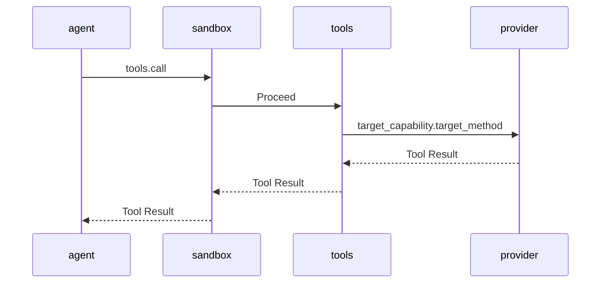
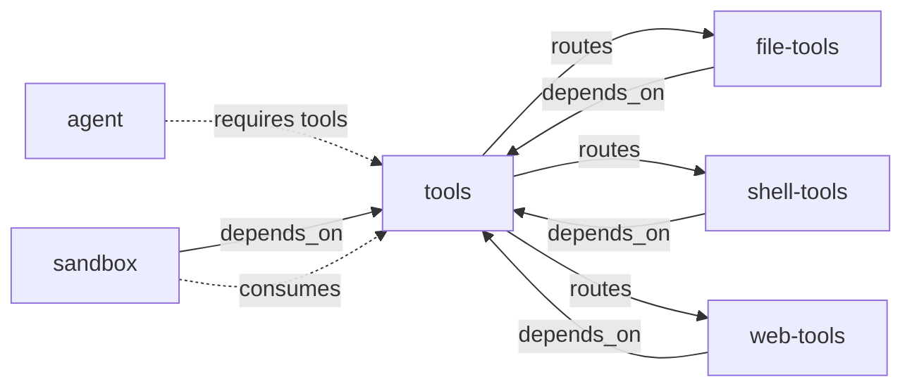

# Agent Tools 完整设计

> 状态：已废止
> 取代者：[docs/design/plugins/05-tools.md](../../design/plugins/05-tools.md) 与 [docs/design/composition-model-context-tools-sandbox.md](../../design/composition-model-context-tools-sandbox.md)
> 说明：切片划分与工具契约已收进设计稿。D9 关于注册表只存内存的说法不成立，tools 现在会写 `registry.json`。

本文是 Agent 常用 Tools 的设计提案。当前只设计，不实现 Tool Provider。

设计输入见 [Agent Tools 设计交接](2026-10-18-agent-tools-design-handoff.md)。平台原则见 [ARCHITECTURE.md](../../../ARCHITECTURE.md) 和 [CONTEXT.md](../../../CONTEXT.md)。

第一轮实现已完成，见 [Agent Framework 实现记录](2026-10-18-agent-framework-implementation.md)。本文继续作为目标契约和后续切片参考。

Workspace 锚定已按当时的 Workspace、Session 与 Sandbox 锚定方案修订：Tool Call 携带 `session_id`，Sandbox 从 Session 解析规范 Workspace。该锚定文档已不在仓库中，现行契约见 [消费链组合方案](../../design/composition-model-context-tools-sandbox.md) 第 7 节的 `meta` 字段集，以及 [plugins/agent/communication.md](../../../plugins/agent/communication.md) 的 `tools.call` 载荷。

## 1. 设计边界

### 1.1 目标

- 定义 `tools` 插件的完整 Capability。
- 定义 File、Shell 和 Web Provider 的方法。
- 定义统一的 Tool 调用包络和结果包络。
- 定义 Workspace、取消、风险和 Sandbox 检查点。
- 给出实现切片和测试矩阵。

### 1.2 非目标

- 不实现后台任务、任务队列和任务持久化。
- 不实现插件市场、远程 Provider 和负载均衡。
- 不实现通用 Service Broker。
- 不实现安全沙箱和权限系统。
- 不实现 UI 确认流程。
- 不把 File、Shell 或 Web 业务字段写入 Host。

### 1.3 职责

| 单元 | 职责 | 非职责 |
|---|---|---|
| Host | Frame 路由、上下文、取消和流水线 | Tool 名称、Schema 和风险 |
| `tools` | Tool 注册、发现和分发 | 文件、命令和网络业务 |
| Tool Provider | 解释参数并执行具体工具 | 模型可见的注册表 |
| `sandbox` | 消费高危 Frame 并决定放行 | 执行文件、命令和网络操作 |
| `agent` | 组装模型工具列表并发起调用 | Tool 注册和 Target 路由 |

### 1.4 状态

| 内容 | 状态 |
|---|---|
| 当前代码 | `tools`、Sandbox、File、Shell 和 Web Provider 已实现 |
| `Request.From` | 已实现 |
| 本文 | 目标契约 |
| 实现 | 第一轮完成 |

## 2. 关键决策

以下决策会影响接口。确认前不进入实现。

| 编号 | 决策 | 理由 | 状态 |
|---|---|---|---|
| D1 | 模型名称使用下划线 | OpenAI-compatible 接口普遍限制函数名 | 已采用 |
| D2 | `pluginsdk.Request` 暴露 `From` | `source_plugin` 必须可信 | 已采用 |
| D3 | Agent 只弱依赖 `tools` | 最小组合仍可无工具运行 | 已采用 |
| D4 | 使用统一 Tool Result 包络 | Agent 和 Sandbox 只需理解一种结果 | 已采用 |
| D5 | 首批只做同步调用 | 不引入后台任务和任务句柄 | 已采用 |
| D6 | Tool Target 必须属于注册方 | 防止 `tools` 变成通用 Broker | 已采用 |
| D7 | 禁止 Target 为 `host` 或 `tools` | 防止权限提升和递归调用 | 已采用 |
| D8 | Workspace 使用 Session 绑定的绝对路径 | 防止调用方切换策略作用域 | 已修订 |
| D9 | 注册表只保存在内存 | 注册是运行时状态，不进入持久化 | 已采用 |
| D10 | Sandbox 不信任自报风险 | 风险是提示，策略才是约束 | 已采用 |

### 2.1 D1 名称

交接文档建议使用 `file.read` 作为模型名称。部分 OpenAI-compatible 接口只接受字母、数字、下划线和连字符。

本设计建议使用 `file_read` 作为模型名称。Target 仍使用 `file.read`。

```text
模型名称       file_read
Target 能力     file
Target 方法     read
```

名称映射只存在于 `tools` 注册表中。模型看不到 Target。

### 2.2 D2 可信来源

协议 Frame 已有 `from`。Host 在投递时注入真实插件名。

当前 `pluginsdk.Request` 没有 `From` 字段。`tools` 无法读取可信来源。

本设计建议增加只读字段：

```go
type Request struct {
    ID         string
    From       string
    ContextID  string
    Capability string
    Method     string
    Payload    json.RawMessage
}
```

`From` 只用于身份和溯源。路由仍只看 `(capability, method)`。

### 2.3 D3 依赖

`agent` 不应硬依赖 `tools`。当前最小组合没有工具插件。

建议依赖如下：

| 插件 | 声明 | 原因 |
|---|---|---|
| `agent` | `requires: ["tools"]` | 工具缺失时跳过工具阶段 |
| Tool Provider | `depends_on: ["tools"]` | 启动顺序在前，注册仍需重试 |
| `sandbox` | `depends_on: ["tools"]` | 需要消费 Tool Call |

当前 Host 只启动 `autostart` 根。Scheme 启动器尚未实现。

发布组合中的 Tool Provider 和 Sandbox 先使用 `autostart: true`。后续实现 Scheme 后再调整。

### 2.4 D4 结果包络

所有 Tool Provider 返回同一种结果：

```json
{
  "content": "模型可见文本",
  "is_error": false,
  "truncated": false,
  "meta": {}
}
```

| 字段 | 必填 | 含义 |
|---|---|---|
| `content` | 是 | Agent 写入 tool message 的文本 |
| `is_error` | 否 | 业务失败标记，默认 `false` |
| `truncated` | 否 | 结果是否被截断 |
| `meta` | 否 | 结构化元数据，Agent 不发给模型 |

`tools` 只校验包络。`tools` 不解释 `meta`。

### 2.5 D5 同步

首批 Tool Call 都是同步 Call。取消使用 Go Context 和 Cancel Frame。

`shell.cancel`、`shell.status` 和 `web.cancel` 需要后台任务模型。首批不实现。

### 2.6 D6 归属

Tool Provider 只能注册指向自身方法的 Tool。

例如 `file-tools` 可以注册 `file.read`。`time-tools` 不能注册指向 `file.read` 的 Tool。

注册时不检查路由，避免启动竞态。调用时检查 Target 是否仍属于 `source_plugin`。

### 2.7 D7 保留 Target

以下 Capability 不能作为 Tool Target：

| Capability | 原因 |
|---|---|
| `host` | Host 管理能力 |
| `tools` | 会形成递归调用 |

保留判断在 `tools.register` 中完成。

### 2.8 D8 Workspace

Workspace 是 Session 绑定的绝对目录路径。它不属于 Tool 名称或 Target。

插件进程的 CWD 是插件目录。相对 Workspace 会产生歧义。File 和 Shell Provider 必须拒绝相对 Workspace。

`tools` 把 Workspace 当作不透明字符串传递。只有 Provider 解释它。

### 2.9 D9 注册表

Tool 注册表只保存在 `tools` 进程内。它不写入磁盘。

Provider 重启后重新注册。旧条目在 `tools.list` 或 `tools.call` 时惰性过滤。

### 2.10 D10 风险

`risk` 是注册元数据。它用于展示、排序和策略提示。

Sandbox 不能只依赖 `risk`。Sandbox 必须按 Target 和参数执行自己的策略。

## 3. 统一模型

### 3.1 Tool Definition

| 字段 | 含义 | 模型可见 |
|---|---|---|
| `name` | 模型函数名 | 是 |
| `description` | 模型说明 | 是 |
| `input_schema` | 参数 JSON Schema | 是 |
| `risk` | `low`、`medium` 或 `high` | 是 |
| `source_plugin` | 注册方插件名 | 否 |
| `target_capability` | 分发 Capability | 否 |
| `target_method` | 分发 Method | 否 |

`source_plugin` 来自 Host 注入的 `from`。插件不能通过 payload 设置它。

Agent 在模型 `description` 末尾追加风险说明。Provider 原文保持不变。

Tool 列表总大小由 Agent 或 Model Context 的 Token Budget 控制。

### 3.2 Tool Call

| 字段 | 含义 |
|---|---|
| `name` | 模型选择的 Tool 名称 |
| `arguments` | 参数对象 |
| `session_id` | 发起 Tool Call 的 Session |
| `workspace` | 可选 Workspace 绝对路径 |
| `call_id` | Agent 提供的调用关联标识 |

`arguments` 必须是 JSON 对象。模型返回的 arguments 字符串由 Agent 解析。`workspace` 只用于一致性校验；Sandbox 使用 `session_id` 解析并覆写规范路径。

### 3.3 Tool Result

Tool Result 使用 D4 包络。业务失败返回 `is_error: true`。传输失败返回协议错误。

### 3.4 调用链



Sandbox 不调用 `Proceed` 时，Pipeline 在当前 Consumer 结束。

## 4. tools 插件

### 4.1 Manifest

```json
{
  "name": "tools",
  "version": "0.1.0",
  "protocol": 1,
  "entry": "tools",
  "autostart": true,
  "priority": 0,
  "provides": ["tools"],
  "requires": [],
  "depends_on": [],
  "description": "Tool registry and dispatcher"
}
```

`tools` 没有 UI、Settings 和持久化。

### 4.2 Capability

| Method | 用途 | 风险 |
|---|---|---|
| `tools.register` | 注册或更新 Tool | `medium` |
| `tools.unregister` | 注销 Tool | `medium` |
| `tools.list` | 返回模型可见定义 | `low` |
| `tools.call` | 按名称分发调用 | 继承 Tool risk |

### 4.3 tools.register

输入：

```json
{
  "name": "file_read",
  "description": "Read a UTF-8 text file inside the workspace.",
  "input_schema": {
    "type": "object",
    "properties": {
      "path": {"type": "string"}
    },
    "required": ["path"],
    "additionalProperties": false
  },
  "target_capability": "file",
  "target_method": "read",
  "risk": "low"
}
```

输出：

```json
{
  "registered": true,
  "updated": false
}
```

同来源覆盖已有名称时，`updated` 为 `true`。

规则：

1. `name` 必须匹配 `^[a-z][a-z0-9_]{0,63}$`。
2. `description` 长度为 1 到 8192 字节。
3. `Request.From` 为空时拒绝注册。
4. `source_plugin` 必须出现在 Host 插件快照中。
5. `input_schema` 必须是 JSON 对象。
6. Schema 顶层 `type` 必须是 `object`。
7. `properties` 必须是对象。
8. `required` 必须是字符串数组。
9. `required` 中的字段必须存在于 `properties`。
10. `risk` 只能是三个固定值。
11. `target_capability` 必须匹配 `^[a-z][a-z0-9-]{0,63}$`。
12. `target_method` 必须匹配 `^[a-z][a-z0-9_.-]{0,63}$`。
13. `target_capability` 不能是 `host` 或 `tools`。
14. 同来源同名注册为更新。
15. 跨来源同名注册返回 `tool_name_conflict`。

注册身份是插件名，不是 `instance_id`。同插件多实例共享同名提交。

### 4.4 tools.unregister

输入：

```json
{
  "name": "file_read"
}
```

输出：

```json
{
  "unregistered": true
}
```

规则：

1. 不存在的名称返回 `unregistered: false`。
2. 其他来源的名称返回 `tool_owner_mismatch`。
3. 重复注销是幂等操作。
4. 请求来源必须是 Host 插件。

### 4.5 tools.list

输入为空对象。

输出：

```json
{
  "tools": [
    {
      "name": "file_read",
      "description": "Read a UTF-8 text file inside the workspace.",
      "input_schema": {
        "type": "object",
        "properties": {
          "path": {"type": "string"}
        },
        "required": ["path"]
      },
      "risk": "low",
      "source_plugin": "file-tools",
      "target_capability": "file",
      "target_method": "read"
    }
  ]
}
```

规则：

1. 结果按 `name` 升序排列。
2. `tools.list` 返回完整 Tool Definition。
3. Agent 只把模型字段发给模型。
4. 模型字段是 `name`、`description`、`input_schema` 和 `risk`。
5. `tools.list` 过滤非 `active` 的条目。
6. 过滤不删除可用于重启后更新的注册项。

### 4.6 tools.call

输入：

```json
{
  "name": "file_read",
  "arguments": {
    "path": "README.md"
  },
  "workspace": "E:/project",
  "call_id": "call-1"
}
```

Target 包络：

```json
{
  "arguments": {
    "path": "README.md"
  },
  "workspace": "E:/project",
  "call_id": "call-1"
}
```

输出使用 Tool Result 包络。

调用规则：

1. 按 `name` 查找注册项。
2. 校验 `arguments` 是 JSON 对象。
3. 校验 `arguments` 不超过 1 MiB。
4. 校验 Target 仍属于注册方。
5. 使用同一个 Go Context 调用 Target。
6. 使用 `CallInContext` 保留 `context_id`。
7. 校验 Provider 返回结果包络。

### 4.7 惰性过滤与清理

`tools` 通过 `host.plugins` 检查注册方状态。

过滤条件：

1. 注册方没有 `active` Instance。
2. 注册方没有 Target 的注册项。
3. 注册方已被禁用。
4. 注册方 `provides` 不包含 Target Capability。

`tools.list` 隐藏不满足条件的条目。`tools.call` 拒绝不满足条件的调用。

注册方缺失或进入 `failed` 时，删除内存条目。

`host.plugins` 失败时，`tools.list` 返回当前注册表。`tools.call` 必须拒绝无法验证的 Target。

Tool Provider 不得为自身 Target 声明 `consumes`。这样注册项才能证明属主身份。

若 Target 已被其他插件拥有，注册项会被 Host 拒绝。

Host 快照没有 Route Owner 字段。这里用 `provides` 和注册项做归属检查。

该检查不是恶意插件沙箱。进程隔离仍只是故障边界。

### 4.8 错误码

| 错误码 | 场景 |
|---|---|
| `bad_arguments` | 请求结构不合法 |
| `tool_not_found` | 名称不存在 |
| `tool_name_conflict` | 跨来源重名 |
| `tool_owner_mismatch` | 注销非本来源 Tool |
| `tool_definition_invalid` | 定义字段不合法 |
| `tool_source_invalid` | 注册来源不是 Host 插件 |
| `tool_target_reserved` | Target 是保留 Capability |
| `tool_target_unavailable` | Target 不属于注册方或已失效 |
| `tool_result_invalid` | Provider 返回非法结果 |

下游协议错误原样返回。例如 `plugin_down` 和 `method_not_found`。

## 5. Tool Provider 通用契约

### 5.1 注册

Provider 启动后向 `tools.register` 注册。注册动作与 `host.register` 存在竞态。

建议 Provider 使用重试：

```text
p := NewPlugin(...)
p.Register(...)
go registerTools(ctx, p)
p.Serve()
```

注册 goroutine：

```text
调用 tools.register
→ 失败时指数退避重试
→ 成功或达到上限后停止
```

注册失败不终止 Provider。`tools.list` 会反映实际状态。

### 5.2 输入

```json
{
  "arguments": {},
  "workspace": "E:/project",
  "call_id": "call-1"
}
```

Provider 只解释 `arguments`。`workspace` 和 `call_id` 用于边界和关联。

### 5.3 输出

Provider 必须返回 D4 包络。`content` 是模型可见文本。

`meta` 可以包含结构化结果。Agent 不把 `meta` 写入模型消息。

Agent 把 `is_error` 和 `truncated` 写入 Tool Fact 的 `meta`。

### 5.4 参数校验

Provider 必须严格解码参数。未知字段应返回 `bad_arguments`。

Provider 不依赖模型遵守 Schema。Provider 自己执行边界检查。

### 5.5 错误

| 类型 | 返回方式 |
|---|---|
| 参数错误 | 协议错误 `bad_arguments` |
| 业务失败 | Tool Result `is_error: true` |
| 传输失败 | 下游协议错误 |
| Context 取消 | 取消终态 |
| Provider 超时 | Tool Result `is_error: true` |

Agent 收到业务失败或协议错误后写入 tool message，然后继续 Turn。

### 5.6 大小限制

| 对象 | 建议上限 |
|---|---:|
| `description` | 8 KiB |
| `input_schema` | 64 KiB |
| Tool Result `content` | 1 MiB |
| Tool Result `meta` | 64 KiB |

超过限制时返回 `tool_result_invalid` 或截断 `content`。

### 5.7 Manifest 示例

```json
{
  "name": "file-tools",
  "version": "0.1.0",
  "protocol": 1,
  "entry": "file-tools",
  "autostart": true,
  "priority": 0,
  "provides": ["file"],
  "requires": ["tools"],
  "depends_on": ["tools"],
  "description": "Workspace-scoped file tools"
}
```

## 6. File Tools

### 6.1 方法清单

| Tool | Target | 风险 | 首批 |
|---|---|---|---|
| `file_read` | `file.read` | `low` | 是 |
| `file_write` | `file.write` | `high` | 是 |
| `file_list` | `file.list` | `low` | 是 |
| `file_stat` | `file.stat` | `low` | 是 |
| `file_search` | `file.search` | `low` | 是 |
| `file_glob` | `file.glob` | `low` | 是 |
| `file_replace` | `file.replace` | `high` | 是 |
| `file_patch` | `file.patch` | `high` | 是 |
| `file_move` | `file.move` | `high` | 否 |
| `file_delete` | `file.delete` | `high` | 否 |

### 6.2 Workspace

规则：

1. `workspace` 必须是绝对路径。
2. `workspace` 必须存在且是目录。
3. Provider 使用 `os.OpenRoot` 打开 Workspace。
4. 所有文件操作使用 `os.Root` 方法。
5. `os.Root` 阻止绝对路径和越界符号链接。
6. Provider 不修改全局 CWD。
7. Provider 不缓存可写文件句柄。
8. Agent 不从插件 CWD 推断 Workspace。

`os.Root` 不阻止挂载点和特殊设备。后续安全沙箱再处理这些边界。

路径规则：

1. 文件参数使用 Workspace 相对路径。
2. 路径分隔符统一为 `/`。
3. 拒绝空路径、绝对路径、盘符和 UNC 路径。
4. 路径参数不是 `.` 时拒绝 `.` 和 `..` 组件。
5. 拒绝 NUL 字符。
6. 拒绝 Windows 保留设备名。
7. `.` 表示 Workspace 根目录。
8. 读取可以跟随根内符号链接。
9. 写入和删除不跟随越界符号链接。

### 6.3 通用结果

File Result 的 `content` 使用 UTF-8 文本。`meta` 保存结构化信息。

业务错误使用 `is_error: true`。参数和路径错误使用协议错误。

### 6.4 file.read

参数：

```json
{
  "type": "object",
  "properties": {
    "path": {"type": "string"},
    "start_line": {"type": "integer", "minimum": 1},
    "end_line": {"type": "integer", "minimum": 1},
    "max_bytes": {"type": "integer", "minimum": 1, "maximum": 1048576}
  },
  "required": ["path"],
  "additionalProperties": false
}
```

| 参数 | 默认值 | 说明 |
|---|---:|---|
| `start_line` | 1 | 起始行，从 1 开始 |
| `end_line` | 不限 | 结束行，包含 |
| `max_bytes` | 65536 | 返回内容上限 |

输出 `meta`：

```json
{
  "path": "README.md",
  "size": 1234,
  "line_start": 1,
  "line_end": 80,
  "line_count": 200,
  "truncated": false,
  "sha256": "hex",
  "encoding": "utf-8"
}
```

规则：

1. 检测 NUL 字节。
2. 检测非法 UTF-8。
3. 二进制文件返回 `file_binary`。
4. 超出 `max_bytes` 时截断。
5. 行范围越界返回 `line_range_invalid`。
6. `sha256` 对应完整文件。
7. 文件超过 8 MiB 时省略 `sha256`。

### 6.5 file.write

参数：

```json
{
  "type": "object",
  "properties": {
    "path": {"type": "string"},
    "content": {"type": "string"},
    "create_dirs": {"type": "boolean", "default": false},
    "overwrite": {"type": "boolean", "default": true},
    "expected_sha256": {"type": "string", "pattern": "^[0-9a-fA-F]{64}$"}
  },
  "required": ["path", "content"],
  "additionalProperties": false
}
```

规则：

1. `overwrite=false` 且文件存在时返回 `file_exists`。
2. `expected_sha256` 不匹配时返回 `file_conflict`。
3. 摘要比较前统一转为小写。
4. `content` 不超过 4 MiB。
5. 默认不创建父目录。
6. 使用同目录临时文件。
7. 写入完成后执行 rename。
8. 失败时不留下部分文件。

输出 `meta`：

```json
{
  "path": "README.md",
  "bytes_written": 1234,
  "sha256": "hex",
  "created": false
}
```

### 6.6 file.list

参数：

```json
{
  "type": "object",
  "properties": {
    "path": {"type": "string", "default": "."},
    "recursive": {"type": "boolean", "default": false},
    "max_depth": {"type": "integer", "minimum": 1, "maximum": 16},
    "max_entries": {"type": "integer", "minimum": 1, "maximum": 1000},
    "include_hidden": {"type": "boolean", "default": true}
  },
  "additionalProperties": false
}
```

输出条目字段：

| 字段 | 含义 |
|---|---|
| `path` | Workspace 相对路径 |
| `type` | `file`、`dir` 或 `symlink` |
| `size` | 字节数 |
| `mtime` | RFC3339 时间 |

规则：

1. 结果按路径排序。
2. 递归不跟随符号链接目录。
3. 达到上限时设置 `truncated`。
4. `.` 只表示根目录。
5. `recursive=true` 时 `max_depth` 默认 4。
6. `max_entries` 默认 200。

### 6.7 file.stat

参数：

```json
{
  "type": "object",
  "properties": {
    "path": {"type": "string"},
    "hash": {"type": "boolean", "default": false}
  },
  "required": ["path"],
  "additionalProperties": false
}
```

输出字段：

| 字段 | 含义 |
|---|---|
| `type` | `file`、`dir` 或 `symlink` |
| `size` | 字节数 |
| `mode` | 权限字符串 |
| `mtime` | 修改时间 |
| `is_symlink` | 是否符号链接 |
| `link_target` | 根内链接目标 |
| `sha256` | 可选文件摘要 |

规则：

1. 使用 `Root.Lstat` 读取元数据。
2. 符号链接目标越界时返回 `path_escape`。
3. `hash=true` 时只对普通文件计算摘要。
4. 文件超过 8 MiB 时省略摘要。

### 6.8 file.search

参数：

```json
{
  "type": "object",
  "properties": {
    "pattern": {"type": "string", "minLength": 1, "maxLength": 1024},
    "path": {"type": "string", "default": "."},
    "glob": {"type": "string"},
    "regex": {"type": "boolean", "default": false},
    "case_sensitive": {"type": "boolean", "default": true},
    "max_matches": {"type": "integer", "minimum": 1, "maximum": 1000},
    "max_files": {"type": "integer", "minimum": 1, "maximum": 10000},
    "max_file_bytes": {"type": "integer", "minimum": 1, "maximum": 1048576},
    "context_lines": {"type": "integer", "minimum": 0, "maximum": 5}
  },
  "required": ["pattern"],
  "additionalProperties": false
}
```

输出 `content` 使用 `path:line:column: text` 格式。

规则：

1. 默认使用字面量搜索。
2. `regex=true` 时使用 Go 正则。
3. 跳过二进制文件。
4. 跳过大文件和符号链接目录。
5. 结果按路径、行号和列号排序。
6. 达到限制时设置 `truncated`。
7. `max_matches` 默认 200。
8. `max_files` 默认 2000。
9. `max_file_bytes` 默认 1048576。
10. `glob` 使用 `file.glob` 的匹配规则。

### 6.9 file.glob

参数：

```json
{
  "type": "object",
  "properties": {
    "pattern": {"type": "string", "minLength": 1},
    "max_results": {"type": "integer", "minimum": 1, "maximum": 1000}
  },
  "required": ["pattern"],
  "additionalProperties": false
}
```

规则：

1. `*` 和 `?` 不跨目录。
2. `**` 匹配零层或多层目录。
3. 结果按路径排序。
4. 只返回文件路径。
5. 达到上限时设置 `truncated`。
6. `max_results` 默认 200。

### 6.10 file.replace

参数：

```json
{
  "type": "object",
  "properties": {
    "path": {"type": "string"},
    "old_text": {"type": "string", "minLength": 1},
    "new_text": {"type": "string"},
    "replace_all": {"type": "boolean", "default": false},
    "expected_sha256": {"type": "string", "pattern": "^[0-9a-fA-F]{64}$"}
  },
  "required": ["path", "old_text", "new_text"],
  "additionalProperties": false
}
```

规则：

1. 使用字面量替换。
2. `replace_all=false` 时只允许一次匹配。
3. 零次匹配返回 `edit_not_found`。
4. 多次匹配返回 `edit_ambiguous`。
5. 摘要不匹配返回 `file_conflict`。
6. 摘要比较前统一转为小写。
7. 使用临时文件和 rename。
8. 文件超过 8 MiB 时拒绝修改。

### 6.11 file.patch

参数：

```json
{
  "type": "object",
  "properties": {
    "path": {"type": "string"},
    "edits": {
      "type": "array",
      "minItems": 1,
      "maxItems": 32,
      "items": {
        "type": "object",
        "properties": {
          "old_text": {"type": "string", "minLength": 1},
          "new_text": {"type": "string"},
          "replace_all": {"type": "boolean", "default": false}
        },
        "required": ["old_text", "new_text"],
        "additionalProperties": false
      }
    },
    "expected_sha256": {"type": "string", "pattern": "^[0-9a-fA-F]{64}$"}
  },
  "required": ["path", "edits"],
  "additionalProperties": false
}
```

规则：

1. 编辑按数组顺序应用。
2. 每个编辑使用字面量匹配。
3. 任一编辑失败时整次修改失败。
4. 失败时不写回文件。
5. 成功时返回编辑数量和摘要。
6. 摘要比较前统一转为小写。
7. 文件超过 8 MiB 时拒绝修改。

### 6.12 file.move 和 file.delete

`file_move` 参数：

```json
{
  "from": "a.txt",
  "to": "b.txt",
  "overwrite": false
}
```

`file_delete` 参数：

```json
{
  "path": "tmp",
  "recursive": false
}
```

这两个工具属于第二批。实现前必须接入 Sandbox。

### 6.13 File 错误码

| 错误码 | 场景 |
|---|---|
| `workspace_required` | 缺少 Workspace |
| `workspace_invalid` | Workspace 不是绝对目录 |
| `path_invalid` | 路径格式不合法 |
| `path_escape` | 路径或链接越界 |
| `path_not_found` | 路径不存在 |
| `path_is_directory` | 需要文件但得到目录 |
| `path_not_directory` | 需要目录但得到文件 |
| `file_exists` | 不允许覆盖 |
| `file_too_large` | 文件超过限制 |
| `file_binary` | 文件不是 UTF-8 文本 |
| `file_conflict` | 摘要不匹配 |
| `line_range_invalid` | 行范围不合法 |
| `edit_not_found` | 文本未找到 |
| `edit_ambiguous` | 文本匹配多次 |
| `file_io` | 其他文件系统错误 |

## 7. Shell Tools

### 7.1 方法清单

| Tool | Target | 风险 | 首批 |
|---|---|---|---|
| `shell_execute` | `shell.execute` | `high` | 是 |
| `shell_status` | `shell.status` | `low` | 否 |
| `shell_cancel` | `shell.cancel` | `medium` | 否 |

### 7.2 shell.execute

参数：

```json
{
  "type": "object",
  "properties": {
    "command": {"type": "string", "minLength": 1},
    "args": {"type": "array", "items": {"type": "string"}},
    "cwd": {"type": "string", "default": "."},
    "env": {"type": "object", "additionalProperties": {"type": "string"}},
    "timeout_ms": {"type": "integer", "minimum": 1, "maximum": 600000},
    "max_output_bytes": {"type": "integer", "minimum": 1, "maximum": 4194304}
  },
  "required": ["command"],
  "additionalProperties": false
}
```

| 参数 | 默认值 | 说明 |
|---|---:|---|
| `cwd` | `.` | Workspace 相对目录 |
| `timeout_ms` | 120000 | Provider 内部超时 |
| `max_output_bytes` | 1048576 | 单流输出上限 |

规则：

1. 不经过 Shell 解释。
2. `args` 直接传给子进程。
3. `cwd` 使用 Workspace 边界。
4. `env` 覆盖继承环境变量。
5. 不记录 `env` 值。
6. 输出按流截断。
7. 非零退出码是业务失败。
8. Context 取消必须终止子进程组。

输出 `meta`：

```json
{
  "exit_code": 0,
  "stdout_bytes": 123,
  "stderr_bytes": 0,
  "stdout_truncated": false,
  "stderr_truncated": false,
  "started_at": "RFC3339",
  "finished_at": "RFC3339",
  "duration_ms": 123,
  "timed_out": false
}
```

`content` 格式：

```text
exit_code: 0
stdout:
...
stderr:
...
```

### 7.3 取消

Unix 使用进程组。取消时向整个组发送终止信号。

Windows 使用 Job Object。取消时终止 Job。

Provider 收到 Context 取消后必须等待子进程收尸。超过宽限期时返回取消终态。

### 7.4 超时

`timeout_ms` 是 Provider 内部超时。它返回 `is_error: true` 和 `timed_out: true`。

Go Context 期限是调用级终态。它返回 `call_deadline_exceeded`。

Provider 内部超时不得超过 Context 期限。

### 7.5 安全

- 不拼接命令字符串。
- 不执行模型提供的 Shell 语法。
- 默认禁止直接调用通用 Shell 解释器。
- 不默认启动交互式程序。
- 不继承未声明的 Secret。
- 输出可能包含 Secret，写入 Session 前需截断。

### 7.6 Shell 错误码

| 错误码 | 场景 |
|---|---|
| `workspace_required` | 缺少 Workspace |
| `workspace_invalid` | Workspace 不是绝对目录 |
| `cwd_invalid` | `cwd` 格式不合法 |
| `cwd_escape` | `cwd` 越界 |
| `command_not_found` | 可执行文件不存在 |
| `env_invalid` | 环境变量名或值不合法 |
| `process_start_failed` | 子进程启动失败 |
| `process_killed` | 子进程被信号终止 |
| `shell_io` | 其他执行错误 |

### 7.7 后台任务

`shell.status` 和 `shell.cancel` 需要任务表和任务句柄。首批不实现。

## 8. Web Tools

### 8.1 方法清单

| Tool | Target | 风险 | 首批 |
|---|---|---|---|
| `web_fetch` | `web.fetch` | `medium` | 是 |
| `web_search` | `web.search` | `medium` | 否 |
| `web_cancel` | `web.cancel` | `low` | 否 |

### 8.2 web.fetch

参数：

```json
{
  "type": "object",
  "properties": {
    "url": {"type": "string", "minLength": 1},
    "method": {"type": "string", "enum": ["GET", "HEAD"]},
    "headers": {"type": "object", "additionalProperties": {"type": "string"}},
    "max_bytes": {"type": "integer", "minimum": 1, "maximum": 4194304},
    "timeout_ms": {"type": "integer", "minimum": 1, "maximum": 120000}
  },
  "required": ["url"],
  "additionalProperties": false
}
```

| 参数 | 默认值 | 说明 |
|---|---:|---|
| `method` | `GET` | 首批只支持读取 |
| `max_bytes` | 1048576 | 解压后内容上限 |
| `timeout_ms` | 30000 | 请求超时 |

输出 `meta`：

```json
{
  "final_url": "https://example.com/",
  "status_code": 200,
  "content_type": "text/html",
  "bytes": 1234,
  "truncated": false,
  "redirects": 0,
  "timed_out": false,
  "fetched_at": "RFC3339"
}
```

规则：

1. 只允许 `http` 和 `https`。
2. 拒绝 URL 用户信息。
3. 解析全部地址并检查私网范围。
4. 每一跳重定向重新检查。
5. 限制重定向次数为 5。
6. 限制解压后大小。
7. 只接受文本内容类型。
8. 只接受 UTF-8 或 ASCII。
9. 保留最终 URL。
10. 非 2xx 是业务失败。
11. Provider 超时返回 `is_error: true` 和 `timed_out: true`。
12. `Authorization` 和 `Cookie` 等敏感头需 Sandbox 允许。
13. 跨源重定向丢弃敏感头。

### 8.3 SSRF 防护

必须阻止以下地址：

- 环回地址。
- 私网地址。
- 链路本地地址。
- 组播地址。
- 未指定地址。
- 云元数据地址。
- IPv4 映射的 IPv6 地址。

DNS 解析后固定 IP。连接时直接拨号到已检查 IP。

连接固定 IP 时保留原始 Host 和 TLS ServerName。

### 8.4 web.search

`web_search` 需要搜索后端。首批不实现。

目标参数：

```json
{
  "query": "string",
  "max_results": 10,
  "recency_days": 30
}
```

目标输出：

```json
{
  "results": [
    {
      "title": "...",
      "url": "...",
      "snippet": "..."
    }
  ]
}
```

`content` 使用可读的结果列表。`meta` 保存结构化结果。

### 8.5 Web 错误码

| 错误码 | 场景 |
|---|---|
| `url_invalid` | URL 格式不合法 |
| `scheme_not_allowed` | 非 HTTP 或 HTTPS |
| `address_blocked` | 私网或保留地址 |
| `redirect_limit` | 重定向过多 |
| `content_type_unsupported` | 内容类型不支持 |
| `charset_unsupported` | 字符集不支持 |
| `response_too_large` | 响应超过限制 |
| `upstream_error` | 上游请求失败 |

## 9. Agent 辅助 Tools

### 9.1 第二批

| Tool | Target | 风险 |
|---|---|---|
| `file_move` | `file.move` | `high` |
| `file_delete` | `file.delete` | `high` |
| `shell_status` | `shell.status` | `low` |
| `shell_cancel` | `shell.cancel` | `medium` |
| `web_download` | `web.download` | `high` |
| `git_status` | `git.status` | `low` |
| `git_diff` | `git.diff` | `low` |

### 9.2 Git Tools

Git Tools 是独立 Provider，不并入 File Tools。

它只提供只读查询。写操作继续由 Shell Tools 执行。

## 10. Sandbox

### 10.1 角色

Sandbox 是 Consumer。它不是 Tool Provider。

### 10.2 检查点

| 方法 | 检查内容 | 默认策略 |
|---|---|---|
| `tools.call` | Tool 名称、参数和风险 | 按 Target 查策略 |
| `file.write` | 路径和内容 | `high` 默认拒绝 |
| `file.replace` | 路径和替换文本 | `high` 默认拒绝 |
| `file.patch` | 路径和编辑列表 | `high` 默认拒绝 |
| `file.move` | 源路径和目标路径 | `high` 默认拒绝 |
| `file.delete` | 路径和递归标记 | `high` 默认拒绝 |
| `shell.execute` | 命令、参数和目录 | `high` 默认拒绝 |
| `web.fetch` | URL 和重定向 | `medium` 记录 |
| `web.search` | 查询和后端 | `medium` 记录 |

### 10.3 策略

| 风险 | 默认行为 |
|---|---|
| `low` | 放行 |
| `medium` | 放行并记录 |
| `high` | 拒绝，显式允许后放行 |
| 未知 | 拒绝 |

### 10.4 规则

1. Sandbox 不信任 Tool 自报风险。
2. Sandbox 按方法和参数执行策略。
3. Sandbox 可以修改 payload 后 `Proceed`。
4. Sandbox 必须最多调用一次 `Proceed`。
5. Sandbox 不执行文件、命令和网络操作。
6. 确认 UI 属于后续切片。
7. `tools` 到 Provider 的下游 Call 仍会经过 Sandbox。
8. 拒绝时返回 `sandbox_denied`。

因此 `tools.call` 和 Provider 方法各检查一次。

Sandbox 通过 `tools.list` 解析 Target。解析失败时按未知风险拒绝。

### 10.5 Manifest

```json
{
  "name": "sandbox",
  "version": "0.1.0",
  "protocol": 1,
  "entry": "sandbox",
  "autostart": true,
  "priority": 500,
  "provides": [],
  "requires": ["tools"],
  "depends_on": ["tools"],
  "consumes": [
    {"capability": "tools", "method": "call"},
    {"capability": "file", "method": "write"},
    {"capability": "file", "method": "replace"},
    {"capability": "file", "method": "patch"},
    {"capability": "shell", "method": "execute"},
    {"capability": "web", "method": "fetch"}
  ]
}
```

Consumer 仍要在 SDK 中注册被消费的方法。`provides` 不表示这些方法归 Sandbox 所有。

第二批 File Tool 实现时，追加对应的 `consumes` 声明。

## 11. 依赖与启动



启动顺序约束：

```text
tools 先于 sandbox
tools 先于 file-tools / shell-tools / web-tools
agent 不参与硬依赖顺序
```

`tools` 不依赖具体 Provider。没有 Provider 时，`tools.list` 返回空列表。

以上顺序只在相关插件都是 `autostart` 根时成立。当前没有 Scheme 运行时。

`depends_on` 只保证启动顺序。它不等待依赖 Plugin Instance 进入 `active`。

## 12. 实现切片

Agent 当前使用 `parameters` 和 `severity` 字段。设计契约使用 `input_schema` 和 `risk`。

切片 7 需要同步修改 Agent 适配类型。`tools.list` 的字段不向 Agent 私有类型妥协。

切片 7 还需要让 Agent 传递绝对 Workspace。空值交由 Provider 返回 `workspace_required`。

`allowed_tools` 使用模型名称，不使用 Target。

| 切片 | 交付 | 验收 |
|---|---|---|
| 0 | SDK `Request.From` | Host 注入值可见，插件不能伪造 |
| 1 | `tools` 插件 | 注册、注销、列表、分发 |
| 2 | `file-tools` 只读 | 读取、列表、状态、搜索、Glob |
| 3 | `file-tools` 写入 | 写入、替换、补丁、原子失败 |
| 4 | `sandbox` 最小策略 | 高危默认拒绝 |
| 5 | `shell-tools` | 执行、超时、取消和进程组 |
| 6 | `web-tools` | Fetch、SSRF、重定向和大小限制 |
| 7 | Agent 对接 | 名称、风险、结果包络和错误 |
| 8 | 集成验收 | 多 Session、重启和取消 |

每个切片完成后运行：

```powershell
go test ./...
go vet ./...
```

涉及并发和取消的切片额外运行：

```powershell
go test -race ./...
```

## 13. 测试矩阵

| 层面 | 测试 |
|---|---|
| `tools` | 注册、更新、重名、注销、列表排序 |
| `tools` | 保留 Target、跨来源注销、非法 Schema |
| `tools` | 失效清理、Target 不可用、结果包络 |
| `tools` | Context 传播、取消和下游错误 |
| File | `..`、绝对路径、盘符、UNC 和 NUL |
| File | 根内链接、越界链接和 Windows 设备名 |
| File | 行范围、截断、二进制和非法 UTF-8 |
| File | 写入冲突、摘要冲突和原子失败 |
| File | 搜索、Glob、限制和排序 |
| Shell | 成功、非零退出、超时和输出截断 |
| Shell | Context 取消和子进程组终止 |
| Shell | 环境变量覆盖和 Secret 不落日志 |
| Web | 环回、私网、链路本地和元数据地址 |
| Web | 重定向到私网、DNS 重绑定和大小限制 |
| Web | 内容类型、字符集和最终 URL |
| Sandbox | 低风险放行、高风险拒绝和未知拒绝 |
| Sandbox | 直接 Provider 调用不能绕过 |
| Agent | Tool 列表、名称映射和风险说明 |
| Agent | Tool Result 写入 Session |
| Agent | Tool 失败后继续 Turn |
| 集成 | 多 Session 并发和 Workspace 隔离 |
| 集成 | Provider 重启和旧注册清理 |
| 集成 | 取消后只产生一个终态 |

## 14. 验收标准

1. Tool 名称和参数 Schema 稳定。
2. 每个 Tool 都有风险级别。
3. `source_plugin` 不可伪造。
4. Target 和 `source_plugin` 不发送给模型。
5. Tool 名称跨来源唯一。
6. 注册方只能调用自身 Target。
7. `host` 和 `tools` 不能作为 Target。
8. 文件路径不能逃逸 Session Workspace。
9. Shell 取消能终止子进程组。
10. Web 请求有超时、大小和地址限制。
11. 每个 Call 只有一个终态。
12. `tools.call` 经过 Sandbox。
13. 直接 Provider 调用也经过 Sandbox。
14. Tool Result 不超过大小限制。
15. 文档、Manifest 和测试同步更新。

## 15. 已采用决策

第一轮实现采用以下选择：

1. 模型名称使用 `file_read`，Target 使用 `file.read`。
2. `pluginsdk.Request` 增加可信 `From`。
3. `tools`、Provider 和 Sandbox 使用 autostart 启动。
4. 首批只做同步调用。
5. 首批暂缓 `web_search` 和 `web_download`。
6. Sandbox 首批只做放行和拒绝，不包含 UI 确认。
