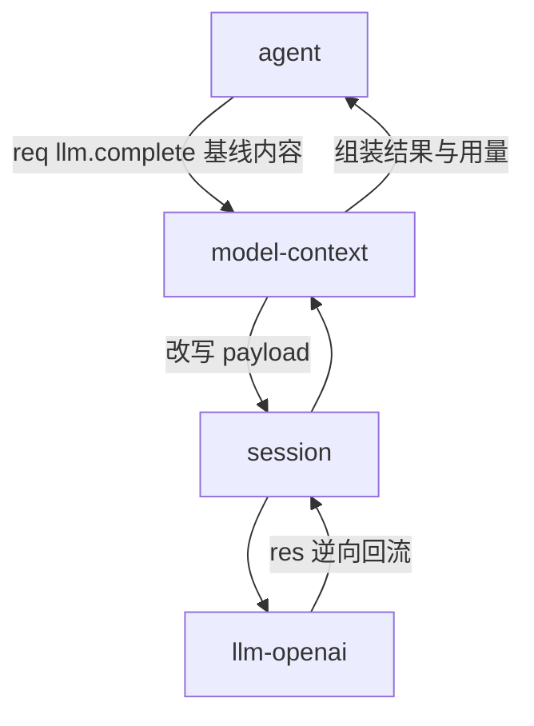

# 消费链组合方案：model-context、tools、sandbox

> 状态：方案阶段。本文是跨插件组合方案。
> 涉及插件：`agent`、`llm-openai`、`session`、`model-context`、`tools`、`sandbox`。
> 消费链机制为当前实现；插件设计为目标契约；未决点见第 9 节。
> 术语见 [CONTEXT.md](../CONTEXT.md)，约束见 [CONSTRAINT.md](../CONSTRAINT.md)。

## 1. 背景与问题

### 1.1 现状（当前实现）

Frame 的路由键是 `(capability, method)`，没有目标插件字段。
一次调用的闭环是双边的：

```text
调用方 → (capability, method) → Provider → Response 回调用方
```

第三方无法进入这条路径。
要插入上下文管理、工具执行或高危拦截，只能由中间人显式调用各插件。
agent 于是成为组合点，每增删一个插件都要修改 agent。

### 1.2 为什么不加目标字段

目标字段等于让发送方掌握拓扑。
耦合只是从编排换成寻址，并未消失。
它还破坏「插件名不参与路由」的既有约束，见 [protocol.md](protocol.md) 第 4 节。
调用方一旦能点名目标，就能绕开检查者。

### 1.3 结论

问题不在 Frame 缺目标，而在调用路径只有两个端点。
解法是让路径可装配：发送方只声明意图，参与者在运行时装配成链。

## 2. 设计原则

| 原则 | 含义 |
|---|---|
| 可组装 | 插件增删只改 manifest，不改其他插件 |
| 无任何强制 | 不设强制消费者；缺席即跳过；平台只观测不拦截 |
| 订阅而非寻址 | Frame 不标注接收方；插件自己声明收哪些 key |
| 只认能力名 | 插件彼此不知晓对方的插件名 |
| Host 不看 payload | 语义判断全部留在插件内部 |

「无任何强制」的必然权衡：sandbox 的不可绕过是部署约定，不是平台保证。

## 3. 消费链基座

本节机制为当前实现。代码见 `internal/host/pipeline.go` 与 `internal/host/transport.go`。

### 3.1 成员资格与顺序

`priority` 只排序，不决定成员资格。
「Frame 要经过谁」由两个声明确定：

| 声明 | 位置 | 作用 |
|---|---|---|
| `consumes` | manifest | 成员资格：参与该 key 的链 |
| `host.register` | 运行时 | 接收锚点：注册同名 handler 才能收 Frame |
| `priority` | manifest | 链内顺序 |

声明 `consumes` 就必须注册同名 handler。
否则该跳返回 `method_not_found`，链中断。
Consumer 注册不抢占 Route Owner；属主始终归 Provider。

### 3.2 装配与传播

Host 逐跳选择成员：

```text
1. 取 active 实例
2. 成员资格：register 过该 key，或 consumes 该 key
3. visited 去重与跳数上限（防循环）
4. 取 priority 不高于当前链位者中的最大值
5. 并列最大 → consume_priority_conflict
```

Request 按 priority 递减逐跳传播。
每跳可改写 payload 后 Proceed，或短路返回。
Response 与归因 Event 沿请求路径逆序回流，每跳可转换结果。
`host.proceed` 是一次性续传入口，重复调用返回 `flow_already_proceeded`。

### 3.3 订阅而非寻址

Frame 不含接收方字段。
sandbox 知道 Frame 交给自己，是因为它声明并注册了该 key。
SDK 的 dispatch 按 `capability.method` 匹配本地 handler。
Consumer 与 Provider 使用同一个 key，区别只在行为。
Consumer 调 Proceed 继续；Provider 直接返回结果。

### 3.4 缺席语义（目标契约，相对当前实现的变更）

当前实现是 fail-closed：声明了 `consumes` 而无活跃 Consumer 时返回 `route_failed`。
按「无任何强制」原则改为 fail-open：

| 情形 | 目标契约 |
|---|---|
| 消费者未安装或未激活 | 从链上略过，退化到下一跳或 Provider |
| 声明了 `consumes` 但未激活 | 只在 `host.plugins` 快照可见，不报错 |
| 同 key 同 priority | 仍返回 `consume_priority_conflict` |

### 3.5 priority 归属（提议）

manifest 顶层 `priority` 是插件级单值。
同一插件在不同链上可能需要不同位置。
提议 `consumes[]` 条目可带自己的 `priority`，顶层值只作缺省：

```json
{
  "priority": 1000,
  "consumes": [
    { "capability": "tools", "method": "call", "priority": 1000 },
    { "capability": "llm", "method": "complete", "priority": 100 }
  ]
}
```

理由：链内位置属于参与声明，不属于插件身份。

## 4. model-context 定位

model-context 是模型侧的边界，且是可选项。
`agent`、`llm-openai`、`session` 不知道它的存在。
Host 通过链装配让它发挥作用。

### 4.1 管的内容

| 内容 | 来源 |
|---|---|
| system prompt 组装 | 插件配置、skills |
| tool 定义 | `tools.list` |
| skills、memory 等注入物 | 各自资源定义 |
| 用户、模型产生的消息 | session 事实日志，见 9.1 |

### 4.2 职责与非职责

职责三条：组装上下文并把最终 messages 传给 llm；监控上下文使用情况；compact。
非职责：不执行 tool；不做高危拦截；不决定 Turn 与 Step 策略。

### 4.3 位置与开关联机



开启时：model-context 在 `llm.complete` 链上改写 payload，最终形态由它定。
关闭时：payload 保持 agent 基线，直达 llm-openai。
基线内容是 `session.derive` 结果加 `tools.list`。
这正是「关闭后上下文就是 session 记录的内容」。
基线路径已有实现，见 `plugins/agent/turn.go`，无需改动。

## 5. 接缝全景

接缝是多方共同参与的 `(capability, method)`。链序按 priority 递减：

| 接缝 | 链 | 语义 |
|---|---|---|
| `llm.complete` | model-context → session → llm-openai | 组装在最前，下游看到真实模型输入 |
| `tools.call` | session → sandbox → tools | 记录 → 检查 → 执行 |
| `file.write`、`shell.execute`、`web.fetch` | sandbox → provider | 直连高危能力也过检查 |

提议的链位（配合 3.5 的按条目覆盖）：

| 插件 | `llm.complete` | `tools.call` | 其他接缝 |
|---|---:|---:|---:|
| model-context | 2000 | 不参与 | 不参与 |
| session | 100 | 1000 | 不参与 |
| sandbox | 不参与 | 500 | 500 |
| tools | 不参与 | 0（Provider） | 不参与 |

降级矩阵：

| 部署 | 效果 |
|---|---|
| 无 model-context | agent 基线直达 llm |
| 无 sandbox | 全部调用无检查 |
| 无 tools | `tools.call` 返回 `method_not_found`，agent 跳过工具阶段 |
| 无 tool provider | `tools.list` 为空，模型不带工具 |

## 6. 插件设计（目标契约）

三个插件彼此不知晓对方，也不知晓 agent。
全部交互只经过 `llm`、`tools`、`session`、`file` 等能力名。

### 6.1 model-context

| 面 | 内容 |
|---|---|
| manifest | `consumes` `llm.complete`（priority 2000）；`provides` `model-context` |
| 弱依赖 | `requires` `session`、`tools`；缺任一均可降级启动 |
| 能力 | `model-context.build` 干跑组装；`model-context.inspect` 用量与告警；`model-context.compact` 手动压缩 |
| 请求侧 | 读 `meta` → 组装 system prompt、skills、memory、tool 定义、派生历史 → 整体替换内容区 → Proceed |
| 回流侧 | token 估算；写 `context_snapshot` 事实；超预算触发 compact |
| 压缩语义 | 只压缩派生视图，不改写 session 事实日志；写 `context_compaction` 事实 |
| 内部模块 | system prompt、skills、memory、MCP 适配、token budget、压缩。均为模块，不出公共接口 |

### 6.2 tools

| 面 | 内容 |
|---|---|
| manifest | `provides` `tools`（priority 0）；`requires` 各 Tool Provider |
| 能力 | `tools.register`、`tools.unregister`、`tools.list`、`tools.call` |
| 定义字段 | `name`、`description`、`input_schema`、`risk` 发给模型 |
| 隐藏字段 | `source_plugin`、`target_capability`、`target_method` 不发给模型 |
| `tools.call` 行为 | 查注册表 → 以 `target_capability.target_method` 发起 Host Call → 结果封装返回 |
| 关键点 | 分发的那一跳再次进链，sandbox 在 `file.write` 等接缝二次拦截 |

Tool Provider 以弱依赖注册，例如 file-tools、shell-tools、web-tools。
它们 `provides` 自己的 capability，并调用 `tools.register` 上架。

### 6.3 sandbox

| 面 | 内容 |
|---|---|
| manifest | `consumes` 一组接缝（priority 500，清单可增删）；可选 `provides` `sandbox` |
| 判据 | payload 内容、`tools.list` 的 `risk`、自身规则配置 |
| 定位 | 只裁决，不执行。执行始终在 tools 与 Tool Provider |
| 审计 | 决定可写入自身存储或 session 事实 |

四态动作：

| 动作 | 行为 |
|---|---|
| allow | 原样 Proceed |
| modify | 改写 payload 后 Proceed |
| deny | 短路返回，不进下一跳 |
| confirm | 返回待确认，等待放行 |

deny 与 confirm 的返回形态未定，见 9.3 与 9.4。

## 7. payload 契约（目标契约）

接缝 payload 分两区。Host 对两区均不解释。

| 区 | 字段 | 规则 |
|---|---|---|
| 内容区 | `messages`、`tools` | model-context 可整体替换 |
| 意图区 | `meta`、`stream`、`call_id` | 消费者只读，原样传递 |

`meta` 承载组装所需的意图，例如 `session_id`、`turn_id`、scheme。
字段集未定，见 9.2。
agent 只需一次性在 payload 带上 `meta`，此后消费者上线下线都不再改动 agent。

Tool Definition 的公开与隐藏字段之分见 6.2。
`risk` 分级（`low`、`medium`、`high`）由 tools 维护，sandbox 只读取。

## 8. 协议与清单变更点

| 项 | 内容 | 状态 |
|---|---|---|
| P1 | 消费者缺席语义改为 fail-open，见 3.4 | 目标契约 |
| P2 | `consumes[]` 条目可带 `priority`，见 3.5 | 提议 |
| P3 | [protocol.md](protocol.md) 第 4 节改写为「路由 + 消费链」，补录 `host.proceed` | 目标契约 |
| P4 | 接缝 payload 的两区契约，见第 7 节 | 待定 |
| P5 | Frame 字段不变，线版本维持 2 | 已定 |
| P6 | 广播 Event 投递升级 | 暂不实现 |

## 9. 未决点

按逐点讨论推进，一次确认一个。

| 编号 | 内容 | 当前倾向 |
|---|---|---|
| 9.1 | 消息真源归属 | 提议归 session；model-context 只持派生视图与资源。关闭时上下文天然回落，开启时无迁移 |
| 9.2 | `meta` 字段集与填写方 | 倾向由 agent 填最小集，消费者只读 |
| 9.3 | deny 与 confirm 的返回形态 | 待定 |
| 9.4 | confirm 由谁续跑 | 候选：agent 或 UI 直连 |
| 9.5 | `consumes[].priority` 的落法 | 待定 |
| 9.6 | tool call 的发起方 | 提议由 agent 发起 `tools.call`，Step 循环留在 agent |

## 10. 暂不实现

1. 广播 Event 从「记录后丢弃」升级为按订阅投递。
2. 内容路由：按 payload 选择链或接收方。
3. 任何强制拦截或强制消费者。
4. sandbox 确认流的 UI 与持久化队列。
5. model-context 内部模块拆为独立插件（memory、skills、mcp、telemetry）。
6. Effect Ledger、权限系统与外部安全沙箱。

## 11. 与 dynamic-composability.md 的差异

对照 [dynamic-composability.md](dynamic-composability.md)：

| 项 | 原方案 | 本方案 |
|---|---|---|
| model-context 形态 | agent 显式调 `model-context.build` 再自调 `llm.complete` | `llm.complete` 链上消费者，整体改写 payload |
| 缺席语义 | fail-closed，防绕过 sandbox | fail-open，无任何强制 |
| priority 粒度 | 插件级单值 | `consumes` 条目可覆盖（提议） |
| tool 定义来源 | agent 调 `tools.list` | model-context 在链内获取；关闭时由 agent 基线兜底 |

其余语义（Generation、Context Call、Cancel Frame、Proceed、Model Context Snapshot）沿用原方案。

## 12. 实现对应

| 内容 | 文件 |
|---|---|
| Frame 与编解码 | `protocol/frame.go` |
| 消费链装配与 Proceed | `internal/host/pipeline.go` |
| 注册、路由与回流 | `internal/host/transport.go` |
| SDK dispatch 与 Proceed | `pluginsdk/plugin.go` |
| agent 基线组装与 Step 循环 | `plugins/agent/turn.go` |
| session 派生视图 | `plugins/session/derive.go` |
