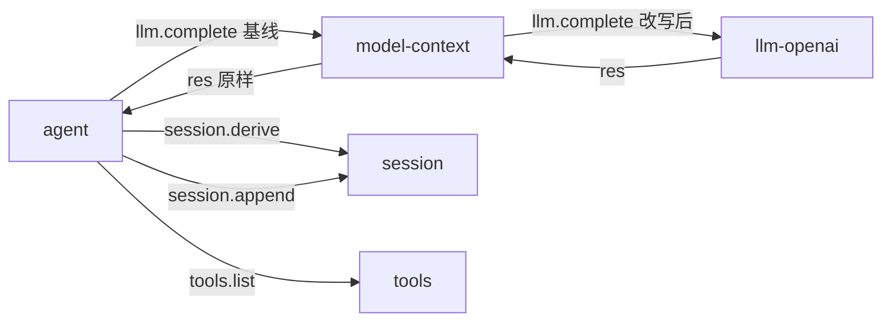
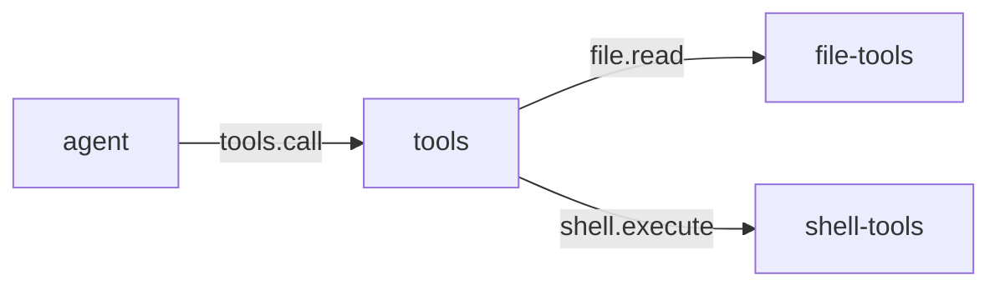
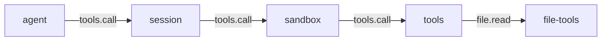

# agent

> 状态：当前实现（轮次编排），目标契约（能力编排）
> 涉及能力：`loop`、`agent`
> 依赖：弱依赖 `session`、`llm`、`tools`、`model-context`；硬依赖插件 `session`、`llm-openai`

本文是 `agent` 插件的设计稿。它描述 agent 在轮次中的编排职责、方法载荷、事实写入顺序和降级行为。

术语见 [CONTEXT.md](../../../CONTEXT.md)，写作约定见 [00-conventions.md](00-conventions.md)，约束见 [CONSTRAINT.md](../../../CONSTRAINT.md)。

## 1. 职责

**当前实现。**

- 管理一个会话的活动轮次。同一会话同一时刻只有一个 Turn 在跑。
- 驱动步骤循环。每步做四件事：组装基线、调模型、分发工具、判断收束。
- 把模型给出的工具调用分发给 `tools` 能力，并收集统一的 Tool Result。
- 处理取消。取消可以来自 `loop.cancel`，也可以来自入站调用被撤销。
- 累计流式正文。合并 `llm.chunk` 增量，按节奏发布临时快照。
- 按固定顺序把轮次事实写入会话事实日志。

**目标契约。**

- 从「轮次编排」扩展为「能力编排」。见第 5.5 节。

## 2. 非职责

- 不执行模型调用。`llm.complete` 由 `llm` 能力承担。
- 不解释工具的业务语义。工具参数、风险、描述都归工具提供方。
- 不组装上下文。上下文组装归 `model-context` 能力。
- 不解释会话事实的业务含义。`meta` 结构由写入方定义。
- 不保存业务记录。agent 唯一的持久化是插件配置。
- 不渲染界面。agent 没有顶层 Component。

## 3. Manifest

**当前实现。**

```json
{
  "name": "agent",
  "version": "0.1.0",
  "protocol": 1,
  "entry": "agent",
  "provides": ["loop", "agent"],
  "requires": ["session", "llm", "tools", "model-context"],
  "depends_on": ["session", "llm-openai"],
  "autostart": true,
  "settings": {
    "get": { "capability": "agent", "method": "settings.get" },
    "save": { "capability": "agent", "method": "settings.save" },
    "schema": [
      { "key": "default_scheme", "label": "Default scheme", "type": "string", "required": true },
      { "key": "max_steps", "label": "Max steps", "type": "number", "required": true }
    ]
  },
  "description": "Turn orchestrator: assembles session/memory/llm/tools; multi-session concurrent",
  "commands": [
    { "name": "config", "description": "Show or set default_scheme / max_steps", "usage": "/agent config [get|set k=v]" }
  ]
}
```

清单结构见 [manifest.md](../../platform/manifest.md)。

**`requires` 与 `depends_on` 在这里的分工。**

| 字段 | 取值 | 作用 |
|---|---|---|
| `requires` | 能力名 | 弱依赖。能力缺失时插件照常启动，调用时返回可恢复错误 |
| `depends_on` | 插件名 | 硬依赖。只影响启动顺序，不参与路由 |

具体到本插件：

- `requires` 里的四个名字都是能力名。`session`、`llm`、`tools` 是 agent 真正会调用的能力。
- `model-context` 只作能力依赖声明。agent 不调用任何 `model-context` 方法。
- `depends_on` 里的两个名字是插件名。`session` 与 `llm-openai` 要先于 agent 就绪。

**当前实现的两条限制。**

- `requires` 目前只是声明。Host 不据此阻断启动，也不据此检查能力在场。
- `depends_on` 目前只产生启动告警。依赖不活时 agent 照样启动，调用时自己拿到错误。

## 4. 方法与载荷

### 4.1 loop.turn

**当前实现。**

输入：

```json
{
  "input": "分析这个项目",
  "session_id": "s-123",
  "workspace_id": "ws-123",
  "workspace": "E:/project",
  "max_steps": 32,
  "allowed_tools": ["file_read"],
  "denied_tools": ["shell_execute"],
  "parent_session_id": "s-parent",
  "origin": "subagent",
  "delegation_depth": 1
}
```

| 字段 | 必填 | 说明 |
|---|---|---|
| `input` | 是 | 用户输入。空字符串直接报错 |
| `session_id` | 否 | 为空时先创建会话 |
| `workspace_id` | 否 | 创建会话时绑定的 Workspace |
| `workspace` | 否 | 只做一致性校验，不覆盖会话绑定 |
| `model` | 否 | 只在创建会话时生效 |
| `context_window` | 否 | 只在创建会话时生效 |
| `max_steps` | 否 | 覆盖配置里的 `max_steps` |
| `allowed_tools` | 否 | 非空时只保留交集工具 |
| `denied_tools` | 否 | 从交集或全集中移除工具 |
| `parent_session_id` | 否 | 子 Agent 的父会话 |
| `origin` | 否 | 会话来源，例如 `subagent` |
| `delegation_depth` | 否 | 委派深度 |

会话已存在时，会话自己的 `model` 与 `context_window` 优先。agent 每次 Turn 都调用 `session.info` 读取它们，
再用 `llm.models.list` 对照当前目录：模型仍在目录中时原样使用，已移除时回退到当前默认模型，
并在 `request_header.model_fallback_from` 记录原模型名。

输出：

```json
{
  "session_id": "s-123",
  "reply": "最终正文",
  "steps": 2,
  "cancelled": false,
  "usage": {
    "prompt_tokens": 100,
    "completion_tokens": 20,
    "total_tokens": 120
  },
  "seqs": [1, 2, 3]
}
```

| 字段 | 说明 |
|---|---|
| `session_id` | 本次使用的会话 |
| `reply` | 最后一次模型返回的正文 |
| `steps` | 实际执行的步数 |
| `cancelled` | 是否被取消 |
| `usage` | 各步用量的累加值 |
| `seqs` | 本次写入会话的 Fact 序号列表 |

`seqs` 只包含 agent 自己写入的 Fact。`model-context` 在链上写入的 Fact 不在其中。

错误：

| 场景 | 错误码 |
|---|---|
| `input` 为空 | `bad_arguments` |
| 载荷缺失或类型错 | `bad_arguments` |
| `workspace` 与会话工作区不一致 | `bad_arguments` |
| 会话没有绑定工作区 | `bad_arguments` |
| 会话创建、查询、写入失败 | 透传 `session` 的错误 |
| 模型调用失败 | 透传 `llm` 的错误 |

**错误落库。** `turn_start` 之后发生错误时，agent 补写 `turn_end(error)`，`meta.error` 保存原始错误。浏览器拿到的仍是原始错误。

### 4.2 loop.cancel

**当前实现。**

输入：

```json
{
  "session_id": "s-123"
}
```

输出：

```json
{
  "session_id": "s-123",
  "cancelled": true
}
```

| 字段 | 说明 |
|---|---|
| `session_id` | 必填。缺失返回 `bad_arguments` |
| `cancelled` | 该会话是否有活动 Turn 被取消 |

没有活动 Turn 时 `cancelled` 为 `false`，不是错误。

取消动作有三步：

1. 标记活动 Turn 为已取消。
2. 对活动中的模型调用发一次 `llm.cancel`。
3. 发布一条 `cancel_requested` 的流式快照。

### 4.3 agent.config.get

**当前实现。**

输入为空对象。输出：

```json
{
  "default_scheme": "tool_calling",
  "max_steps": 128
}
```

| 字段 | 说明 |
|---|---|
| `default_scheme` | 默认工具方案 |
| `max_steps` | 单 Turn 最大步数 |

### 4.4 agent.config.set

**当前实现。**

输入字段均可省略：

```json
{
  "default_scheme": "tool_calling",
  "max_steps": 64
}
```

输出与 `agent.config.get` 相同。

| 规则 | 说明 |
|---|---|
| 空字符串不覆盖 | `default_scheme` 传空值时保留原值 |
| 非正数不覆盖 | `max_steps` 传 0 或负数时保留原值 |
| 立即生效 | 内存值先更新 |
| 同时落盘 | 新值写入插件目录的 `config.json` |

写盘失败返回 `handler_error`。此时内存里的新值已经生效，但没有持久化。

### 4.5 agent.settings.get

**当前实现。**

输入为空对象。输出：

```json
{
  "values": {
    "default_scheme": "tool_calling",
    "max_steps": 128
  }
}
```

`values` 是 Settings Renderer 的读写信封。键与配置字段同名。

### 4.6 agent.settings.save

**当前实现。**

输入：

```json
{
  "values": {
    "default_scheme": "tool_calling",
    "max_steps": 64
  }
}
```

输出：

```json
{
  "saved": true
}
```

保存走的是与 `agent.config.set` 同一套逻辑。写盘失败同样返回 `handler_error`，`saved` 为 `false`。

## 5. 接缝与调用关系

### 5.1 llm.complete 接缝

**当前实现。**



agent 在 `llm.complete` 链上只是发起方。它不声明 `consumes`，链上的组装由 `model-context` 完成。

`model-context` 声明 `consumes` 为 `llm.complete`，`priority` 为 2000。它在链首改写内容区，再把请求交给 `llm-openai`。

**目标契约。**

`tools.call` 接缝上的位置见第 5.2 节。sandbox 的接入方式见
[composition-model-context-tools-sandbox.md](../composition-model-context-tools-sandbox.md) 第 6.3 节。

### 5.2 tools.call 接缝

**当前实现。**



agent 是 `tools.call` 的发起方。`tools` 是该键的 Provider。

**目标契约。**

接入 sandbox 后，同一个键上多两个参与者：



链序按 `priority` 递减。提议的链位是 session 1000、sandbox 500、tools 0。

### 5.3 agent 只发基线

**当前实现。**

agent 组装上下文时只发两样东西：

- `session.derive` 的投影结果作为消息基线。
- `tools.list` 的结果作为工具基线。

agent 不调用 `model-context.build`，也不直接调用 `model-context` 的任何方法。

`model-context` 活跃时，它在链上写入 system prompt 与 runtime context 事实，
再从会话重新投影，最后替换内容区。关掉 `model-context`，模型输入就等于基线。

agent 的 `llm.complete` 还带一个 `meta`：

| 字段 | 说明 |
|---|---|
| `session_id` | 会话标识 |
| `turn_id` | 轮次标识 |
| `step_id` | 步骤标识 |
| `mode` | 当前模式。本阶段与 `scheme` 同值 |
| `scheme` | 当前工具方案 |
| `workspace_id` | 会话绑定的工作区标识 |
| `workspace` | 规范路径 |
| `model` | 会话选择的模型。为空时不覆盖 llm 的默认模型 |
| `context_window` | 会话选择的模型窗口。供 model-context 约束压缩预算 |

`meta` 是意图区。链上的消费者只读它并原样传下去。

### 5.4 降级行为

**当前实现。**

`tools` 是弱依赖能力。能力缺失或调用失败时：

1. 跳过工具阶段。模型这一轮拿不到工具。
2. Turn 继续执行，不变成失败。
3. `request_header` 的 `meta.degraded` 记录原因。

降级原因取值：

| 情形 | `degraded` 内容 |
|---|---|
| `tools.list` 调用失败 | `tools unavailable: <错误>` |
| `tools.list` 响应无法解析 | `bad tools.list response: <错误>` |

`tools.list` 返回空列表不算降级。此时没有 `degraded` 字段。

**目标契约。**

`sandbox` 接入后，裁决结果也要落进会话事实。deny 与 confirm 的形态尚未确定，见
[composition-model-context-tools-sandbox.md](../composition-model-context-tools-sandbox.md) 第 9.3 节。

### 5.5 从轮次编排到能力编排

**目标契约。**

当前 agent 假设会话只有它一个写者。工具结果由 agent 自己决定写回时机，子代理没有回写通道。

能力编排要解决这三件事：

| 方向 | 当前实现 | 目标契约 |
|---|---|---|
| 工具结果写回时机 | 每个工具调用各写一批 | 同一步的工具结果一批写入 |
| 子代理结果回写 | 无回写通道 | 子会话最终回答写进父会话 |
| 模式与方案 | `mode` 与 `scheme` 同值 | 两者分离，`mode` 表达编排模式 |

**工具结果写回时机。** 同一步内多个工具结果合成一次 `session.append`。这样 Fact 批次更少，UI 增量帧也更少。写入仍必须在下一步的 `session.derive` 之前完成，否则模型看不到结果。

**子代理结果回写。** `loop.turn` 已接受 `parent_session_id`，但当前实现只把它写进会话元数据。目标契约是子代理插件在子会话结束后，把最终回答作为一条 `message` 写进父会话。父会话的事实要能引用子会话标识。

**模式与方案分离。** `mode` 表达编排模式，`scheme` 表达工具方案。模式专属分支见第 14 节。

接入 `task` 能力后，agent 要把任务状态变化写进会话事实，并在 `meta` 里带上任务上下文标识。这些都不在当前实现里。

## 6. 工具契约

**当前实现。**

agent 不提供工具。它只消费工具。

| 项 | 说明 |
|---|---|
| 工具列表来源 | `tools.list` |
| 工具调用 | `tools.call` |
| 结果形状 | 统一 Tool Result，规格见 [00-conventions.md](00-conventions.md) 第 8 节 |

agent 发给 `tools.call` 的载荷：

| 字段 | 说明 |
|---|---|
| `name` | 模型给出的工具名 |
| `arguments` | 模型给出的参数。空值补成 `{}` |
| `session_id` | 会话标识 |
| `workspace` | 规范路径 |
| `workspace_id` | 工作区标识 |
| `mode` | 当前模式。本阶段与 `scheme` 同值 |
| `call_id` | 模型给出的工具调用标识 |

**工具筛选规则。**

| 规则 | 说明 |
|---|---|
| `allowed_tools` 非空 | 只保留交集工具 |
| `allowed_tools` 为空 | 取全部工具 |
| `scheme` 为 `chat` | 不给模型挂工具 |
| `denied_tools` 非空 | 从结果里移除这些工具 |

`scheme` 为 `chat` 且 `allowed_tools` 非空时，仍按交集给工具。

**发给模型的工具描述。** agent 在 `description` 末尾追加一行风险值。
`input_schema` 为空时补成空对象 schema。

```text
<工具原描述>
Risk: <0 到 100 的整数>.
```

**工具失败处理。** 工具调用失败不终止 Turn。agent 写入一条 `message`，`role` 为 `tool`，`meta.is_error` 为 `true`。
错误带稳定错误码时，正文前缀为 `tool error [<code>]:`，`meta.error_code` 保存该码，`meta.wire_error` 保存原始错误文本。

## 7. Prompt 贡献

**当前实现。**

agent 不写任何模型可见文本。

模型侧文本按 [prompts/README.md](../../prompts/README.md) 分三路，agent 一路都不占。

| 路径 | 归属 |
|---|---|
| 静态轨节 | model-context |
| 动态轨节 | model-context |
| 工具描述三件套 | 工具提供方 |

**目标契约。**

模式专属 system prompt 落地后，agent 负责声明当前模式。它只产出一个节对象，交给组装插件。

## 8. 记录与持久化

### 8.1 事实写入顺序

**当前实现。**

一次 Turn 的完整写入顺序：

```text
turn_start
message(user)
step_start
request_header
[model-context: message(system), message(runtime_context), context_snapshot]
llm_usage
message(assistant)
message(tool)*
step_end
turn_end
```

方括号内的三条事实由 `model-context` 在 `llm.complete` 中写入。
system prompt 与 runtime context 只在渲染结果变化时才追加。`context_snapshot` 每步都写。

`context_snapshot` 是模型实际输入的权威记录。`request_header` 是 agent 的基线摘要。

每条事实的 `meta` 都带 `turn_id` 和 `plugin`。`plugin` 的值是 `agent`。
轮次级的事实不带 `step_id`，步骤级的事实带。

**`request_header` 的 `meta`。**

| 字段 | 说明 |
|---|---|
| `step` | 当前步序号 |
| `mode` | 当前模式。本阶段等于 `scheme` |
| `scheme` | 当前工具方案 |
| `model` | 会话选择的模型。未选择时省略 |
| `context_window` | 会话选择的模型窗口。未选择时省略 |
| `token_estimate` | agent 基线的本地估算 |
| `degraded` | 仅在工具不可用时出现 |

`token_estimate` 是本地估算。实际值以 `context_snapshot` 为准。

**`llm_usage` 的 `meta`。**

| 字段 | 说明 |
|---|---|
| `usage` | 上游 API 返回的用量 |
| `model` | llm 最终响应的模型 |
| `context_window` | llm 最终响应的窗口 |
| `finish_reason` | 上游本次响应的 `finish_reason` |

用量口径是 API 返回值，不是本地估算。

**`message(tool)` 的 `meta`。**

| 字段 | 说明 |
|---|---|
| `tool_name` | 工具名 |
| `is_error` | 结果是否失败 |
| `truncated` | 结果是否被截断 |
| `tool_meta` | 工具返回的 `meta`。存在时才有 |
| `wire_error` | 调用失败时的错误文本。存在时才有 |

**`step_end` 的 `meta.reason`。**

| 值 | 含义 |
|---|---|
| `completed` | 本步没有工具调用，Turn 正常收束。带 `finish_reason`、`scheme` 和 `tool_calls` |
| `tool_calls` | 本步有工具调用且全部执行完毕 |
| `cancelled` | 工具执行途中被取消，本步在此收口 |
| `error` | 上游响应不可作为终态。带 `error_code` |

**`turn_end` 的 `meta.reason`。**

| 值 | 含义 |
|---|---|
| `completed` | 正常收束。带 `tool_calls` 和 `steps` |
| `max_steps` | 达到步数上限，且最后一步仍有工具调用。带 `tool_calls` 和 `steps` |
| `cancelled` | 被取消 |
| `error` | 中途出错。`meta.error` 保存原始错误，稳定码保存在 `meta.error_code` |

### 8.2 纯文本收尾与上游终态

**当前实现。**

模型返回零个工具调用时，agent 按上游 `finish_reason` 判定本步终态：

| `finish_reason` | 处理 |
|---|---|
| `stop` 或未知值 | `step_end(completed)`，Turn 可以正常收束 |
| `length` | `step_end(error)` 与 `turn_end(error)`，错误码 `llm_output_truncated` |
| `content_filter` | `step_end(error)` 与 `turn_end(error)`，错误码 `llm_content_filtered` |
| `tool_calls` / `function_call` | `step_end(error)` 与 `turn_end(error)`，错误码 `llm_tool_calls_missing` |

截断和过滤路径保留已产生的 assistant 正文与 reasoning，`loop.turn` 同时返回对应错误码。
`stop` 仍是合法终态：模型只输出文字、不调用工具时无法从协议上判定为失败。
`turn_end(completed)` 因此带 `tool_calls` 计数，聊天区对零工具轮次显示「未调用工具」。

### 8.3 取消路径为什么写 step_end(cancelled)

**当前实现。**

工具循环中途被取消时，本步的 assistant 事实已经记下了全部 `tool_calls`。
但只有执行到的那几个工具拿到了结果。

此时如果写 `step_end(tool_calls)`，会话里就会留下没有对应结果的 `tool_call_id`。
下游按 id 配对时会错。

所以取消路径写 `step_end(cancelled)`，并结束 Turn。
不写 `step_end(tool_calls)`，避免留下悬空的 `tool_call_id`。

取消时还会做两件事：

1. 把已累计的 assistant 正文写成一条 `message`，`role` 为 `assistant`。
2. 写 `turn_end(cancelled)`，并追加一条 `role=user` 的提示事实。

那条提示事实的 `meta.kind` 是 `turn_cancelled`。它留在模型可见的日志里，
让下一轮不要误续写被放弃的任务。聊天界面会过滤掉它。

### 8.4 流式通信

**当前实现。**

agent 消费 `llm.chunk`，不把私有载荷透传给浏览器。

```text
llm.chunk
→ agent 流式累计器
→ 流式快照
→ session.stream.update
→ session 运行时
→ Command(stream)
→ session-chat
```

`stream_chunk` 不持久化。最终的 assistant `message` 事实是正文真源。

发布节奏：首个增量立即发布。之后最多每 24 个增量或 100 毫秒发布一次。
最终完成快照和取消快照始终发布。

agent 不写 `stream_chunk` 事实。

### 8.5 持久化

**当前实现。**

agent 只持久化插件配置，路径是插件目录下的 `config.json`。

会话事实由 `session` 能力持久化。agent 不直接读会话文件。

## 9. WebUI

**当前实现。**

agent 没有顶层 Component。它不直接调用 `setData` 或 `runCommand`。

| Component | 操作 | 能力 |
|---|---|---|
| `session-chat` | 发送用户输入 | `loop.turn` |
| `session-chat` | 取消当前 Turn | `loop.cancel` |
| `session-chat` | 显示临时正文 | session 的 `Command(stream)` |
| `session-chat` | 显示最终正文 | session 的 `State(ChatState)` |

**目标契约。**

agent 若要提供自己的面板，需要在 `plugin.json` 的 `ui` 里声明 Component 和 Mount。

## 10. 错误码

**当前实现。**

agent 主要用平台级错误码。它另有三个 `llm_` 开头的插件级码，描述模型响应的形态。

| 场景 | 错误码 |
|---|---|
| 载荷缺失、为空或类型错 | `bad_arguments` |
| `input` 为空 | `bad_arguments` |
| `loop.cancel` 缺 `session_id` | `bad_arguments` |
| `workspace` 与会话工作区不一致 | `bad_arguments` |
| 会话没有绑定工作区 | `bad_arguments` |
| 配置写盘失败 | `handler_error` |
| 会话创建、查询、写入失败 | 透传 `session` 的错误 |
| 模型调用失败 | 透传 `llm` 的错误，`llm` 用 `llm_upstream` |

平台级错误码见 [00-conventions.md](00-conventions.md) 第 6 节。

**目标契约。**

agent 若要新增插件级错误码，前缀用 `agent_`。

## 11. 配置

**当前实现。**

配置文件在插件目录下的 `config.json`：

```json
{
  "default_scheme": "tool_calling",
  "max_steps": 128
}
```

| 字段 | 默认值 | 说明 |
|---|---|---|
| `default_scheme` | `tool_calling` | 只有 `chat` 和其余取值有区别 |
| `max_steps` | `128` | 单 Turn 最大步数 |

`default_scheme` 为 `chat` 时不给模型挂工具。其余取值按 `tool_calling` 处理。

配置文件不存在、解析失败或字段非法时，回落到默认值。

### 11.1 配置快照语义

**当前实现。**

每次 Turn 在开始时捕获一份配置快照。Turn 全程只用这份快照。

配置修改的效果：

- `agent.config.set` 立即改内存值，下一次 Turn 生效。
- 运行中的 Turn 不受影响，继续用它的快照。
- `agent.settings.save` 走同一条路径。

所以「改了配置但这一轮没变」是预期行为，不是缺陷。

**目标契约。**

模式专属分支落地后，配置会多出模式相关字段。快照规则不变。

## 12. 测试要求

**当前实现。**

按 [00-conventions.md](00-conventions.md) 第 13 节展开。

| 项 | agent 的具体要求 |
|---|---|
| 载荷解码 | 空载荷、缺 `input`、字段类型错 |
| 成功响应 | `loop.turn` 输出的六个字段形状 |
| 稳定错误码 | 第 10 节每行一个用例 |
| 配置持久化 | 写入 `config.json`、写盘失败返回 `handler_error` |
| 事件载荷 | `llm.chunk` 合并后的快照字段与顺序 |
| 纯函数 | 工具筛选、路径一致性比较、token 估算 |
| 取消路径 | 取消时保存已累计正文，写 `step_end(cancelled)` |
| 降级路径 | `tools.list` 失败时 `meta.degraded` 有值 |

补充要求：

- 事实写入顺序要有逐条断言。顺序错了模型上下文就会错。
- 取消路径要断言没有 `step_end(tool_calls)`。
- 要断言 agent 不调用 `model-context.build`。
- 要断言不同会话的 Turn 可以并发，同一会话的两个 Turn 串行。
- 要断言运行中的 Turn 不受配置修改影响。

**目标契约。**

能力编排落地后，要加子代理结果回写与工具结果批量写入的用例。

## 13. 验收标准

| 项 | 检查 |
|---|---|
| 能力名已登记 | `loop` 与 `agent` 在 [00-conventions.md](00-conventions.md) 第 3 节 |
| 错误码全局唯一 | 只用平台级码，不与第 6 节冲突 |
| 不直连其他插件 | 全部交互走能力调用 |
| 不用插件名寻址 | 路由只用 `(capability, method)` |
| 状态标注清楚 | 每节区分当前实现、目标契约、未实现 |
| 方法载荷完整 | 六个方法各有输入、输出、错误 |
| 图与代码一致 | 图中模块名与 `plugins/` 目录一致 |
| 链接有效 | 链接指向存在的文件 |

## 14. 未实现

**暂不实现。**

| 项 | 说明 |
|---|---|
| 模式专属分支 | `mode` 与 `scheme` 同值。minimal、normal 的命名未落地 |
| 后台轮次 | 没有独立于 Turn 的后台执行入口 |
| 同会话并发轮次 | 同一会话的 Turn 串行排队，没有并行队列 |
| 子代理结果回写 | `parent_session_id` 只写进会话元数据 |
| 工具结果批量写入 | 当前逐个工具调用各写一批 |
| sandbox 裁决结果落库 | sandbox 尚未接入 |
| `requires` 真正生效 | Host 目前不据此阻断启动 |

**目标契约。**

上表前六项都是能力编排要补的缺口。补齐后 agent 的定位从轮次编排变成能力编排。

## 15. 结构体索引

本节只作实现参考。Go 类型名不是公共契约。

| Go 类型 | 角色 |
|---|---|
| `plugin` | 插件状态、配置、会话槽表 |
| `sessionSlot` | 每会话的轮次锁与活动 Turn |
| `turnState` | 单会话活动 Turn 状态 |
| `turnIn` / `turnOut` | `loop.turn` 载荷 |
| `cancelIn` / `cancelOut` | `loop.cancel` 载荷 |
| `config` / `configGetOut` / `configSetIn` | 编排器配置 |
| `settingsGetOut` / `settingsSaveIn` / `settingsSaveOut` | Settings Renderer 载荷 |
| `chatMessage` | 上下文消息形状 |
| `toolSpec` / `toolDefinition` / `toolFunction` | 工具描述形状 |
| `toolCall` / `functionCall` | 模型给出的工具调用 |
| `toolResult` | 统一 Tool Result |
| `usage` | 用量计数 |
| `llmCompleteIn` / `llmCompleteOut` / `llmMeta` | `llm.complete` 载荷子集 |
| `llmCancelIn` / `llmCancelOut` | `llm.cancel` 载荷 |
| `sessionCreateIn` / `sessionCreateOut` | `session.create` 载荷子集 |
| `sessionInfoOut` / `sessionAppendIn` / `sessionAppendOut` | `session` 调用载荷子集 |
| `messagesOut` | `session.derive` 响应子集 |
| `modelContextOut` | 基线组装结果 |
| `streamChunk` / `streamMessage` | 流式增量与累计消息 |
| `streamAccumulator` / `streamFlushPolicy` | 流式累计与发布节奏 |
| `streamSnapshot` | 流式快照 |

跨插件 JSON 规范见 [plugins/agent/communication.md](../../../plugins/agent/communication.md)。
