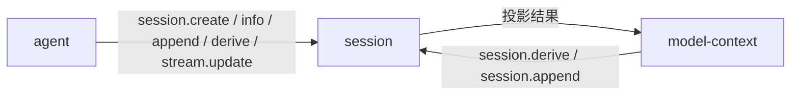
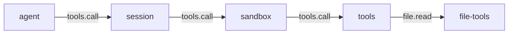

# session

> 状态：当前实现
> 涉及能力：`session`
> 依赖：无。`requires` 与 `depends_on` 都是空数组

本文是 `session` 插件的设计稿。它描述事实日志、投影规则、工作区注册表和 WebUI 组件。

术语见 [CONTEXT.md](../../../CONTEXT.md)，写作约定见 [00-conventions.md](00-conventions.md)，约束见 [CONSTRAINT.md](../../../CONSTRAINT.md)。

## 1. 职责

**当前实现。**

- 保存 append-only 的事实日志。一个会话一个 JSONL 文件。
- 提供事实的写入、查询和分页读取。
- 提供模型上下文投影。把事实投影成模型可见的消息序列。
- 维护工作区注册表。负责目录规范化、当前选择、重命名和移除。
- 驱动四个 WebUI 组件。维护选中会话、打开列表和流式草稿。

**目标契约。**

预留事实类型的扩展位。见第 8.5 节。

## 2. 非职责

- 不解释事实的业务含义。`meta` 的结构由写入方定义。
- 不调用模型。`model-context` 能力负责组装上下文。
- 不做压缩。压缩是 `model-context` 的事。
- 不执行工具。工具由 `tools` 能力分发。
- 不校验模型是否存在。模型目录属于 llm 插件。
- 不渲染界面内容。组件归 session 所有，但组件是插件的一部分。

## 3. Manifest

**当前实现。**

```json
{
  "name": "session",
  "version": "0.1.0",
  "protocol": 1,
  "entry": "session",
  "provides": ["session"],
  "requires": [],
  "depends_on": [],
  "autostart": true,
  "priority": 1000,
  "description": "Session log, workspace registry, projection and multi-session UI",
  "commands": [
    { "name": "list", "description": "List sessions", "usage": "/session list" },
    { "name": "derive", "description": "Print Model Context messages", "usage": "/session derive" },
    { "name": "dump-trace", "description": "Export Session Log facts as JSON", "usage": "/session dump-trace" },
    { "name": "info", "description": "Show session metadata", "usage": "/session info" }
  ],
  "ui": {
    "entry": "ui/main.js",
    "components": [
      { "tag": "session-history", "mount_id": "history", "slot": "left" },
      { "tag": "session-chat", "mount_id": "chat", "slot": "center" },
      { "tag": "session-trace", "mount_id": "trace", "slot": "right" },
      { "tag": "session-dock", "mount_id": "dock", "slot": "bottom" }
    ]
  }
}
```

清单结构见 [manifest.md](../../platform/manifest.md)。

**`requires` 与 `depends_on` 为空。**

session 不依赖任何能力或插件。它自己就是被依赖方。

### 3.1 为什么 priority 是 1000

**当前实现。**

`priority` 是插件级单值。它只在消费链里决定链内位置，不决定成员资格。

session 的 `priority` 是 1000。session 现在没有声明 `consumes`，也没有注册 `tools.call` 或 `llm.complete`。
所以 1000 目前不影响任何链。它是为接入接缝预留的位置。

**接入接缝后的链序。**

`consumes[]` 条目目前不带独立 priority，链内位置一律取插件顶层值。按这个规则：

| 插件 | `priority` | `llm.complete` | `tools.call` |
|---|---:|---|---|
| model-context | 2000 | 链首。先组装 | 不参与 |
| session | 1000 | 中间。记录事实并派生视图 | 链首。记录调用 |
| sandbox | 500 | 不参与 | 中间。裁决 |
| tools | 0 | 不参与 | 链尾。Provider |
| llm-openai | 0 | 链尾。Provider | 不参与 |

顶层单值 1000 同时满足两个位置：在 `llm.complete` 上排在 model-context 之后、llm-openai 之前；
在 `tools.call` 上排在 sandbox 之前、tools 之后。

**提议。**

同一插件在不同链上需要不同位置时，用 `consumes[]` 条目内的 `priority` 覆盖顶层值。
这个字段仍是提议状态，尚未落地，见 [00-conventions.md](00-conventions.md) 第 5 节。

**目标契约。**

session 声明 `consumes` 后，1000 生效。届时上表的链序才成立。

## 4. 方法与载荷

**当前实现。**

方法按用途分四组。下面的分组只是阅读顺序，不影响路由。

### 4.1 事实日志类

**session.create**

输入：

```json
{
  "session_id": "s-123",
  "name": "项目分析",
  "workspace_id": "ws-123",
  "workspace": "E:/project",
  "model": "deepseek-chat",
  "context_window": 65536,
  "parent_session_id": "s-parent",
  "origin": "subagent",
  "delegation_depth": 1
}
```

| 字段 | 必填 | 说明 |
|---|---|---|
| `session_id` | 否 | 省略时由 Session 生成 |
| `name` | 否 | 显示名 |
| `workspace_id` | 否 | 必须在工作区注册表里存在 |
| `workspace` | 否 | 只给路径时自动注册工作区 |
| `model` | 否 | 会话级模型选择。创建后不变 |
| `context_window` | 否 | 会话级模型窗口。负数按 0 保存 |
| `parent_session_id` | 否 | 父会话 |
| `origin` | 否 | 会话来源 |
| `delegation_depth` | 否 | 委派深度 |

输出：

```json
{
  "session_id": "s-123",
  "created_ts": 1760000000000
}
```

| 规则 | 说明 |
|---|---|
| 幂等 | 已存在的会话直接返回，不重复建 |
| `session_id` 必须是单一路径名 | 规则见第 11.2 节 |
| `workspace_id` 与 `workspace` 同时给 | 必须指向同一目录，否则 `workspace_mismatch` |
| 两者都不给 | 返回 `workspace_required` |
| `model` 与 `context_window` | 写入 `session_start` 的 `meta`，创建后不再变化 |

**session.append**

输入：

```json
{
  "session_id": "s-123",
  "facts": [
    {
      "type": "message",
      "role": "user",
      "content": "分析项目",
      "tool_calls": null,
      "tool_call_id": "",
      "meta": {}
    }
  ]
}
```

| 字段 | 必填 | 说明 |
|---|---|---|
| `session_id` | 是 | 目标会话 |
| `facts` | 是 | 事实数组，不能为空 |
| `facts[].type` | 是 | 事实类型，不能为空 |
| `facts[].role` | 否 | 角色 |
| `facts[].content` | 否 | 正文 |
| `facts[].tool_calls` | 否 | 工具调用 |
| `facts[].tool_call_id` | 否 | 工具结果关联 |
| `facts[].meta` | 否 | 写入方定义的关联信息 |

输出：

```json
{
  "session_id": "s-123",
  "seqs": [12],
  "next_seq": 13
}
```

| 规则 | 说明 |
|---|---|
| 批内顺序保证 | 按输入顺序分配序号 |
| 原子分配 | 所有事实在同一把会话锁下分配序号并写入 |
| 不隐式创建 | 会话不存在返回 `session_not_found` |
| `seq` 由 Session 分配 | 写入方不指定 |
| `ts` 由 Session 生成 | 写入方的时间戳不生效 |

**session.query**

输入：

```json
{
  "session_id": "s-123",
  "after_seq": 10,
  "limit": 100,
  "types": ["message"]
}
```

| 字段 | 必填 | 说明 |
|---|---|---|
| `session_id` | 是 | 目标会话 |
| `after_seq` | 否 | 开区间。只返回序号大于它的 |
| `limit` | 否 | 为 0 时不限制数量 |
| `types` | 否 | 为空时返回所有类型 |

输出：

```json
{
  "facts": [],
  "next_seq": 20,
  "total": 20
}
```

**session.info**

输入：

```json
{
  "session_id": "s-123"
}
```

输出：

```json
{
  "session_id": "s-123",
  "name": "项目分析",
  "workspace_id": "ws-123",
  "workspace": "E:/project",
  "model": "deepseek-chat",
  "context_window": 65536,
  "parent_session_id": "",
  "origin": "",
  "delegation_depth": 0,
  "created_ts": 1760000000000,
  "fact_count": 20,
  "next_seq": 21
}
```

`model` 与 `context_window` 来自 `session_start`。旧会话没有这两个字段时省略。

**session.update**

输入：

```json
{
  "session_id": "s-123",
  "name": "项目分析"
}
```

| 字段 | 必填 | 说明 |
|---|---|---|
| `session_id` | 是 | 目标会话 |
| `name` | 否 | 新名称。省略表示不改名 |
| `pinned` | 否 | 置顶状态。省略表示不改 |
| `workspace` | 否 | 传入即报错 |
| `workspace_id` | 否 | 传入即报错 |

输出：

```json
{
  "session_id": "s-123",
  "name": "项目分析",
  "pinned": true,
  "workspace": "E:/project"
}
```

名称或置顶状态变化写入一条 `session_meta` 事实。工作区绑定在会话生命周期内不可修改。

**session.delete**

输入：

```json
{
  "session_id": "s-123"
}
```

输出：

```json
{
  "session_id": "s-123",
  "deleted": true,
  "selected_id": "s-124"
}
```

| 规则 | 说明 |
|---|---|
| 有未闭合 Turn | 返回 `bad_arguments` |
| 打开或选中的会话 | 删除前从打开列表移除，并选中同工作区相邻会话 |
| 落盘文件 | 关闭句柄后删除 `<session_id>.jsonl` |
| 会话不存在 | 返回 `session_not_found` |

### 4.2 投影类

**session.derive**

输入：

```json
{
  "session_id": "s-123",
  "full_tool_results": 8
}
```

| 字段 | 必填 | 说明 |
|---|---|---|
| `session_id` | 是 | 目标会话 |
| `full_tool_results` | 否 | 保留完整结果的工具消息条数。省略时用配置值 |

输出：

```json
{
  "messages": [
    {
      "seq": 3,
      "role": "system",
      "content": "You are an AI agent powered by LiteAgent...",
      "meta": {
        "source": "model-context",
        "kind": "system_prompt",
        "hash": "..."
      }
    }
  ],
  "covered_through_seq": 1,
  "summary_seq": 9,
  "truncated_tools": 1,
  "truncated_seqs": [4]
}
```

| 字段 | 说明 |
|---|---|
| `messages` | 模型可见的消息序列 |
| `covered_through_seq` | 被摘要覆盖到的序号 |
| `summary_seq` | 生效摘要的序号 |
| `truncated_tools` | 被替换为 stub 的工具消息数 |
| `truncated_seqs` | 被替换的事实序号 |

`seq` 与 `meta` 是审计字段。模型适配器忽略它们，`model-context` 用它们识别自己的事实。

`derive` 是纯投影。同样的事实总是得到同样的输出。
它不是界面视图，也不返回全部事实元数据。

**投影规则**

**当前实现。** 八条规则按执行顺序列出。

| 序号 | 规则 | 说明 |
|---|---|---|
| 1 | 取最新生效摘要 | 找 `active=true` 的 `context_summary`，读 `shadowed_from_seq` 与 `shadowed_to_seq`。没有区间字段时回退 `covers_through_seq` |
| 2 | 遮蔽区间内的普通消息不投影 | 序号落在区间内的普通 `message` 不进入结果，区间外的保留 |
| 3 | 系统提示放到头部 | 最新 `kind=system_prompt` 的消息放到头部。没有它时，保留旧规则：最新可见的 system 消息放到头部 |
| 4 | 运行时上下文保留一条 | 最新 `kind=runtime_context` 的消息只保留一条，放在摘要之后 |
| 5 | 摘要作为 system 消息插入 | 插在系统提示之后 |
| 6 | 系统提示与运行时上下文不受遮蔽影响 | 它们是当前状态，不是对话历史 |
| 7 | 旧工具结果替换为 stub | 最早的若干条工具消息替换成确定性 stub，计入 `truncated_tools`，被替换的序号写入 `truncated_seqs` |
| 8 | 修复孤立工具消息 | 前面 assistant 的 `tool_calls` 不包含该 `tool_call_id` 时，投影为 `role=user`，正文加 `[recovered tool result; original tool_call_id="..."]` 前缀 |

规则 1 的补充：多条摘要在场时，序号最大的那条生效，其余忽略。

规则 3 的补充：旧规则只适用于 `role=system` 且没有 `kind` 标记的消息。
它同样参与遮蔽判断，被遮蔽时不作为头部。

规则 4 的补充：运行时上下文沿用它自己的角色。当前实现里 model-context 用 `role=user` 写它。

规则 7 的 stub 文本格式：

```text
[tool result omitted; <字节数> bytes; see seq=<序号>]
```

这个格式是公开契约。`model-context` 的 inspect 用它重建被截断的消息。

**摘要遮蔽区间的语义**

**当前实现。**

遮蔽区间是一个半开区间，由起点和终点两个序号确定：

| 字段 | 含义 |
|---|---|
| `shadowed_from_seq` | 区间起点。等于 0 表示没有下界 |
| `shadowed_to_seq` | 区间终点。落在它之后的消息不受影响 |
| `covers_through_seq` | 旧字段。没有区间字段时作终点用 |

区间内的普通对话消息被摘要替代。原始消息仍留在日志里，只是不进模型输入。

摘要不覆盖系统提示与运行时上下文。这两类内容是当前状态。

摘要的边界不落在工具调用与结果之间。分段规则见
[prompts/05-compaction.md](../../prompts/05-compaction.md)。

**session.messages**

输入：

```json
{
  "session_id": "s-123",
  "before_seq": 3,
  "limit": 200
}
```

| 字段 | 必填 | 说明 |
|---|---|---|
| `session_id` | 是 | 目标会话 |
| `before_seq` | 否 | 开区间。省略或为 0 时从最新一页开始 |
| `limit` | 否 | 默认 200，最大 500 |

输出：

```json
{
  "session_id": "s-123",
  "messages": [],
  "first_seq": 2,
  "has_more": false,
  "total": 40
}
```

结果按时间正序排列。`first_seq` 是页内第一条的序号。
`has_more` 表示该页之前还有消息。

**session.facts**

输入：

```json
{
  "session_id": "s-123",
  "before_seq": 20,
  "limit": 200
}
```

字段语义与 `session.messages` 相同。`total` 是完整事实数，`facts` 是页内事实。

### 4.3 工作区类

**当前实现。**

工作区方法属于 `session` 能力，没有单独的 `workspace` 能力。

工作区记录形状：

```json
{
  "workspace_id": "ws-123",
  "name": "项目分析",
  "path": "E:/project",
  "created_ts": 1760000000000,
  "updated_ts": 1760000000000
}
```

| 方法 | 输入 | 输出 |
|---|---|---|
| `session.workspace.list` | 无 | `{workspaces, selected_id}` |
| `session.workspace.create` | `{path, name?}` | `{workspace, created}` |
| `session.workspace.select` | `{workspace_id}` | `{workspace_id}` |
| `session.workspace.current` | 无 | `{workspace}` |
| `session.workspace.rename` | `{workspace_id, name}` | `{workspace}` |
| `session.workspace.remove` | `{workspace_id}` | `{workspace_id, removed, selected_id}` |

| 规则 | 说明 |
|---|---|
| 路径必须绝对 | 相对路径返回 `workspace_invalid` |
| 路径必须是目录 | 指向文件返回 `workspace_invalid` |
| 路径要先规范化 | 解析符号链接并清理 |
| 同路径只注册一次 | 重复路径返回已有记录，`created` 为 `false` |
| `workspace.create` 会选中 | 注册后同时设为当前工作区 |
| `workspace.remove` 只删注册 | 不删目录，也不删会话 |
| 选中态不写日志 | 选中状态只影响界面 |

`workspace.select` 会同时协调选中会话：先恢复该工作区记住的会话，
没有就选最新会话，都没有就清空选中。

### 4.4 WebUI 类

**session.list**

输入可省略。带 `workspace_id` 时只列该工作区的会话。

输出：

```json
{
  "sessions": [
    {
      "session_id": "s-123",
      "name": "项目分析",
      "workspace_id": "ws-123",
      "workspace": "E:/project",
      "pinned": true,
      "fact_count": 20,
      "created_ts": 1760000000000,
      "last_ts": 1760000010000
    }
  ]
}
```

置顶会话排在前面。其余按 `last_ts` 降序排列。相同时按 `created_ts` 降序，再相同按 `session_id` 降序。

**session.state**

输入：

```json
{
  "session_id": "s-123"
}
```

`session_id` 可省略。显式给出时返回该会话的状态。

省略时的解析顺序：

1. 用当前工作区记住的选中会话。
2. 没有记住的会话时，取该工作区 `last_ts` 最新的会话，并记为选中会话。
3. 仍没有会话时，清空聊天与追踪，只返回历史状态。

输出：

```json
{
  "history": {},
  "chat": {},
  "chats": [],
  "trace": {}
}
```

| 字段 | 说明 |
|---|---|
| `history` | 历史状态 |
| `chat` | 选中会话的聊天状态 |
| `chats` | 当前工作区所有打开面板的聊天状态 |
| `trace` | 选中会话的追踪状态 |

该方法读取日志并重建状态，同时初始化缺失的选中会话。
它不是纯只读查询：传入的 `session_id` 必须已存在，否则返回 `session_not_found`。

**session.dock**

输入可省略，或指定 `session_id`。省略时按 `session.state` 的规则解析当前会话。

输出是底部状态，形状见第 9.3 节。

它是 `session-dock` 首次挂载和重连 resync 的入口，不推送其他 Mount。

**session.select**

输入：

```json
{
  "session_id": "s-123"
}
```

输出：

```json
{
  "session_id": "s-123"
}
```

选中会话属于插件运行时。浏览器不保存也不推导当前会话。
调用成功后，运行时立即向 `history`、`chat`、`trace` 各推送一次状态。

`select` 同时把会话加入打开列表。重复选择只切换当前标签，不重复打开。
打开属于其他工作区的会话时，运行时同时切换工作区选择。

**session.close**

输入：

```json
{
  "session_id": "s-123"
}
```

输出：

```json
{
  "session_id": "s-123",
  "closed": true,
  "selected_id": "s-124"
}
```

关闭不会取消运行中的 Turn。关闭当前标签后，运行时选择相邻的打开会话。

被关闭的会话如果正好是它所属工作区的选中项，选中项必须落到该工作区仍打开的会话上。
没有就清空，不留下指向已关闭会话的悬空标识。

会话没在打开列表里时，`closed` 为 `false`，不是错误。

**session.refresh**

输入为空对象。输出：

```json
{
  "published": true
}
```

该方法把当前选中的工作区、会话和打开列表原样向 `history`、`chat`、`trace` 发布一遍状态。
它不接受输入，也不改变任何选择。

**session.stream.update**

输入：

```json
{
  "session_id": "s-123",
  "turn_id": "t-1",
  "step_id": "st-2",
  "update_id": 17,
  "message": {
    "role": "assistant",
    "content": "当前累计正文",
    "reasoning": "当前累计 reasoning",
    "tool_calls": []
  },
  "status": "streaming"
}
```

| 字段 | 必填 | 说明 |
|---|---|---|
| `session_id` | 是 | 目标会话 |
| `turn_id` | 是 | 轮次标识 |
| `step_id` | 是 | 步骤标识 |
| `update_id` | 是 | 必须为正数。同一轮次步骤内单调递增 |
| `message` | 是 | 当前累计消息 |
| `status` | 否 | 省略时按 `streaming` 处理 |

输出：

```json
{
  "accepted": true,
  "reason": "stale"
}
```

`status` 取值：

| 值 | 含义 |
|---|---|
| `streaming` | 增量中 |
| `cancel_requested` | 已请求取消 |
| `complete` | 本步完成 |
| `cancelled` | 本步取消 |
| `error` | 本步出错 |

同一 `(turn_id, step_id)` 内，较旧的 `update_id` 被丢弃，返回 `accepted` 为 `false`。

`cancel_requested` 会立即推送聊天面板状态。

## 5. 接缝与调用关系

### 5.1 当前实现

**当前实现。**

session 不参与消费链。它只提供 `session` 能力被别人调用。



调用方都在 `plugins/` 目录里：agent、model-context。
session 不主动调用任何能力。

### 5.2 目标契约：接缝上的位置

**目标契约。**

session 参与两个接缝。它在链上先看到请求，可以记录实际发生的事。



`tools.call` 上 session 的链位是 1000，排在 sandbox 的 500 之前。
这意味着 session 先于裁决看到调用，可以记录被拒绝和被修改的调用。

`llm.complete` 上 session 的链位是 100，排在 llm-openai 之前。
这意味着 session 看到的是 `model-context` 改写后的真实输入。

链序规则见 [00-conventions.md](00-conventions.md) 第 5 节。
组合方案见 [composition-model-context-tools-sandbox.md](../composition-model-context-tools-sandbox.md)。

## 6. 工具契约

**当前实现。**

session 不提供工具。它也不消费工具。

| 项 | 说明 |
|---|---|
| 工具提供者约定 | 见 [00-conventions.md](00-conventions.md) 第 8 节 |
| 工具分发契约 | 见 [plugins/tools/communication.md](../../../plugins/tools/communication.md) |

session 与工具的唯一交集是 `tools.call` 载荷里的 `session_id` 和 `workspace`。

## 7. Prompt 贡献

**当前实现。**

session 不产出任何模型可见文本。

它只保存别处产出的内容，并把它们投影给模型。

| 路径 | 谁产出 | session 的角色 |
|---|---|---|
| 静态轨节 | model-context | 存成事实，投影时放到头部 |
| 动态轨节 | model-context | 存成事实，投影时保留最新一条 |
| 工具描述三件套 | 工具提供方 | 不参与 |

压缩摘要也是 model-context 产出的。session 存成 `context_summary` 事实，
并按遮蔽区间把它投影给模型。

Prompt 规格见 [prompts/README.md](../../prompts/README.md)。

## 8. 记录与持久化

### 8.1 事实模型

**当前实现。**

一条事实是一行 JSON：

```json
{
  "seq": 12,
  "type": "message",
  "role": "assistant",
  "content": "最终正文",
  "tool_calls": null,
  "tool_call_id": "",
  "meta": {
    "turn_id": "t-1",
    "step_id": "st-2",
    "reasoning": "最终推理"
  },
  "ts": 1760000000000
}
```

| 字段 | 说明 |
|---|---|
| `seq` | 会话内顺序。由 Session 分配，单调递增 |
| `type` | 事实类型。见下表 |
| `role` | 消息角色或过程角色 |
| `content` | 正文或描述 |
| `tool_calls` | assistant 的工具调用 |
| `tool_call_id` | tool 消息关联的调用标识 |
| `meta` | 写入方定义的关联信息 |
| `ts` | 毫秒时间戳。由 Session 生成 |

### 8.2 事实类型词汇表

**当前实现。**

| 类型 | 用途 | 进入模型上下文 |
|---|---|---|
| `session_start` | 会话元数据 | 否 |
| `turn_start` | 轮次开始 | 否 |
| `turn_end` | 轮次终态 | 否 |
| `step_start` | 步骤开始 | 否 |
| `step_end` | 步骤终态 | 否 |
| `request_header` | 模型请求摘要 | 否 |
| `llm_usage` | 用量统计 | 否 |
| `message` | 用户、assistant、tool、system 消息 | 是 |
| `context_summary` | 上下文摘要 | 激活时作为 system 消息 |
| `context_compaction` | 压缩审计 | 否 |
| `context_snapshot` | 单步模型输入快照 | 否 |
| `session_meta` | 名称更新或旧工作区绑定补齐 | 否 |

只有 `message` 与激活的 `context_summary` 进入模型上下文。

过程事实不带 `message` 类型，所以不会污染上下文。规则见
[00-conventions.md](00-conventions.md) 第 10 节。

### 8.3 角色词汇表

**当前实现。**

| 角色 | 用途 |
|---|---|
| `system` | 系统上下文 |
| `user` | 用户输入 |
| `assistant` | 模型输出 |
| `tool` | 工具结果 |
| `host` | 过程元数据 |

### 8.4 meta 的所有权规则

**当前实现。**

`meta` 的结构由写入方定义，Session 只存不解释。

| 规则 | 说明 |
|---|---|
| 写入方定义结构 | Session 不校验 `meta` 的内部字段 |
| Session 只读固定切片 | 只有 `context_summary` 的摘要字段会被投影读取 |
| 公共约定 | `turn_id`、`step_id`、`plugin` 由写入方按约定填 |
| 语义约定 | `source`、`kind`、`hash` 由内容提供方填 |

投影会读到的 `meta` 切片只有两类：

| 事实类型 | 读取字段 | 用途 |
|---|---|---|
| `context_summary` | `active`、`covers_through_seq`、`shadowed_from_seq`、`shadowed_to_seq` | 决定摘要是否生效与遮蔽区间 |
| `message` | `source`、`kind`、`hash` | 识别系统提示与运行时上下文 |

其余 `meta` 字段由界面投影按约定读取，例如 `reasoning`、`tool_name`、`is_error`。
界面读的是已知字段，读不到就当作缺省，不算错。

**当前实现。** Session 写入的 `session_start` 与 `session_meta` 事实，
其 `meta` 是会话元数据本身。写入方的 `meta` 与它不冲突，因为类型不同。

### 8.5 目标契约：预留事实类型

**目标契约。**

后续插件会引入新的事实类型。预留的有：

| 类型 | 用途 | 写入方 |
|---|---|---|
| `memory_item` | 跨会话记忆条目 | memory 能力 |
| `subagent_spawned` | 子代理派发记录 | subagent 能力 |
| `task_item` | 任务条目与状态变化 | task 能力 |
| `sandbox_decision` | 裁决结果 | sandbox 能力 |

子代理的**结果**不单列类型。`09-subagent.md` 第 5 节规定结果用 `message` 加 `meta.kind` 表达，
所以结果天然进入模型上下文。派发记录是过程事实，需要单独的类型。

新增一种事实类型时，Session 需要做的事只有一件：

| 要做的 | 不要做的 |
|---|---|
| 在类型词汇表里登记名字 | 不要为它写投影规则 |
| 决定它是否进入模型上下文 | 不要解析它的 `meta` 结构 |

判断依据是它属于「消息」还是「过程事实」。
只有 `message` 类事实进入模型上下文，新类型默认不进。

新类型如果需要进入模型上下文，要走 `message` 加 `meta.kind` 的路子。
这样第 4.2 节的七条投影规则不需要改。

**目标契约。** Session 不为新类型预留字段。字段由写入方在 `meta` 里定义。

## 9. WebUI

**当前实现。**

session 拥有四个 Component。标签都以插件名加连字符开头。

| Component | Mount | Slot | 职责 |
|---|---|---|---|
| `session-history` | `history` | `left` | 会话列表、工作区选择、新建会话、改名/置顶/删除 |
| `session-chat` | `chat` | `center` | 消息区、Turn 分组、流式草稿、输入框 |
| `session-trace` | `trace` | `right` | 事实追踪 |
| `session-dock` | `dock` | `bottom` | 模型、用量、上下文占用、轮次状态 |

Mount 身份是 `plugin_name + mount_id`。`mount_id` 只定位实例，不参与业务路由。

### 9.1 状态与命令的划分

**当前实现。**

状态是可重建的完整快照。命令是瞬时增量。

| Mount | 收到状态 | 收到命令 |
|---|---|---|
| `history` | 历史状态 | 无 |
| `chat` | 聊天面板状态 | 聊天增量、流式增量 |
| `trace` | 追踪状态 | 追踪增量 |
| `dock` | 底部状态 | 底部增量 |

划分规则：

1. 完整状态只用于挂载、选择、刷新和重连 resync。
2. 追加事实时发增量命令，不再发完整状态。
3. 命令不重放。状态是唯一恢复手段。
4. 接收方校验 `after_seq` 等于本地 `through_seq`。不等就重读完整状态。
5. 所有 Mount 的 `revision` 取自同一个单调计数器。组件丢弃同会话的旧版本。
6. 插件重启后 `revision` 仍须递增，否则重连会被当成旧状态丢掉。

### 9.2 推送时机

**当前实现。**

| 时机 | 推送的 Mount |
|---|---|
| 追加到选中会话 | `history` 状态；`chat`、`trace`、`dock` 的增量命令 |
| 追加到当前工作区的其他打开会话 | `history` 状态；`chat` 的增量命令 |
| 追加到其他工作区的打开会话 | `history` 状态；`chat` 的增量命令。后台面板 |
| 创建会话且属于当前工作区 | 四个 Mount 的状态。新会话加入打开列表 |
| 创建会话且属于其他工作区 | `history` 状态 |
| 选择会话或切换工作区 | 四个 Mount 的状态 |
| 流式更新属于选中会话 | `chat` 的 `Command("stream")` |
| 流式更新状态是 `cancel_requested` | `chat` 与 `dock` 状态 |

追加和创建都不改变已有选中会话。否则后台写入会抢占用户正在看的视图。

### 9.3 状态形状

**当前实现。**

聊天状态的关键字段：

| 字段 | 说明 |
|---|---|
| `session_id` / `name` | 会话标识与显示名 |
| `workspace_id` / `workspace` | 会话绑定的工作区 |
| `model` / `context_window` | 会话选择的模型与窗口 |
| `revision` | 单调递增的版本号 |
| `through_seq` | 该状态覆盖到的最后一条事实 |
| `first_seq` / `has_more` | 窗口边界与是否还有更早的消息 |
| `messages` | 消息窗口 |
| `turn` | 当前轮次状态 |
| `turns` | 各轮次摘要 |
| `usage` | 用量累计 |
| `context` | 最近一次快照摘要 |
| `request` | 最近一次请求摘要 |
| `stream` | 流式草稿。在场时表示进程内还有草稿 |
| `error` | 轮次错误 |

窗口上限：聊天状态最多 200 条消息，追踪状态最多 200 条事实。
两者的正文字积都受约 2 MiB 预算约束。更早的内容用 `session.messages` 和 `session.facts` 分页读。

底部状态是聊天状态的轻量投影。它不携带消息正文。
上下文百分比用最近一次用量的 `prompt_tokens` 除以模型窗口。

### 9.4 组件与方法的对应

**当前实现。**

| Component | 上行调用 | 下行 |
|---|---|---|
| `session-history` | `session.workspace.list/create/select`、`session.refresh/state`、`llm.models.list` | 历史状态 |
| `session-chat` | `session.state`、`session.messages`、`session.select/close`、`loop.turn/cancel` | 聊天面板状态、聊天增量命令、流式命令 |
| `session-trace` | `session.state`、`session.facts` | 追踪状态、追踪增量命令 |
| `session-dock` | `session.dock` | 底部状态、底部增量命令 |

所有组件都不保存当前会话，也不互相传值。
打开列表和选中会话只在插件运行时里维护。

`session-history` 在 llm 能力可用时读取模型目录，供新建会话时选择。
能力不可用时隐藏模型行，创建会话仍能成功。

组件的主题变量由插件自己拥有，统一使用 `--session-*` 前缀。

## 10. 错误码

**当前实现。**

session 使用 `session_` 与 `workspace_` 两个前缀。

| 场景 | 错误码 |
|---|---|
| 缺少 `session_id` | `bad_arguments` |
| `session_id` 含路径分隔符或 `..` | `bad_arguments` |
| `facts` 为空 | `bad_arguments` |
| 事实类型为空 | `bad_arguments` |
| JSON 解码失败 | `bad_arguments` |
| 修改已有会话的工作区 | `bad_arguments` |
| 删除有未闭合 Turn 的会话 | `bad_arguments` |
| 会话不存在 | `session_not_found` |
| 缺少工作区 | `workspace_required` |
| 工作区不存在 | `workspace_not_found` |
| 工作区路径不合法 | `workspace_invalid` |
| 会话工作区与工作区标识不一致 | `workspace_mismatch` |
| JSONL 写失败 | `handler_error` |

平台级错误码见 [00-conventions.md](00-conventions.md) 第 6 节。

**当前实现。** 追加事实失败应终止当前轮次。界面投递失败不回滚事实写入。

## 11. 配置

### 11.1 存储位置

**当前实现。**

| 内容 | 位置 |
|---|---|
| 会话数据目录 | `SESSION_DATA_DIR` 环境变量。缺省是 `./sessions` |
| 单个会话日志 | `<数据目录>/<session_id>.jsonl` |
| 工作区注册表 | `<数据目录>/workspaces.json` |
| 注册表路径覆盖 | `SESSION_WORKSPACES_FILE` |
| 旧版注册表来源 | `LEGACY_WORKSPACE_DATA_FILE` |
| 插件配置 | 插件目录下的 `config.json` |

一个会话对应一个 JSONL 文件。每行一个事实，`seq` 在会话内单调递增。
损坏的行读取时跳过并写警告。

首次启动时，如果旧版 `<数据根>/workspace/workspaces.json` 存在，会被迁移到自己的数据目录。
旧路径是从会话目录向上两级推导的。布局不匹配时找不到就是找不到，不会去猜别的位置。
迁移写盘失败直接报错并中止启动，不会静默丢弃已有工作区列表。

### 11.2 会话标识的路径安全规则

**当前实现。**

`session_id` 直接决定 `.jsonl` 的落盘位置。所以它必须是单一路径名。

| 规则 | 说明 |
|---|---|
| 不能为空 | 缺失返回 `bad_arguments` |
| 不能是 `.` | 拒绝 |
| 不能是 `..` | 拒绝 |
| 不能含 `/` | 拒绝 |
| 不能含 `\` | 拒绝 |
| 不能含 `..` | 任何一段出现 `..` 都拒绝 |

违反规则返回 `bad_arguments`。这条规则挡住了调用方把写入点指到数据目录之外。

### 11.3 配置项

**当前实现。**

配置文件在插件目录下的 `config.json`：

```json
{
  "fullToolResults": 8
}
```

| 字段 | 默认值 | 说明 |
|---|---|---|
| `fullToolResults` | 8 | 投影时保留完整结果的工具消息条数 |

更早的工具消息被替换成确定性 stub。`session.derive` 的 `full_tool_results` 可以单次覆盖。

## 12. 测试要求

**当前实现。**

按 [00-conventions.md](00-conventions.md) 第 13 节展开。

| 项 | session 的具体要求 |
|---|---|
| 载荷解码 | 空载荷、缺 `session_id`、事实类型为空 |
| 成功响应 | 每个方法的输出字段形状 |
| 稳定错误码 | 第 10 节每行一个用例 |
| 配置持久化 | 注册表写入、迁移失败中止启动 |
| 事件载荷 | 流式增量命令的字段与合并标记 |
| 纯函数 | 投影函数、窗口裁剪、路径规范化 |
| 取消路径 | 终态事实后清除流式草稿 |
| 降级路径 | 缺少模型目录时隐藏模型行 |

补充要求：

- 事实写入顺序与序号分配要有逐条断言。
- 损坏行跳过要有用例，重启后计数仍对。
- 未闭合轮次要在恢复时补写终态事实。
- 界面版本号要跨进程重启继续递增。

### 12.1 投影规则的表格驱动测试

**当前实现。**

第 4.2 节的七条规则要用表格驱动的方式测。每行是一组事实序列和一个期望。

测试表的形状：

| 用例名 | 事实序列 | 期望消息角色序列 | 期望附加字段 |
|---|---|---|---|
| 无摘要的普通会话 | user、assistant、tool | user、assistant、tool | `summary_seq` 为 0 |
| 生效摘要遮蔽旧消息 | user、assistant、摘要、user | system（摘要）、user | `summary_seq` 指向摘要 |
| 未激活摘要被忽略 | 同上但 `active=false` | user、assistant、user | `summary_seq` 为 0 |
| 系统提示置于头部 | system_prompt、user | system、user | 无 |
| 无系统提示时取最新 system | system、user | system、user | 无 |
| 运行时上下文只留最新 | 两条 runtime_context、user | runtime_context、user | 无 |
| 系统提示不受遮蔽影响 | 摘要区间覆盖全部、system_prompt | system（提示）、system（摘要） | 无 |
| 旧工具结果被替换 | 多条 tool 消息 | tool 消息数不变 | `truncated_tools` 与 `truncated_seqs` |

每行还要断言：

1. 消息顺序等于期望顺序。
2. 投影是纯函数。同样的输入两次调用结果相同。
3. 被替换的工具消息正文等于固定格式的 stub。

## 13. 验收标准

| 项 | 检查 |
|---|---|
| 能力名已登记 | `session` 在 [00-conventions.md](00-conventions.md) 第 3 节 |
| 错误码全局唯一 | `session_` 与 `workspace_` 前缀不与第 6 节冲突 |
| 不直连其他插件 | 全部交互走能力调用 |
| 不用插件名寻址 | 路由只用 `(capability, method)` |
| 状态标注清楚 | 每节区分当前实现、目标契约、未实现 |
| 方法载荷完整 | 每个方法有输入、输出、错误 |
| 图与代码一致 | 图中模块名与 `plugins/` 目录一致 |
| 链接有效 | 链接指向存在的文件 |

## 14. 未实现

**暂不实现。**

| 项 | 说明 |
|---|---|
| 多用户 | 一个 Session 进程服务一个用户空间，没有身份与鉴权 |
| 跨设备同步 | 日志是本地文件，没有同步协议 |
| 会话迁移 | 会话不可跨工作区移动，也不可跨机器搬运 |
| 单条事实删除 | 日志只追加，没有单条事实的删除或改写接口；`session.delete` 删除整个会话文件 |
| 事实压缩 | 日志文件不做归档或分片 |

**目标契约。**

预留事实类型的接入见第 8.5 节。它属于扩展，不属于本轮实现。

## 15. 结构体索引

本节只作实现参考。Go 类型名不是公共契约。

| Go 类型 | 角色 |
|---|---|
| `Fact` | 持久日志单元 |
| `Meta` | 会话元数据 |
| `summaryMeta` | 摘要投影参数 |
| `messageMeta` | 消息投影参数 |
| `chatMessage` | 投影输出消息 |
| `streamMessage` / `streamSnapshot` | 流式消息与快照 |
| `createIn` / `createOut` | 创建方法载荷 |
| `appendIn` / `factIn` / `appendOut` | 写入方法载荷 |
| `queryIn` / `queryOut` | 查询方法载荷 |
| `deriveIn` / `deriveOut` | 投影方法载荷 |
| `listIn` / `listOut` / `sessionSummary` | 列表方法载荷 |
| `infoIn` / `infoOut` | 元数据方法载荷 |
| `messagesIn` / `messagesOut` | 消息分页载荷 |
| `factsIn` / `factsOut` | 事实分页载荷 |
| `stateIn` / `stateOut` | 界面状态载荷 |
| `selectIn` / `selectOut` | 选中会话载荷 |
| `closeIn` / `closeOut` | 关闭会话载荷 |
| `updateIn` / `updateOut` | 更新会话载荷 |
| `streamUpdateIn` / `streamUpdateOut` | 流式更新载荷 |
| `workspaceRecord` | 工作区注册记录 |
| `workspaceRegistryState` | 注册表文件形状 |
| `workspaceStore` | 注册、选择与持久化 |
| `store` | 单会话内存索引与文件写入 |
| `plugin` | 插件运行时状态 |
| `chatStateUI` / `historyStateUI` / `traceStateUI` / `dockStateUI` | 四种界面状态 |
| `chatAppendUI` / `traceAppendUI` / `dockAppendUI` | 三种增量命令载荷 |
| `streamDeltaUI` | 流式增量命令载荷 |

跨插件 JSON 规范见 [plugins/session/communication.md](../../../plugins/session/communication.md)。
