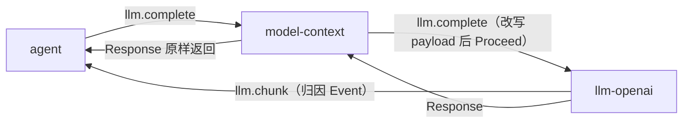

# llm-openai

> 状态：当前实现。按模型路由到不同端点已实现；Anthropic 风格端点、重试退避、提示缓存标记为目标契约。
> 涉及能力：`llm`
> 依赖：无。`requires` 与 `depends_on` 均为空数组。

本文的写法与章节顺序按 [00-conventions.md](00-conventions.md) 第 12 节。术语见 [CONTEXT.md](../../../CONTEXT.md)，约束见 [CONSTRAINT.md](../../../CONSTRAINT.md)。

插件自己的跨插件 JSON 规范在 [plugins/llm-openai/communication.md](../../../plugins/llm-openai/communication.md)。本文是设计稿，粒度更细，状态标注更严格。

## 1. 职责

**当前实现。**

插件把一次模型请求转发给 OpenAI 兼容端点。请求固定走 `POST {base_url}/chat/completions`。

职责五条。

1. 转发消息与工具定义，解析上游响应。
2. 管理流式增量，把 delta 聚合成最终结果。
3. 支持取消在途请求。
4. 管理模型目录与默认模型。
5. 管理端点地址与 API 密钥的读取、修改和持久化。

插件无状态。它不读会话，不记日志，不参与轮次编排。

## 2. 非职责

**当前实现。**

| 不做 | 说明 |
|---|---|
| 组装上下文 | 模型输入由组装插件决定，见 [04-model-context.md](04-model-context.md) |
| 执行工具 | 只回传工具调用，不执行、不校验参数 |
| 管理会话 | 不调用 `session`，不写任何事实 |
| 解释工具调用语义 | 只按 index 合并字节，不解析 `arguments` 的 JSON |
| 决定轮次与步骤 | 一次 `llm.complete` 对应一次模型请求 |

**目标契约。**

插件不负责把工具调用转成工具执行计划。这条边界由组装插件与编排插件维持。

## 3. Manifest

**当前实现。** 完整内容与 [plugins/llm-openai/plugin.json](../../../plugins/llm-openai/plugin.json) 一致。

```json
{
  "name": "llm-openai",
  "version": "0.1.0",
  "protocol": 1,
  "entry": "llm-openai",
  "provides": ["llm"],
  "requires": [],
  "depends_on": [],
  "autostart": true,
  "settings": {
    "get": { "capability": "llm", "method": "settings.get" },
    "save": { "capability": "llm", "method": "settings.save" },
    "schema": [
      {
        "key": "models",
        "label": "模型目录",
        "type": "list",
        "required": true,
        "description": "每行一个模型，各自绑定端点与密钥，可同时配置多个供应商。上下文窗口用于上下文用量和压缩预算；留空按 0 处理。API Key 显示为脱敏值：保持不变则不修改，留空表示清除。",
        "item_fields": [
          { "key": "id", "label": "模型 ID", "type": "string", "required": true },
          { "key": "label", "label": "显示名", "type": "string" },
          { "key": "context_window", "label": "上下文窗口", "type": "number", "min": 0 },
          {
            "key": "base_url",
            "label": "Base URL",
            "type": "string",
            "required": true,
            "description": "OpenAI-compatible 端点，例如 https://api.deepseek.com/v1。"
          },
          { "key": "api_key", "label": "API Key", "type": "secret" }
        ]
      },
      {
        "key": "default_model",
        "label": "默认模型",
        "type": "select",
        "required": true,
        "options_from": "models",
        "option_value": "id",
        "option_label": "label",
        "description": "新会话默认使用该模型；已有会话保持创建时的选择。会话记录的模型已从目录移除时，agent 回退到该默认模型。"
      }
    ]
  },
  "description": "Stateless OpenAI-compatible LLM completion with streaming",
  "commands": [
    { "name": "config", "description": "Show or set model config", "usage": "/llm-openai config [get|set k=v]" }
  ]
}
```

**字段说明。**

| 字段 | 当前含义 |
|---|---|
| `provides` | 声明 `llm` 能力。路由以运行时上报的 `(capability, method)` 为准 |
| `priority` | 字段缺省，即 0。插件在 `llm.complete` 链上是 Provider，不参与消费链排序 |
| `autostart` | true。作为启动根被拉起 |
| `requires` | 空数组。插件不依赖任何其他能力 |
| `depends_on` | 空数组。插件不需要等待其他插件先启动 |

**`settings` 段。** 这段声明 Host 的 Settings Renderer 怎么读写本插件。

`get` 与 `save` 各指向一个能力方法。读取走 `llm.settings.get`，保存走 `llm.settings.save`。

`schema` 的两个字段对应第 11 节的配置项。

| key | 控件 | 语义 |
|---|---|---|
| `models` | list | 模型目录。每行一个模型，含 ID、显示名、上下文窗口、Base URL、API Key。必填，至少一项 |
| `default_model` | select | 默认模型。选项来自 `models` 列表 |

目录行自带端点与密钥，所以不同供应商的模型可以并存。`api_key` 行是脱敏回显：
保持脱敏值不变则保留原密钥，清空则清除，填新值则覆盖。

**`commands` 段。** 声明一个命令面 `/llm-openai config [get|set k=v]`。

**当前实现。** 插件代码里没有注册任何命令处理入口。这条命令目前只有清单声明，没有可执行行为。

**目标契约。** 命令面由 Host 分发到插件的处理器。

**暂不实现。** 命令面不作为本轮交付项。

## 4. 方法与载荷

插件注册八个方法。

| 方法 | 用途 | 状态 |
|---|---|---|
| `llm.complete` | 发起一次模型请求 | 当前实现 |
| `llm.cancel` | 取消指定的在途请求 | 当前实现 |
| `llm.config.get` | 读取配置，密钥脱敏 | 当前实现 |
| `llm.config.set` | 修改配置 | 当前实现 |
| `llm.models.list` | 读取模型目录 | 当前实现 |
| `llm.models.set` | 整体替换模型目录 | 当前实现 |
| `llm.settings.get` | 供 Settings Renderer 读取 | 当前实现 |
| `llm.settings.save` | 供 Settings Renderer 保存 | 当前实现 |

### 4.1 llm.complete

**输入。**

```json
{
  "call_id": "t-1-s1",
  "messages": [
    { "role": "user", "content": "分析这个项目" }
  ],
  "tools": [
    {
      "type": "function",
      "function": {
        "name": "file_read",
        "description": "Read a file",
        "parameters": {
          "type": "object",
          "properties": { "path": { "type": "string" } }
        }
      }
    }
  ],
  "model": "deepseek-chat",
  "temperature": 0.2,
  "max_tokens": 4096,
  "stream": true
}
```

| 字段 | 必填 | 类型 | 说明 |
|---|---|---|---|
| `call_id` | 否 | string | 调用方给的业务标识。`llm.cancel` 按它定位 |
| `messages` | 是 | array | OpenAI 形状的消息数组。空数组返回 `bad_arguments` |
| `tools` | 否 | array | function 工具定义数组 |
| `model` | 否 | string | 本次使用的模型 ID。ID 决定路由到哪个端点。缺省时用默认模型，不在目录中时返回 `bad_arguments` |
| `temperature` | 否 | number | 采样温度。指针类型，能区分 0 与未填 |
| `max_tokens` | 否 | number | 最大生成 token。0 表示不下发该字段 |
| `stream` | 否 | boolean | 缺省为 true。指针类型，能区分 false 与未填 |

消息对象字段：`role`、`content`、`tool_calls`、`tool_call_id`。

**输出。**

```json
{
  "content": "最终正文",
  "reasoning": "最终推理",
  "tool_calls": [
    {
      "id": "call-1",
      "type": "function",
      "function": {
        "name": "file_read",
        "arguments": "{\"path\":\"README.md\"}"
      }
    }
  ],
  "finish_reason": "tool_calls",
  "usage": {
    "prompt_tokens": 100,
    "completion_tokens": 20,
    "total_tokens": 120
  },
  "model": "deepseek-chat",
  "context_window": 65536
}
```

| 字段 | 说明 |
|---|---|
| `content` | 最终正文。非流式取首个 choice 的 `message.content`，流式为 delta 累加 |
| `reasoning` | 上游 `reasoning_content`。流式为累加值 |
| `tool_calls` | 工具调用数组。流式按 index 归并后按 index 升序输出 |
| `finish_reason` | 结束原因。流式下上游未给时按有无工具调用兜底 |
| `usage` | token 用量。流式取末尾 usage 帧 |
| `model` | 本次实际使用的模型。调用方据此记录，不必猜配置默认值 |
| `context_window` | 模型目录里该模型的上下文窗口。不在目录中时为 0 |

**错误码。**

| 场景 | 错误码 |
|---|---|
| 载荷为空 | `bad_arguments` |
| 载荷 JSON 解析失败 | `bad_arguments` |
| `messages` 为空 | `bad_arguments` |
| `model` 不在目录中 | `bad_arguments` |
| 上游请求建连失败 | `llm_upstream` |
| 上游返回非 2xx | `llm_upstream` |
| 上游响应解析失败 | `llm_upstream` |
| 请求体序列化失败 | `handler_error` |

**当前实现细节。**

配置快照在调用开始时捕获。运行中的调用继续用旧快照，修改从下一次调用起生效。

模型解析是两级：请求里的 `model`，缺省时用 `default_model`。解析出的 ID 必须在目录里；
不在目录中返回 `bad_arguments`，不静默回退到别的供应商。目录、端点、密钥在同一次快照里读出。

上游请求打到所选模型条目的 `base_url` 下的 `/chat/completions`，每个条目各带自己的端点与密钥。
请求头固定带 `Content-Type: application/json`。条目密钥非空时加 `Authorization: Bearer`。流式额外加 `Accept: text/event-stream`。

流式请求不设总超时。非流式请求超时 5 分钟。

流式模式下上游请求带 `stream_options.include_usage`，用量取末尾帧。上游不给用量时 `usage` 全为 0。

### 4.2 llm.cancel

**输入。**

```json
{ "call_id": "t-1-s1" }
```

| 字段 | 必填 | 类型 | 说明 |
|---|---|---|---|
| `call_id` | 是 | string | 要取消的调用标识。空串返回 `cancelled: false` 且不记录 |

**输出。**

```json
{ "call_id": "t-1-s1", "cancelled": true }
```

| 字段 | 说明 |
|---|---|
| `call_id` | 回显请求里的标识 |
| `cancelled` | 此刻是否确实中止了一个在途请求 |

**错误码。** 载荷为空或 JSON 解析失败返回 `bad_arguments`。其余情况不报错。

**当前实现细节。** 取消语义见第 4.9 节。

### 4.3 llm.config.get

**输入。** 无需载荷。处理器不解析载荷。

**输出。**

```json
{
  "base_url": "https://api.deepseek.com/v1",
  "api_key": "api***key",
  "model": "deepseek-chat",
  "models": [
    {
      "id": "deepseek-chat",
      "label": "DeepSeek Chat",
      "context_window": 65536,
      "base_url": "https://api.deepseek.com/v1",
      "api_key": "api***key"
    }
  ],
  "default_model": "deepseek-chat"
}
```

| 字段 | 说明 |
|---|---|
| `base_url` | 旧字段。镜像默认模型条目的端点 |
| `api_key` | 旧字段。镜像默认模型条目的脱敏密钥。长度不超过 8 时全掩码，否则保留首尾各 3 位 |
| `model` | 与 `default_model` 同值。为兼容旧调用方保留 |
| `models` | 模型目录。每项含自己的 `base_url` 与脱敏后的 `api_key` |
| `default_model` | 默认模型 ID |

**错误码。** 无。

### 4.4 llm.config.set

**输入。** 所有字段可省略。

```json
{
  "base_url": "https://api.openai.com/v1",
  "api_key": "new-secret",
  "model": "gpt-test",
  "models": [
    {
      "id": "gpt-test",
      "label": "GPT Test",
      "context_window": 131072,
      "base_url": "https://api.openai.com/v1",
      "api_key": "new-secret"
    }
  ],
  "default_model": "gpt-test"
}
```

| 字段 | 必填 | 类型 | 说明 |
|---|---|---|---|
| `base_url` | 否 | string | 旧字段。`models` 存在时填给没有自己端点的条目；缺省时更新默认模型条目。写入前归一化 |
| `api_key` | 否 | string | 旧字段。语义同上，非空时生效 |
| `model` | 否 | string | 旧字段。当 `default_model` 缺省时用作候选 |
| `models` | 否 | array | 存在时整体替换目录。显式传空数组报错 |
| `default_model` | 否 | string | 缺省时取旧字段，再缺省时保留当前值 |

目录条目字段：`id`、`label`、`context_window`、`base_url`、`api_key`。条目级 `api_key` 是三态：
不传保留同 ID 条目的原密钥，空串清除，其它值覆盖；把读到的脱敏值原样传回等价于保留。

**输出。** 与 `llm.config.get` 相同。

**错误码。**

| 场景 | 错误码 |
|---|---|
| 载荷为空或 JSON 解析失败 | `bad_arguments` |
| `models` 为空数组、ID 为空、ID 重复、新 ID 缺 `base_url`、`context_window` 为负 | `handler_error` |
| 写 `config.json` 失败 | `handler_error` |

**当前实现细节。**

校验失败时不做任何修改：内存和文件都保持原样。方法返回 `handler_error`。

`default_model` 指向目录外的 ID 时，本方法补一条同名条目，沿用此前默认条目的端点与密钥，不报错。
这与 `llm.models.set` 不同，后者直接返回 `bad_arguments`。

### 4.5 llm.models.list

**输入。** 无需载荷。

**输出。**

```json
{
  "default_model": "deepseek-chat",
  "models": [
    { "id": "deepseek-chat", "label": "DeepSeek Chat", "context_window": 65536 }
  ]
}
```

| 字段 | 说明 |
|---|---|
| `default_model` | 默认模型 ID |
| `models` | 模型目录。每项含 `id`、`label`、`context_window` |

**错误码。** 无。

**当前实现细节。** 输出里没有 `base_url` 也没有 `api_key`：端点和密钥不出该方法。
这是 `session-history` 读取模型下拉用的方法。

### 4.6 llm.models.set

**输入。**

```json
{
  "models": [
    {
      "id": "deepseek-chat",
      "label": "DeepSeek Chat",
      "context_window": 65536,
      "base_url": "https://api.deepseek.com/v1",
      "api_key": "api***key"
    },
    {
      "id": "gpt-4o",
      "label": "GPT-4o",
      "context_window": 128000,
      "base_url": "https://api.openai.com/v1",
      "api_key": "sk-***oai"
    }
  ],
  "default_model": "deepseek-chat"
}
```

| 字段 | 必填 | 类型 | 说明 |
|---|---|---|---|
| `models` | 是 | array | 目录内容。必须非空，ID 必须唯一 |
| `models[].base_url` | 新 ID 必填 | string | 该模型的端点。已存在的 ID 缺省时沿用原端点 |
| `models[].api_key` | 否 | string | 三态：不传保留，空串清除，其它值覆盖 |
| `default_model` | 否 | string | 省略时取第一项 |

**输出。** 与 `llm.models.list` 相同。

**错误码。**

| 场景 | 错误码 |
|---|---|
| 载荷为空或 JSON 解析失败 | `bad_arguments` |
| `models` 为空数组 | `bad_arguments` |
| 模型 ID 为空或重复 | `bad_arguments` |
| 新 ID 缺 `base_url` | `bad_arguments` |
| `context_window` 为负 | `bad_arguments` |
| `default_model` 指向目录外 | `bad_arguments` |
| 写 `config.json` 失败 | `handler_error` |

**当前实现细节。** 目录与默认值都没变时直接返回，不重写 `config.json`。
目录条目里的密钥三态规则与 `llm.config.set` 相同，脱敏值永不落盘。

### 4.7 llm.settings.get

**输入。** 无需载荷。

**输出。**

```json
{
  "values": {
    "models": [
      {
        "id": "deepseek-chat",
        "label": "DeepSeek Chat",
        "context_window": 65536,
        "base_url": "https://api.deepseek.com/v1",
        "api_key": "api***key"
      }
    ],
    "default_model": "deepseek-chat"
  }
}
```

| 字段 | 说明 |
|---|---|
| `values.models` | 模型目录。每行含自己的 `base_url` 与脱敏后的 `api_key` |
| `values.models[].api_key` | 脱敏值。永不回显明文，同时充当“保持不变”的占位符 |
| `values.default_model` | 默认模型 ID |

**错误码。** 无。

### 4.8 llm.settings.save

**输入。**

```json
{
  "values": {
    "models": [
      {
        "id": "deepseek-chat",
        "label": "DeepSeek Chat",
        "context_window": 65536,
        "base_url": "https://api.deepseek.com/v1",
        "api_key": "api***key"
      }
    ],
    "default_model": "deepseek-chat"
  }
}
```

| 字段 | 必填 | 类型 | 说明 |
|---|---|---|---|
| `values.models` | 是 | array | 目录内容。必须非空，ID 必须唯一 |
| `values.models[].base_url` | 新 ID 必填 | string | 该模型的端点。已存在的 ID 缺省时沿用原端点 |
| `values.models[].api_key` | 否 | string | 三态：不传保留，空串清除，其它值覆盖，脱敏值等价于保留 |
| `values.default_model` | 否 | string | 省略时取第一项 |

**输出。**

```json
{ "saved": true }
```

**错误码。**

| 场景 | 错误码 |
|---|---|
| 载荷为空或 JSON 解析失败 | `bad_arguments` |
| `models` 为空数组、ID 为空或重复、新 ID 缺 `base_url`、`context_window` 为负 | `bad_arguments` |
| `default_model` 指向目录外 | `bad_arguments` |
| 写 `config.json` 失败 | `handler_error` |

**当前实现细节。** 保存成功后由 Host 派发 `liteagent:settings-saved`。`session-history` 据此重新读 `llm.models.list`，刷新新会话的模型下拉。
改模型 ID 视为新条目，但脱敏回显仍能匹配回原密钥，改名不丢密钥。

### 4.9 取消语义

**当前实现。**

取消分两层。插件自己维护一张在途表和一张取消缓冲表。

**一，先登记再发请求。** `llm.complete` 先建立可取消的上下文，把取消函数登记进在途表，然后才发起上游请求。登记时先查取消缓冲表。命中就立即取消自己，不进在途表。

**二，取消分两种结果。**

| 情形 | `cancelled` | 副作用 |
|---|---|---|
| 该 id 在途 | true | 执行取消，移出在途表 |
| 该 id 不在途 | false | 记进取消缓冲表 |

**`cancelled: false` 的含义。** 此刻没有在途请求被中止。它不表示取消被丢弃。取消被记进缓冲表，之后注册的同名调用会立刻中止。

缓冲表上限 256 条。超出时按先进先出淘汰。调用正常结束时，该 id 从在途表和缓冲表同时清除。

取消通过取消插件侧的上下文实现。上游 HTTP 请求随之中断，请求失败按 `llm_upstream` 返回。

## 5. 接缝与调用关系

**当前实现。**

插件在 `llm.complete` 接缝上是 Provider，位置在链尾。



| 接缝 | 位置 | 语义 |
|---|---|---|
| `llm.complete` | 链尾 Provider | 组装后的模型输入到达本插件 |

**当前实现细节。**

插件不调用 `session`，也不调用任何其他能力。它只发往上游 HTTP 端点。

`llm.chunk` 是带归因的 Event，携带发起请求的帧 id。Event 只用于实时增量，最终结果仍在 Response 里。

带归因的 Event 沿请求路径逆序回流。链上有多个参与者时，中间环节转发同一个帧 id。

平台协议细节见 [protocol.md](../../platform/protocol.md)。本文不复述帧格式与路由表。

## 6. 工具契约

无。插件不上架工具，也不消费工具能力。

插件把上游的工具调用原样回传给调用方。工具描述由工具提供方贡献，规则见 [prompts/03-tool-prompts.md](../../prompts/03-tool-prompts.md)。

## 7. Prompt 贡献

无。插件不贡献 prompt 文本，也不读取任何上下文配置。

插件收到什么就转发什么。上下文组装的唯一入口是组装插件，规则见 [00-conventions.md](00-conventions.md) 第 9 节。

## 8. 记录与持久化

**当前实现。**

插件只写自己的配置文件，不写会话事实。

| 项 | 说明 |
|---|---|
| 文件 | 插件目录下的 `config.json` |
| 权限 | `0644` |
| 内容 | 端点、密钥、模型目录、默认模型 |
| 密钥 | 明文写入 |
| 版本控制 | 已被 `.gitignore` 的 `plugins/**/config.json` 排除 |

请自行保护插件目录和文件权限。

**当前实现细节。**

写盘失败时返回 `handler_error`。此时内存里的新值已经生效，但没有持久化。文件与内存会短暂不一致，直到进程重启。

配置修改立即生效。运行中的调用继续用开始时捕获的快照。

## 9. WebUI

**当前实现。**

插件没有顶层组件。清单里没有 `ui` 段。

插件只提供 Settings。Host 的 Settings Renderer 按第 3 节的 schema 渲染。

**可选协作者。** `session-history` 读 `llm.models.list`，用于新会话的模型下拉。

能力不可用时，`session-history` 隐藏选择器。会话仍按本插件的默认模型运行。

插件不发 `setData`，也不发 `runCommand`。

## 10. 错误码

**当前实现。**

| 错误码 | 类别 | 触发场景 |
|---|---|---|
| `bad_arguments` | 平台级 | 载荷为空、JSON 解析失败、`messages` 为空、模型不在目录中、参数校验失败 |
| `handler_error` | 平台级 | 请求体序列化失败、写配置文件失败、`llm.config.set` 目录校验失败 |
| `llm_upstream` | 插件级 | 建连失败、非 2xx、响应解析失败 |

**当前实现细节。**

`llm.cancel` 不返回错误。取消未命中在途表时返回 `cancelled: false`。

Event 发送失败不影响最终 Response。插件忽略发送错误。

`llm_upstream` 属于插件级码。前缀登记见 [00-conventions.md](00-conventions.md) 第 6 节。
agent 另有三个 `llm_` 开头的码，前缀重叠的情况见同一节的待定说明。

## 11. 配置

**当前实现。**

配置文件在插件目录下的 `config.json`。

```json
{
  "models": [
    {
      "id": "deepseek-chat",
      "label": "DeepSeek Chat",
      "context_window": 65536,
      "base_url": "https://api.deepseek.com/v1",
      "api_key": ""
    },
    {
      "id": "gpt-4o",
      "label": "GPT-4o",
      "context_window": 128000,
      "base_url": "https://api.openai.com/v1",
      "api_key": ""
    }
  ],
  "default_model": "deepseek-chat"
}
```

| 字段 | 类型 | 说明 |
|---|---|---|
| `models` | array | 模型目录。缺省一条 `deepseek-chat`，端点为内置默认 |
| `models[].id` | string | 模型 ID。路由键 |
| `models[].label` | string | 显示名。缺省用 ID |
| `models[].context_window` | number | 上下文窗口。0 表示未知 |
| `models[].base_url` | string | 该模型的 OpenAI-compatible 端点。缺省 `https://api.deepseek.com/v1` |
| `models[].api_key` | string | 该模型的密钥。缺省空 |
| `default_model` | string | 默认模型 ID |
| `base_url` / `api_key` / `model` | string | 旧字段。只读：启动时迁移进条目，`llm.config.get` 时镜像默认条目，不再写盘 |

**启动优先级。**

```text
环境变量 → config.json → 内置默认值
```

| 环境变量 | 作用 |
|---|---|
| `OPENAI_MODEL` | 指定默认模型。目录里没有这个 ID 时追加一条 |
| `OPENAI_BASE_URL` | 覆盖默认模型条目的 `base_url` |
| `OPENAI_API_KEY` | 覆盖默认模型条目的 `api_key` |

环境变量在配置文件之后覆盖。一组环境变量只描述一个端点，所以只作用于默认模型那一条；
其余条目仍按各自端点路由。要配多个供应商，用 `config.json` 或设置页。

**迁移。** 旧的单端点配置（顶层 `base_url` + `api_key` + 不带端点的 `models`）启动时自动迁移：
顶层端点和密钥填进没有自己端点的条目。旧字段只有 `model` 时迁移成单模型目录。
下一次写盘就落成新形状，顶层旧字段不再出现。

**归一化规则。**

每条的 `base_url` 在三条输入路径上都做同样处理：去首尾空白，去末尾斜杠。这样不会拼出 `…/v1//chat/completions`。

**模型目录。**

目录是路由表：模型 ID 决定请求打到哪个端点、用哪个密钥。不同供应商的模型并存于同一个目录，
同一供应商的多个模型重复填写端点即可。

`context_window` 为 0 表示未知。上下文用量和压缩预算拿不到模型窗口时，只能靠组装插件的配置上限兜底。

启动时的归一化是宽容的。ID 为空或重复的条目被丢弃，`label` 为空时用 ID 补齐，`context_window` 为负时按 0 处理。
三个修改方法（`llm.models.set`、`llm.settings.save`、`llm.config.set`）则按第 4 节的错误表拒绝坏条目。

**密钥三态。**

条目级 `api_key` 在三个修改方法里是三态字段：不传保留同 ID 条目的原密钥，空串清除，其它值覆盖。
把读到的脱敏值原样传回等价于保留，脱敏值永不落盘；改模型 ID 时脱敏回显仍能匹配回原密钥。

**默认模型。**

| 方法 | `default_model` 指向目录外 |
|---|---|
| `llm.models.set` | 返回 `bad_arguments` |
| `llm.settings.save` | 返回 `bad_arguments` |
| `llm.config.set` | 补一条同名条目，沿用此前默认条目的端点与密钥 |

**目标契约。** 端点已经支持多端点与按模型路由到不同端点。Anthropic 风格端点的协议适配属于多 provider 适配的剩余部分，见第 14.2 节。

## 12. 测试要求

**当前实现。**

按 [00-conventions.md](00-conventions.md) 第 13 节展开，再补插件特有的项。

| 项 | 用例要点 |
|---|---|
| 载荷解码 | 空载荷、坏 JSON、`messages` 为空 |
| 成功响应 | 非流式与流式两条路径的响应形状 |
| 稳定错误码 | 每个错误码都有对应用例 |
| 配置持久化 | 写入、脱敏、失败路径 |
| 事件载荷 | 三种 channel 的字段与顺序 |
| 纯函数 | 归一化、脱敏、模型校验、密钥三态解析 |
| 取消路径 | 在途命中、不在途、取消先于注册 |
| 降级路径 | 无。本插件没有弱依赖 |

插件特有项。

| 项 | 用例要点 |
|---|---|
| 快照捕获 | 改配置不影响在途调用 |
| 取消缓冲 | 超过 256 条后先进先出淘汰 |
| 取消竞态 | 取消先到，随后注册的同名调用立即中止 |
| 工具调用合并 | 按 index 合并，参数按顺序追加 |
| 密钥脱敏 | 短密钥全掩码，长密钥保留首尾各 3 位 |
| 密钥三态 | 不传保留、空串清除、脱敏值回显保留，改 ID 不丢密钥 |
| 目录校验 | 空目录、重复 ID、缺端点、负窗口 |
| 多供应商路由 | 模型 ID 命中哪个条目就打到哪个端点、带哪个密钥 |
| 默认模型 | 三个方法三种不同表现 |
| 端点归一化 | 文件、环境变量、设置页三条路径 |

## 13. 验收标准

| 项 | 检查方式 |
|---|---|
| 能力名已登记 | `llm` 在 [00-conventions.md](00-conventions.md) 第 3 节的能力表里 |
| 错误码全局唯一 | `llm_upstream` 不与平台级码冲突 |
| 不直连其他插件 | 插件不调用任何其他能力 |
| 不用插件名寻址 | 文档里没有按插件名调用的描述 |
| 状态标注清楚 | 每节区分当前实现、目标契约、未实现 |
| 方法载荷完整 | 八个方法各有输入、输出、错误 |
| 图与代码一致 | 图中的模块名与插件目录一致 |
| 链接有效 | 链接指向存在的文件 |

插件行为验收。

| 项 | 检查方式 |
|---|---|
| 上游地址正确 | 请求打到所选模型条目的 `{base_url}/chat/completions`，无双斜杠 |
| 流式能聚合 | 累计结果与 Response 一致 |
| 取消能落地 | 在途请求被中止，返回 `cancelled: true` |
| 密钥不回显 | `llm.settings.get` 只给脱敏值 |
| 配置可持久化 | 重启后端点、密钥、目录都还在 |

## 14. 未实现

### 14.1 暂不实现

本轮明确排除以下项。

| 项 | 当前状况 |
|---|---|
| 多模态 | 消息的 `content` 是纯字符串，没有图片、音频或文件块 |
| 工具并行调用控制 | 插件只按 index 合并上游给的并行调用，不控制并发度 |
| 思维链回传格式 | 插件原样透传上游的 `reasoning_content`，不定义结构化格式 |

思维链的对外格式、是否分段、是否可折叠，都由组装插件与编排插件决定。

### 14.2 目标契约

**目标契约。** 三项都还没实现。

| 项 | 内容 | 落点 |
|---|---|---|
| 多 provider 适配 | 支持 Anthropic 风格端点。按模型路由到不同端点已实现，剩下的差异在请求形状、鉴权头、事件格式 | `llm.complete` 的上游分支 |
| 重试与退避 | 建连失败与 5xx 按次数上限重试，间隔递增。当前一次失败即返回 `llm_upstream` | `llm.complete` 的上游分支 |
| 提示缓存的显式标记 | 在请求里标出可缓存前缀的边界。当前没有这个字段 | `llm.complete` 的请求体 |

**暂不实现。** 本轮不写这三项的代码。

## 15. 结构体索引

下表只作实现参考，不是平台契约。插件之间的契约只有 JSON 字段名。

| Go 类型 | 角色 |
|---|---|
| `plugin` | 插件实例。持有配置、在途表、取消缓冲表 |
| `config` | 磁盘与运行配置。顶层 `base_url`/`api_key`/`model` 是只读旧字段 |
| `modelConfig` | 模型目录条目：模型 + 自己的端点与密钥 |
| `modelEntryIn` | 目录条目输入。`api_key` 是三态指针 |
| `modelSummary` | `llm.models.list` 的摘要项，不含端点与密钥 |
| `completeIn` / `completeOut` | `llm.complete` 载荷 |
| `chatMessage` | 模型消息 |
| `tool` / `toolFunction` | 工具描述 |
| `toolCall` / `functionCall` | 工具调用 |
| `usage` | token 用量 |
| `chunkText` | `content` 与 `reasoning` 的 delta |
| `chunkToolCall` | `tool_call` 的 delta |
| `llmCancelIn` / `llmCancelOut` | `llm.cancel` 载荷 |
| `configGetOut` / `configSetIn` | 配置方法载荷 |
| `modelsListOut` / `modelsSetIn` | 模型目录方法载荷 |
| `settingsGetOut` / `settingsSaveIn` / `settingsSaveOut` | 设置方法载荷 |
| `upstreamRequest` / `upstreamResponse` / `upstreamDelta` | 上游请求与响应形状 |
