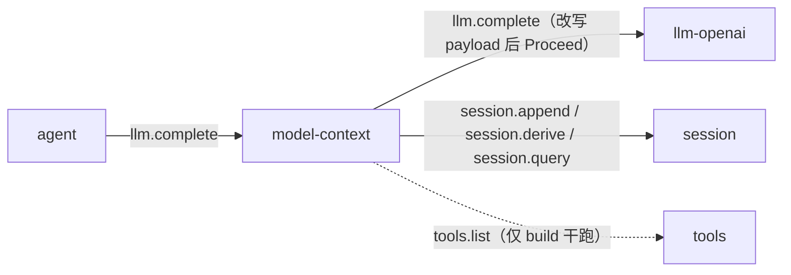
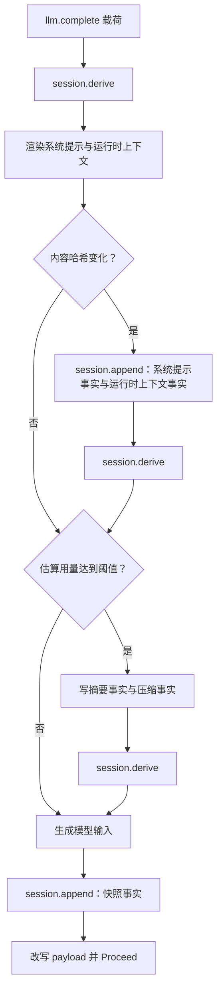

# model-context

> 状态：当前实现。显式轨道字段、模型摘要路径为目标契约。
> 涉及能力：`model-context`。消费 `llm.complete`。
> 依赖：弱依赖 `session` 与 `tools`。

本文的写法与章节顺序按 [00-conventions.md](00-conventions.md) 第 12 节。术语见 [CONTEXT.md](../../../CONTEXT.md)，约束见 [CONSTRAINT.md](../../../CONSTRAINT.md)。

插件自己的跨插件 JSON 规范在 [plugins/model-context/communication.md](../../../plugins/model-context/communication.md)。本文是设计稿，粒度更细，状态标注更严格。

## 1. 职责

**当前实现。**

插件在 `llm.complete` 链上组装模型输入。它消费 `llm.complete`，改写内容区，再把请求放行。

职责五条。

1. 把渲染后的系统提示写成会话事实。
2. 把运行时上下文写成追加式会话事实。
3. 从会话投影出实际发给模型的消息。
4. 计算用量预算，超预算时压缩。
5. 提供干跑、还原与手工压缩三个方法。

**核心不变式。** 模型可见的内容都能从会话记录重建。插件写事实，再从事实派生消息。

## 2. 非职责

**当前实现。**

| 不做 | 说明 |
|---|---|
| 执行工具 | 只转发工具定义，不调用任何工具 |
| 高危裁决 | 不判断工具是否危险，不做权限检查 |
| 决定轮次与步骤 | 不编排轮次，不决定步骤策略 |
| 存储记忆与技能 | 不做跨会话记忆，不做技能索引 |
| 改写会话日志 | 压缩靠遮蔽区间生效，不删改已有事实 |

插件只写自己的配置，不写其他插件的数据。

## 3. Manifest

**当前实现。** 完整内容与 [plugins/model-context/plugin.json](../../../plugins/model-context/plugin.json) 一致。

```json
{
  "name": "model-context",
  "version": "0.2.0",
  "protocol": 1,
  "entry": "model-context",
  "autostart": true,
  "priority": 2000,
  "provides": ["model-context"],
  "consumes": [
    { "capability": "llm", "method": "complete" }
  ],
  "requires": ["session", "tools"],
  "description": "Transparent context assembly: system/runtime facts, compact snapshots, deterministic compaction"
}
```

**字段说明。**

| 字段 | 当前含义 |
|---|---|
| `provides` | 声明 `model-context` 能力 |
| `consumes` | 声明参与 `llm.complete` 这条链。这是成员资格声明 |
| `priority` | 2000。插件级单值，决定在链内的位置 |
| `requires` | 弱依赖 `session` 与 `tools` |
| `depends_on` | 字段缺省。插件不要求任何插件先启动 |
| `autostart` | true。作为启动根被拉起 |

**`priority: 2000` 的含义。**

消费链按 `priority` 降序逐跳传播。2000 高于链上其他参与者，插件因此坐在 `llm.complete` 的链首。

| 参与者 | `priority` | `llm.complete` 上的位置 |
|---|---:|---|
| model-context | 2000 | 链首。先组装 |
| session | 1000 | 中间。记录事实并派生视图。session 声明 `consumes` 后才在链上 |
| llm-openai | 0 | 链尾。Provider，拿到最终请求 |

`consumes[]` 条目目前不带独立 priority，链内位置一律取插件顶层值。同一插件在不同链上需要不同位置时，用 `consumes[]` 条目内的 `priority` 覆盖顶层值。这个字段是提议状态，尚未落地，见 [00-conventions.md](00-conventions.md) 第 5 节。

**`consumes` 的含义。**

`consumes` 声明参与哪条链。声明了就必须注册同名处理器，插件确实注册了 `llm.complete`。

消费者与 Provider 用同一个能力名。消费者改写载荷后放行，Provider 直接返回结果。

**`requires` 弱依赖的降级行为。**

| 依赖 | 缺失时 | 后果 |
|---|---|---|
| `session` | 插件仍能启动 | `llm.complete` 路径失败，不调用模型 |
| `tools` | 插件仍能启动 | `build` 干跑返回空工具集并附告警 |

`session` 缺失时，`session.derive` 与 `session.append` 都不可用，组装无法完成。插件让请求失败，不降级成裸请求。

`tools` 缺失只影响干跑。`llm.complete` 路径的工具集来自载荷，不查工具能力。

**暂不实现。** `depends_on` 保持缺省。插件不硬依赖任何插件名。

## 4. 方法与载荷

插件注册三个方法，另有一个被消费的方法。

| 方法 | 用途 | 状态 |
|---|---|---|
| `model-context.build` | 干跑组装，不写事实 | 当前实现 |
| `model-context.inspect` | 按快照还原消息 | 当前实现 |
| `model-context.compact` | 手工压缩 | 当前实现 |
| `llm.complete` | 消费，改写内容区后放行 | 当前实现 |

三个方法的载荷都是严格解码。出现未知字段、多余的 JSON 值、空载荷都返回 `bad_arguments`。

### 4.1 model-context.build

干跑一次组装。它不写事实，不调用模型，也不压缩。

**输入。**

```json
{
  "session_id": "s-1",
  "turn_id": "t-1",
  "step_id": "t-1-s1",
  "mode": "coding",
  "scheme": "tool_calling",
  "workspace": "E:/project",
  "workspace_id": "ws-1",
  "model": "deepseek-chat",
  "context_window": 65536,
  "tools": [],
  "max_context_tokens": 0
}
```

| 字段 | 必填 | 类型 | 说明 |
|---|---|---|---|
| `session_id` | 是 | string | 要投影的会话。缺省返回 `bad_arguments` |
| `turn_id` | 否 | string | 只写进干跑上下文，不落库 |
| `step_id` | 否 | string | 同上 |
| `mode` | 否 | string | 写入运行时上下文 |
| `scheme` | 否 | string | 写入运行时上下文 |
| `workspace` | 否 | string | 工作区绝对路径。用于读 AGENTS.md 与插值 |
| `workspace_id` | 否 | string | 插值变量 |
| `model` | 否 | string | 只用于计算预算 |
| `context_window` | 否 | number | 模型窗口。为 0 表示未知 |
| `tools` | 否 | array | 工具定义。省略时调 `tools.list` |
| `max_context_tokens` | 否 | number | 大于 0 时覆盖配置上限 |

**输出。**

```json
{
  "model_context_id": "mc-preview-1760000000000000000-1",
  "messages": [],
  "tools": [],
  "token_estimate": 1234,
  "compact_needed": false,
  "warnings": [],
  "system_prompt_hash": "…",
  "runtime_context_hash": "…"
}
```

| 字段 | 说明 |
|---|---|
| `model_context_id` | 干跑标识，前缀是 `mc-preview-`。它不是落库快照的标识 |
| `messages` | 干跑拼出的消息数组 |
| `tools` | 本次用的工具定义 |
| `token_estimate` | 消息与工具的固定估算 |
| `compact_needed` | 估算达到阈值为 true。插件不会真的压缩 |
| `warnings` | 降级与截断说明 |
| `system_prompt_hash` | 系统提示内容哈希 |
| `runtime_context_hash` | 运行时上下文内容哈希 |

**错误码。**

| 场景 | 错误码 |
|---|---|
| 载荷为空、JSON 解析失败、出现未知字段 | `bad_arguments` |
| `session_id` 为空 | `bad_arguments` |
| 提示渲染失败 | `bad_arguments` |
| `session.derive` 失败 | 透传 Session 错误，或 `context_derive_failed` |

**当前实现细节。**

`tools` 省略时调 `tools.list`。调用失败或返回体解析失败时，工具集为空，告警是 `tools_unavailable`。显式传空数组时不调 `tools.list`。

`tools.list` 的结果会转成 function 定义，描述末尾追加一行 `Risk: N.`，风险值来自工具注册。

`max_context_tokens` 大于 0 时覆盖配置上限，但不会超过 `context_window`。两个都为 0 时不设上限。

干跑的消息由当前渲染结果覆盖到投影视图上得到。真实请求用的是会话里已记录的事实。两者在哈希未变时一致。

### 4.2 model-context.inspect

按快照还原一次请求的实际消息。

**输入。** 两个标识二选一。

```json
{ "model_context_id": "mc-1760000000000000000-7" }
```

```json
{ "session_id": "s-1" }
```

| 字段 | 必填 | 类型 | 说明 |
|---|---|---|---|
| `model_context_id` | 二选一 | string | 读进程内存里的快照 |
| `session_id` | 二选一 | string | 读会话里最新的快照事实 |

两个都缺返回 `bad_arguments`。

**输出。**

```json
{
  "found": true,
  "snapshot": {
    "model_context_id": "mc-1760000000000000000-7",
    "session_id": "s-1",
    "surface": [3, 20, 4, 21],
    "messages_hash": "…",
    "truncated_seqs": [21],
    "tools": [],
    "token_estimate": 1234,
    "warnings": []
  },
  "messages": [
    {
      "seq": 3,
      "role": "system",
      "content": "You are an AI agent…",
      "source": "system_prompt",
      "token_estimate": 1200
    },
    {
      "seq": 21,
      "role": "tool",
      "content": "[tool result omitted; 120 bytes; see seq=21]",
      "truncated": true,
      "source": "session",
      "token_estimate": 12
    }
  ],
  "breakdown": {
    "system_prompt_tokens": 1200,
    "runtime_context_tokens": 80,
    "summary_tokens": 0,
    "session_tokens": 400,
    "tools_tokens": 900
  },
  "integrity": "ok",
  "warnings": []
}
```

| 字段 | 说明 |
|---|---|
| `found` | 是否找到快照。按 `session_id` 查不到时为 false，不报错 |
| `snapshot` | 快照全文 |
| `messages` | 还原出的消息，按 `surface` 顺序 |
| `messages[].source` | 内容来源。取值有 `system_prompt`、`runtime_context`、`summary`、`session` |
| `messages[].truncated` | 该消息是否是被遮蔽的工具结果 |
| `messages[].token_estimate` | 单条消息的本地估算 |
| `breakdown` | 各来源的 token 估算 |
| `integrity` | 还原校验结果。取值有 `ok`、`mismatch` |
| `warnings` | 校验说明 |

**错误码。**

| 场景 | 错误码 |
|---|---|
| 两个标识都缺 | `bad_arguments` |
| `model_context_id` 不在内存里 | `model_context_not_found` |
| `session.query` 失败 | `context_derive_failed` |

**当前实现细节。**

按 `model_context_id` 查询只覆盖当前进程。内存快照上限由 `snapshot_memory_limit` 控制，超出后先进先出淘汰。进程重启后按 ID 查不到。

按 `session_id` 查询读持久事实，不要求快照还在内存。查不到快照时返回 `found: false` 与空消息数组。

日志读取失败时仍返回快照，并附告警 `reconstruction_unavailable`。还原规则见第 8.3 节。

### 4.3 model-context.compact

手工压缩一段旧消息，写入确定性摘要。

**输入。**

```json
{
  "session_id": "s-1",
  "keep_recent_tokens": 12000,
  "max_summary_chars": 12000
}
```

| 字段 | 必填 | 类型 | 说明 |
|---|---|---|---|
| `session_id` | 是 | string | 要压缩的会话 |
| `keep_recent_tokens` | 否 | number | 大于 0 时覆盖配置 |
| `max_summary_chars` | 否 | number | 大于 0 时覆盖配置 |

**输出。**

```json
{
  "session_id": "s-1",
  "compacted": true,
  "source_from_seq": 7,
  "source_to_seq": 42,
  "summary_seq": 43,
  "messages_covered": 18,
  "token_before": 80000,
  "token_after": 50000
}
```

| 字段 | 说明 |
|---|---|
| `compacted` | 是否真的压缩了。没有可压缩的旧分段时为 false |
| `source_from_seq` | 被摘要覆盖的第一条事实的序号 |
| `source_to_seq` | 被摘要覆盖的最后一条事实的序号 |
| `summary_seq` | 新写入的摘要事实序号 |
| `messages_covered` | 被覆盖的消息条数 |
| `token_before` | 压缩前的估算用量 |
| `token_after` | 压缩后的估算用量 |

**错误码。**

| 场景 | 错误码 |
|---|---|
| 载荷为空、JSON 解析失败、出现未知字段 | `bad_arguments` |
| `session_id` 为空 | `bad_arguments` |
| `session.derive` 失败 | 透传 Session 错误，或 `context_derive_failed` |
| `session.query` 失败 | `context_derive_failed` |
| 写事实失败 | `context_record_failed` |

**当前实现细节。** 手工压缩的原因记为 `manual`。预算触发的压缩原因记为 `budget`。

目标区间已经被现有摘要覆盖时，不重复压缩，返回 `compacted: false`。

## 5. 接缝与调用关系

**当前实现。**

插件在 `llm.complete` 接缝上是链首，在 `llm.complete` 之外只调用 `session` 与 `tools`。



| 接缝 | 位置 | 语义 |
|---|---|---|
| `llm.complete` | 链首消费者 | 组装在最前，下游看到真实模型输入 |
| `session.append` | 写事实 | 系统提示、运行时上下文、快照、摘要、压缩 |
| `session.derive` | 读投影 | 派生实际模型输入 |
| `session.query` | 读事实 | 干跑取消息，还原快照 |
| `tools.list` | 读工具 | 只在 `build` 干跑时调用 |

插件不写别的插件的数据，不持有别的插件的进程句柄。

### 5.1 被消费的 llm.complete

**当前实现。**

输入是编排插件给的基线载荷。

```json
{
  "call_id": "t-1-s1",
  "messages": [{ "role": "user", "content": "分析这个项目" }],
  "tools": [],
  "stream": true,
  "meta": {
    "session_id": "s-1",
    "turn_id": "t-1",
    "step_id": "t-1-s1",
    "mode": "coding",
    "scheme": "tool_calling",
    "workspace_id": "ws-1",
    "workspace": "E:/project",
    "model": "deepseek-chat",
    "context_window": 65536
  }
}
```

| 字段 | 必填 | 说明 |
|---|---|---|
| `meta.session_id` | 是 | 缺失返回 `bad_arguments`，不调用模型 |
| `meta.turn_id` / `meta.step_id` | 否 | 写进快照 |
| `meta.mode` / `meta.scheme` | 否 | 写进运行时上下文 |
| `meta.workspace` | 否 | 绝对路径。缺失时跳过 AGENTS.md 并记告警 |
| `meta.workspace_id` | 否 | 插值变量 |
| `meta.model` | 否 | 写进快照 |
| `meta.context_window` | 否 | 写进快照。用于约束压缩预算 |
| `messages` | 否 | 基线内容区。插件整体替换 |
| `tools` | 否 | 基线工具集。插件整体替换 |
| 其他字段 | 否 | 原样保留并向下游传递 |

**输出。** 插件改写 `messages` 与 `tools`，保留其余字段，然后放行。响应原样返回。

载荷不是对象、`meta` 缺失、`meta` 解析失败、`meta.session_id` 为空、`tools` 不是数组，都返回 `bad_arguments`。

### 5.2 组装流程

**当前实现。** 插件先记录，再派生。



**为什么是这个顺序。**

先记录再派生有两个直接好处。

**一，模型输入与日志投影一致。** 发给模型的消息就是从会话事实投影出来的。日志里记的东西和模型看到的东西是同一份。

**二，配置与资源变化不改写旧历史。** 内容哈希变了就追加一条新事实，旧事实留在日志里。投影规则决定哪一条生效。

反过来做，先派生再记录，就要在每次请求后回改历史。会话日志会随配置抖动。

**当前实现细节。**

事实写入失败时不调用模型。方法返回 `context_record_failed`。

没有事实追加时不做第二次投影。投影结果没变。

摘要与压缩事实写在同一个 `session.append` 批次里。快照事实写在放行之前。

压缩最多跑 3 轮。每一轮压缩后重新投影，再估算用量。

## 6. 工具契约

无。插件不上架工具。

插件读 `tools.list` 的结果，转成 function 定义随请求下发。它不注册工具，也不分发工具调用。

## 7. Prompt 贡献

插件是唯一的组装入口。其他插件贡献内容，插件负责渲染与拼装。

本文档的轨道模型以 [prompts/02-system-prompt.md](../../prompts/02-system-prompt.md) 第 2 节与第 3 节为准。

### 7.1 两条轨道

**当前实现。** 分节词表见 [prompts/02-system-prompt.md](../../prompts/02-system-prompt.md) 第 2 节。

| 轨 | 节名 | 性质 |
|---|---|---|
| 静态轨 | `identity`、`persona`、`system_semantics`、`task_policy`、`tool_discipline`、`communication`、`output_format`、`safety` | 身份、纪律、语气、格式 |
| 动态轨 | `environment`、`workspace_rules`、`skills`、`memory` | 工作区、用户指令文件、技能、记忆 |

静态轨与动态轨之间是缓存边界。静态轨字节稳定，服务端的提示缓存才能命中。

### 7.2 当前实现的隐含边界

**当前实现。** 插件只产出两条消息。

| 消息 | 角色 | 来源 |
|---|---|---|
| 系统提示 | system | `prompt_sections` 渲染结果 |
| 运行时上下文 | user | 模式、方案、AGENTS.md 渲染结果 |

边界因此隐含在角色里。系统消息属静态轨，用户消息属动态轨。

**当前实现的缺口。**

节归属没有被校验。`prompt_sections` 里可以放 `{{workspace}}` 这类动态变量，渲染照样通过。

内置默认配置的节归属与标准词表不一致。

| 节 | order | 按 `order < 0` 推断的轨道 |
|---|---:|---|
| `identity` | -1000 | 静态轨 |
| `persona` | 0 | 动态轨 |
| `policy` | 500 | 动态轨 |

也就是说，当前实现里只有一条节落在静态轨。标准词表的八条静态节没有落地。

当前支持的变量只有四个。`{{date}}`、`{{platform}}`、`{{product}}`、`{{model_family}}` 都未支持。

### 7.3 目标契约：显式轨道

**目标契约。** 把轨道归属从隐含约定升级为配置字段。

| 改动 | 说明 |
|---|---|
| 配置增加 `track` 字段 | 取 `static` 或 `dynamic` |
| 缺省推断 | `order < 0` 判静态轨，否则判动态轨 |
| 静态性守卫 | 静态轨出现动态变量时渲染失败 |
| 渲染按轨道拆分 | 静态轨进系统提示，动态轨进运行时上下文 |
| 分节词表落地 | 十二个标准节名 |

错误码与当前实现不同。

| 场景 | 当前实现 | 目标契约 |
|---|---|---|
| 未知变量 | `bad_arguments` | `prompt_variable_unknown` |
| 静态轨出现动态变量 | 不报错 | `prompt_variable_not_allowed` |
| 节名重复 | `bad_arguments` | `prompt_section_duplicate` |
| 静态轨为空 | `bad_arguments` | 渲染失败 |

两条消息各自独立计算内容哈希。静态轨整条渲染为一条 system 消息。动态轨整条渲染为一条 user 消息，位置在摘要之后。

**暂不实现。** 本轮不改配置结构。当前实现不判轨道，所有 `prompt_sections` 都渲染进同一条系统提示消息。

## 8. 记录与持久化

**当前实现。**

插件只写会话事实，不写自己的文件。配置文件见第 11 节。

### 8.1 事实模型

插件写五类事实。

**系统提示事实。** 类型 `message`，角色 `system`。

```json
{
  "type": "message",
  "role": "system",
  "content": "You are an AI agent powered by LiteAgent…",
  "meta": {
    "plugin": "model-context",
    "source": "model-context",
    "kind": "system_prompt",
    "hash": "64 位小写 SHA-256",
    "sections": [
      { "name": "identity", "order": -1000, "hash": "…" },
      { "name": "persona", "order": 0, "hash": "…" }
    ]
  }
}
```

| meta 字段 | 说明 |
|---|---|
| `plugin` | 恒为 `model-context` |
| `source` | 恒为 `model-context` |
| `kind` | 恒为 `system_prompt` |
| `hash` | 整条系统提示的内容哈希 |
| `sections` | 每节的名称、顺序与内容哈希 |

**运行时上下文事实。** 类型 `message`，角色 `user`。

```json
{
  "type": "message",
  "role": "user",
  "content": "Current runtime context. This snapshot supersedes earlier runtime-context snapshots.\n\n## Mode\ncoding\n\n## AGENTS.md\n…",
  "meta": {
    "plugin": "model-context",
    "source": "model-context",
    "kind": "runtime_context",
    "hash": "…",
    "sections": [
      { "name": "mode", "hash": "…" },
      { "name": "agents_md", "hash": "…" }
    ]
  }
}
```

| meta 字段 | 说明 |
|---|---|
| `plugin` / `source` | 恒为 `model-context` |
| `kind` | 恒为 `runtime_context` |
| `hash` | 整条运行时上下文的内容哈希 |
| `sections` | 每节的名称与内容哈希 |
| `cleared` | 上下文从有到无时为 true |

上下文为空时写清空快照，正文是 `Current runtime context: none. Earlier runtime-context snapshots no longer apply.`，`sections` 为空数组。

**快照事实。** 类型 `context_snapshot`，角色 `host`，正文为空。

| meta 字段 | 说明 |
|---|---|
| `model_context_id` | 本次请求的快照标识 |
| `revision` | 进程内递增的版本号 |
| `session_id` / `turn_id` / `step_id` | 请求身份 |
| `mode` / `model` / `context_window` | 模型侧元数据。未知时省略 |
| `surface` | 实际发送的消息序号，按模型顺序 |
| `message_count` | 实际发送的消息条数 |
| `messages_hash` | OpenAI 消息形状的规范 JSON 的 SHA-256 |
| `truncated_seqs` | 被替换为确定性 stub 的工具消息序号 |
| `tools` | 实际发送的工具定义 |
| `tools_hash` | 工具定义的 SHA-256 |
| `token_estimate` | 整份请求的固定估算 |
| `parts` | 内容来源与序号分组 |
| `warnings` | 降级与截断说明 |

**摘要事实。** 类型 `context_summary`，角色 `host`，正文是摘要文本。

| meta 字段 | 说明 |
|---|---|
| `active` | 是否为当前生效的摘要 |
| `covers_through_seq` | 覆盖到哪一条 |
| `shadowed_from_seq` | 遮蔽区间起点 |
| `shadowed_to_seq` | 遮蔽区间终点 |
| `previous_summary_seq` | 上一份摘要的序号 |
| `plugin` | 恒为 `model-context` |
| `generated_by` | 恒为 `model-context.compact` |
| `strategy` | 当前恒为 `deterministic_digest` |
| `reason` | `budget` 或 `manual` |
| `compaction_id` | 本次压缩的标识 |
| `messages_covered` | 被覆盖的消息条数 |

摘要只覆盖普通对话消息。系统提示与运行时上下文不受遮蔽区间影响。

**压缩事实。** 类型 `context_compaction`，角色 `host`，正文为空。

| meta 字段 | 说明 |
|---|---|
| `plugin` | 恒为 `model-context` |
| `reason` | `budget` 或 `manual` |
| `strategy` | 当前恒为 `deterministic_digest` |
| `compaction_id` | 与摘要事实同一个标识 |
| `source_from_seq` / `source_to_seq` | 被压缩的区间 |
| `messages` | 被压缩的消息条数 |
| `token_before` / `token_after` | 压缩前后的估算用量 |
| `previous_summary_seq` | 上一份摘要的序号 |

### 8.2 只有内容哈希变化才追加

**当前实现。** 规则一条。

系统提示与运行时上下文各算一条内容哈希。哈希与最新一条同类事实相同时不追加。哈希不同时追加一条新事实。

这条规则带来两个结果。

**一，记录不膨胀。** 内容没变就不追加。同一会话里只有一条系统提示事实与一条运行时上下文事实。

**二，旧历史不被改写。** 配置变了就多一条事实。投影规则决定哪一条生效，旧事实留在日志里备查。

运行时上下文有一条额外分支。最新一条事实是清空快照、本次也渲染为空时，不追加。

缓存收益要到显式轨道落地后才完整。当前所有节都渲染进同一条系统提示消息，边界只在这条消息内部。

**当前实现细节。** 追加的事实会让插件重新投影一次。哈希没变时投影结果不变，插件跳过第二次投影。

### 8.3 快照与还原

**当前实现。** 快照记形状与哈希，不记正文。

| 字段 | 含义 |
|---|---|
| `surface` | 实际发送的消息序号，按模型顺序 |
| `messages_hash` | 实际发送消息的规范 JSON 哈希 |
| `tools_hash` | 实际发送工具定义的哈希 |
| `truncated_seqs` | 被会话投影替换成 stub 的工具消息序号 |
| `parts` | 消息按来源分组。每组含来源名与序号列表 |
| `breakdown` | 还原时按来源统计的 token 估算 |
| `integrity` | 还原结果与快照是否对得上 |

**还原规则。**

1. 按 `surface` 顺序取对应的消息事实与摘要事实。
2. 摘要事实作为 system 消息，来源记为 `summary`。
3. `kind=system_prompt` 的来源记为 `system_prompt`，`kind=runtime_context` 的记为 `runtime_context`，其余记为 `session`。
4. `truncated_seqs` 里的工具消息按会话的 stub 格式重建，并标记 `truncated=true`。
5. 用重建出的消息算哈希，与快照比较。不一致时 `integrity` 为 `mismatch`，并附告警。
6. `breakdown` 与逐条 `token_estimate` 都是本地估算。快照里的 `token_estimate` 仍是整份请求的固定估算。

stub 的文本格式是 `[tool result omitted; {字节数} bytes; see seq={序号}]`。

**旧快照的重试逻辑。**

旧快照没有 `truncated_seqs` 字段。还原时校验不通过，且快照里确实没有截断记录，插件会用当前的 `session.derive` 取一次截断序号，重试还原。

只有重试后的哈希与快照一致才采用。采用后把告警换成 `truncation_inferred_from_current_derive`。

哈希仍然对不上时，保留 `mismatch` 与原告警。

### 8.4 压缩

**当前实现。** 压缩走确定性摘要。

**触发点。**

| 触发点 | 条件 |
|---|---|
| 预算触发 | 估算用量达到有效预算乘 `compact_threshold` |
| 手动 | 调用 `model-context.compact` |

**分段规则。**

普通对话消息按 user 消息分段。遇到 user 消息就开一个新段。

一段从 user 消息开始，包含它之后的 assistant 消息与工具消息。工具调用与工具结果的配对落在同一段，不会被切开。

**保留规则。**

从最新一段往回挑整段保留，累计 token 不超过 `retain_recent_tokens`。最后一段总是保留。

比保留区间更旧的段进入摘要。区间为空时不压缩。

**摘要正文格式。**

```text
Earlier conversation summary:
- user: 分析这个项目
- assistant: 已经看过 README
- assistant: [tool_calls]
- tool: README.md 的前三行内容
```

每行是 `- {角色}: {正文}`。正文先把连续空白压成单个空格，超过 400 字符时截断并加省略标记。带工具调用的消息追加 `[tool_calls]`。

整个摘要不超过 `compact_max_chars`。超出时按字符截断。

**遮蔽机制。**

摘要事实记下遮蔽区间的起止序号。会话投影按这个区间隐藏旧消息。

会话日志本身不被改写。旧消息仍在日志里，只是投影时看不见。

系统提示与运行时上下文不在遮蔽范围内。压缩只覆盖普通对话消息。

**预算超限。**

压缩最多跑 3 轮。每轮之后重新投影并重新估算。

3 轮之后估算用量仍达到上限时返回 `context_budget_exceeded`。请求不继续，模型不被调用。

**目标契约。** 压缩改为模型摘要路径。用一次辅助调用生成固定九节骨架的交接摘要，落库前校验。

骨架与验收标准见 [prompts/05-compaction.md](../../prompts/05-compaction.md)。确定性摘要保留为兜底。

## 9. WebUI

无。插件没有组件，清单里没有 `ui` 段。

插件不发 `setData`，也不发 `runCommand`。它的三个方法只由能力调用方使用。

## 10. 错误码

**当前实现。**

| 错误码 | 类别 | 触发场景 |
|---|---|---|
| `bad_arguments` | 平台级 | 载荷为空、JSON 解析失败、出现未知字段、缺少 `session_id`、`meta` 缺失或无效、提示渲染失败 |
| `context_derive_failed` | 插件级 | `session.derive` 或 `session.query` 的返回体解析失败 |
| `context_record_failed` | 插件级 | `session.append` 失败 |
| `context_budget_exceeded` | 插件级 | 压缩后估算用量仍超过上限 |
| `model_context_not_found` | 插件级 | 按 ID 查不到内存快照 |
| `session_not_found` | 插件级 | 由 `session.derive` 原样透传 |

错误码前缀符合 [00-conventions.md](00-conventions.md) 第 6 节对 `model-context` 的约定。

**当前实现细节。**

`session.derive` 失败时，Session 插件自己的错误码原样透传。返回体解析失败才改写成 `context_derive_failed`。

`session.append` 与 `session.query` 的失败一律改写成 `context_record_failed` 与 `context_derive_failed`，原始错误码不保留。

`context_budget_exceeded` 在压缩后仍超限时返回。此时不调用模型。

## 11. 配置

**当前实现。** 配置文件在插件目录下的 `config.json`。文件缺失或解析失败时用内置默认值。

```json
{
  "prompt_sections": [
    { "name": "identity", "order": -1000, "text": "You are an AI agent powered by LiteAgent." },
    { "name": "persona", "order": 0, "text": "You are a coding agent. Your working directory is {{workspace}}." },
    { "name": "policy", "order": 500, "text": "Use tools when they are needed…" }
  ],
  "max_context_tokens": 60000,
  "compact_threshold": 0.8,
  "retain_recent_tokens": 12000,
  "compact_max_chars": 12000,
  "agents_md_max_bytes": 65536,
  "snapshot_memory_limit": 128
}
```

| 字段 | 类型 | 缺省 | 说明 |
|---|---|---:|---|
| `prompt_sections` | array | 内置三节 | 提示分节。必须非空 |
| `system_prompt` | string | 空 | 旧字段。`prompt_sections` 为空时降级成单节 |
| `max_context_tokens` | number | 60000 | 配置上限。小于等于 0 表示不设上限 |
| `compact_threshold` | number | 0.8 | 压缩触发比例。取值在 0 到 1 之间 |
| `retain_recent_tokens` | number | 12000 | 压缩时保留的近期 token 数 |
| `compact_max_chars` | number | 12000 | 摘要最大字符数 |
| `agents_md_max_bytes` | number | 65536 | AGENTS.md 读取上限 |
| `snapshot_memory_limit` | number | 128 | 内存里保留的快照数 |

**变量表。**

| 变量 | 含义 | 轨道 | 状态 |
|---|---|---|---|
| `{{workspace}}` | 工作区绝对路径 | 动态 | 当前实现 |
| `{{workspace_id}}` | 工作区标识 | 动态 | 当前实现 |
| `{{mode}}` | 运行模式 | 动态 | 当前实现 |
| `{{scheme}}` | 方案名 | 动态 | 当前实现 |
| `{{date}}` | 当前日期 | 动态 | 目标契约 |
| `{{platform}}` | 操作系统 | 动态 | 目标契约 |
| `{{product}}` | 产品名 | 静态 | 目标契约 |
| `{{model_family}}` | 模型家族 | 静态 | 目标契约 |

**静态性规则。**

静态轨不得出现动态变量。静态轨混入一个随工作区变化的值，缓存边界就失效了。

当前实现没有这条守卫。静态轨里写 `{{workspace}}` 照样渲染通过。

**目标契约。** 静态轨出现动态变量时渲染失败，错误码 `prompt_variable_not_allowed`。变量表按 [prompts/02-system-prompt.md](../../prompts/02-system-prompt.md) 第 4 节扩展。

**预算口径。**

| 项 | 规则 |
|---|---|
| 有效预算 | `min(max_context_tokens, context_window)` |
| `max_context_tokens` 小于等于 0 | 不设上限。只受模型窗口约束 |
| `context_window` 为 0 | 模型目录没有元数据。只受配置约束 |
| 触发阈值 | 有效预算乘 `compact_threshold` |
| 估算口径 | 整份请求的 JSON 字节数除以 4，向上取整 |

**当前实现细节。**

`prompt_sections` 按 `order` 升序排列。`order` 相同时按 `name` 升序。渲染结果与配置书写顺序无关。

节正文裁剪空白后为空时跳过，不产生空段。节名重复时渲染失败。

运行时上下文按固定顺序拼接：模式、方案、AGENTS.md。

## 12. 测试要求

**当前实现。**

按 [00-conventions.md](00-conventions.md) 第 13 节展开，再补插件特有的项。

| 项 | 用例要点 |
|---|---|
| 载荷解码 | 空载荷、坏 JSON、未知字段、多余 JSON 值 |
| 成功响应 | 三个方法各自的响应形状 |
| 稳定错误码 | 每个错误码都有对应用例 |
| 配置持久化 | 缺省值、覆盖值、非法值回退 |
| 事件载荷 | 无。插件不发事件 |
| 纯函数 | 渲染、哈希、选段、摘要生成 |
| 取消路径 | 无。插件不主动取消 |
| 降级路径 | `tools` 缺失、`session` 缺失、AGENTS.md 读不到 |

插件特有项。

| 项 | 用例要点 |
|---|---|
| 渲染守卫 | 未知变量、节名重复、空节名、空轨、全部节渲染为空 |
| 哈希稳定性 | 同配置连续渲染 10 次，系统提示哈希不变 |
| 快照还原一致性 | 还原出的消息哈希与快照一致，`integrity` 为 `ok` |
| 旧快照重试 | 缺 `truncated_seqs` 时重试成功与失败两条路径 |
| 追加规则 | 哈希不变时不追加，哈希变化时追加一条 |
| 配对不切开 | 摘要边界不落在工具调用与结果之间 |
| 预算边界 | 触发阈值、压缩后仍超限、压缩轮数上限 |
| 工具降级 | `tools.list` 失败时返回空工具集与告警 |
| 载荷改写 | `messages` 被替换，其他字段原样传递 |
| 严格解码 | 未知字段导致 `bad_arguments` |

## 13. 验收标准

| 项 | 检查方式 |
|---|---|
| 能力名已登记 | `model-context` 在 [00-conventions.md](00-conventions.md) 第 3 节的能力表里 |
| 错误码全局唯一 | 六个错误码不与平台级码冲突 |
| 不直连其他插件 | 跨插件交互全部经过能力调用 |
| 不用插件名寻址 | 文档里没有按插件名调用的描述 |
| 状态标注清楚 | 每节区分当前实现、目标契约、未实现 |
| 方法载荷完整 | 三个方法各有输入、输出、错误 |
| 图与代码一致 | 图中的模块名与插件目录一致 |
| 链接有效 | 链接指向存在的文件 |

插件行为验收。

| 项 | 检查方式 |
|---|---|
| 模型可见即可重建 | 按快照还原的消息哈希与记录一致 |
| 事实先于派生 | 记录失败时不调用模型 |
| 历史不被改写 | 配置变化后旧事实仍在日志里 |
| 压缩不切开配对 | 摘要边界落在用户消息分段处 |
| 预算不越界 | 压缩后估算用量低于上限，否则报预算超限 |
| 链首位置 | 插件在 `llm.complete` 链上 priority 2000，先于下游组装 |

## 14. 未实现

### 14.1 暂不实现

本轮明确排除以下项。

| 项 | 当前状况 |
|---|---|
| skills | 动态轨没有技能节。插件不读技能索引 |
| memory | 动态轨没有记忆节。插件不读跨会话记忆 |
| MCP 接入 | 不接外部工具服务器。工具集只来自载荷与 `tools.list` |
| 模型生成摘要 | 只做确定性摘要 |
| 模式专属系统提示 | 所有模式共用同一套 `prompt_sections` |
| 消息正文入快照 | 快照只存序号与哈希。正文仍从会话事实还原 |
| 自动资源事实 | 不写 `context_resource` 类的资源变更事实 |

这些项在 [prompts/09-plan.md](../../prompts/09-plan.md) 里有对应的阶段划分，后续阶段再落地。

### 14.2 目标契约

**目标契约。** 四项都还没实现。

| 项 | 内容 | 规格 |
|---|---|---|
| 显式轨道字段 | `prompt_sections` 增加 `track`。缺省按 `order < 0` 推断 | [prompts/02-system-prompt.md](../../prompts/02-system-prompt.md) 第 2 节 |
| 模型摘要路径 | 用一次辅助调用生成九节骨架的交接摘要。校验失败退回确定性摘要 | [prompts/05-compaction.md](../../prompts/05-compaction.md) |
| 注入信封与转义 | 运行时上下文加 `<runtime_context>` 包裹，用户可控文本做保留标签转义 | [prompts/04-runtime-injection.md](../../prompts/04-runtime-injection.md) 第 2 节与第 3 节 |
| 动态轨扩展 | 动态轨接入技能索引与记忆条目，按预算截断 | [prompts/04-runtime-injection.md](../../prompts/04-runtime-injection.md) 第 9 节 |

**暂不实现。** 本轮不写这四项的代码。

## 15. 结构体索引

下表只作实现参考，不是平台契约。插件之间的契约只有 JSON 字段名。

| Go 类型 | 角色 |
|---|---|
| `plugin` | 插件实例。持有配置与内存快照表 |
| `config` | 配置文件内容 |
| `promptSection` | 提示分节 |
| `sectionAudit` | 单节的名称、顺序与哈希 |
| `completeMeta` | `llm.complete` 的 `meta` |
| `llmMessage` | 发给模型的消息形状 |
| `toolDefinition` / `toolFunction` | 工具定义 |
| `toolSpec` | `tools.list` 的返回项 |
| `derivedMessage` / `derivedMeta` | 会话投影的消息与其 meta |
| `deriveOut` | `session.derive` 的返回 |
| `factIn` / `fact` / `appendIn` / `appendOut` | 会话事实的写入与读取 |
| `queryIn` / `queryOut` | `session.query` 的载荷 |
| `systemFactMeta` | 系统提示事实的 meta |
| `runtimeFactMeta` | 运行时上下文事实的 meta |
| `summaryFactMeta` | 摘要事实的 meta |
| `compactionFactMeta` | 压缩事实的 meta |
| `snapshot` / `snapshotPart` | 快照与来源分组 |
| `buildIn` / `buildOut` | `model-context.build` 载荷 |
| `inspectIn` / `inspectOut` / `inspectedMessage` / `inspectBreakdown` | `model-context.inspect` 载荷 |
| `compactIn` / `compactOut` | `model-context.compact` 载荷 |
| `assembly` | 内部组装结果。含系统提示、运行时上下文与哈希 |
| `prepared` | 内部准备结果。含消息、工具、投影与快照 |
