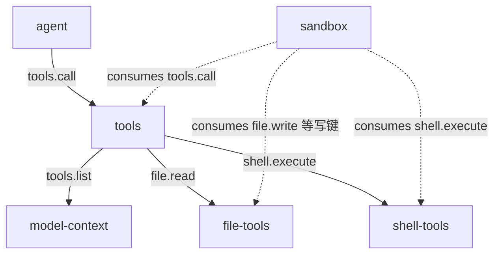
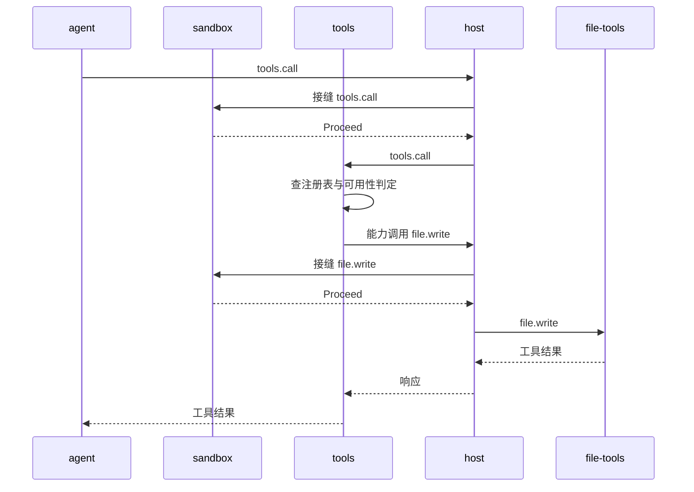

# tools

> 状态：当前实现（注册、发现、分发）；目标契约（描述扩展、风险硬门）
> 涉及能力：`tools`
> 依赖：无硬依赖也无弱依赖。运行时读取 `host.plugins` 快照判定来源可用性。

术语见 [CONTEXT.md](../../../CONTEXT.md)。写作约定见 [00-conventions.md](00-conventions.md)。

## 1. 职责

**当前实现。**

- 维护工具注册表，接收提供方上报的工具定义。
- 对外给出可用工具视图，隐藏陈旧或失效的定义。
- 把一次 `tools.call` 转成对目标能力的一次能力调用。
- 把注册表落盘，tools 重启后先恢复声明。

**目标契约。**

- 承载工具描述的 `guidelines` 与 `prompt_snippet` 字段。
- 支持按 `tags` 与暴露面过滤工具列表。

## 2. 非职责

- 不执行工具。执行始终发生在提供方进程内。
- 不做权限裁决。裁决由 sandbox 在接缝上独立完成。
- 不按插件名寻址。分发键只有 `(capability, method)`。
- 不缓存工具结果。两次调用各自落到提供方。
- 不拼装模型输入。工具清单由上下文组装插件渲染。

## 3. Manifest

**当前实现。** 与 `plugins/tools/plugin.json` 一致。

```json
{
  "name": "tools",
  "version": "0.1.0",
  "protocol": 1,
  "entry": "tools",
  "autostart": true,
  "priority": 0,
  "provides": ["tools"],
  "requires": [],
  "depends_on": [],
  "description": "Tool registration, generation-aware discovery and dispatch"
}
```

**关于 `priority: 0`。** tools 是 `tools.call` 接缝的属主，不是消费者。
它不在接缝的中间位置，因此优先级取链上最低值。
链序是 sandbox 为 500、tools 为 0。session 的 1000 还没有落地，它当前不声明 `consumes`。
链序机制见 [composition-model-context-tools-sandbox.md](../composition-model-context-tools-sandbox.md) 第 5 节。

**关于 `provides` 与保留能力。** `tools` 与 `host` 是保留能力名。
任何工具都不能以它们为目标，所以 `tools` 永远不是工具目标。

**关于 `requires` 为空。** 依赖方向是提供方依赖 tools，不是反过来。
缺少 tools 时，提供方的 `tools.sync` 重试失败并写标准错误，插件本身照常启动。

## 4. 方法与载荷

### 4.1 tools.sync

**当前实现。** 原子替换本来源的全部工具定义。

输入：

```json
{
  "tools": [
    {
      "name": "file_read",
      "description": "Read a workspace file.",
      "input_schema": {"type": "object", "properties": {"path": {"type": "string"}}, "required": ["path"]},
      "risk": 10,
      "tags": ["fs", "read"],
      "target_capability": "file",
      "target_method": "read"
    }
  ]
}
```

| 字段 | 类型 | 必填 | 说明 |
|---|---|---|---|
| `tools` | 数组 | 是 | 本来源的完整集合。空数组表示注销全部。 |
| `tools[].name` | 字符串 | 是 | 匹配 `^[a-z][a-z0-9_]{0,63}$`，跨来源唯一 |
| `tools[].description` | 字符串 | 是 | 去除首尾空白后 1 到 8192 字节 |
| `tools[].input_schema` | 对象 | 是 | 最多 64 KiB，`type` 必须是 `object`，`properties` 必填 |
| `tools[].risk` | 整数 | 是 | 0 到 100，越高越危险 |
| `tools[].tags` | 字符串数组 | 否 | 最多 16 个，匹配 `^[a-z][a-z0-9_-]{0,31}$` |
| `tools[].target_capability` | 字符串 | 是 | 必须在来源 `provides` 内，不能是 `host` 或 `tools` |
| `tools[].target_method` | 字符串 | 是 | 目标方法名 |

输出：

```json
{"synced": true, "added": 8, "updated": 0, "removed": 2}
```

| 字段 | 类型 | 说明 |
|---|---|---|
| `synced` | 布尔 | 成功时为 `true`。失败时返回协议错误码，不返回本对象。 |
| `added` | 整数 | 本次新增的工具数 |
| `updated` | 整数 | 定义有变化并被覆盖的工具数 |
| `removed` | 整数 | 本次被删除的工具数 |

错误码：`tool_source_invalid`、`tool_definition_invalid`、`tool_target_reserved`、`tool_name_conflict`。

### 4.2 tools.register

**当前实现。** 增量注册或更新单个工具。

输入与 `tools.sync` 的单个元素同构，不带 `tools` 包装。

输出：

```json
{"registered": true, "updated": false}
```

| 字段 | 类型 | 说明 |
|---|---|---|
| `registered` | 布尔 | 成功时为 `true` |
| `updated` | 布尔 | 同名工具此前存在则为 `true` |

错误码：`tool_source_invalid`、`tool_definition_invalid`、`tool_target_reserved`、`tool_name_conflict`。

### 4.3 tools.unregister

**当前实现。** 注销本来源的单个工具。

输入：

```json
{"name": "file_read"}
```

输出：

```json
{"unregistered": true}
```

| 字段 | 类型 | 说明 |
|---|---|---|
| `unregistered` | 布尔 | 名称不存在时为 `false`，不报错 |

错误码：`tool_source_invalid`、`tool_owner_mismatch`、`bad_arguments`。

### 4.4 tools.list

**当前实现。** 列出当前可用工具，按 `name` 升序排列。

输入为空对象 `{}`。

输出：

```json
{"tools": [{"name": "file_read", "description": "...", "input_schema": {}, "risk": 10, "target_capability": "file", "target_method": "read"}]}
```

| 字段 | 类型 | 说明 |
|---|---|---|
| `tools` | 数组 | 无可用工具时为空数组，不是 `null` |
| `tools[]` | 对象 | 完整工具定义，含隐藏字段 |

错误码：`tool_target_unavailable`。读取来源快照失败时返回。

**目标契约。** 输入增加 `tags` 与 `exposure` 过滤项。

- `tags` 按工具标签过滤，可给多个，命中其一即入选。
- `exposure` 取 `direct`、`deferred`、`hidden` 三态。
- 暴露面三态的语义见 [prompts/03-tool-prompts.md](../../prompts/03-tool-prompts.md) 第 7 节。

### 4.5 tools.call

**当前实现。** 校验并分发一次工具调用。

输入：

```json
{
  "name": "file_read",
  "arguments": {"path": "README.md"},
  "session_id": "s-1",
  "workspace": "E:/project",
  "workspace_id": "ws-1",
  "call_id": "call-1",
  "mode": "coding"
}
```

| 字段 | 类型 | 必填 | 说明 |
|---|---|---|---|
| `name` | 字符串 | 是 | 工具名，匹配 `^[a-z][a-z0-9_]{0,63}$` |
| `arguments` | 对象 | 是 | 传给提供方的参数，必须是 JSON 对象，最大 1 MiB |
| `session_id` | 字符串 | 否 | 透传给提供方，用于审计 |
| `workspace` | 字符串 | 否 | 透传给提供方，路径安全的锚点 |
| `workspace_id` | 字符串 | 否 | 透传给提供方，用于审计 |
| `call_id` | 字符串 | 否 | 透传给提供方，用于审计 |
| `mode` | 字符串 | 否 | 透传给提供方，表示调用模式 |

输出是提供方返回的工具结果包络，tools 原样返回。

```json
{"content": "模型可见文本", "is_error": false, "truncated": false, "meta": {}}
```

| 字段 | 类型 | 说明 |
|---|---|---|
| `content` | 字符串 | 模型可见文本，最大 1 MiB |
| `is_error` | 布尔 | 业务失败时为 `true` |
| `truncated` | 布尔 | 正文被截断时为 `true` |
| `meta` | 对象 | 附加信息，最大 64 KiB |

错误码：`tool_not_found`、`tool_target_unavailable`、`tool_result_invalid`、`bad_arguments`。

**目标契约。** 提供方输入增加 `tool_name` 字段。

当前提供方收不到"自己被以哪个名字调用"。
一个提供方注册多个工具时，提供方无法区分调用来自哪个工具名。
新增 `tool_name` 后，提供方可以在结果里回显工具身份。

### 4.6 注册与校验

**当前实现。**

全量校验通过才替换。`tools.sync` 先校验整批，再一次性替换。
任一条定义非法，整批不变，注册表保持原状。

空数组表示注销该来源的全部工具。

跨来源重名拒绝，返回 `tool_name_conflict`。
同一来源的同名工具是更新，不报错。

来源必须在自己的 `provides` 里提供目标能力。
否则返回 `tool_source_invalid`，报文中写明来源与目标能力。

目标能力不能是 `host` 或 `tools`，否则返回 `tool_target_reserved`。

注册时不要求来源已经 `active`。
提供方在 `Serve()` 之前调用 `tools.sync`，此时实例仍是 `loading`，但 Generation 已分配。

### 4.7 可用性判定

**当前实现。** 工具可见要同时满足四条。

| 序号 | 条件 | 不满足时的原因文案 |
|---|---|---|
| 1 | 来源插件存在且已启用 | 来源未加载或已禁用 |
| 2 | 来源 Manifest 提供目标能力 | 来源不提供该能力 |
| 3 | 至少一个 `active` 实例注册了目标方法 | 目标方法未注册 |
| 4 | 来源当前最大 Generation 与记录一致 | 来源 Generation 已变，需要重新同步 |

任一不满足，该工具在 `tools.list` 中被隐藏。
`tools.call` 直接命中该工具时，返回 `tool_target_unavailable`。

### 4.8 Generation 机制

**当前实现。** Generation 是 Host 分配的插件实例代次标识。

tools 在注册时记录来源的最大 Generation，与定义一起存入注册表。
判定可用性时，比对记录值与当前快照中的最大 Generation。

它解决的是一个真实竞态：提供方重启后尚未同步。
此时旧定义仍留在注册表里，但目标方法可能已经变了。
若不比对 Generation，模型会拿到一份与当前实现不符的工具描述。

比对不通过时，工具被判定为陈旧并隐藏。
提供方完成 `tools.sync` 后，Generation 被刷新，工具重新可见。

## 5. 接缝与调用关系

**当前实现。**



`tools.call` 是多方接缝。session 在链上记录，sandbox 在链上裁决。
tools 位于链尾，是这个键的属主。

**分发流程。**

```text
1. 解码载荷，校验工具名与 arguments
2. 查注册表，命中失败返回 tool_not_found
3. 读 host.plugins 快照，失败返回 tool_target_unavailable
4. 跑四条可用性判定，任一不过返回 tool_target_unavailable
5. 组装 ProviderInput，丢掉工具名与隐藏字段
6. 用同一个 Context 与 context_id 发起 (target_capability, target_method)
7. 校验返回是合法工具结果，否则 tool_result_invalid
8. 原样返回工具结果
```

第 6 步是关键。目标调用重新进入链路。
sandbox 在 `file.write` 这类写键上仍能二次拦截，裁决不会被绕过。
只读键按 sandbox 的风险档位放行，不进它的消费清单。



sandbox 在 `tools.call` 与 `file.write` 这类写键上都参与。写键在链上被拒时，`tools.call` 这一跳就不会走到分发。
只读键按 sandbox 的风险档位放行，不进它的消费清单。

## 6. 工具契约

### 6.1 工具定义字段

**当前实现。**

| 字段 | 类型 | 来源 | 说明 |
|---|---|---|---|
| `name` | 字符串 | 提供方 | 全局唯一，匹配 `^[a-z][a-z0-9_]{0,63}$` |
| `description` | 字符串 | 提供方 | 1 到 8192 字节 |
| `input_schema` | 对象 | 提供方 | object schema，最多 64 KiB |
| `risk` | 整数 | 提供方 | 0 到 100，越高越危险 |
| `tags` | 字符串数组 | 提供方 | 最多 16 个，供模式筛选 |
| `source_plugin` | 字符串 | tools 注入 | 注册载荷里没有这个字段 |
| `target_capability` | 字符串 | 提供方 | 目标能力，不能是 `host` 或 `tools` |
| `target_method` | 字符串 | 提供方 | 目标方法 |
| `source_generation` | 整数 | tools 注入 | 用于识别陈旧工具 |

`source_plugin` 与 `source_generation` 由 tools 在注册时写入。
注册方若在载荷里带上同名字段，会因未知字段被拒。

### 6.2 字段可见性

**当前实现。** 隐藏字段是 `source_plugin`、`target_capability`、`target_method`、`source_generation` 与 `tags`。

`tools.list` 返回完整定义，包含隐藏字段。
模型侧只拿到 `name`、`description` 与 `input_schema`。
`risk` 以 `Risk: N.` 的形式追加在描述末尾。
裁剪由上下文组装插件完成，不由 tools 完成。

### 6.3 风险刻度

**当前实现。**

| 范围 | 含义 |
|---:|---|
| 0 到 19 | 只读或无副作用 |
| 20 到 49 | 可逆的本地修改 |
| 50 到 79 | 显著的本地修改 |
| 80 到 100 | 任意代码执行或破坏性操作 |

当前在册工具的实际取值。

| 工具 | 风险值 | 所属范围 |
|---|---:|---|
| `file_read`、`file_list`、`file_stat`、`file_search`、`file_glob` | 10 | 只读 |
| `file_write`、`file_replace`、`file_patch` | 80 | 任意执行或破坏 |
| `shell_execute` | 90 | 任意执行或破坏 |

刻度中段当前没有在册工具。`risk` 50 是代码里的常量，但无提供方使用。

### 6.4 描述扩展

**目标契约。** 工具定义增加两个字段，语义见 [prompts/03-tool-prompts.md](../../prompts/03-tool-prompts.md) 第 1 节。

| 字段 | 类型 | 说明 |
|---|---|---|
| `guidelines` | 字符串数组 | 这一类调用的跨调用纪律，渲染进静态轨 `tool_discipline` 节 |
| `prompt_snippet` | 字符串 | 一句话工具清单 |

工具描述三件套的分工是"一个事实只出现一次"。
`description` 讲这一类工具的共同语义，`guidelines` 讲多次调用之间的纪律。

**目标契约。** 工具定义再增加 `group` 字段，用于分组。
分组只影响展示与筛选，不参与路由。

### 6.5 风险硬门

**目标契约。** 注册表自身按 `risk` 设一个上限。

上限之上的工具直接拒绝注册，返回 `tool_definition_invalid`。
裁决方缺席时，超高危工具仍然不可用。

这与"无任何强制"原则有张力。
该原则主张平台只观测不拦截，缺席即跳过。
风险硬门是注册表级别的自限，性质上更接近强制。

取舍如下。

| 方案 | 效果 | 代价 |
|---|---|---|
| 只靠 sandbox | 部署一致时最安全 | sandbox 缺席即无保护 |
| 注册表硬门 | 缺席时仍有底线 | 硬门本身要调参 |

硬门值应取在"普通命令执行"之上，而不是等于最高值。
留出余量，让裁决方在链上做更细的判断。

## 7. Prompt 贡献

**当前实现。** tools 不产出任何模型侧文本。

工具清单经 `tools.list` 交给上下文组装插件，由它渲染进工具表。
`risk` 由上下文组装插件追加为 `Risk: N.`。

**目标契约。** tools 透传 `guidelines` 与 `prompt_snippet`。

纪律节的渲染由上下文组装插件负责，规则见 [prompts/03-tool-prompts.md](../../prompts/03-tool-prompts.md) 第 5 节。
工具缺席时，其贡献的纪律条目不再出现。

## 8. 记录与持久化

**当前实现。** tools 不写会话记录。

注册表落盘到插件工作目录下的 `registry.json`。
落盘走临时文件加重命名，避免半写状态。

重启时先恢复注册表声明。恢复时逐条重新校验。
非法条目被跳过，不污染整张注册表。
恢复只是缓存，运行时仍按四条可用性判定逐条校验。

## 9. WebUI

无。tools 不提供组件，不占用任何 Slot。

## 10. 错误码

**当前实现。** 插件级错误码，前缀 `tool_`。

| 错误码 | 形态 | 场景 |
|---|---|---|
| `tool_not_found` | 协议错误 | 名称不存在 |
| `tool_name_conflict` | 协议错误 | 跨来源重名 |
| `tool_owner_mismatch` | 协议错误 | 注销非本来源的工具 |
| `tool_definition_invalid` | 协议错误 | 定义字段不合法 |
| `tool_source_invalid` | 协议错误 | 来源未提供目标能力，或来源不可核实 |
| `tool_target_reserved` | 协议错误 | 目标能力是 `host` 或 `tools` |
| `tool_target_unavailable` | 协议错误 | 来源或目标方法不可用，Generation 陈旧 |
| `tool_result_invalid` | 协议错误 | 提供方返回非法结果 |

**当前实现。** 还复用以下平台级错误码。

| 错误码 | 形态 | 场景 |
|---|---|---|
| `bad_arguments` | 协议错误 | 载荷缺失、字段错型、工具名非法 |
| `handler_error` | 协议错误 | 内部序列化失败 |

tools 不产出业务失败。工具的业务失败由提供方在结果里给出。

## 11. 配置

**当前实现。** Manifest 不声明 `settings`。

注册表路径由环境变量 `TOOLS_REGISTRY_FILE` 覆盖。
未设置时使用工作目录下的 `registry.json`。
路径为空时跳过落盘，工具只在内存里存在。

## 12. 测试要求

按 [00-conventions.md](00-conventions.md) 第 13 节展开。

| 项 | 本插件的用例 |
|---|---|
| 载荷解码 | 缺字段、错类型、空载荷、多余字段均报 `bad_arguments` |
| 成功响应 | 同步后新增计数正确，列表按名称升序 |
| 稳定错误码 | 第 10 节每个插件级错误码各一条用例 |
| 配置持久化 | 注册表落盘后重启可恢复，损坏条目被跳过 |
| 事件载荷 | 无。tools 不发事件 |
| 纯函数 | 名称与标签正则、能力与方法名校验、schema 校验 |
| 取消路径 | 目标调用继承同一个 Context，取消能透传 |
| 降级路径 | 来源插件缺席或禁用时列表为空 |

补充用例。

| 用例 | 断言 |
|---|---|
| 同步原子性 | 批次中一条非法时整批不生效 |
| 跨来源重名 | 返回 `tool_name_conflict` |
| 同来源同名 | 视为更新，不报错 |
| 保留目标 | 目标为 `tools` 或 `host` 时返回 `tool_target_reserved` |
| 空数组同步 | 该来源的工具全部注销 |
| 陈旧 Generation | 来源 Generation 变化后列表为空，调用返回 `tool_target_unavailable` |
| 上下文透传 | 目标调用带同一个 `context_id` |
| 非法结果 | 提供方返回非工具结果时报 `tool_result_invalid` |

## 13. 验收标准

| 项 | 检查 |
|---|---|
| 五个方法齐备 | `sync`、`register`、`unregister`、`list`、`call` 都有载荷契约 |
| 原子替换 | 全量校验通过才替换 |
| 可用性四条 | 存在且启用、提供目标能力、活动实例注册方法、Generation 一致 |
| 不直连提供方 | 分发只经能力调用 |
| 不按插件名寻址 | 文档与实现均无按插件名调用的描述 |
| 隐藏字段不下发 | 模型侧收不到隐藏字段 |
| 风险刻度一致 | 与提供方和裁决方使用同一刻度 |
| 错误码唯一 | 与平台级码不冲突 |

## 14. 未实现

**暂不实现。**

- 工具结果缓存。同一工具的两次调用各自落到提供方。
- 工具重试。失败直接回给调用方。
- 并发闸门。同一工具的并发调用数不受限。
- 结果预算分级。工具结果统一按 1 MiB 截断，不分级。

## 15. 结构体索引

仅作实现参考。契约的 Go 实现归插件自己所有，字段以 JSON 名为准。

| Go 类型 | 角色 |
|---|---|
| `toolsPlugin` | 插件实例，持有 SDK 调用器、注册表与落盘路径 |
| `sdkCaller` | SDK 调用接口，抽象出 `Call` 与 `CallInContext` |
| `registry` | 注册表，含读写锁与工具表 |
| `toolEntry` | 单条注册记录，含定义与 Generation |
| `persistedRegistry` | 注册表落盘结构 |
| `persistedTool` | 单条落盘记录，含定义与 Generation |
| `Definition` | 工具定义 |
| `CallInput` | `tools.call` 入参 |
| `ProviderInput` | 转发给提供方的载荷 |
| `RegisterInput` | 单条注册定义 |
| `RegisterOutput` | 注册结果 |
| `SyncInput` | 全量同步入参 |
| `SyncOutput` | 全量同步结果 |
| `Result` | 工具结果包络 |
| `hostSnapshot` | `host.plugins` 快照根节点 |
| `pluginSnapshot` | 单个插件的快照 |
| `instanceSnapshot` | 单个实例的快照，含 Generation |
| `registrationSnapshot` | 实例已注册的 `(capability, method)` |
