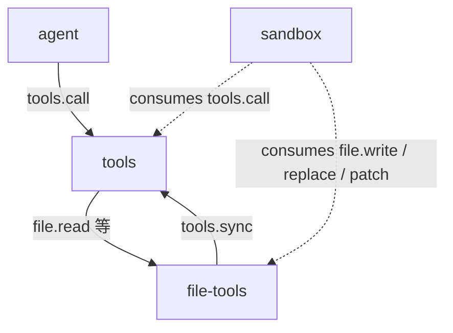

# file-tools

> 状态：当前实现（八个工具、路径安全、原子写入）；目标契约（描述配方、guidelines、越界错误码归位）
> 涉及能力：`file`
> 依赖：弱依赖 `tools`，硬依赖 `tools`

术语见 [CONTEXT.md](../../../CONTEXT.md)。写作约定见 [00-conventions.md](00-conventions.md)。

## 1. 职责

**当前实现。**

- 提供工作区范围内的文本文件读写与检索，共八个工具。
- 提供 `file` 能力的方法，供工具注册表分发。
- 把自己的工具集合注册到工具注册表。
- 保证所有文件操作不越出工作区。

**目标契约。**

- 为每个工具写符合五段配方的 `description`。
- 提供 `guidelines`，把跨调用纪律交给上下文组装插件。

## 2. 非职责

- 不裁决权限。裁决由 sandbox 在接缝上独立完成。
- 不执行命令。命令执行是 shell-tools 的事。
- 不越出工作区。所有路径都在工作区内解析。
- 不跟随符号链接目录。目录遍历遇到符号链接就停。
- 不维护会话记录。记录归 session 插件。

## 3. Manifest

**当前实现。** 与 `plugins/file-tools/plugin.json` 一致。

```json
{
  "name": "file-tools",
  "version": "0.1.0",
  "protocol": 1,
  "entry": "file-tools",
  "autostart": true,
  "priority": 0,
  "provides": ["file"],
  "requires": ["tools"],
  "depends_on": ["tools"],
  "description": "Workspace-scoped file read, write, list, stat, search, glob, replace and patch tools"
}
```

**为什么 `requires` 与 `depends_on` 都写 `tools`。**

两个字段表达不同的事。

| 字段 | 语义 | 缺失时的表现 |
|---|---|---|
| `requires` | 弱依赖能力名 | 插件照常启动，注册调用返回可恢复错误 |
| `depends_on` | 硬依赖插件名 | Host 用它安排启动顺序 |

`tools.sync` 是注册工具的前提，所以 tools 必须在场，这是硬依赖。
注册本身是弱依赖：tools 缺席时，插件仍可启动并提供 `file` 能力方法。
只是它的工具不会出现在模型面前。

两个字段指向同一个插件，是因为一个约束同时落在两边。

**关于 `provides`。** 只声明 `file`。
所有工具的目标能力都是 `file`，由注册表校验这条约束。

## 4. 方法与载荷

### 4.1 file.read

**当前实现。** 读取工作区内的一个文本文件。

输入：

```json
{"path": "README.md", "start_line": 1, "end_line": 80, "max_bytes": 65536}
```

| 字段 | 类型 | 必填 | 说明 |
|---|---|---|---|
| `path` | 字符串 | 是 | 工作区相对路径 |
| `start_line` | 整数 | 否 | 起始行，从 1 开始 |
| `end_line` | 整数 | 否 | 结束行，包含该行 |
| `max_bytes` | 整数 | 否 | 正文上限，默认 65536 |

输出：

```json
{
  "content": "第一行",
  "is_error": false,
  "truncated": false,
  "meta": {
    "path": "README.md",
    "size": 120,
    "line_start": 1,
    "line_end": 2,
    "line_count": 2,
    "encoding": "utf-8",
    "sha256": "64 位十六进制"
  }
}
```

| 字段 | 类型 | 说明 |
|---|---|---|
| `meta.path` | 字符串 | 相对路径，统一用 `/` |
| `meta.size` | 整数 | 文件字节数，不是返回片段的长度 |
| `meta.line_start` | 整数 | 实际返回的起始行 |
| `meta.line_end` | 整数 | 实际返回的结束行 |
| `meta.line_count` | 整数 | 文件总行数 |
| `meta.encoding` | 字符串 | 固定为 `utf-8` |
| `meta.sha256` | 字符串 | 文件不超过 8 MiB 时给出 |

正文是所选各行的换行连接，末尾不带换行。

错误码：`path_invalid`、`path_is_directory`、`path_not_found`、`file_too_large`、`file_binary`、`line_range_invalid`、`file_io`。

**已知偏差。** `max_bytes` 的 schema 上限是 1048576，运行期不裁剪。
运行期只处理默认值 65536 与调用方传入值。

### 4.2 file.write

**当前实现。** 原子写入工作区内的一个文本文件。

输入：

```json
{
  "path": "src/main.go",
  "content": "package main\n",
  "create_dirs": true,
  "overwrite": true,
  "expected_sha256": "64 位十六进制"
}
```

| 字段 | 类型 | 必填 | 说明 |
|---|---|---|---|
| `path` | 字符串 | 是 | 工作区相对路径 |
| `content` | 字符串 | 是 | 文件正文，UTF-8 |
| `create_dirs` | 布尔 | 否 | 默认 `true`。为 `false` 时父目录缺失返回 `path_not_found`。 |
| `overwrite` | 布尔 | 否 | 默认 `true`。为 `false` 时文件已存在即失败。 |
| `expected_sha256` | 字符串 | 否 | 期望的文件摘要，用于并发保护 |

输出：

```json
{
  "content": "",
  "is_error": false,
  "truncated": false,
  "meta": {"path": "src/main.go", "bytes_written": 13, "sha256": "64 位十六进制", "created": true}
}
```

| 字段 | 类型 | 说明 |
|---|---|---|
| `meta.path` | 字符串 | 相对路径 |
| `meta.bytes_written` | 整数 | 写入的字节数 |
| `meta.sha256` | 字符串 | 新正文的摘要 |
| `meta.created` | 布尔 | 文件此前不存在则为 `true` |

错误码：`path_invalid`、`path_is_directory`、`path_not_found`、`file_exists`、`file_conflict`、`file_too_large`、`file_io`。

写入走同目录临时文件加重命名，替换是原子的。
`create_dirs` 默认创建缺失的父目录。显式传入 `false` 且父目录缺失时返回 `path_not_found`，
错误消息包含父目录路径和 `create_dirs=true` 提示，不暴露底层 `statat` 文本。

### 4.3 file.list

**当前实现。** 列出工作区内的目录项。

输入：

```json
{"path": ".", "recursive": true, "max_depth": 4, "max_entries": 200, "include_hidden": true}
```

| 字段 | 类型 | 必填 | 说明 |
|---|---|---|---|
| `path` | 字符串 | 否 | 目录路径，默认 `.` |
| `recursive` | 布尔 | 否 | 默认 `false` |
| `max_depth` | 整数 | 否 | 递归深度，默认 1，递归时默认 4 |
| `max_entries` | 整数 | 否 | 最多返回的目录项数，默认 200 |
| `include_hidden` | 布尔 | 否 | 默认 `true`。为 `false` 时跳过以 `.` 开头的名字。 |

输出正文每行四列，用制表符分隔。

```text
dir	src	0	2026-10-20T09:00:00Z
file	src/main.go	13	2026-10-20T09:01:00Z
```

```json
{"content": "...", "is_error": false, "truncated": false, "meta": {"path": ".", "entries": []}}
```

| 字段 | 类型 | 说明 |
|---|---|---|
| `meta.path` | 字符串 | 被列举的目录 |
| `meta.entries` | 数组 | 每个项含 `path`、`type`、`size`、`mtime` |
| `meta.entries[].type` | 字符串 | `file`、`dir` 或 `symlink` |

错误码：`path_invalid`、`path_not_directory`、`path_not_found`、`file_io`。

结果按路径排序。符号链接目录不展开。

### 4.4 file.stat

**当前实现。** 查看一个工作区路径的元信息。

输入：

```json
{"path": "README.md", "hash": true}
```

| 字段 | 类型 | 必填 | 说明 |
|---|---|---|---|
| `path` | 字符串 | 是 | 工作区相对路径，允许 `.` |
| `hash` | 布尔 | 否 | 默认 `false`。为 `true` 时附带摘要。 |

输出正文是 `meta` 的缩进 JSON 文本。

```json
{
  "path": "README.md",
  "type": "file",
  "size": 120,
  "mode": "-rw-r--r--",
  "mtime": "2026-10-20T09:00:00Z",
  "is_symlink": false,
  "sha256": "64 位十六进制"
}
```

| 字段 | 类型 | 说明 |
|---|---|---|
| `meta.type` | 字符串 | `file`、`dir` 或 `symlink` |
| `meta.mode` | 字符串 | 文件模式文本 |
| `meta.mtime` | 字符串 | UTC 时间戳 |
| `meta.is_symlink` | 布尔 | 路径本身是否为符号链接 |
| `meta.link_target` | 字符串 | 符号链接的目标，仅符号链接给出 |
| `meta.sha256` | 字符串 | 仅 `hash` 为 `true`、目标是常规文件且不超过 8 MiB 时给出 |

错误码：`path_invalid`、`path_not_found`、`path_escape`、`file_io`。

统计用 `Lstat`，不跟随符号链接。
符号链接的目标不可解析时，返回对应错误而不是给出一个假类型。

### 4.5 file.search

**当前实现。** 在工作区文本中搜索字面量或正则。

输入：

```json
{
  "pattern": "tool",
  "path": ".",
  "glob": "**/*.go",
  "regex": false,
  "case_sensitive": true,
  "max_matches": 200,
  "max_files": 2000,
  "max_file_bytes": 1048576,
  "context_lines": 0
}
```

| 字段 | 类型 | 必填 | 说明 |
|---|---|---|---|
| `pattern` | 字符串 | 是 | 搜索串，`regex` 为 `true` 时是正则 |
| `path` | 字符串 | 否 | 起点，默认 `.`。可以是单个文件。 |
| `glob` | 字符串 | 否 | 只在匹配的相对路径上搜索 |
| `regex` | 布尔 | 否 | 默认 `false` |
| `case_sensitive` | 布尔 | 否 | 默认 `true` |
| `max_matches` | 整数 | 否 | 默认 200 |
| `max_files` | 整数 | 否 | 默认 2000 |
| `max_file_bytes` | 整数 | 否 | 单文件大小上限，默认 1048576 |
| `context_lines` | 整数 | 否 | 上下文字符行数，默认 0，上限 5 |

输出正文每行四列，用冒号分隔。

```text
src/main.go:12:5: 	tool := registry.Get()
```

```json
{"content": "...", "is_error": false, "truncated": false, "meta": {"matches": [], "files_scanned": 42}}
```

| 字段 | 类型 | 说明 |
|---|---|---|
| `meta.matches` | 数组 | 每个命中含 `path`、`line`、`column`、`text` |
| `meta.files_scanned` | 整数 | 本次扫描的文件数 |

错误码：`bad_arguments`、`path_invalid`、`path_not_found`、`file_io`。

二进制文件、超大文件与符号链接会被跳过。
上下文行的列号固定为 0，只有命中行给出真实列号。
列号按字符计，不按字节计。

### 4.6 file.glob

**当前实现。** 按 glob 模式找工作区文件。

输入：

```json
{"pattern": "src/**/*.go", "max_results": 200}
```

| 字段 | 类型 | 必填 | 说明 |
|---|---|---|---|
| `pattern` | 字符串 | 是 | 相对路径模式，不能含 `..` |
| `max_results` | 整数 | 否 | 默认 200 |

输出正文是换行分隔的相对路径。

```json
{"content": "src/main.go\nsrc/util.go", "is_error": false, "truncated": false, "meta": {"pattern": "src/**/*.go", "paths": []}}
```

| 字段 | 类型 | 说明 |
|---|---|---|
| `meta.pattern` | 字符串 | 原样回显的模式 |
| `meta.paths` | 数组 | 命中的相对路径 |

错误码：`bad_arguments`、`file_io`。

`*` 与 `?` 不跨目录，`**` 匹配零层或多层目录。
遍历从工作区根开始，最多扫描 10000 个文件。

### 4.7 file.replace

**当前实现。** 在一个文件里替换字面量文本。

输入：

```json
{
  "path": "README.md",
  "old_text": "old",
  "new_text": "new",
  "replace_all": false,
  "expected_sha256": "64 位十六进制"
}
```

| 字段 | 类型 | 必填 | 说明 |
|---|---|---|---|
| `path` | 字符串 | 是 | 工作区相对路径 |
| `old_text` | 字符串 | 是 | 待替换原文，不能为空 |
| `new_text` | 字符串 | 是 | 替换文本，可以为空 |
| `replace_all` | 布尔 | 否 | 默认 `false` |
| `expected_sha256` | 字符串 | 否 | 期望的文件摘要 |

输出：

```json
{"content": "", "is_error": false, "truncated": false, "meta": {"path": "README.md", "edits": 1, "sha256": "64 位十六进制", "changed": true}}
```

| 字段 | 类型 | 说明 |
|---|---|---|
| `meta.edits` | 整数 | 应用的编辑数，此处恒为 1 |
| `meta.sha256` | 字符串 | 修改后正文的摘要 |
| `meta.changed` | 布尔 | 正文是否真的变了 |

错误码：`bad_arguments`、`path_invalid`、`path_not_found`、`file_too_large`、`file_conflict`、`edit_not_found`、`edit_ambiguous`、`file_io`。

### 4.8 file.patch

**当前实现。** 在一个文件里按顺序应用多处字面量编辑。

输入：

```json
{
  "path": "README.md",
  "edits": [
    {"old_text": "a", "new_text": "b"},
    {"old_text": "c", "new_text": "d", "replace_all": true}
  ],
  "expected_sha256": "64 位十六进制"
}
```

| 字段 | 类型 | 必填 | 说明 |
|---|---|---|---|
| `path` | 字符串 | 是 | 工作区相对路径 |
| `edits` | 数组 | 是 | 1 到 32 条 |
| `edits[].old_text` | 字符串 | 是 | 待替换原文，不能为空 |
| `edits[].new_text` | 字符串 | 是 | 替换文本 |
| `edits[].replace_all` | 布尔 | 否 | 默认 `false` |
| `expected_sha256` | 字符串 | 否 | 期望的文件摘要 |

输出与 `file.replace` 同形，`meta.edits` 是实际应用的条数。

错误码：`bad_arguments`、`path_invalid`、`path_not_found`、`file_too_large`、`file_conflict`、`edit_not_found`、`edit_ambiguous`、`file_io`。

编辑按数组顺序应用，后一条匹配的是前一条改完之后的正文。
整次修改原子：任一条失败就不写回文件。

### 4.9 路径安全

**当前实现。**

工作区必须是绝对目录。

| 检查 | 失败错误码 |
|---|---|
| 工作区为空 | `workspace_required` |
| 工作区不是绝对路径 | `workspace_invalid` |
| 工作区不是已存在目录 | `workspace_invalid` |
| 工作区打不开 | `workspace_invalid` |

文件路径必须是工作区相对路径。

| 检查 | 失败错误码 |
|---|---|
| 路径为空 | `path_invalid` |
| 路径含 NUL | `path_invalid` |
| 路径以 `/` 开头 | `path_invalid` |
| 路径是绝对路径 | `path_invalid` |
| 路径带盘符或 UNC 前缀 | `path_invalid` |
| 路径含空组件、`.` 或 `..` | `path_invalid` |
| 路径含 Windows 保留设备名 | `path_invalid` |
| 文件方法收到 `.` | `path_invalid` |

盘符与 UNC 前缀按卷名判定，只在 Windows 上生效。

符号链接越界由 `os.Root` 拒绝。
`os.Root` 解析每一段路径，并要求解析结果仍落在根内。
越界时返回 `path escapes from parent`。

**已知偏差。** 该错误当前被归到 `file_io`。
[communication.md](../../../plugins/file-tools/communication.md) 约定的是 `path_escape`。
`path_escape` 当前只由权限错误触发。

**目标契约。** 越界错误统一映射为 `path_escape`，让实现与契约一致。

**当前实现。** 目录遍历遇到符号链接就停。
`file.list` 不展开符号链接目录，`file.search` 与 `file.glob` 跳过符号链接条目。

### 4.10 并发保护

**当前实现。** 摘要校验用 `expected_sha256` 表达。

读操作在 `meta.sha256` 里给出文件摘要。
写与编辑操作接受 `expected_sha256`，比对当前文件摘要。
不一致时返回 `file_conflict`，文件不被改动。

`file.write` 另有两条规则。

| 情形 | 结果 |
|---|---|
| 给了摘要但文件不存在 | `file_conflict` |
| 文件已存在且 `overwrite` 为 `false` | `file_exists` |

**已知偏差。** 摘要校验与写入不是一个原子操作。
校验读到的内容与最终写回之间存在时间窗。
写入本身是原子的，因为落盘走同目录临时文件加重命名。

**目标契约。** 把校验与写入合成一次比较并交换。
先按期望摘要比对当前文件，再在同一把锁内替换。

## 5. 接缝与调用关系

**当前实现。**



`file` 能力的写方法（`file.write`、`file.replace`、`file.patch`）是多方接缝。
sandbox 在这三个写键上独立参与，直连高危能力也过裁决。
tools 分发时发出的目标调用重新进入链路，所以裁决能生效两次。

注册方向是反的。file-tools 启动时调用 `tools.sync` 上架八个工具。

## 6. 工具契约

**当前实现。**

| 工具名 | 风险值 | 标签 | 目标方法 |
|---|---:|---|---|
| `file_read` | 10 | `fs`、`read` | `file.read` |
| `file_list` | 10 | `fs`、`read` | `file.list` |
| `file_stat` | 10 | `fs`、`read` | `file.stat` |
| `file_search` | 10 | `fs`、`read` | `file.search` |
| `file_glob` | 10 | `fs`、`read` | `file.glob` |
| `file_write` | 80 | `fs`、`write` | `file.write` |
| `file_replace` | 80 | `fs`、`write` | `file.replace` |
| `file_patch` | 80 | `fs`、`write` | `file.patch` |

风险刻度见 [05-tools.md](05-tools.md) 第 6.3 节。
五个只读工具取 10，三个写工具取 80。

八个工具的目标能力都是 `file`，即本插件 `provides` 的能力。

## 7. Prompt 贡献

**当前实现。** file-tools 不产出模型侧文本。

八个工具的 `description` 各是一句话，只讲做什么。
没有 `guidelines`，也没有 `prompt_snippet`。

**已知偏差。** 写与编辑类工具返回的 `content` 是空字符串。
按 [prompts/03-tool-prompts.md](../../prompts/03-tool-prompts.md) 第 2.5 节，
空输出应给占位文本，否则模型会以为工具没跑。

**目标契约。**

每个工具的 `description` 按五段配方写，规格见 [prompts/03-tool-prompts.md](../../prompts/03-tool-prompts.md) 第 2 节。

```text
<首句：一句话能力陈述，写清做什么、返回什么。>
<行为语义：工作目录是否持久、超时与截断的默认值和上限。>
<边界：截断策略、失败返回格式。>
<防绕过：说明为什么用这个工具而不是绕路。>
<When to use / When NOT to use：什么时候用，什么时候不要用。>
```

每个工具另有一组 `guidelines`，只讲跨调用纪律。
描述已经讲过的事实不再重复，纪律节不重复描述。

`file_read` 的 `guidelines` 示例：

```text
- file_read: read the whole region you need before editing it; do not read 30 lines at a time and stitch them together.
- file_read: prefer one wide range over several narrow ones; each extra call costs a round trip.
```

`file_write` 的 `guidelines` 示例：

```text
- file_write: pass expected_sha256 when you have just read the file; a mismatch means someone else changed it.
- file_write: read before you write; never write a file you have not read in this session.
```

工具名以常量引用，不写死在纪律文本里。
渲染时用注册时的名字，工具卸载后其条目自动消失。

## 8. 记录与持久化

**当前实现。** file-tools 不写会话记录，也不维护自己的存储。

摘要只经 `meta` 传给模型，再由模型带回下一次写。
文件内容不进会话事实，进事实的是会话插件的事。

**目标契约。** 裁决方把放行与拒绝结果写入会话事实。
file-tools 自身仍不写记录。

## 9. WebUI

无。file-tools 不提供组件，不占用任何 Slot。

## 10. 错误码

**当前实现。** 插件级错误码。

| 错误码 | 形态 | 场景 |
|---|---|---|
| `workspace_required` | 协议错误 | 缺少工作区 |
| `workspace_invalid` | 协议错误 | 工作区不是绝对目录，或打不开 |
| `path_invalid` | 协议错误 | 路径格式不合法 |
| `path_escape` | 协议错误 | 权限错误导致的越界 |
| `path_not_found` | 协议错误 | 路径不存在 |
| `path_is_directory` | 协议错误 | 需要文件却得到目录 |
| `path_not_directory` | 协议错误 | 需要目录却得到文件 |
| `file_exists` | 业务失败 | 不允许覆盖但文件已存在 |
| `file_too_large` | 协议错误 | 文件或正文超过限制 |
| `file_binary` | 业务失败 | 含 NUL 字节或不是合法 UTF-8 |
| `file_conflict` | 业务失败 | 摘要不匹配，或给了摘要但文件不存在 |
| `line_range_invalid` | 协议错误 | 行范围越界 |
| `edit_not_found` | 业务失败 | 待替换文本未命中 |
| `edit_ambiguous` | 业务失败 | 待替换文本多次命中且未开 `replace_all` |
| `file_io` | 协议错误 | 其他文件系统错误 |

**当前实现。** 还复用平台级错误码 `bad_arguments`。
载荷缺字段、字段错型、多余字段、编辑条数越界都归它。

业务失败返回 `is_error: true`，错误码放在 `meta.code`。

**目标契约。** 符号链接越界从 `file_io` 改判为 `path_escape`。

## 11. 配置

无独立配置。Manifest 不声明 `settings`。

工作区由调用方在载荷里给出，不来自插件配置。
每个文件参数都相对该工作区解析。

## 12. 测试要求

按 [00-conventions.md](00-conventions.md) 第 13 节展开。

| 项 | 本插件的用例 |
|---|---|
| 载荷解码 | 缺字段、错类型、空载荷、多余字段均报 `bad_arguments` |
| 成功响应 | 八个方法各一条正常路径用例，校验 `meta` 形状 |
| 稳定错误码 | 第 10 节每个错误码各一条用例 |
| 配置持久化 | 无插件侧存储 |
| 事件载荷 | 无。file-tools 不发事件 |
| 纯函数 | 路径归一化、glob 匹配、摘要计算、行切分 |
| 取消路径 | 取消后不再写回文件 |
| 降级路径 | `tools` 缺席时 `file` 能力方法仍可用 |

补充用例。

| 用例 | 断言 |
|---|---|
| 路径逃逸 | `../outside`、`E:/outside`、`/outside`、UNC 前缀、`a/../../b` 全部被拒 |
| 盘符与 UNC | 含盘符或 UNC 前缀的路径返回 `path_invalid` |
| 符号链接越界 | 指向工作区外的链接读不到内容 |
| 目录写入 | 目标是目录时返回 `path_is_directory` |
| 父目录缺失 | `create_dirs` 为 `false` 时返回 `path_not_found` |
| 摘要冲突 | 给出过期的 `expected_sha256` 时返回 `file_conflict`，文件不变 |
| 摘要缺失文件 | 给了摘要但文件不存在时返回 `file_conflict` |
| 禁止覆盖 | `overwrite` 为 `false` 且文件存在时返回 `file_exists` |
| 补丁原子性 | 一条编辑失败时文件内容不变 |
| 编辑歧义 | 文本多次命中且未开 `replace_all` 时返回 `edit_ambiguous` |
| 二进制读取 | 含 NUL 字节的文件返回 `file_binary` |
| 行范围越界 | 返回 `line_range_invalid` |
| 超大文件 | 超过读取上限时返回 `file_too_large` |

## 13. 验收标准

| 项 | 检查 |
|---|---|
| 八个方法齐备 | `read`、`write`、`list`、`stat`、`search`、`glob`、`replace`、`patch` 都有载荷契约 |
| 工具与方法一一对应 | 每个工具的目标方法存在 |
| 目标能力在 `provides` 内 | 八个工具全部指向 `file` |
| 路径不越界 | 绝对路径、盘符、UNC、`..`、符号链接都被拒绝 |
| 写入原子 | 补丁失败时文件不变 |
| 摘要可复算 | 读操作给出的 `sha256` 能被写操作接受 |
| 错误码唯一 | 与平台级码不冲突 |
| 标签齐备 | 每个工具都有 `fs` 标签与读写标签 |

## 14. 未实现

**暂不实现。**

- 目录监视。文件变化不会被主动推送给模型。
- 符号链接跟随。链接目录一律不展开。
- 二进制文件预览。二进制内容一律拒绝。
- 编码转换。只处理 UTF-8。
- 编辑的撤销。写操作没有历史与回滚。

## 15. 结构体索引

仅作实现参考。契约的 Go 实现归插件自己所有，字段以 JSON 名为准。

| Go 类型 | 角色 |
|---|---|
| `plugin` | 插件实例，本身不持有状态 |
| `workspace` | 工作区句柄，封装 `os.Root` |
| `Definition` | 工具定义 |
| `RegisterInput` | 单条注册定义 |
| `SyncInput` | 全量同步入参 |
| `SyncOutput` | 全量同步结果 |
| `ProviderInput` | 转发给提供方的载荷 |
| `Result` | 工具结果包络 |
| `Caller` | SDK 调用接口 |
| `readIn` | `file.read` 的参数 |
| `writeIn` | `file.write` 的参数 |
| `listIn` | `file.list` 的参数 |
| `entryOut` | `file.list` 的单条目录项 |
| `statIn` | `file.stat` 的参数 |
| `searchIn` | `file.search` 的参数 |
| `matchOut` | `file.search` 的单条命中 |
| `globIn` | `file.glob` 的参数 |
| `replaceIn` | `file.replace` 的参数 |
| `patchIn` | `file.patch` 的参数 |
| `editIn` | 单条字面量编辑 |
