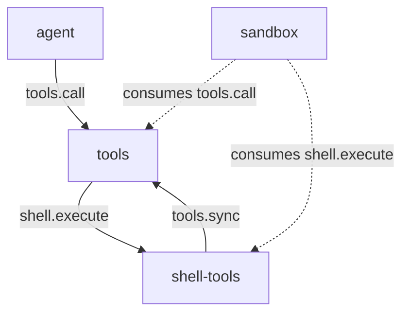

# shell-tools

> 状态：当前实现（同步执行、超时、输出上限、进程树取消）；目标契约（描述配方、guidelines、空输出占位）
> 涉及能力：`shell`
> 依赖：弱依赖 `tools`，硬依赖 `tools`

术语见 [CONTEXT.md](../../../CONTEXT.md)。写作约定见 [00-conventions.md](00-conventions.md)。

## 1. 职责

**当前实现。**

- 在工作区里同步执行一条命令。
- 管理超时、单流输出上限与进程树取消。
- 提供 `shell` 能力方法，供工具注册表分发。
- 把自己的工具集合注册到工具注册表。

**目标契约。**

- 为 `shell_execute` 写符合五段配方的 `description`。
- 提供 `guidelines`，把跨调用纪律交给上下文组装插件。

## 2. 非职责

- 不裁决权限。裁决由 sandbox 在接缝上独立完成。
- 不做交互式会话。持久终端会话是 terminal 插件的目标。
- 不做后台任务。进程随调用结束。
- 不维护 shell 状态。每次执行都是新进程。
- 不解析 shell 语法。命令与参数直接进进程。

## 3. Manifest

**当前实现。** 与 `plugins/shell-tools/plugin.json` 一致。

```json
{
  "name": "shell-tools",
  "version": "0.1.0",
  "protocol": 1,
  "entry": "shell-tools",
  "autostart": true,
  "priority": 0,
  "provides": ["shell"],
  "requires": ["tools"],
  "depends_on": ["tools"],
  "description": "Synchronous process execution with process-tree cancellation"
}
```

**为什么 `requires` 与 `depends_on` 都写 `tools`。**

`depends_on` 保证 tools 先启动，`tools.sync` 才有地方可调。
`requires` 表达弱依赖：tools 缺席时插件照常启动，`shell.execute` 仍可被直接调用。

工具注册只是副作用，能力方法是主体，所以两个字段都要写。

**关于 `provides`。** 只声明 `shell`。
工具 `shell_execute` 的目标能力是 `shell`，由注册表校验这条约束。

## 4. 方法与载荷

### 4.1 shell.execute

**当前实现。** 同步执行一条命令。

输入：

```json
{
  "command": "go",
  "args": ["test", "./..."],
  "cwd": ".",
  "env": {"CGO_ENABLED": "0"},
  "timeout_ms": 120000,
  "max_output_bytes": 1048576
}
```

| 字段 | 类型 | 必填 | 说明 |
|---|---|---|---|
| `command` | 字符串 | 是 | 可执行文件名或路径，不能含 NUL |
| `args` | 字符串数组 | 否 | 参数向量，按序传递 |
| `cwd` | 字符串 | 否 | 工作区内的相对目录或绝对目录，默认 `.` |
| `env` | 对象 | 否 | 环境变量覆盖，键值都是字符串 |
| `timeout_ms` | 整数 | 否 | 运行超时，默认 120000 |
| `max_output_bytes` | 整数 | 否 | 单流输出上限，默认 1048576 |

输出：

```json
{
  "content": "exit_code: 0\nstdout:\nok\nstderr:\n",
  "is_error": false,
  "truncated": false,
  "meta": {
    "exit_code": 0,
    "stdout_bytes": 3,
    "stderr_bytes": 0,
    "stdout_truncated": false,
    "stderr_truncated": false,
    "started_at": "2026-10-20T09:00:00Z",
    "finished_at": "2026-10-20T09:00:01Z",
    "duration_ms": 1000,
    "timed_out": false
  }
}
```

| 字段 | 类型 | 说明 |
|---|---|---|
| `meta.exit_code` | 整数 | 进程退出码，进程状态缺失时为 -1 |
| `meta.stdout_bytes` | 整数 | 标准输出产生的总字节数，不是保留的字节数 |
| `meta.stderr_bytes` | 整数 | 标准错误产生的总字节数 |
| `meta.stdout_truncated` | 布尔 | 标准输出是否超出上限 |
| `meta.stderr_truncated` | 布尔 | 标准错误是否超出上限 |
| `meta.started_at` | 字符串 | 启动时刻，UTC |
| `meta.finished_at` | 字符串 | 结束时刻，UTC |
| `meta.duration_ms` | 整数 | 耗时毫秒 |
| `meta.timed_out` | 布尔 | 是否由内部超时结束 |

超时时另加 `meta.code`，值为 `process_timeout`。
等待出错但退出码为 0 时另加 `meta.process_error`。

错误码：`workspace_required`、`workspace_invalid`、`cwd_invalid`、`cwd_escape`、`command_not_found`、`command_blocked`、`env_invalid`、`process_start_failed`、`bad_arguments`。

**已知偏差。** `timeout_ms` 与 `max_output_bytes` 的 schema 有上限。
运行期不裁剪这两个值，只在未给值时套默认值。

### 4.2 取消与超时

**当前实现。** 三条退出路径。

| 触发 | 返回形态 |
|---|---|
| 父 Context 取消 | 协议错误码 `call_cancelled` |
| 父 Context 截止时间到 | 协议错误码 `call_deadline_exceeded` |
| 内部超时 | 业务失败，`meta.timed_out` 为 `true` |

三条路径都会终止整个子进程树，然后等待进程退出。

**Unix。** 子进程用 `Setpgid` 单独成组。
终止时对进程组发 `SIGKILL`，组内所有进程一起死。
进程组之外的祖先进程不受影响。

**Windows。** 子进程用 `CREATE_NEW_PROCESS_GROUP` 启动。
随后创建一个 Job Object，设置 `JOB_OBJECT_LIMIT_KILL_ON_JOB_CLOSE`，
再把子进程放进该 Job。终止时调用 `TerminateJobObject`。

Job 句柄按进程号存起来，执行结束后关闭并从表中删除。

**已知偏差。** 进程启动成功但加入 Job 失败时，
插件会终止进程并返回 `process_start_failed`。

### 4.3 输出处理

**当前实现。**

标准输出与标准错误各自一个带上限的缓冲。
两个流的上限都是 `max_output_bytes`，各自独立计算。
Windows 下若输出不是合法 UTF-8，先按当前 ANSI 代码页（`GetACP`）解码为 UTF-8；`*_bytes` 仍记原始字节数。

正文按固定顺序排布。

```text
exit_code: <退出码>
stdout:
<标准输出>
stderr:
<标准错误>
```

正文末尾的换行会被去掉。

**截断语义。** 缓冲保留前 `max_output_bytes` 字节，超出部分丢弃。
`*_bytes` 记的是产生的总字节数。
总字节数超过上限时，对应的 `*_truncated` 为 `true`。
顶层 `truncated` 是两者的或。

**已知偏差。** 空输出没有占位文本。
标准输出为空时，正文里只剩一行 `stdout:`。

**目标契约。** 按 [prompts/03-tool-prompts.md](../../prompts/03-tool-prompts.md) 第 2.5 节补占位。
空流写 `(no output)`，让模型知道命令确实跑过。

**已知偏差。** 截断时没有给出丢了多少。
按 [prompts/03-tool-prompts.md](../../prompts/03-tool-prompts.md) 第 2.4 节，
结果 `meta` 应追加 `original_bytes` 与 `truncated_bytes`。

### 4.4 边界

**当前实现。**

| 检查 | 失败错误码 |
|---|---|
| 工作区为空 | `workspace_required` |
| 工作区不是绝对路径 | `workspace_invalid` |
| 工作区不是已存在目录 | `workspace_invalid` |
| `command` 为空白或含 NUL | `bad_arguments` |
| `command` 是被禁用的解释器 | `command_blocked` |
| `cwd` 是盘符相对形式（如 `C:foo`） | `cwd_invalid` |
| `cwd` 含空组件、`.` 或 `..`（相对路径） | `cwd_invalid` |
| `cwd` 解析失败或不是目录 | `cwd_invalid` |
| `cwd` 解析后落在工作区外 | `cwd_escape` |
| 环境变量名非法或值含 NUL | `env_invalid` |
| 可执行文件找不到 | `command_not_found` |
| 进程启动失败 | `process_start_failed` |

**`cwd` 越界检查。** 相对路径先做组件检查，再拼到 Workspace 下；绝对路径直接使用。
两者都做符号链接解析，解析后的路径必须仍在工作区内，否则返回 `cwd_escape`。

**被禁用的解释器。** 取命令的 basename，去掉 `.exe` 后缀，转小写比对。
命中名单即拒绝。

| 名单 | 说明 |
|---|---|
| `cmd`、`powershell`、`pwsh` | Windows 命令行与 PowerShell |
| `bash`、`sh`、`zsh`、`fish` | 常见 Unix shell |
| `wsl` | Windows 子系统 |
| `cscript`、`wscript` | Windows 脚本宿主 |

名单是硬编码的，配置只提供一个总开关。

**环境变量校验。** 键名只允许字母、数字与下划线。
首字符只能是字母或下划线。
值不能含 NUL 字节。
子进程继承宿主环境，`env` 里的同名项覆盖继承值。
环境变量的值不被记录。

**命令查找失败。** 可执行文件按系统查找规则定位。
找不到时返回 `command_not_found`，进程没有启动。

## 5. 接缝与调用关系

**当前实现。**



`shell.execute` 是多方接缝。
sandbox 在这个键上独立参与，直连高危能力也过裁决。
tools 分发时发出的目标调用重新进入链路，所以裁决能生效两次。

注册方向是反的。shell-tools 启动时调用 `tools.sync` 上架工具。

## 6. 工具契约

**当前实现。**

| 工具名 | 风险值 | 标签 | 目标方法 |
|---|---:|---|---|
| `shell_execute` | 90 | `shell` | `shell.execute` |

风险值 90 落在 80 到 100 区间，含义是任意代码执行或破坏性操作。
风险刻度见 [05-tools.md](05-tools.md) 第 6.3 节。

工具的目标能力是 `shell`，即本插件 `provides` 的能力。

## 7. Prompt 贡献

**当前实现。** shell-tools 不产出模型侧文本。

`shell_execute` 的 `description` 是一段两句话的说明。
它提到退出码、输出与截断元信息，但没有按五段配方组织。
没有 `guidelines`，也没有 `prompt_snippet`。

**目标契约。**

`description` 按五段配方写，规格见 [prompts/03-tool-prompts.md](../../prompts/03-tool-prompts.md) 第 2 节。

```text
<首句：一句话能力陈述，写清做什么、返回什么。>
<行为语义：不走 shell 解析，超时与输出上限的默认值和上限。>
<边界：截断策略、失败返回格式。>
<防绕过：说明为什么用这个工具而不是绕路。>
<When to use / When NOT to use：什么时候用，什么时候不要用。>
```

描述里的数值从配置插值，不写死。
超时上限、默认输出上限与被禁用的命令列表都随配置变化。

`guidelines` 只讲跨调用纪律，示例：

```text
- shell_execute: each line of standard output is a round trip to you. Redirect long output to a file and read the file instead.
- shell_execute: pass arguments as a vector; there is no shell parsing, so pipes and redirects do not work.
- shell_execute: a non-zero exit code is a business failure; read stderr before retrying.
```

工具名以常量引用，不写死在纪律文本里。

## 8. 记录与持久化

**当前实现。** shell-tools 不写会话记录，也不维护自己的存储。

环境变量的值不被记录。
命令与输出进不进会话事实，由会话插件决定。

**目标契约。** 裁决方把放行与拒绝结果写入会话事实。
shell-tools 自身仍不写记录。

## 9. WebUI

无。shell-tools 不提供组件，不占用任何 Slot。

## 10. 错误码

**当前实现。** 插件级错误码。

| 错误码 | 形态 | 场景 |
|---|---|---|
| `workspace_required` | 协议错误 | 缺少工作区 |
| `workspace_invalid` | 协议错误 | 工作区不是绝对目录，或不是已存在目录 |
| `cwd_invalid` | 协议错误 | `cwd` 格式不合法，或不是目录 |
| `cwd_escape` | 协议错误 | `cwd` 解析后落在工作区外 |
| `command_not_found` | 协议错误 | 可执行文件找不到 |
| `command_blocked` | 业务失败 | 解释器被配置禁用 |
| `env_invalid` | 协议错误 | 环境变量名非法或值含 NUL |
| `process_start_failed` | 协议错误 | 进程启动失败，或加入进程组失败 |
| `process_timeout` | 业务失败 | 内部超时，出现在 `meta.code` |

**当前实现。** 还复用平台级错误码。

| 错误码 | 形态 | 场景 |
|---|---|---|
| `bad_arguments` | 协议错误 | 载荷缺字段、字段错型、`command` 非法 |
| `call_cancelled` | 协议错误 | 父 Context 取消 |
| `call_deadline_exceeded` | 协议错误 | 父 Context 截止时间到 |

业务失败返回 `is_error: true`，错误码放在 `meta.code`。

`process_timeout` 当前是业务失败的 `meta.code`，不是协议错误码。

## 11. 配置

**当前实现。** 插件工作目录下的 `config.json`，启动时读一次。
读不到或解析失败时用零值，不阻塞启动。

```json
{"allow_shell_interpreters": false}
```

| 配置项 | 类型 | 默认 | 说明 |
|---|---|---|---|
| `allow_shell_interpreters` | 布尔 | `false` | 为 `false` 时拒绝名单里的通用解释器 |

示例见 `plugins/shell-tools/config.example.json`。

**解释器禁用列表。** 名单硬编码在源码里，配置只提供总开关。
开关为 `true` 时名单整体失效。
沙箱仍会独立检查这个高危操作。

**超时上限。** 不是配置项。

| 值 | 数值 | 来源 |
|---|---:|---|
| 运行期默认 | 120000 毫秒 | 源码常量 |
| 模型侧上限 | 600000 毫秒 | 输入 schema |

**输出上限。** 不是配置项。

| 值 | 数值 | 来源 |
|---|---:|---|
| 运行期默认 | 1048576 字节 | 源码常量 |
| 模型侧上限 | 4194304 字节 | 输入 schema |

**目标契约。** 把超时上限与输出上限提到配置里。
上限随部署变化时，工具描述里的数值也要跟着变。

## 12. 测试要求

按 [00-conventions.md](00-conventions.md) 第 13 节展开。

| 项 | 本插件的用例 |
|---|---|
| 载荷解码 | 缺字段、错类型、空载荷、多余字段均报 `bad_arguments` |
| 成功响应 | 正常路径的正文排布与 `meta` 形状 |
| 稳定错误码 | 第 10 节每个插件级错误码各一条用例 |
| 配置持久化 | 无插件侧存储。配置只读不写 |
| 事件载荷 | 无。shell-tools 不发事件 |
| 纯函数 | 解释器名单比对、环境变量名校验、目录越界判定 |
| 取消路径 | 父 Context 取消与截止时间到 |
| 降级路径 | `tools` 缺席时 `shell.execute` 仍可被直接调用 |

补充用例。

| 用例 | 断言 |
|---|---|
| 超时 | 内部超时后 `is_error` 为 `true`，`meta.timed_out` 为 `true` |
| 取消 | 父 Context 取消返回 `call_cancelled` |
| 截止时间 | 父 Context 截止时间到返回 `call_deadline_exceeded` |
| 输出截断 | 超出上限时 `stdout_truncated` 为 `true`，顶层 `truncated` 为 `true` |
| 截断字节数 | `stdout_bytes` 记的是总字节数，不是保留的字节数 |
| 非零退出码 | 退出码非 0 时 `is_error` 为 `true` |
| 进程树终止 | 子进程再派生子进程，取消后两级都不再存活 |
| 解释器禁用 | `bash`、`powershell.exe` 被拒绝 |
| 环境变量 | 非法键名返回 `env_invalid` |
| 目录越界 | `cwd` 指向工作区外返回 `cwd_escape` |
| 命令找不到 | 返回 `command_not_found` |
| 参数不经 shell | 命令与参数按向量传递，不做 shell 解析 |

## 13. 验收标准

| 项 | 检查 |
|---|---|
| 方法齐备 | `shell.execute` 有完整的输入、输出与错误契约 |
| 工具与方法对应 | `shell_execute` 指向 `shell.execute` |
| 目标能力在 `provides` 内 | 工具目标能力是 `shell` |
| 三条退出路径 | 取消、截止时间、内部超时各有确定形态 |
| 进程树终止 | 取消与超时都终止整棵进程树 |
| 输出有上限 | 两个流各自受 `max_output_bytes` 约束 |
| 风险值一致 | 风险值 90 与刻度表对得上 |
| 错误码唯一 | 与平台级码不冲突 |

## 14. 未实现

**暂不实现。**

- 交互式终端。需要持续会话与输入回传。
- 后台进程。进程随调用结束。
- 管道。标准输入不接管道，标准输出不连标准输出。
- 信号转发。宿主收不到子进程信号。
- 跨平台 shell 选择。命令与参数始终按向量传递。

## 15. 结构体索引

仅作实现参考。契约的 Go 实现归插件自己所有，字段以 JSON 名为准。

| Go 类型 | 角色 |
|---|---|
| `plugin` | 插件实例，持有配置 |
| `config` | 配置，目前只有一个布尔开关 |
| `sdkCaller` | SDK 调用接口 |
| `executeIn` | `shell.execute` 的参数 |
| `Definition` | 工具定义 |
| `RegisterInput` | 单条注册定义 |
| `SyncInput` | 全量同步入参 |
| `SyncOutput` | 全量同步结果 |
| `ProviderInput` | 转发给提供方的载荷 |
| `Result` | 工具结果包络 |
| `Caller` | SDK 调用接口 |
| `processSpec` | 进程规格，含命令、目录、环境、超时与输出上限 |
| `cappedBuffer` | 带上限的输出缓冲，记录总量与截断标记 |
