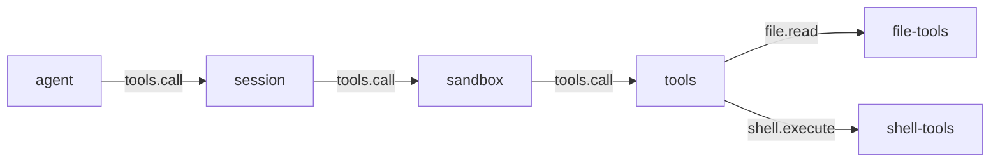
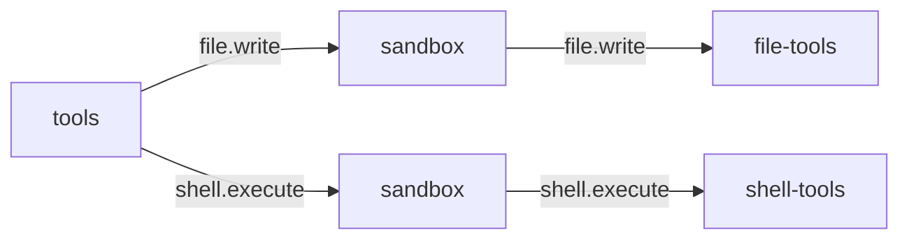

# sandbox

> 状态：目标契约。插件尚未实现，当前实现没有这个能力。
> 涉及能力：`sandbox`
> 依赖：弱依赖 `session`、`tools`；消费 `tools.call`、`file.write`、`file.replace`、`file.patch`、`shell.execute`

本文是 `sandbox` 插件的设计稿。它描述裁决语义、确认流、规则模型、审计口径和界面契约。

术语见 [CONTEXT.md](../../../CONTEXT.md)，写作约定见 [00-conventions.md](00-conventions.md)，约束见 [CONSTRAINT.md](../../../CONSTRAINT.md)。组合方案见 [composition-model-context-tools-sandbox.md](../composition-model-context-tools-sandbox.md)。

## 1. 职责

**目标契约。**

- 对工具调用做裁决，给出四态动作之一。
- 按工具风险刻度、路径范围、命令模式判断。
- 在裁决链上短路或改写载荷，不执行工具。
- 记录每条裁决的审计条目。
- 在需要人确认时发起确认流，并管理确认令牌。

四态动作：

| 动作 | 行为 |
|---|---|
| `allow` | 原样放行，继续走链 |
| `modify` | 改写载荷后放行 |
| `deny` | 短路返回，不进下一跳 |
| `confirm` | 短路返回确认请求，等待人决策 |

裁决方在链上的位置决定它看到的是真实调用。
它排在 `session` 之后、`tools` 之前，所以它看到的是已记录但未执行的调用。

## 2. 非职责

- 不执行工具。执行始终在工具提供方进程内。
- 不替代提供方的边界检查。路径存在性、编码、并发由提供方负责。
- 不改写工具语义。裁决只回答放不放行与怎么放行。
- 不做物理隔离。v1 没有进程级沙箱，内核级隔离不在本轮。
- 不控制网络出口。出口策略不在本轮。
- 不按插件名寻址。裁决只看能力名与方法名。
- 不拼装模型输入。提示贡献交由上下文组装插件渲染。

## 3. Manifest

**目标契约。**

```json
{
  "name": "sandbox",
  "version": "0.1.0",
  "protocol": 1,
  "entry": "sandbox",
  "description": "Permission adjudication on tool seams: allow, modify, deny, confirm",
  "autostart": true,
  "priority": 500,
  "provides": ["sandbox"],
  "consumes": [
    { "capability": "tools", "method": "call" },
    { "capability": "file", "method": "write" },
    { "capability": "file", "method": "replace" },
    { "capability": "file", "method": "patch" },
    { "capability": "shell", "method": "execute" }
  ],
  "requires": ["session", "tools"],
  "depends_on": [],
  "commands": [
    { "name": "rules", "description": "List adjudication rules", "usage": "/sandbox rules" },
    { "name": "check", "description": "Dry-run one tool call", "usage": "/sandbox check <tool> <json>" }
  ],
  "ui": {
    "entry": "ui/main.js",
    "components": [
      { "tag": "sandbox-confirm", "mount_id": "confirm", "slot": "right" }
    ]
  },
  "settings": {
    "get": { "capability": "sandbox", "method": "settings.get" },
    "save": { "capability": "sandbox", "method": "settings.save" },
    "schema": [
      { "key": "default_action", "label": "Default action", "type": "select", "required": true,
        "options": [
          { "value": "allow", "label": "Allow everything not matched by a rule" },
          { "value": "confirm", "label": "Confirm everything not matched by a rule" }
        ]
      },
      { "key": "confirm_ttl_seconds", "label": "Confirm token TTL (seconds)", "type": "number", "required": true },
      { "key": "audit_retention_days", "label": "Audit retention (days)", "type": "number", "required": true }
    ]
  }
}
```

**关于 `priority: 500`。**

`tools.call` 的链序按 `priority` 递减。提议的链位是：

| 插件 | `tools.call` | 作用 |
|---|---:|---|
| `session` | 1000 | 记录调用 |
| `sandbox` | 500 | 裁决调用 |
| `tools` | 0 | 分发调用 |

所以 sandbox 在 session 与 tools 之间。
它晚于 session 记录，早于 tools 执行。

链序机制见 [00-conventions.md](00-conventions.md) 第 5 节。
其他接缝的链位见 [composition-model-context-tools-sandbox.md](../composition-model-context-tools-sandbox.md) 第 5 节。

**关于 `consumes` 的五条接缝。**

`tools.call` 是主接缝。tools 分发时对目标能力的调用会重新进链，所以 sandbox 在那里再截一次。
`file.write`、`file.replace`、`file.patch`、`shell.execute` 是直连高危能力的接缝。
它们被单独声明，是因为调用方可能不经 tools 直接调用这些能力。
链序规则见 [05-tools.md](05-tools.md) 第 5 节。

**待定：消费集是否扩充。**

本设计稿的 `consumes` 是五条。其他插件设计稿提出了 sandbox 参与以下键的诉求：

| 键 | 提出方 | 当前状态 |
|---|---|---|
| `file.read` | 05-tools.md、06-file-tools.md | 已从这两份文档移除。只读键按风险档位放行 |
| `web.fetch` | 14-web-tools.md | 待定 |
| `git.commit`、`git.checkout` | 15-git-tools.md | 待定 |
| `terminal.write` | 16-terminal.md | 待定 |

扩充消费集要连带确认三件事：sandbox 是否为新键注册同名处理器、新键的风险档位、
以及缺席即放行下 sandbox 未激活时该键是否仍有审计记录。未确认前，消费集保持五条。

**关于 `provides: ["sandbox"]`。**

`sandbox` 能力对外暴露四个方法，见第 4 节。
`provides` 是能力声明，不是寻址手段。调用方只写 `(capability, method)`。

**关于 `requires`。**

`session` 是写审计条目要用的。`tools` 是查工具风险刻度要用的。
两者都是弱依赖。缺失时插件照常启动。
`session` 缺席时审计退化为插件内存里的有界环形缓冲，不返回错误。

## 4. 方法与载荷

### 4.1 sandbox.check

对一次候选调用做干跑裁决。**它没有副作用**，不写审计条目。

输入：

```json
{
  "tool": "shell_execute",
  "arguments": {"command": "rm -rf build"},
  "capability": "shell",
  "method": "execute",
  "session_id": "s-1",
  "workspace": "E:/project"
}
```

| 字段 | 类型 | 必填 | 说明 |
|---|---|---|---|
| `tool` | 字符串 | 否 | 工具名。省略时用 `capability` 与 `method` 反查注册表 |
| `arguments` | 对象 | 否 | 候选参数。省略时按空对象处理 |
| `capability` | 字符串 | 否 | 目标能力名。用于反查注册表 |
| `method` | 字符串 | 否 | 目标方法名。用于反查注册表 |
| `session_id` | 字符串 | 否 | 会话标识。影响作用域规则的匹配 |
| `workspace` | 字符串 | 否 | 工作区路径。用于路径范围的匹配 |

`tool` 与 `capability` 加 `method` 至少给一组。两组都给且冲突时返回 `bad_arguments`。

输出：

```json
{
  "decision": "deny",
  "rule_id": "r-3",
  "reason": "命令模式 rm -rf * 命中拒绝规则 r-3",
  "modified_arguments": null,
  "expires_at": null
}
```

| 字段 | 类型 | 说明 |
|---|---|---|
| `decision` | 字符串 | `allow`、`modify`、`deny`、`confirm` 之一 |
| `rule_id` | 字符串 | 命中的规则标识。没有规则命中时为空串 |
| `reason` | 字符串 | 人类可读的判定依据。空串表示按默认策略放行 |
| `modified_arguments` | 对象 | 仅 `modify` 时给出。改写后的完整参数。其余情况为 `null` |
| `expires_at` | 整数 | 毫秒时间戳。仅在判定带有效期时给出 |

`expires_at` 只在两种情况出现。
一是 `confirm`，此时它表示确认令牌的过期时刻。
二是命中了带 `ttl` 的 `allow` 规则，此时它表示该次放行的失效时刻。
`deny` 与无有效期规则的 `allow` 省略该字段。

错误码：`bad_arguments`、`sandbox_rule_invalid`。

### 4.2 sandbox.decide

提交一次人工裁决。它只对已存在的确认令牌有效。

输入：

```json
{
  "token": "cf-7f3a",
  "decision": "allow",
  "remember": "session",
  "source": "user"
}
```

| 字段 | 类型 | 必填 | 说明 |
|---|---|---|---|
| `token` | 字符串 | 是 | 确认令牌。必须存在且未过期 |
| `decision` | 字符串 | 是 | `allow` 或 `deny`。`modify` 不接受 |
| `remember` | 字符串 | 否 | `once` 或 `session`。缺省是 `once` |
| `source` | 字符串 | 否 | `user` 或 `api`。缺省是 `api` |

输出：

```json
{
  "token": "cf-7f3a",
  "decision": "allow",
  "state": "approved",
  "rule_id": "",
  "expires_at": 1760000300000
}
```

| 字段 | 类型 | 说明 |
|---|---|---|
| `token` | 字符串 | 原样回显 |
| `decision` | 字符串 | 记录的人工决定 |
| `state` | 字符串 | `approved` 或 `rejected` |
| `rule_id` | 字符串 | `remember` 为 `session` 时生成的会话级规则标识。否则为空串 |
| `expires_at` | 整数 | 令牌过期时刻 |

错误码：`sandbox_confirm_token_invalid`、`sandbox_confirm_expired`、`bad_arguments`。

`remember` 取 `session` 时，插件在会话作用域内加一条 `allow` 规则。
它不写入持久化的规则文件，见第 8.3 节。

### 4.3 sandbox.list_rules

列出当前生效的规则。

输入：

```json
{
  "lifetime": "all",
  "session_id": "s-1"
}
```

| 字段 | 类型 | 必填 | 说明 |
|---|---|---|---|
| `lifetime` | 字符串 | 否 | `all`、`persistent` 或 `session`。缺省是 `all` |
| `session_id` | 字符串 | 否 | 列会话级规则时指定会话 |

输出：

```json
{
  "rules": [
    {
      "rule_id": "r-3",
      "action": "deny",
      "scope": {"command_pattern": "rm -rf *"},
      "priority": 100,
      "lifetime": "persistent",
      "ttl_seconds": 0,
      "note": "禁止递归删除",
      "created_ts": 1760000000000
    }
  ]
}
```

| 字段 | 类型 | 说明 |
|---|---|---|
| `rules` | 数组 | 规则列表。按 `priority` 降序，同优先级按 `rule_id` 升序 |
| `rules[].rule_id` | 字符串 | 规则标识 |
| `rules[].action` | 字符串 | `allow`、`modify`、`deny`、`confirm` 之一 |
| `rules[].scope` | 对象 | 匹配条件，见第 4.5 节 |
| `rules[].priority` | 整数 | 同动作规则内的排序权重。越大越先 |
| `rules[].lifetime` | 字符串 | `persistent` 或 `session` |
| `rules[].ttl_seconds` | 整数 | 有效期秒数。0 表示不过期 |
| `rules[].note` | 字符串 | 人写的说明 |
| `rules[].created_ts` | 整数 | 创建时刻 |

错误码：`bad_arguments`。

### 4.4 sandbox.set_rule

新增或更新一条规则。

输入：

```json
{
  "rule_id": "r-9",
  "action": "confirm",
  "scope": {"tool": "shell_execute", "path_glob": "E:/project/**"},
  "priority": 50,
  "lifetime": "persistent",
  "ttl_seconds": 0,
  "note": "工作区内的命令先问一次"
}
```

| 字段 | 类型 | 必填 | 说明 |
|---|---|---|---|
| `rule_id` | 字符串 | 否 | 省略时自动生成。给出时表示更新该规则 |
| `action` | 字符串 | 是 | `allow`、`modify`、`deny`、`confirm` 之一 |
| `scope` | 对象 | 是 | 匹配条件，至少一个字段非空 |
| `priority` | 整数 | 否 | 缺省是 100 |
| `lifetime` | 字符串 | 否 | `persistent` 或 `session`。缺省是 `persistent` |
| `ttl_seconds` | 整数 | 否 | 缺省是 0 |
| `note` | 字符串 | 否 | 说明 |
| `modified_arguments` | 对象 | 否 | 仅 `modify` 规则需要。改写用的参数模板 |

输出：

```json
{
  "rule_id": "r-9",
  "created": true,
  "rules_version": 12
}
```

| 字段 | 类型 | 说明 |
|---|---|---|
| `rule_id` | 字符串 | 生效的规则标识 |
| `created` | 布尔 | 本次是新增。更新已有规则时为 `false` |
| `rules_version` | 整数 | 规则集版本号。每次变更加一 |

错误码：`sandbox_rule_invalid`、`sandbox_rule_not_found`、`bad_arguments`。

更新一个不存在的 `rule_id` 时返回 `sandbox_rule_not_found`。
只升不降的校验失败时返回 `sandbox_rule_invalid`，见第 4.5 节。

### 4.5 规则模型

**规则的形式。**

一条规则由一个动作和一组匹配条件组成。

```json
{
  "rule_id": "r-9",
  "action": "confirm",
  "scope": {
    "tool": "shell_execute",
    "capability": "shell",
    "method": "execute",
    "path_glob": "E:/project/**",
    "command_pattern": "git *"
  },
  "priority": 50,
  "lifetime": "persistent",
  "ttl_seconds": 0,
  "note": "工作区内的命令先问一次"
}
```

| 条件 | 语义 |
|---|---|
| `tool` | 工具名全等匹配 |
| `capability` | 目标能力名全等匹配 |
| `method` | 目标方法名全等匹配 |
| `path_glob` | 参数里的路径做通配匹配 |
| `command_pattern` | 命令做前缀与通配匹配 |

一条规则里的多个条件是合取。全部满足才命中。
多条规则之间是析取。任一命中就进入动作比较。

`path_glob` 与 `command_pattern` 各看一个参数位置。
`file.write` 看 `path`，`shell.execute` 看 `command`。
参数名由工具的输入模式决定，裁决方不猜。

**匹配优先级。**

命中规则先按动作排，再按权重排。

| 序号 | 规则 | 说明 |
|---:|---|---|
| 1 | 动作优先级 | `deny` 高于 `confirm`，`confirm` 高于 `modify`，`modify` 高于 `allow` |
| 2 | 同动作比权重 | `priority` 大的先 |
| 3 | 同权重比范围 | 范围窄的先 |
| 4 | 同范围比标识 | `rule_id` 字典序小的先 |

**拒绝优先于询问。** 动作优先级把这条钉死。
一条更宽的 `allow` 规则不能救回一条更窄的 `deny` 规则。

**没有规则命中时。** 走风险分段与默认动作，见第 6.1 节。

**规则持久化位置。** 见第 8.3 节。

**规则只升不降。**

规则集是单调的。它只往更严的方向变。

| 操作 | 结果 |
|---|---|
| 新增一条更宽的 `allow` 或 `confirm` 规则 | `sandbox_rule_invalid` |
| 新增一条更窄的规则 | 成功 |
| 把一条 `deny` 规则的动作改成别的 | `sandbox_rule_invalid` |
| 删除一条 `deny` 规则 | `sandbox_rule_invalid` |
| 删除一条 `allow`、`modify` 或 `confirm` 规则 | 成功 |
| 把一条 `confirm` 规则改成 `deny` | 成功。往严的方向改 |

「更宽」按范围包含关系判断。两条规则逐个条件字段比。

| 情况 | 判定 |
|---|---|
| 字段相同，或只有一条规则有该字段 | 有该字段的那条更窄 |
| 两条都有该字段 | 判断取值集合的包含关系 |
| 包含关系判不出来 | 按不包含处理，新规则被拒 |

这样「收窄」是可判定的。
把 `path_glob` 从 `E:/**` 改成 `E:/project/**` 是收窄，允许。

**为什么需要单调性。** 规则文件是共享资产。
一个人写宽规则，另一个人写的拒绝规则就会被冲掉。
单调性让既有的拒绝不会被更宽的规则覆盖。

### 4.6 确认流

**为什么不能挂起。**

平台没有挂起调用的机制。Host 只转发帧并闭环响应。
消费链上也没有「等消费者」的语义。

裁决方在链上阻塞，会把整条链和发起方一起挂住。
基准工程的做法是让轮次等一个通道，那依赖轮次可挂起。
LiteAgent 没有这个能力，所以确认流必须拆成两阶段。

**两阶段流程。**

```text
阶段一，裁决方短路
1. 裁决结果是 confirm
2. 插件建一个确认令牌，记录原始调用的摘要
3. 插件把待确认请求推给自己的界面组件
4. 插件短路返回，错误码是 sandbox_confirm_required
5. 响应里带令牌与过期时刻

阶段二，调用方重发
6. 界面把决定交给插件，插件执行 sandbox.decide
7. 插件记录令牌的决定，状态转成 approved 或 rejected
8. 调用方带着令牌重发同一个调用
9. 插件校验令牌，按记录的决定放行或拒绝
```

**阶段一的返回形态。**

短路返回的是一个工具结果包络，`is_error` 为 `true`。

```json
{
  "content": "This call needs user confirmation before it runs.\nTool: shell_execute\nReason: 命中确认规则 r-9\nConfirmation token: cf-7f3a\nWait for the user's decision, then issue the same call again with \"confirm_token\": \"cf-7f3a\". The token expires at 2026-10-20T22:15:00Z.",
  "is_error": true,
  "truncated": false,
  "meta": {
    "sandbox_decision": "confirm",
    "rule_id": "r-9",
    "confirm_token": "cf-7f3a",
    "expires_at": 1760000300000
  }
}
```

令牌写在正文里，因为正文是模型可见的部分。
模型读到令牌，才能在重发时带上它。

**令牌状态。**

| 状态 | 含义 |
|---|---|
| `pending` | 已创建，等人决定 |
| `approved` | 人放行 |
| `rejected` | 人拒绝 |
| `expired` | 超过有效期 |
| `consumed` | 已被一次重发消费 |

**令牌生命周期。**

| 约束 | 规则 |
|---|---|
| 一次性 | 消费后转 `consumed`，再用返回 `sandbox_confirm_token_invalid` |
| 有效期 | 默认 300 秒，由 `confirm_ttl_seconds` 配 |
| 绑定会话 | 令牌记会话标识。跨会话使用返回 `sandbox_confirm_token_invalid` |
| 绑定调用 | 令牌记工具名与参数摘要。对不上返回 `sandbox_confirm_token_invalid` |
| 进程内 | 令牌只在内存里。插件重启后全部失效 |

**过期行为。**

令牌过期后重发，返回 `sandbox_confirm_expired`。
过期不等于拒绝，它表示这次确认没赶上。
调用方要重新发起一次调用，走完整的阶段一。

**重发时令牌怎么带。**

令牌走工具参数里的保留键 `confirm_token`。

```json
{
  "name": "shell_execute",
  "arguments": {"command": "git status", "confirm_token": "cf-7f3a"}
}
```

受裁决管辖的工具要在自己的输入模式里声明这个可选字段。
字段说明固定为「上一次调用返回 `sandbox_confirm_required` 时给出的确认令牌」。
第一次调用不带它。

sandbox 在放行前把这个键从载荷里删掉。
提供方永远看不到它。

**确认结果如何回到原调用。**

原调用没有等到结果。它在阶段一就结束了，结束态是需要确认。

真正执行的是阶段二的重发。它的返回值才是这次工具调用的结果。
所以准确的说法是：原调用方在重发时拿到了结果。
两次调用由同一个令牌关联。

**界面呈现形式。**

承载者是 `sandbox-confirm` 组件。Mount 是 `confirm`，槽位是 `right`。
它在右栏底部停靠，形态是右下角的确认面板。

面板展示工具名、风险值、判定理由、参数摘要与过期时刻。
它只提供两个决定：放行一次与拒绝。
它不提供「永久放行」，因为跨会话的永久授权不在本轮。

**缺席即放行。**

裁决方缺席时，这一跳被跳过，调用直接进下一跳。

**缺席即放行是部署约定，不是平台保证。**
部署要求确认流生效时，sandbox 必须在链上在场。

## 5. 接缝与调用关系

### 5.1 工具调用链

**目标契约。**



裁决在 `tools.call` 上发生。session 先记录，sandbox 再裁决，tools 最后执行。

### 5.2 直连高危能力的链

**目标契约。**



tools 分发后对目标能力的调用会重新进链。
sandbox 在这些键上再截一次，所以直连调用也过裁决。
分发那跳重新进链的机制见 [05-tools.md](05-tools.md) 第 5 节。

### 5.3 节点对照

图中的节点用能力名标注。

| 图中节点 | 能力名 | 插件目录 |
|---|---|---|
| `session` | `session` | `plugins/session` |
| `sandbox` | `sandbox` | `plugins/sandbox` |
| `tools` | `tools` | `plugins/tools` |
| `file-tools` | `file` | `plugins/file-tools` |
| `shell-tools` | `shell` | `plugins/shell-tools` |
| `agent` | `loop`、`agent` | `plugins/agent` |

## 6. 工具契约

sandbox 不提供工具。它也不调用工具。

它消费工具调用，并读取工具注册表的 `risk` 字段。
工具描述三件套与风险刻度见 [05-tools.md](05-tools.md) 第 6 节。

### 6.1 风险刻度对接

工具注册表的 `risk` 是 0 到 100 的整数，由提供方声明。

| 范围 | 含义 | 默认动作 |
|---:|---|---|
| 0 到 19 | 只读或无副作用 | `allow` |
| 20 到 49 | 可逆的本地修改 | `allow` |
| 50 到 79 | 显著的本地修改 | `allow` |
| 80 到 100 | 任意执行或破坏 | `confirm` |

默认动作由 `default_action` 配置项整体覆盖。
覆盖后所有未命中规则的调用都用同一个动作。

sandbox 通过 `tools.list` 查注册表里的 `risk`。
查不到时按保守值处理，把未知工具当作风险 50。

**待定：风险分段与默认动作。**

上表把 50 到 79 的「显著的本地修改」也归到 `allow`，而 `confirm` 只覆盖 80 以上。
这带来两处说不通：

- 查不到工具时说的「保守值」是 50，但 50 落在 `allow` 档，保守的说法不成立。
- `git.commit` 风险 60、`git-tools` 的写操作也落在 `allow` 档，裁决形同虚设。

四态动作是 `allow`、`modify`、`deny`、`confirm`。`modify` 的定义是改写载荷后放行，
不适合当「显著的本地修改」的默认动作。

分段与默认动作的最终映射要一起定：哪些档位走 `allow`、哪些走 `confirm`、哪些走 `deny`，
以及未知工具的兜底风险值。未定之前，本表按原样保留。

### 6.2 裁决方缺席时的兜底

**当前实现没有这个能力。**

sandbox 缺席时，消费链按 fail-open 跳过该跳，见
[composition-model-context-tools-sandbox.md](../composition-model-context-tools-sandbox.md) 第 3.4 节。
这时没有任何裁决发生。

兜底分两层。

| 层 | 机制 | 状态 |
|---|---|---|
| 一 | tools 注册表的风险硬门。超过上限的工具拒绝注册 | 目标契约，见 [05-tools.md](05-tools.md) 第 6.5 节 |
| 二 | 提供方自己的边界检查。路径越界、参数非法直接失败 | 当前实现 |

第一层是一致部署下的底线。
它挡得住「超高危工具随裁决方一起消失」，挡不住「中等风险工具无人管」。
第二层只保证单次调用不越界，不保证策略一致。

**缺席即放行是部署约定，不是平台保证。**
平台只观测不拦截，这条原则见
[composition-model-context-tools-sandbox.md](../composition-model-context-tools-sandbox.md) 第 2 节。

### 6.3 接缝载荷

sandbox 只读意图区，不改内容区的其他部分。

| 区 | 字段 | sandbox 的处理 |
|---|---|---|
| 内容区 | `name`、`arguments` | 读。`modify` 时改写 `arguments` |
| 意图区 | `meta`、`stream`、`call_id` | 只读，原样传递 |

`sandbox` 在 `arguments` 里保留一个保留键 `confirm_token`。
确认续传的用法见第 4.6 节。
命中确认续传时，插件在放行前把这个键从载荷里删掉。
提供方永远看不到这个键。

受裁决管辖的工具要在自己的输入模式里声明这个可选字段。
这是工具契约的一次扩展，见 [05-tools.md](05-tools.md) 第 6 节。

## 7. Prompt 贡献

**目标契约。**

sandbox 贡献动态轨的 `policy` 节。
节内容由上下文组装插件渲染，插件自己不写消息。

节只在有生效策略时出现。
没有规则且默认动作是 `allow` 时，整节缺席。

**动态轨顺序。**

现有顺序是 `environment → workspace_rules → skills → memory`，
见 [prompts/04-runtime-injection.md](../../prompts/04-runtime-injection.md) 第 8 节。
`policy` 节插在 `environment` 之后、`workspace_rules` 之前。
它紧跟环境事实，模型在读工作区指令前就知道有哪些限制。

**英文示例。**

```text
## Policy

A permission policy is active in this session. Some tool calls may be denied or may require
the user's confirmation before they run.

- A denied call returns a policy error naming the reason. Do not retry the same call and do not
  try to reach the same result by another route. State what you wanted to do and let the user
  decide.
- A call that requires confirmation returns a confirmation token. Show the request to the user,
  wait for the decision, then re-issue the same call with the token in `confirm_token`.
- Confirmed permission does not extend to the next call. Every call is judged on its own.
```

**为什么要有这一节。**

模型看不到裁决结果，直到它发起一次被拒的调用。
没有这一节时，第一次被拒会浪费一整轮。
提前告知能让模型先说明意图，也让它在被拒后不重复试同一条路。

**信噪比。**

这一节不进静态轨。它随规则变化重渲染。
会话里有待确认请求时，追加一句说明有待确认的请求存在。

## 8. 记录与持久化

### 8.1 裁决审计条目

每条裁决记一条会话事实，事实类型是 `sandbox_decision`。

```json
{
  "type": "sandbox_decision",
  "role": "host",
  "content": "",
  "meta": {
    "call_id": "call-1",
    "tool": "shell_execute",
    "target_capability": "shell",
    "target_method": "execute",
    "decision": "deny",
    "rule_id": "r-3",
    "reason": "命令模式 rm -rf * 命中拒绝规则 r-3",
    "risk": 90,
    "arguments_digest": "sha256:9f2c…",
    "session_id": "s-1",
    "turn_id": "t-1",
    "step_id": "st-2",
    "confirm_token": "",
    "ts": 1760000000000
  }
}
```

| 字段 | 说明 |
|---|---|
| `decision` | 四态动作之一 |
| `rule_id` | 命中的规则。没有规则命中时为空串 |
| `reason` | 判定依据 |
| `risk` | 工具风险值。查不到时为 0 |
| `arguments_digest` | 参数摘要。不记参数原文 |
| `confirm_token` | 有确认令牌时给出。没有时为空串 |

### 8.2 为什么记在会话事实里

**目标契约。**

审计条目写会话事实，不写插件自己的存储。理由有三条。

| 理由 | 说明 |
|---|---|
| 需要交错顺序 | 裁决发生在调用与结果之间。单独存会丢掉与工具调用的相对位置 |
| 事实日志是会话的唯一真源 | 参数原文与工具结果已经在这里。审计条目拼在同一条时间线上才可回放 |
| 插件实例不绑定会话 | 一个插件实例服务多个会话。它自己的存储没有会话归属保证 |

`session` 缺席时，审计退化为插件内存里的有界环形缓冲。
环形缓冲不落盘，它只用于当次排查。

事实类型 `sandbox_decision` 需要在 session 的类型词汇表登记。
登记动作只有一行，按 [02-session.md](02-session.md) 第 8.5 节的规则做。
它不带 `message` 类型，所以不进模型上下文。

### 8.3 规则持久化

**目标契约。**

| 作用域 | 存储位置 | 生命周期 |
|---|---|---|
| 持久规则 | 插件工作目录下的 `rules.json` | 跨会话、跨进程重启 |
| 会话规则 | 插件内存，按 `session_id` 分桶 | 会话结束即失效 |

`rules.json` 的结构：

```json
{
  "version": 12,
  "rules": [
    {
      "rule_id": "r-3",
      "action": "deny",
      "scope": {"command_pattern": "rm -rf *"},
      "priority": 100,
      "lifetime": "persistent",
      "ttl_seconds": 0,
      "note": "禁止递归删除",
      "created_ts": 1760000000000
    }
  ]
}
```

写盘走临时文件加重命名，避免半写状态。
损坏的规则文件在启动时被跳过，插件以空规则集启动。

### 8.4 确认令牌存储

**目标契约。**

确认令牌存在插件内存里，不落盘。
进程重启后所有令牌失效，重发的调用拿到 `sandbox_confirm_token_invalid`。

确认请求的摘要可以落盘，用于界面在重启后仍能显示历史。
摘要不含参数原文。

## 9. WebUI

**目标契约。**

sandbox 拥有一个 Component。

| Component | Mount | Slot | 职责 |
|---|---|---|---|
| `sandbox-confirm` | `confirm` | `right` | 展示待确认请求，收集人工决定 |

它在右栏底部停靠，形态是右下角的确认面板。

**插槽可共享。** 同一插槽内允许多个插件的组件并存，实例身份是插件名加挂载标识。
这条规则见 [00-conventions.md](00-conventions.md) 第 11 节。
[manifest.md](../../platform/manifest.md) 第 3 节的表述更严格，需要 Host 侧同步放宽。

### 9.1 状态

状态是可重建的完整快照。

```json
{
  "revision": 8,
  "pending": [
    {
      "token": "cf-7f3a",
      "tool": "shell_execute",
      "risk": 90,
      "reason": "命中确认规则 r-9",
      "arguments_preview": "rm -rf build",
      "session_id": "s-1",
      "created_ts": 1760000000000,
      "expires_at": 1760000300000
    }
  ],
  "policy": {
    "default_action": "allow",
    "rule_count": 4,
    "has_deny_rule": true
  }
}
```

| 字段 | 说明 |
|---|---|
| `revision` | 单调递增的版本号。组件丢弃旧版本 |
| `pending` | 待确认请求列表。按创建时间升序 |
| `pending[].arguments_preview` | 参数的脱敏摘要。超长时截断 |
| `policy` | 当前策略概览 |

### 9.2 命令

| 命令 | 载荷 | 效果 |
|---|---|---|
| `Command("confirm")` | `{token, decision}` | 提交人工决定 |
| `Command("dismiss")` | `{token}` | 关闭面板，不提交决定 |
| `Command("refresh")` | `{}` | 重新拉取状态 |

命令不持久化。确认结果通过 `sandbox.decide` 落进令牌状态。

### 9.3 组件与方法对应

| 方向 | 调用 |
|---|---|
| 上行 | `sandbox.decide`、`sandbox.list_rules`、`sandbox.check` |
| 下行 | 状态推送、`Command(confirm)` |

组件不直接读写插件存储，也不直接读会话事实。

### 9.4 缺席即消失

sandbox 缺席时，组件不挂载。
没有待确认请求时，面板显示为空态，不隐藏挂载点。

## 10. 错误码

**目标契约。** 插件级错误码，前缀 `sandbox_`。

| 错误码 | 形态 | 场景 |
|---|---|---|
| `sandbox_denied` | 协议错误 | 裁决结果为 `deny`，调用被拒 |
| `sandbox_confirm_required` | 协议错误 | 裁决结果为 `confirm`，需要人决策 |
| `sandbox_confirm_token_invalid` | 协议错误 | 令牌不存在、已用掉或不属于该调用 |
| `sandbox_confirm_expired` | 协议错误 | 令牌已过期 |
| `sandbox_rule_invalid` | 协议错误 | 规则字段非法，或违反只升不降的约束 |
| `sandbox_rule_not_found` | 协议错误 | 更新一个不存在的规则 |

平台级错误码见 [00-conventions.md](00-conventions.md) 第 6 节。
本插件复用 `bad_arguments` 与 `handler_error`。

## 11. 配置

**目标契约。**

配置文件在插件目录下的 `config.json`：

```json
{
  "default_action": "allow",
  "confirm_ttl_seconds": 300,
  "audit_retention_days": 30,
  "rules_file": "rules.json",
  "risk_bands": [
    {"max_risk": 19, "action": "allow"},
    {"max_risk": 49, "action": "allow"},
    {"max_risk": 79, "action": "allow"},
    {"max_risk": 100, "action": "confirm"}
  ]
}
```

| 字段 | 默认值 | 说明 |
|---|---:|---|
| `default_action` | `allow` | 未命中规则时的动作 |
| `confirm_ttl_seconds` | 300 | 确认令牌的有效期 |
| `audit_retention_days` | 30 | 审计条目的保留天数 |
| `rules_file` | `rules.json` | 规则文件路径，相对插件工作目录 |
| `risk_bands` | 见上 | 风险分段到动作的映射 |

配置文件不存在、解析失败或字段非法时，回落到默认值。

`confirm_ttl_seconds` 的取值范围是 30 到 3600。
超出范围时回落默认值，不报错。

**Settings 入口。** 用标准设置方法，形态见 [manifest.md](../../platform/manifest.md) 第 4 节。

`sandbox.settings.get` 的输入为空对象，输出是 `values` 包络，字段与上表一一对应。

`sandbox.settings.save` 的输入是同一个 `values` 包络，输出是 `{"saved": true}`。

保存后写进 `config.json`。配置改动不影响在途调用。

## 12. 测试要求

**目标契约。**

按 [00-conventions.md](00-conventions.md) 第 13 节展开。

| 项 | 本插件的用例 |
|---|---|
| 载荷解码 | 缺字段、错类型、空载荷、多余字段均报 `bad_arguments` |
| 成功响应 | 四个方法的输出字段形状 |
| 稳定错误码 | 第 10 节每个插件级错误码各一条用例 |
| 配置持久化 | 规则文件写入、重启恢复、损坏文件被跳过 |
| 事件载荷 | 审计条目的字段与顺序 |
| 纯函数 | 规则匹配、动作优先级、路径归一化、命令模式匹配 |
| 取消路径 | 调用被取消时不写审计条目，令牌不残留 |
| 降级路径 | `tools.list` 失败时按风险 50 处理，`session` 缺席时不写事实 |

### 12.1 四态动作用例

| 用例 | 断言 |
|---|---|
| 放行 | `allow` 时载荷原样进下一跳 |
| 改写 | `modify` 时载荷带改写后的 `arguments`，原 `confirm_token` 被删 |
| 拒绝 | `deny` 时短路，不进下一跳，返回 `sandbox_denied` |
| 询问 | `confirm` 时短路，返回 `sandbox_confirm_required` 与令牌 |
| 未知工具 | 注册表查不到时按风险 50 判定，不报错 |

### 12.2 规则优先级用例

| 用例 | 断言 |
|---|---|
| 拒绝优先于询问 | 同时命中 `deny` 与 `confirm` 规则时结果是 `deny` |
| 询问优先于改写 | 同时命中 `confirm` 与 `modify` 规则时结果是 `confirm` |
| 放行最弱 | `allow` 规则不压过任何其他动作 |
| 同动作比权重 | 两条 `deny` 规则命中时选 `priority` 大的那条 |
| 条件按合取 | 一条规则内多个条件全部满足才命中 |
| 无规则走默认 | 不命中任何规则时按 `risk_bands` 或 `default_action` 判定 |
| 拒绝不可被覆盖 | 新增一条更宽的 `allow` 规则时返回 `sandbox_rule_invalid` |
| 拒绝不可被删 | 删除一条 `deny` 规则时返回 `sandbox_rule_invalid` |
| 拒绝不可降级 | 把一条 `deny` 规则改成 `allow` 时返回 `sandbox_rule_invalid` |
| 收窄允许 | 把一条 `deny` 规则的路径范围收窄时成功 |

### 12.3 令牌生命周期用例

| 用例 | 断言 |
|---|---|
| 令牌一次性 | 同一个令牌用第二次时返回 `sandbox_confirm_token_invalid` |
| 令牌过期 | 过期后重发返回 `sandbox_confirm_expired` |
| 令牌绑定调用 | 令牌用于另一个工具或另一组参数时返回 `sandbox_confirm_token_invalid` |
| 令牌不跨会话 | 会话 A 的令牌在会话 B 使用时返回 `sandbox_confirm_token_invalid` |
| 批准后放行 | `sandbox.decide` 判 `allow` 后重发，调用进下一跳 |
| 拒绝后不放行 | `sandbox.decide` 判 `deny` 后重发，返回 `sandbox_denied` |
| 待确认时重发 | 还没有人工决定就重发，返回 `sandbox_confirm_required` 并给出剩余时长 |

### 12.4 确认流用例

| 用例 | 断言 |
|---|---|
| 两阶段 | 第一次调用不进下一跳，第二次带令牌才进 |
| 界面可见 | 产生待确认请求后，组件状态里有一条 `pending` |
| 决定落库 | `sandbox.decide` 后令牌状态变为 `approved` 或 `rejected` |
| 审计完整 | 一次确认产生两条审计条目，先 `confirm` 后终态 |
| 干跑无痕 | `sandbox.check` 不产生审计条目 |

## 13. 验收标准

| 项 | 检查 |
|---|---|
| 能力名已登记 | `sandbox` 在 [00-conventions.md](00-conventions.md) 第 3 节 |
| 错误码全局唯一 | `sandbox_` 前缀与第 6 节平台级码不冲突 |
| 不直连其他插件 | 全部交互走能力调用或消费链 |
| 不用插件名寻址 | 文档与实现均无按插件名调用的描述 |
| 状态标注清楚 | 每节区分目标契约、当前实现没有的能力、未实现 |
| 方法载荷完整 | 四个方法各有输入、输出、字段表、错误码 |
| 图与代码一致 | 图中节点用能力名，与第 5.3 节对照表一致 |
| 链接有效 | 链接指向存在的文件 |
| 四态齐备 | `allow`、`modify`、`deny`、`confirm` 都有用例 |
| 缺席语义写清 | 文档写明缺席即放行是部署约定 |
| 确认流两阶段 | 阶段一短路，阶段二带令牌重发，各有用例 |
| 令牌一次性 | 同一令牌用第二次时被拒 |
| 规则单调 | 更宽的放行规则与拒绝规则的删除都被拒 |
| 保留键被清理 | `confirm_token` 不出现在提供方收到的载荷里 |

## 14. 未实现

**暂不实现。**

| 项 | 说明 |
|---|---|
| 进程级沙箱 | 没有内核级隔离，没有受限令牌，没有 Landlock 或 Seatbelt |
| 网络出口控制 | 不代理网络流量，不做域名白名单 |
| 规则的可视化编辑器 | 规则只能用 `sandbox.set_rule` 写，没有图形化编辑界面 |
| 跨会话的永久授权 | 人工批准只能落在会话作用域，不能提升为持久规则 |
| 审批沉淀为策略 | 一次批准不会自动生成新的规则条目 |
| 强制拦截 | 平台不保证调用一定过裁决，缺席即跳过 |
| 审计的独立查询界面 | 审计条目只能在会话追踪视图里看 |
| 多用户 | 规则文件按插件实例隔离，没有账号概念 |

**目标契约。**

进程级沙箱是这类系统真正的安全边界。
当前实现没有这个能力，裁决只防误操作，不防绕过。

## 15. 结构体索引

仅作实现参考。契约的 Go 实现归插件自己所有，字段以 JSON 名为准。

| Go 类型 | 角色 |
|---|---|
| `sandboxPlugin` | 插件实例，持有 SDK 调用器、规则集与令牌表 |
| `sdkCaller` | SDK 调用接口，抽象出 `Call` 与 `CallInContext` |
| `ruleSet` | 规则集，含版本号与按作用域分桶的规则表 |
| `rule` | 单条规则，含动作、匹配条件、权重与生命周期 |
| `ruleScope` | 匹配条件，含工具、能力、方法、路径与命令模式 |
| `actionRank` | 动作优先级排序，deny 在 confirm 之前 |
| `matcher` | 规则匹配器，纯函数 |
| `pathMatcher` | 路径范围匹配，做归一化与包含判断 |
| `commandMatcher` | 命令模式匹配，解析参数后逐项比对 |
| `riskResolver` | 从工具注册表取风险值，带保守兜底 |
| `decision` | 裁决结果，含动作、规则标识、理由与改写参数 |
| `checkIn` / `checkOut` | `sandbox.check` 载荷 |
| `decideIn` / `decideOut` | `sandbox.decide` 载荷 |
| `listRulesIn` / `listRulesOut` / `ruleView` | `sandbox.list_rules` 载荷 |
| `setRuleIn` / `setRuleOut` | `sandbox.set_rule` 载荷 |
| `confirmToken` | 确认令牌，含状态、过期时刻与原始调用摘要 |
| `tokenStore` | 令牌表，含创建、查询与一次性消费 |
| `auditRecord` | 审计条目 |
| `auditWriter` | 审计写入器，写会话事实或退化到环形缓冲 |
| `persistedRules` | 规则文件落盘结构 |
| `confirmStateUI` | 确认面板状态 |
| `confirmCommandUI` | 确认面板的命令载荷 |
