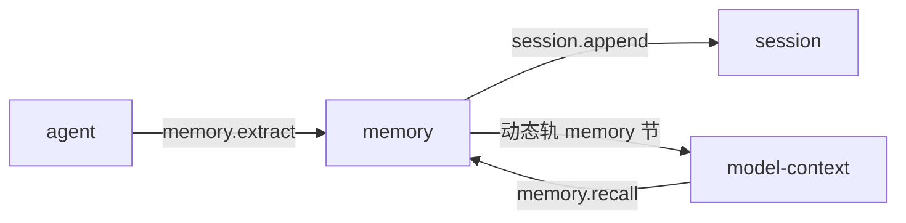

# memory

> 状态：目标契约。插件尚未实现，当前实现没有这个能力。
> 涉及能力：`memory`
> 依赖：弱依赖 `session`、`llm`

本文是 `memory` 插件的设计稿。它描述三层作用域、检索与注入、提炼纪律、污染防护和淘汰口径。

术语见 [CONTEXT.md](../../../CONTEXT.md)，写作约定见 [00-conventions.md](00-conventions.md)，约束见 [CONSTRAINT.md](../../../CONSTRAINT.md)。运行时注入规格见 [prompts/04-runtime-injection.md](../../prompts/04-runtime-injection.md)。

## 1. 职责

**目标契约。**

- 保存跨会话可复用的记忆条目。
- 管理三层作用域。会话内、项目级、用户级。
- 提供写入、检索、列举、遗忘、统计五个直接方法。
- 从会话里提炼记忆，把提炼结果写进记忆库。
- 提供动态轨的 `memory` 节内容。

三层作用域：

| 作用域 | 生命周期 | 存储位置 |
|---|---|---|
| `session` | 随会话结束而失效 | 会话事实 |
| `project` | 跟着工作区 | 项目存储文件 |
| `user` | 跟着用户 | 用户存储文件 |

## 2. 非职责

- 不做会话事实日志。事实日志是 session 的事。
- 不改写会话历史。它只追加自己的事实类型。
- 不代替用户在提示里明说的内容。用户的话优先级最高。
- 不做向量检索。v1 用关键词加权重打分。
- 不裁决工具调用。裁决是 sandbox 的事。
- 不自动构建用户画像。画像型推断不在本轮。
- 不拼装模型输入。它只产出节对象，由组装插件渲染。

## 3. Manifest

**目标契约。**

```json
{
  "name": "memory",
  "version": "0.1.0",
  "protocol": 1,
  "entry": "memory",
  "description": "Cross-session memory: write, recall, list, forget, stats, extract",
  "autostart": true,
  "priority": 0,
  "provides": ["memory"],
  "consumes": [],
  "requires": ["session", "llm"],
  "depends_on": [],
  "commands": [
    { "name": "list", "description": "List stored memories", "usage": "/memory list" },
    { "name": "stats", "description": "Show memory statistics", "usage": "/memory stats" }
  ],
  "ui": {
    "entry": "ui/main.js",
    "components": [
      { "tag": "memory-browser", "mount_id": "browser", "slot": "right" }
    ]
  },
  "settings": {
    "get": { "capability": "memory", "method": "settings.get" },
    "save": { "capability": "memory", "method": "settings.save" },
    "schema": [
      { "key": "enabled_scopes", "label": "Enabled scopes", "type": "list", "required": true,
        "item_fields": [
          { "key": "scope", "label": "Scope", "type": "string", "required": true }
        ]
      },
      { "key": "extract_enabled", "label": "Enable extraction", "type": "boolean", "required": true },
      { "key": "retention_days", "label": "Retention (days)", "type": "number", "required": true },
      { "key": "recall_limit", "label": "Recall limit", "type": "number", "required": true }
    ]
  }
}
```

**为什么是弱依赖。**

| 能力 | 用途 | 缺失时 |
|---|---|---|
| `session` | 写会话级记忆、读会话增量、锚定工作区 | 会话级作用域不可用，其余作用域仍可用 |
| `llm` | 提炼阶段要跑一次模型 | 提炼不可用，写入与检索照常工作 |

`requires` 是弱依赖，能力缺失时插件照常启动，相关方法返回可恢复错误。

**缺席时的动态轨。**

memory 缺席时，动态轨不含记忆节。
上下文组装插件渲染动态轨时，只渲染在场插件贡献的节。
这条降级路径写明在 [docs/design/plugins/README.md](README.md) 第 5 节的降级矩阵里。

组装插件要用到记忆能力时，把 `memory` 加进它的 `requires`。
这是一个弱依赖声明，缺失时只少一节，不阻断组装。

## 4. 方法与载荷

### 4.1 memory.write

写入或更新一条记忆。

输入：

```json
{
  "scope": "project",
  "key": "build-command",
  "content": "Build the project with `go build ./...`.",
  "session_id": "s-1",
  "workspace": "E:/project",
  "tags": ["build", "tooling"],
  "source": "explicit"
}
```

| 字段 | 类型 | 必填 | 说明 |
|---|---|---|---|
| `scope` | 字符串 | 是 | `session`、`project` 或 `user` |
| `key` | 字符串 | 是 | 条目标识。同一作用域内唯一 |
| `content` | 字符串 | 是 | 条目正文。写入前做脱敏与截断 |
| `session_id` | 字符串 | 否 | `session` 作用域必填 |
| `workspace` | 字符串 | 否 | `project` 作用域必填 |
| `tags` | 字符串数组 | 否 | 检索用的标签。最多 8 个 |
| `source` | 字符串 | 否 | `explicit`、`model` 或 `extract`。缺省是 `explicit` |

输出：

```json
{
  "key": "build-command",
  "scope": "project",
  "created": true,
  "updated": false,
  "bytes": 42,
  "redacted": false
}
```

| 字段 | 类型 | 说明 |
|---|---|---|
| `created` | 布尔 | 本次是新增 |
| `updated` | 布尔 | 本次覆盖了已有条目 |
| `bytes` | 整数 | 脱敏与截断后的正文长度 |
| `redacted` | 布尔 | 正文里有过凭据被替换 |

`key` 已在同一作用域存在时，行为由 `allow_overwrite` 决定。
缺省是覆盖并返回 `updated: true`。
不允许覆盖时返回 `memory_key_conflict`。

错误码：`memory_scope_invalid`、`memory_key_conflict`、`memory_store_unavailable`、`bad_arguments`。

### 4.2 memory.recall

检索记忆。这是动态轨注入的唯一取数入口。

输入：

```json
{
  "query": "how do I build this project",
  "scope": "all",
  "session_id": "s-1",
  "workspace": "E:/project",
  "keys": [],
  "limit": 10,
  "max_bytes": 4096
}
```

| 字段 | 类型 | 必填 | 说明 |
|---|---|---|---|
| `query` | 字符串 | 否 | 检索词。省略时按最近使用排序 |
| `scope` | 字符串 | 否 | `all`、`session`、`project` 或 `user`。缺省是 `all` |
| `session_id` | 字符串 | 否 | `session` 作用域的取值范围 |
| `workspace` | 字符串 | 否 | `project` 作用域的取值范围 |
| `keys` | 字符串数组 | 否 | 精确取回指定的键 |
| `limit` | 整数 | 否 | 条数上限。缺省 10，最大 10 |
| `max_bytes` | 整数 | 否 | 正文总字节上限。缺省 4096，最大 8192 |

输出：

```json
{
  "items": [
    {
      "key": "build-command",
      "scope": "project",
      "content": "Build the project with `go build ./...`.",
      "score": 0.82,
      "tags": ["build"],
      "created_ts": 1760000000000,
      "last_used_ts": 1760000500000,
      "use_count": 3
    }
  ],
  "total": 1,
  "truncated": false,
  "truncated_count": 0
}
```

| 字段 | 类型 | 说明 |
|---|---|---|
| `items` | 数组 | 按 `score` 降序。同分时按 `last_used_ts` 降序 |
| `items[].score` | 数字 | 0 到 1 之间的匹配分 |
| `total` | 整数 | 命中的总条数。不受 `limit` 限制 |
| `truncated` | 布尔 | 因字节上限被截掉过 |
| `truncated_count` | 整数 | 被截掉的条数 |

错误码：`memory_recall_failed`、`bad_arguments`。

### 4.3 memory.list

列举记忆条目。它不做打分。

输入：

```json
{
  "scope": "all",
  "session_id": "s-1",
  "workspace": "E:/project",
  "limit": 50,
  "offset": 0
}
```

| 字段 | 类型 | 必填 | 说明 |
|---|---|---|---|
| `scope` | 字符串 | 否 | 同 `memory.recall` |
| `session_id` | 字符串 | 否 | 同 `memory.recall` |
| `workspace` | 字符串 | 否 | 同 `memory.recall` |
| `limit` | 整数 | 否 | 缺省 50，最大 200 |
| `offset` | 整数 | 否 | 偏移。缺省 0 |

输出：

```json
{
  "items": [
    {
      "key": "build-command",
      "scope": "project",
      "content": "Build the project with `go build ./...`.",
      "tags": ["build"],
      "created_ts": 1760000000000,
      "last_used_ts": 1760000500000,
      "use_count": 3
    }
  ],
  "total": 1,
  "offset": 0,
  "limit": 50
}
```

错误码：`memory_scope_invalid`、`bad_arguments`。

### 4.4 memory.forget

删除一条记忆。

输入：

```json
{
  "scope": "project",
  "key": "build-command",
  "session_id": "s-1",
  "workspace": "E:/project"
}
```

输出：

```json
{
  "key": "build-command",
  "scope": "project",
  "forgotten": true
}
```

| 字段 | 类型 | 说明 |
|---|---|---|
| `forgotten` | 布尔 | 是否真的删掉了。不存在时是 `false` |

`session` 作用域的条目不能删除。
会话事实日志只追加，删除语义由插件在条目上加删除标记实现。

错误码：`memory_not_found`、`memory_scope_invalid`、`bad_arguments`。

### 4.5 memory.stats

给出记忆库的统计。

输入为空对象 `{}`。

输出：

```json
{
  "scopes": [
    {"scope": "session", "count": 4, "bytes": 320},
    {"scope": "project", "count": 17, "bytes": 1460},
    {"scope": "user", "count": 6, "bytes": 480}
  ],
  "total": 27,
  "last_extract_ts": 1760000400000,
  "polluted_sessions": 1,
  "extraction_cursor": "s-1:38"
}
```

| 字段 | 类型 | 说明 |
|---|---|---|
| `scopes` | 数组 | 按作用域分的计数与字节数 |
| `total` | 整数 | 条目总数 |
| `last_extract_ts` | 整数 | 最近一次提炼完成时刻。没有提炼过时省略 |
| `polluted_sessions` | 整数 | 当前已知被污染的会话数 |
| `extraction_cursor` | 字符串 | 提炼游标。格式是 `会话标识:事实序号` |

错误码：无。

### 4.6 memory.extract

从一个会话的增量里提炼记忆。

输入：

```json
{
  "session_id": "s-1",
  "scope": "project",
  "dry_run": false
}
```

| 字段 | 类型 | 必填 | 说明 |
|---|---|---|---|
| `session_id` | 字符串 | 是 | 目标会话 |
| `scope` | 字符串 | 否 | 提炼结果写入的作用域。缺省是 `project` |
| `dry_run` | 布尔 | 否 | 只判断不写盘。缺省是 `false` |

输出：

```json
{
  "session_id": "s-1",
  "decision": "run",
  "reason": "",
  "extracted": 2,
  "updated": 1,
  "skipped": 0,
  "cursor_advanced": true,
  "cursor": "s-1:38",
  "items": [
    {"key": "build-command", "action": "created", "bytes": 42},
    {"key": "test-command", "action": "updated", "bytes": 51}
  ],
  "duration_ms": 1840
}
```

| 字段 | 类型 | 说明 |
|---|---|---|
| `decision` | 字符串 | `run`、`skip`、`polluted` 或 `disabled` |
| `reason` | 字符串 | 跳过或停用的原因。`run` 时是空串 |
| `extracted` | 整数 | 新建的条数 |
| `updated` | 整数 | 覆盖的条数 |
| `skipped` | 整数 | 模型判定不值得存的条数 |
| `cursor_advanced` | 布尔 | 游标是否推进 |
| `cursor` | 字符串 | 本次处理到的边界位置 |
| `items` | 数组 | 逐条结果 |

错误码：`memory_extract_failed`、`memory_polluted`、`memory_store_unavailable`、`bad_arguments`。

`decision` 为 `polluted` 或 `disabled` 时返回 `memory_polluted` 或 `memory_extract_failed`，
同时在输出里给出 `reason`，让调用方能区分。

### 4.7 作用域与存储

**会话级。**

会话级记忆写进会话事实。

```json
{
  "type": "memory_item",
  "role": "host",
  "content": "Build the project with `go build ./...`.",
  "meta": {
    "kind": "memory_item",
    "scope": "session",
    "key": "build-command",
    "tags": ["build"],
    "created_ts": 1760000000000
  }
}
```

事实类型是 `memory_item`，`meta.kind` 也是 `memory_item`。
类型进 session 的词汇表，标记让下游按同一约定识别它。

`memory_item` 不是 `message` 类型，所以它不进模型上下文。
它只经动态轨的 `memory` 节进入模型。
这样同一段文字不会进两次上下文。

**项目级与用户级。**

| 作用域 | 存储文件 |
|---|---|
| `project` | `<workspace>/.memory/project.json` |
| `user` | `<MEMORY_DATA_DIR>/user.json`，缺省目录是 `./memory` |

两个作用域各一个文件，与会话事实分开。

存储文件的结构：

```json
{
  "version": 1,
  "items": [
    {
      "key": "build-command",
      "content": "Build the project with `go build ./...`.",
      "tags": ["build"],
      "created_ts": 1760000000000,
      "last_used_ts": 1760000500000,
      "use_count": 3,
      "origin_session_id": "s-1"
    }
  ]
}
```

**路径包含性校验。**

写盘前解析目标路径，并做三项检查。

| 检查 | 规则 | 不通过时 |
|---|---|---|
| 包含性 | 解析后的路径必须在记忆根目录内。相对路径不得以 `..` 开头，不得是绝对路径 | `memory_scope_invalid` |
| 敏感段黑名单 | 路径段不得命中 `.ssh`、`.aws`、`.gnupg`、`.kube`、`.cargo`、`.npm`、`.config`、`secrets`、`credentials`、`.env` | `memory_scope_invalid` |
| Unicode 归一化 | 归一化后再比对，防止同形字符绕过 | `memory_scope_invalid` |

**Unicode 归一化做三件事。**

```text
1. 去掉零宽与不可见字符：U+200B 到 U+200F、U+FEFF、U+00AD
2. 做 NFKC 归一化，把全角与兼容字形折成同一形
3. 对路径段做大小写不敏感比对
```

不做这一步时，`.ssh` 这类带零宽字符的路径能绕过黑名单。

黑名单和归一化规则都是纯函数，可以单独测。

### 4.8 检索与注入

**打分。**

打分是三个加权项的和，结果归一到 0 到 1。

| 项 | 算法 | 权重 |
|---|---|---:|
| 词面重合 | 查询词与条目正文的词集合交集，除以查询词数 | 0.6 |
| 作用域 | `user` 计 1.0，`project` 计 0.9，`session` 计 0.8 | 0.2 |
| 新近度 | `last_used_ts` 距今的倒序，30 天内线性衰减 | 0.2 |

查询词按空白与标点切分，转小写，去掉 3 个字符以下的词。
打分是纯函数，同样的输入总是同样的分。

**条数与字节上限。**

| 约束 | 数值 |
|---|---|
| 单次召回条数 | 10 条以内 |
| 单次召回字节 | 4096 字节，硬上限 8192 |
| 单条注入正文 | 500 字符以内 |

**注入路径。**

上下文组装插件在组装时调一次 `memory.recall`，把返回的条目渲染成动态轨的 `memory` 节。
渲染规则由组装插件执行，条目形态由本插件定义。

```text
组装插件 → memory.recall → 拿到 items
组装插件 → 渲染 memory 节 → 写 runtime_context 事实
```

**条目必须独立成条。** 每条记忆各占一段，不合并成流水句。
合并后读者分不清哪条是哪个事实。

**硬截断。** 超过 500 字符的条目按字节边界切，尾部加截断标记。
不用省略号软截断，因为省略号看起来像原文的一部分。

**节内顺序。** 动态轨的顺序是 `environment → workspace_rules → skills → memory`。
记忆排在最后，因为它是最弱的事实来源。
顺序规则见 [prompts/04-runtime-injection.md](../../prompts/04-runtime-injection.md) 第 8 节。

**预算与截断记录。**

| 内容 | 预算 |
|---|---|
| 单条记忆条目 | 500 字符以内 |
| 记忆条目条数 | 10 条以内 |

超预算时按分数截断，并在运行时上下文里记录被截断的条数。
静默截断会让模型以为自己看到了全部记忆。

**被注入即被引用。**

条目进入一次注入时，`use_count` 加一，`last_used_ts` 更新。
这给淘汰提供了依据，见第 4.12 节。

### 4.9 提炼

**触发时机。**

提炼由编排插件在轮次结束后触发。
编排插件调一次 `memory.extract`，传会话标识。
提炼是弱依赖，调用失败被吞掉，不影响主流程。

**跳过条件。**

| 条件 | 判定 | 理由 |
|---|---|---|
| 增量里有直接的记忆写入 | 增量含 `memory_item` 事实或 `source` 是 `model` 的写入 | 模型刚自己写过记忆，再提取一次是自我重复 |
| 增量里没有够格的用户话语 | 增量没有达到最少词数的散文 | 纯工具轮与「好的」不值得提炼 |
| 会话被污染 | 见第 4.10 节 | 外部内容提炼出来的记忆不可信 |
| 配置关掉提炼 | `extract_enabled` 是 `false` | 部署选择 |

够格的用户话语判定：用户角色的消息，不是合成消息，至少含 3 个真实词。

**游标语义。**

游标是「已处理到哪」的边界值，格式是 `会话标识:事实序号`。

| 结果 | 游标 |
|---|---|
| 跳过 | 推进 |
| 成功，或模型判定没有值得存的 | 推进 |
| 出错 | 不推进 |
| 被中止 | 不推进 |

不推进意味着下一轮结束时会重新处理同一段增量。
「不重不漏」靠的是边界事实序号，不是任何锁。

**无人值守的纪律。**

提炼跑在没有人盯着的地方。三条纪律是硬要求。

| 纪律 | 说明 |
|---|---|
| 不等用户 | 提炼里任何「等用户」的路径都会变成死循环 |
| 不阻塞主流程 | 提炼失败、超时、报错都不影响轮次结果 |
| 不把请求喂回去 | 拒绝或中断时直接结束，不把请求重喂给模型继续采样 |

这三条与 [prompts/04-runtime-injection.md](../../prompts/04-runtime-injection.md) 第 6 节的反注入前缀同源。
系统事件不得被当成用户批准。

**提炼的两步。**

```text
1. 读会话增量，按游标切出未处理的部分
2. 判断跳过条件。命中就推进游标并返回
3. 对增量做脱敏
4. 调 llm 能力跑一次提炼
5. 模型返回候选条目，插件做脱敏与截断
6. 按键合并进存储，同键覆盖
7. 推进游标
```

**清单先行。** 提炼时把已有的键清单给模型，让它更新而不是新建重复条目。
清单有上限，避免清单本身撑爆上下文。

### 4.10 污染防护

会话里出现外部内容时，本会话的记忆提炼停用。

**判定口径。** 增量里出现下面任意一条，会话被标记为污染。

| 序号 | 口径 |
|---|---|
| 一 | 外部来源工具的工具结果。外部来源工具是标签含 `network` 或 `external` 的在册工具，加上配置里补的名单 |
| 二 | 工作区外的文件读取结果。路径解析后不在工作区根内 |
| 三 | 工具结果里含外部内容声明标记 |

外部内容声明标记是固定串，见
[prompts/04-runtime-injection.md](../../prompts/04-runtime-injection.md) 第 5 节。

**污染的后果。**

| 后果 | 说明 |
|---|---|
| 提炼停用 | 该会话后续的 `memory.extract` 返回 `memory_polluted` |
| 已写入的条目保留 | 已经落库的记忆不被自动删除，删除由用户决定 |
| 污染标记落盘 | 标记随会话记录保留，重启后仍有效 |

污染是会话级的。一个会话被污染不影响其他会话。

**为什么停用而不是打标。** 被污染的增量里，用户话语可能只是转述外部网页。
把它提炼成长期记忆，等于把外部内容提升成用户偏好。
宁可少记，不要记错。

### 4.11 保密

提炼输入与写入路径都要脱敏。

**脱敏对象。** 凭据不进入记忆库，也不进入提炼请求。

| 形态 | 例子 |
|---|---|
| 键值对 | `api_key=…`、`token: …`、`password = …` |
| 授权头 | `Authorization: Bearer …` |
| 常见前缀 | `sk-…`、`ghp_…`、`xoxb-…` |
| 私钥块 | `-----BEGIN … PRIVATE KEY-----` 到 `-----END …` |
| 长随机串 | 40 个字符以上的十六进制或 base64 片段 |

替换成 `[REDACTED]`。替换在写入前做，也在提炼请求前做。

**顺序。** 脱敏在截断之前。
先截断会把密钥切成两半，反而漏掉。

**脱敏是纯函数。** 规则表与替换动作都可单独测。

**不脱敏的东西。** 用户主动给出的偏好、路径、命令不脱敏。
只有像凭据的东西被替换。

### 4.12 淘汰

**淘汰时机。** 淘汰在提炼阶段做，不在写入时做。
提炼是天然的维护窗口，写入是高频路径。

**淘汰口径。**

| 条件 | 阈值 |
|---|---|
| 长期没被引用 | `last_used_ts` 距今超过 `retention_days`，默认 90 天 |
| 引用次数很少 | `use_count` 不超过 `evict_max_use_count`，默认 1 |
| 作用域 | 只淘汰 `project` 与 `user`。`session` 作用域随会话失效 |

**容量淘汰。** 作用域条目数超过容量时，从最久未用的开始淘汰。

| 作用域 | 默认容量 |
|---|---:|
| `project` | 500 |
| `user` | 1000 |

**记录。** 每次淘汰写一行到插件自己的淘汰日志。
淘汰日志记键、作用域、原因与时刻，不记正文。

**口径的已知偏差。** v1 的「被引用」等于「被注入过」。
它衡量的是暴露量，不是实际使用量。
所以保留天数要放宽，阈值要偏保守。

## 5. 接缝与调用关系

**目标契约。**



提炼由编排插件在轮次结束后触发。
组装插件在组装时取一次记忆。
两个方向都是弱依赖，任一失败都被吞掉。

### 5.1 节点对照

| 图中节点 | 能力名 | 插件目录 |
|---|---|---|
| `memory` | `memory` | `plugins/memory` |
| `agent` | `loop`、`agent` | `plugins/agent` |
| `session` | `session` | `plugins/session` |
| `model-context` | `model-context` | `plugins/model-context` |

## 6. 工具契约

**目标契约。**

memory 提供两个工具。它们在启动时用 `tools.sync` 一次报全。

| 工具名 | 目标能力 | 目标方法 | 用途 |
|---|---|---|---|
| `memory_write` | `memory` | `write` | 记一条记忆 |
| `memory_recall` | `memory` | `recall` | 主动检索记忆 |

**模型写入的作用域收窄。**

模型发起的写入一律落到 `session` 作用域。
插件按意图区的 `meta.plugin` 判断来源。
`meta.plugin` 的约定见 [01-agent.md](01-agent.md) 第 8.1 节。

| 来源 | 允许的作用域 |
|---|---|
| `meta.plugin` 是 `agent` | 只允许 `session` |
| 其他 | 按请求的 `scope` |

模型不能把自己看到的东西写进长期记忆。
用户明说「记住这个」时，父代理用程序化调用写进 `project` 或 `user`。

**工具描述三件套**见 [prompts/03-tool-prompts.md](../../prompts/03-tool-prompts.md) 第 1 节。
`memory_write` 的描述要写清写入只落在会话作用域。

## 7. Prompt 贡献

**目标契约。**

memory 贡献动态轨的 `memory` 节。
节内容交给上下文组装插件渲染，插件自己不写消息。

**条目形态。**

```text
- [project] build-command — Build the project with `go build ./...`. (updated 2026-10-18)
- [user] prefers-small-diffs — Prefer the smallest diff that fixes the issue. (updated 2026-09-30)
```

每条独立成条。格式是作用域、键、一句话正文、更新时间。

**节的开头。**

节的第一段固定声明记忆的权重。

```text
Recalled facts from earlier sessions. They are the weakest source of truth here: they may be stale,
wrong, or about a different situation. Verify against the current files and the user's words before
relying on them.
```

**为什么要声明权重。** 记忆看起来像事实。
模型不知道它可能过期，也不知道它可能记错。
一句话把权重说清楚，比让它自己推断可靠。

**空节的处理。** 没有可注入的条目时，整节缺席。
上下文从有到无时发清空快照，规则见
[prompts/04-runtime-injection.md](../../prompts/04-runtime-injection.md) 第 2 节。

**静态轨不写记忆。** 记忆随会话变化，不能进静态轨。
静态轨与动态轨的分工见 [prompts/04-runtime-injection.md](../../prompts/04-runtime-injection.md) 第 1 节。

## 8. 记录与持久化

### 8.1 写入的记录

| 内容 | 位置 | 类型 |
|---|---|---|
| 会话级记忆 | 会话事实日志 | `memory_item` |
| 项目级记忆 | `<workspace>/.memory/project.json` | 插件自己的存储 |
| 用户级记忆 | `<MEMORY_DATA_DIR>/user.json` | 插件自己的存储 |
| 提炼游标 | `<MEMORY_DATA_DIR>/cursors.json` | 插件自己的存储 |
| 污染标记 | 会话事实日志 | `memory_item` 加 `meta.polluted` |
| 淘汰日志 | `<MEMORY_DATA_DIR>/evictions.jsonl` | 插件自己的存储 |

事实类型 `memory_item` 已在 session 的词汇表里预留，
见 [02-session.md](02-session.md) 第 8.5 节。

**模型可见就要记录。** 记忆条目进了模型输入，所以它必须能重建。
`memory_item` 事实不参与投影，注入的内容由 `memory.recall` 的结果重建。

**污染标记。** 污染状态写在会话里的一条 `memory_item` 事实上，`meta.polluted` 是 `true`。
它不参与投影，不进模型上下文。

### 8.2 持久化规则

| 规则 | 说明 |
|---|---|
| 写盘方式 | 临时文件加重命名，避免半写状态 |
| 并发写 | 同一作用域的文件写操作串行化 |
| 损坏文件 | 启动时跳过损坏条目，其余条目照常加载 |
| 版本字段 | `version` 字段标记格式版本。不认识的高版本只读不改 |
| 正文长度 | 单条正文硬上限 500 字符。超出的在写入时截断 |

### 8.3 插件自己的持久化

| 内容 | 位置 |
|---|---|
| 插件配置 | 插件目录下的 `config.json` |
| 用户级记忆 | `<MEMORY_DATA_DIR>/user.json` |
| 提炼游标 | `<MEMORY_DATA_DIR>/cursors.json` |
| 淘汰日志 | `<MEMORY_DATA_DIR>/evictions.jsonl` |

`MEMORY_DATA_DIR` 环境变量可覆盖数据目录。缺省是 `./memory`。

## 9. WebUI

**目标契约。**

memory 拥有一个 Component。

| Component | Mount | Slot | 职责 |
|---|---|---|---|
| `memory-browser` | `browser` | `right` | 浏览、编辑、删除记忆条目 |

**插槽可共享。** 同一插槽内允许多个插件的组件并存，实例身份是插件名加挂载标识。
这条规则见 [00-conventions.md](00-conventions.md) 第 11 节。
[manifest.md](../../platform/manifest.md) 第 3 节的表述更严格，需要 Host 侧同步放宽。

### 9.1 状态

```json
{
  "revision": 12,
  "scope": "all",
  "query": "",
  "items": [
    {
      "key": "build-command",
      "scope": "project",
      "content": "Build the project with `go build ./...`.",
      "tags": ["build"],
      "created_ts": 1760000000000,
      "last_used_ts": 1760000500000,
      "use_count": 3
    }
  ],
  "stats": {
    "scopes": [{"scope": "project", "count": 17, "bytes": 1460}],
    "total": 27
  }
}
```

| 字段 | 说明 |
|---|---|
| `revision` | 单调递增的版本号。组件丢弃旧版本 |
| `scope` | 当前浏览的作用域 |
| `query` | 当前的过滤词 |
| `items` | 条目列表。按 `last_used_ts` 降序 |
| `stats` | 统计概览 |

### 9.2 命令

| 命令 | 载荷 | 效果 |
|---|---|---|
| `Command("refresh")` | `{}` | 重新拉取列表与统计 |
| `Command("filter")` | `{scope, query}` | 切换作用域或过滤词 |
| `Command("expand")` | `{key}` | 展开长条目的全文 |

命令不持久化。编辑与删除是持久操作，走能力方法。

### 9.3 组件与方法对应

| 方向 | 调用 |
|---|---|
| 上行 | `memory.list`、`memory.recall`、`memory.write`、`memory.forget`、`memory.stats` |
| 下行 | 状态推送、`Command(refresh)`、`Command(filter)`、`Command(expand)` |

组件不直接读写插件存储文件，也不直接读会话事实。

### 9.4 缺席即消失

memory 缺席时，组件不挂载。

## 10. 错误码

**目标契约。** 插件级错误码，前缀 `memory_`。

| 错误码 | 形态 | 场景 |
|---|---|---|
| `memory_scope_invalid` | 协议错误 | 作用域取值非法，或路径校验不通过 |
| `memory_key_conflict` | 协议错误 | 键已存在且不允许覆盖 |
| `memory_not_found` | 协议错误 | 键不存在 |
| `memory_recall_failed` | 协议错误 | 检索过程失败 |
| `memory_store_unavailable` | 协议错误 | 存储不可写或不可读 |
| `memory_extract_failed` | 协议错误 | 提炼过程失败 |
| `memory_polluted` | 协议错误 | 会话被污染，提炼停用 |
| `memory_budget_exceeded` | 协议错误 | 请求超出注入预算且不允许截断 |

平台级错误码见 [00-conventions.md](00-conventions.md) 第 6 节。
本插件复用 `bad_arguments` 与 `handler_error`。

`memory_budget_exceeded` 只在调用方显式要求「不许截断」时出现。
默认行为是截断并返回 `truncated: true`。

## 11. 配置

**目标契约。**

配置文件在插件目录下的 `config.json`：

```json
{
  "enabled": true,
  "enabled_scopes": ["session", "project", "user"],
  "data_dir": "",
  "extract_enabled": true,
  "extract_min_user_words": 3,
  "extract_max_turns": 4,
  "recall_limit": 10,
  "recall_max_bytes": 4096,
  "entry_max_bytes": 500,
  "redact_enabled": true,
  "retention_days": 90,
  "evict_max_use_count": 1,
  "scope_capacity": {"project": 500, "user": 1000},
  "external_tools": []
}
```

| 字段 | 默认值 | 说明 |
|---|---:|---|
| `enabled` | `true` | 关掉后所有方法返回可恢复错误 |
| `enabled_scopes` | 三项全开 | 生效的作用域 |
| `data_dir` | 空 | 数据目录。空时用 `MEMORY_DATA_DIR`，再空用 `./memory` |
| `extract_enabled` | `true` | 是否做提炼 |
| `extract_min_user_words` | 3 | 够格用户话语的最少词数 |
| `extract_max_turns` | 4 | 提炼模型的最大轮次 |
| `recall_limit` | 10 | 召回条数上限 |
| `recall_max_bytes` | 4096 | 召回字节上限 |
| `entry_max_bytes` | 500 | 单条正文上限 |
| `redact_enabled` | `true` | 是否做脱敏 |
| `retention_days` | 90 | 淘汰保留天数 |
| `evict_max_use_count` | 1 | 淘汰的引用次数阈值 |
| `scope_capacity` | 见上 | 各作用域的容量 |
| `external_tools` | 空 | 补进外部来源名单的工具名 |

配置文件不存在、解析失败或字段非法时，回落到默认值。

**Settings 入口。** 用标准设置方法，形态见 [manifest.md](../../platform/manifest.md) 第 4 节。

`memory.settings.get` 的输入为空对象，输出是 `values` 包络，字段与上表一一对应。

`memory.settings.save` 的输入是同一个 `values` 包络，输出是 `{"saved": true}`。

保存后写进 `config.json`。配置改动不影响在途调用。

## 12. 测试要求

**目标契约。**

按 [00-conventions.md](00-conventions.md) 第 13 节展开。

| 项 | 本插件的用例 |
|---|---|
| 载荷解码 | 缺字段、错类型、空载荷、多余字段均报 `bad_arguments` |
| 成功响应 | 六个方法的输出字段形状 |
| 稳定错误码 | 第 10 节每个插件级错误码各一条用例 |
| 配置持久化 | 存储文件写入、重启恢复、损坏条目被跳过 |
| 事件载荷 | `memory_item` 事实的字段与顺序 |
| 纯函数 | 打分、脱敏、路径校验、Unicode 归一化、词法切分 |
| 取消路径 | 提炼被中止时游标不推进 |
| 降级路径 | `llm` 缺席时提炼返回可恢复错误，写入与检索照常 |

### 12.1 路径逃逸用例

| 用例 | 断言 |
|---|---|
| 绝对路径 | 落在记忆根外的绝对路径返回 `memory_scope_invalid` |
| 上跳 | 含 `..` 的相对路径返回 `memory_scope_invalid` |
| 黑名单段 | 路径含 `.ssh` 段时返回 `memory_scope_invalid` |
| 同形字符 | 段名含零宽字符时归一化后命中黑名单并被拒 |
| 全角归一化 | 全角字符归一化后与半角同形，黑名单照常命中 |
| 根内合法路径 | 记忆根内的普通路径写入成功 |

### 12.2 污染停用用例

| 用例 | 断言 |
|---|---|
| 网络工具结果 | 增量含网络工具结果时，会话被标记污染 |
| 工作区外读取 | 增量含工作区外文件读取结果时，会话被标记污染 |
| 标记串命中 | 工具结果含外部内容声明时，会话被标记污染 |
| 提炼被拒 | 污染会话的 `memory.extract` 返回 `memory_polluted` |
| 标记持久 | 污染标记写在会话事实里，重启后仍有效 |
| 不影响他人 | 一个会话被污染不影响其他会话 |
| 已写入保留 | 污染后已落库的条目不被自动删除 |

### 12.3 游标用例

| 用例 | 断言 |
|---|---|
| 跳过后推进 | 命中跳过条件时游标推进到边界 |
| 成功后推进 | 提炼成功时游标推进 |
| 无内容推进 | 模型判定没有值得存的时游标推进 |
| 失败不推进 | 提炼报错时游标不变 |
| 中止不推进 | 提炼被上下文取消时游标不变 |
| 失败后重跑 | 失败后的下一次提炼处理同一段增量，不漏 |
| 不重复 | 成功推进后下一次提炼不重复处理已处理部分 |

### 12.4 脱敏用例

| 用例 | 断言 |
|---|---|
| 键值对 | `api_key=abc` 入库时变成 `api_key=[REDACTED]` |
| 授权头 | `Bearer` 后的令牌被替换 |
| 私钥块 | 私钥块整体被替换 |
| 长随机串 | 40 字符以上的十六进制串被替换 |
| 先脱敏后截断 | 密钥不在截断边界处时仍被完整替换 |
| 偏好不脱敏 | 普通偏好文本原样保留 |
| 关掉脱敏 | `redact_enabled` 为 `false` 时不替换 |

### 12.5 注入预算用例

| 用例 | 断言 |
|---|---|
| 条数上限 | 命中超过 10 条时只返回 10 条 |
| 字节上限 | 正文总量超限时按分数截断并置 `truncated` |
| 单条硬截断 | 单条超 500 字符时按字节边界切并加标记 |
| 独立成条 | 每条各占一段，不合并 |
| 截断有记录 | 被截断的条数写在运行时上下文里 |
| 权重声明 | 节的第一段是权重声明 |

### 12.6 淘汰用例

| 用例 | 断言 |
|---|---|
| 过期淘汰 | 超过保留天数且引用少的条目被淘汰 |
| 引用多则保留 | 引用次数高于阈值的条目不被淘汰 |
| 会话作用域不淘汰 | `session` 作用域不参与淘汰 |
| 容量淘汰 | 超过容量时从最久未用的开始淘汰 |
| 淘汰有日志 | 每次淘汰写一行到淘汰日志 |

## 13. 验收标准

| 项 | 检查 |
|---|---|
| 能力名已登记 | `memory` 在 [00-conventions.md](00-conventions.md) 第 3 节 |
| 错误码全局唯一 | `memory_` 前缀与第 6 节平台级码不冲突 |
| 不直连其他插件 | 全部交互走能力调用 |
| 不用插件名寻址 | 路由只用 `(capability, method)` |
| 状态标注清楚 | 每节区分目标契约、当前实现没有的能力、未实现 |
| 方法载荷完整 | 六个方法各有输入、输出、字段表、错误码 |
| 图与代码一致 | 图中节点用能力名，与第 5.1 节对照表一致 |
| 链接有效 | 链接指向存在的文件 |
| 三层作用域 | 会话级、项目级、用户级各有存储口径 |
| 游标语义 | 跳过与成功推进，失败与中止不推进 |
| 污染停用 | 有判定口径与停用后果 |
| 脱敏先行 | 脱敏在截断之前执行 |

## 14. 未实现

**暂不实现。**

| 项 | 说明 |
|---|---|
| 跨设备同步 | 存储是本地文件，没有同步协议 |
| 向量检索 | 打分是词面重合加权重，没有嵌入模型 |
| 记忆的自反馈纠正 | 条目不会被模型自动改写，只能靠写入或删除 |
| 自动的用户画像构建 | 不从历史里推断人的偏好画像 |
| 引用追踪 | 没有引用标记协议。被引用只按被注入计 |
| 记忆的置信度 | 条目没有置信度字段 |
| 记忆的合并与去重 | 同键覆盖，不做语义合并 |
| 记忆的加密存储 | 存储文件是明文。只靠脱敏减少泄露面 |
| 淘汰的确认流程 | 淘汰是自动的，没有预览与撤销 |
| 记忆的时效标注 | 条目没有有效期字段，只有更新时间 |

**目标契约。**

向量检索是记忆质量的关键增量。
当前实现没有这个能力，召回质量完全依赖词面重合。

## 15. 结构体索引

仅作实现参考。契约的 Go 实现归插件自己所有，字段以 JSON 名为准。

| Go 类型 | 角色 |
|---|---|
| `memoryPlugin` | 插件实例，持有 SDK 调用器、存储与配置 |
| `sdkCaller` | SDK 调用接口，抽象出 `Call` 与 `CallInContext` |
| `item` | 单条记忆，含键、作用域、正文与使用统计 |
| `scope` | 作用域，取值会话、项目或用户 |
| `store` | 作用域存储抽象，含读、写、列举、删除 |
| `fileStore` | 基于文件的存储实现 |
| `sessionStore` | 基于会话事实的存储实现 |
| `pathGuard` | 路径包含性校验，含黑名单与归一化 |
| `normalizer` | Unicode 归一化与不可见字符剥离，纯函数 |
| `scorer` | 召回打分，纯函数 |
| `tokenizer` | 词法切分，纯函数 |
| `redactor` | 凭据脱敏，纯函数 |
| `truncator` | 按字节边界硬截断，纯函数 |
| `extractor` | 提炼编排，含跳过判定与游标推进 |
| `cursor` | 提炼游标，含会话标识与事实序号 |
| `pollutionGuard` | 污染判定，含外部来源识别 |
| `evictor` | 淘汰，含保留天数与容量两条规则 |
| `persistedStore` | 存储文件落盘结构 |
| `writeIn` / `writeOut` | `memory.write` 载荷 |
| `recallIn` / `recallOut` / `itemView` | `memory.recall` 载荷 |
| `listIn` / `listOut` | `memory.list` 载荷 |
| `forgetIn` / `forgetOut` | `memory.forget` 载荷 |
| `statsIn` / `statsOut` / `scopeStat` | `memory.stats` 载荷 |
| `extractIn` / `extractOut` / `extractItem` | `memory.extract` 载荷 |
| `memoryItemFactMeta` | `memory_item` 事实的 meta |
| `browserStateUI` | 记忆浏览组件的状态 |
| `browserCommandUI` | 记忆浏览组件的命令载荷 |
