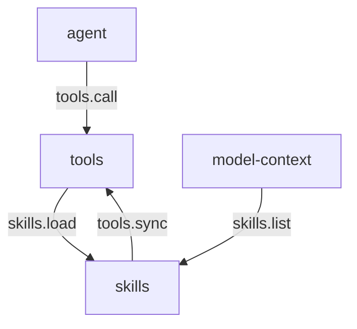

# skills

> 状态：目标契约。插件尚未实现，本文档描述它落地后应满足的契约。
> 涉及能力：`skills`
> 依赖：`tools`（弱依赖）

术语见 [CONTEXT.md](../../../CONTEXT.md)。写作约定见 [00-conventions.md](00-conventions.md)。

## 1. 职责

**目标契约。**

- 维护技能清单。发现技能目录，解析清单头，产出可索引的条目。
- 向动态轨的 `skills` 节注入技能索引。索引每条只有一行摘要。
- 按需加载技能正文。模型请求加载时读出正文，作为工具结果进会话。
- 维护技能的启用与禁用状态。
- 校验技能声明的工具依赖。依赖不在册时该技能不可用。

技能是本地文件里的流程说明。它把"怎么做"从模型记忆里搬到可版本管理的文本里。

## 2. 非职责

- 不执行技能里的动作。动作始终由工具执行。
- 不修改主系统提示的静态轨。技能只产出动态轨节。
- 不做技能市场的分发与安装。
- 不保证技能内容可信。技能是本地文件，但外部引用仍不可信。
- 不做语义检索。索引靠名字与摘要匹配，不靠向量检索。

## 3. Manifest

完整 JSON：

```json
{
  "name": "skills",
  "version": "0.1.0",
  "protocol": 1,
  "entry": "skills",
  "description": "Skill index and on-demand skill body loading",
  "autostart": true,
  "priority": 0,
  "provides": ["skills"],
  "consumes": [],
  "requires": ["tools"],
  "depends_on": [],
  "commands": [],
  "ui": {
    "entry": "ui/main.js",
    "components": [
      {"tag": "skills-list", "mount_id": "list", "slot": "left"}
    ]
  },
  "settings": {
    "get": {"capability": "skills", "method": "settings.get"},
    "save": {"capability": "skills", "method": "settings.save"},
    "schema": [
      {
        "key": "workspace_root",
        "label": "Workspace skills root",
        "type": "string",
        "description": "Leave empty to use <workspace>/.agents/skills"
      },
      {
        "key": "user_root",
        "label": "User skills root",
        "type": "string",
        "description": "Leave empty to use <user-home>/.agents/skills"
      },
      {
        "key": "skills",
        "label": "Skill switches",
        "type": "list",
        "item_fields": [
          {"key": "name", "label": "Name", "type": "string", "required": true},
          {"key": "enabled", "label": "Enabled", "type": "boolean"}
        ]
      },
      {"key": "max_index_bytes", "label": "Index byte budget", "type": "number"},
      {"key": "max_body_bytes", "label": "Body byte budget", "type": "number"}
    ]
  }
}
```

**关于 `provides: ["skills"]`。** 能力名与插件名相同。路由键是 `(skills, method)`。

**关于 `requires: ["tools"]`。** 插件注册 `skill_load` 工具要经工具注册表，所以弱依赖 `tools`。
弱依赖的语义是"缺失时插件照常启动，调用时返回可恢复错误"。
`tools` 缺席时，插件仍能启动，`skills.list`、`skills.describe`、`skills.reload` 仍可用。
此时 `skill_load` 注册不上，动态轨也没有 `skills` 节。

**关于 skills 自身是可选能力。** 插件缺席时，动态轨不含 `skills` 节，对话不中断。
降级矩阵见 [README.md](README.md) 第 5 节。

**关于 `ui`。** 只有一个组件，占 `left` 槽。详见第 9 节。

**关于 `settings`。** 技能目录、开关与两个预算上限都可配。
配置文件形态见第 11 节。

## 4. 方法与载荷

### 4.1 skills.list

列出技能。默认返回索引视图。

输入：

```json
{"view": "index", "scope": "all"}
```

| 字段 | 类型 | 必填 | 说明 |
|---|---|---|---|
| `view` | 字符串 | 否 | `index` 只返回可用技能。`full` 返回全部技能。缺省 `index` |
| `scope` | 字符串 | 否 | `all`、`workspace`、`user`。缺省 `all` |

索引视图输出：

```json
{
  "skills": [
    {
      "name": "pdf-extract",
      "description": "Extract text and tables from PDF files, keeping page numbers.",
      "scope": "workspace"
    }
  ],
  "entry_count": 1,
  "omitted_count": 0
}
```

| 字段 | 类型 | 说明 |
|---|---|---|
| `skills` | 数组 | 索引条目。空数组表示没有可用技能 |
| `skills[].name` | 字符串 | 技能名。全局唯一 |
| `skills[].description` | 字符串 | 一行摘要。最长 250 字符 |
| `skills[].scope` | 字符串 | `workspace` 或 `user` |
| `entry_count` | 整数 | 返回的条目数 |
| `omitted_count` | 整数 | 因预算被裁掉的条目数 |

索引视图只给一行摘要。触发条件不进索引，它在全量视图里。

全量视图输出在索引视图基础上追加字段：

| 字段 | 类型 | 说明 |
|---|---|---|
| `skills[].description` | 字符串 | 完整摘要。不受 250 字符限制 |
| `skills[].when_to_use` | 字符串 | 触发条件。可为空串 |
| `skills[].enabled` | 布尔 | 是否被用户禁用 |
| `skills[].available` | 布尔 | 是否可用。禁用或依赖缺失时为 `false` |
| `skills[].missing_tools` | 字符串数组 | 缺失的工具名 |
| `skills[].body_path` | 字符串 | 清单头所在文件的绝对路径 |
| `skills[].body_hash` | 字符串 | 正文内容的 64 位小写 SHA-256 |

错误码：`bad_arguments`。

### 4.2 skills.describe

读单个技能的元信息。不返回正文。

输入：

```json
{"name": "pdf-extract"}
```

| 字段 | 类型 | 必填 | 说明 |
|---|---|---|---|
| `name` | 字符串 | 是 | 技能名 |

输出与 `skills.list` 的单条全量条目同构。

错误码：`skills_not_found`、`skills_invalid_manifest`、`bad_arguments`。

被禁用的技能仍可 describe。输出里 `enabled` 为 `false`，`available` 为 `false`。

### 4.3 skills.load

读技能正文。

输入：

```json
{"name": "pdf-extract", "session_id": "s-1"}
```

| 字段 | 类型 | 必填 | 说明 |
|---|---|---|---|
| `name` | 字符串 | 是 | 技能名 |
| `session_id` | 字符串 | 否 | 会话标识。用于去重。经工具注册表调用时由提供方输入带入 |

输出：

```json
{
  "name": "pdf-extract",
  "body": "# 抽取流程\n\n1. 打开 PDF\n2. 逐页抽取\n",
  "body_hash": "9f2c…",
  "already_loaded": false,
  "loaded_at": 1760000000000
}
```

| 字段 | 类型 | 说明 |
|---|---|---|
| `name` | 字符串 | 技能名 |
| `body` | 字符串 | 技能正文。已转义保留标签 |
| `body_hash` | 字符串 | 正文内容的 64 位小写 SHA-256 |
| `already_loaded` | 布尔 | 本次是重复加载时为 `true` |
| `loaded_at` | 整数 | 本会话首次加载该技能的时间戳。毫秒 |
| `message` | 字符串 | 重复加载时的提示语。不重复加载时省略 |

重复加载且正文哈希未变时，`body` 省略，只回 `already_loaded` 与 `message`：

```json
{
  "name": "pdf-extract",
  "body_hash": "9f2c…",
  "already_loaded": true,
  "loaded_at": 1760000000000,
  "message": "Skill 'pdf-extract' is already loaded in this session. Read the body earlier in this conversation instead of loading it again."
}
```

错误码：`skills_not_found`、`skills_body_missing`、`skills_dependency_missing`、`skills_load_failed`、`bad_arguments`。

### 4.4 skills.reload

重扫技能目录并重建索引。

输入：

```json
{"scope": "all"}
```

| 字段 | 类型 | 必填 | 说明 |
|---|---|---|---|
| `scope` | 字符串 | 否 | `all`、`workspace`、`user`。缺省 `all` |

输出：

```json
{"scanned": 12, "available": 9, "disabled": 1, "invalid": 2}
```

| 字段 | 类型 | 说明 |
|---|---|---|
| `scanned` | 整数 | 扫到的技能清单数 |
| `available` | 整数 | 可用技能数 |
| `disabled` | 整数 | 被禁用或依赖缺失的技能数 |
| `invalid` | 整数 | 清单头非法被跳过的技能数 |

单条技能非法不中止整次重扫。该条被跳过并计入 `invalid`。

错误码：`bad_arguments`、`handler_error`。

### 4.5 技能结构

一个技能是一个目录。

```text
<skills-root>/<skill-name>/
  SKILL.md          必需。清单头加正文
  references/       可选。正文引用的补充资料
  scripts/          可选。技能附带的脚本
```

清单头用 YAML frontmatter，与正文之间以空行分隔。

```markdown
---
name: pdf-extract
description: Extract text and tables from PDF files, keeping page numbers.
when_to_use: 用户要读 PDF、抽取 PDF 文本或核对 PDF 表格时。
required_tools:
  - file_read
body: references/extract.md
---

# 抽取流程

1. 用 `file_read` 打开 PDF。
2. 逐页抽取文本与表格。
```

| 字段 | 必填 | 说明 |
|---|---|---|
| `name` | 是 | 技能名。匹配 `^[a-z][a-z0-9_-]{0,63}$` |
| `description` | 是 | 一行摘要。最长 250 字符 |
| `when_to_use` | 否 | 触发条件。只进全量视图，不进索引 |
| `required_tools` | 否 | 所需工具名数组 |
| `body` | 否 | 正文相对路径。缺省时正文是 frontmatter 之后的 Markdown |

`body` 指向的路径相对技能目录，不允许 `..` 或绝对路径。
正文是 Markdown。它可以引用 `references/` 下的文件，但引用文件不由插件自动读取。

### 4.6 发现规则与作用域

两个根目录。

| 根 | 默认路径 | 作用域 |
|---|---|---|
| 工作区 | `<workspace>/.agents/skills` | 只在当前工作区的会话可见 |
| 用户级 | `<user-home>/.agents/skills` | 所有工作区的会话可见 |

发现规则：

1. 根目录下的一级子目录，每个含 `SKILL.md` 的算一个技能。
2. 根目录本身的 `SKILL.md` 算一个技能，名字取根目录名。
3. 同一层里后出现的同名技能覆盖先出现的。
4. 工作区技能覆盖用户级技能。同名时只有工作区那份可见。
5. 清单头非法的技能被跳过，不影响其他技能。
6. 符号链接一律拒绝。目录级与文件级都不跟随。

第 6 条来自 ZCode 的技能扫描。它的做法是"拒绝即无逃逸"，不用判定链接指向何处。
适配改动是把它从插件作用域推广到全部作用域，并落到工作区根。

### 4.7 工具依赖

技能声明 `required_tools` 后，这些工具必须都在工具注册表里。
判定用注册表的工具名集合，不查目标能力是否可用。

任一所需工具不在册时，该技能：

- 不进索引。
- `available` 为 `false`，`missing_tools` 列出缺的工具名。
- `skills.load` 返回 `skills_dependency_missing`。

工具注册表不可读时，全部带 `required_tools` 的技能按不可用处理。
纯文本技能不受影响。

### 4.8 标杆经验的适配改造

外部工程的技能机制不能照搬，要按 LiteAgent 的硬约束改造。

| 外部经验 | 出处 | 改造 |
|---|---|---|
| 清单按根目录优先级扫描，优先级每层加 10 | ZCode `analysis/notes/bootstrap.md` 的 `skills/roots.ts` | 改成工作区优先于用户级。用户级技能是全局的，不参与逐层累加 |
| 技能清单作为元用户段进上下文 | ZCode `analysis/prompts.md` 第 4.5 节 | 改成动态轨的 `skills` 节。动态轨处在缓存边界之后，位置由 order 决定 |
| 技能元数据超预算就只留名称行 | ZCode `analysis/prompt-writing.md` 第 102 行 | 改成两级预算。单条 250 字符由插件裁，总量 1% 由组装插件裁 |
| 技能工具不在场就不注入清单 | ZCode `analysis/mcp-plugin.md` 第 3 节 | 保留。这是上下文承诺与工具面一致的前提 |
| 符号链接一律拒绝 | ZCode `analysis/mcp-plugin.md` 第 3 节 | 保留，并推广到全部作用域 |
| 技能正文进历史片段 | codex `analysis/mcp-plugin.md` 第 3 节 | 改成工具结果。正文进会话消息，不进动态轨 |
| 技能里显式提及时才注入 | codex `analysis/prompts.md` 第 4.3 节 | 改成模型按需调用加载工具。LiteAgent 没有 `$` 提语法 |
| 技能目录整体进 token 预算 | codex `analysis/configuration.md` 的 `skill_max_context_tokens` | 不采纳。预算按上下文比例算，插件自己算不出模型窗口 |

改造理由有三条。

- 插件之间不直连。技能正文经工具注册表回到模型，插件不写会话事实。
- 只有 `(capability, method)` 寻址。模型寻址不到技能插件，只能调工具。
- 没有广播事件。技能可用性变化不向外推事件，靠下一次重扫与索引刷新体现。

## 5. 接缝与调用关系



`skills` 能力上有两个方向的调用。模型经工具注册表调 `skills.load`，组装插件直接调 `skills.list`。
两条路都不直连别的插件。

模型加载技能的路径：

```text
1. 模型发出 skill_load 工具调用
2. tools 分发到 (skills, load)
3. skills 读正文，转义保留标签
4. 正文作为工具结果回到模型
5. agent 把工具结果写成会话事实
```

skills 插件不写会话事实。正文经工具结果进入会话，由 agent 落盘。

## 6. 工具契约

**目标契约。** 插件注册一个工具。

| 工具名 | 风险值 | 标签 | 目标方法 |
|---|---:|---|---|
| `skill_load` | 10 | `skills`、`read` | `skills.load` |

风险值 10 表示只读本地文件。技能内容进上下文不等于工具本身有副作用。
技能的指令是否被遵守由模型决定，不由风险值决定。

描述按 [prompts/03-tool-prompts.md](../../prompts/03-tool-prompts.md) 第 2 节的五段写。
要点：

- 首句说清读取技能的正文。
- 行为段写清正文一次性进入上下文，不会自动重读。
- 边界段写清正文上限与重复加载的行为。
- 防绕过段写清不要凭记忆猜技能内容。
- When 双举说明什么时候加载、什么时候不加载。

英文示例：

```text
Read the full body of one skill so you can follow its procedure.

The body is a Markdown document stored in the workspace or the user skills directory. It enters the conversation once. Loading the same skill again in the same session returns a short notice instead of a second copy, so read it fully the first time. Bodies are capped at 64 KiB; a larger skill fails with a load error instead of returning a truncated procedure.

Do not act on a skill you have not loaded. Summaries in the skills index are one line and are not the procedure.

Use this tool when a skill index entry matches the task, or when the user names a skill.
Do not use this tool for ordinary tasks that need no special procedure, and do not use it to load a skill whose name is not in the index.
```

`guidelines` 一条，进静态轨 `tool_discipline` 节：

```text
- skill_load: read the returned skill body completely before acting; a skill summary line is not the procedure.
```

## 7. Prompt 贡献

skills 只产出动态轨的 `skills` 节。不写静态轨，不产出工具清单文本。

### 7.1 技能索引注入

节名 `skills`，轨道动态，order 200。节名是平台词汇表里的词，插件不改名。

索引条目的格式是每条一行。组装插件按行渲染，便于按行裁剪。

渲染示例：

```text
## Skills

Skills you can load before acting. Call `skill_load` with the skill name, then follow the returned body exactly.

- pdf-extract: Extract text and tables from PDF files, keeping page numbers and source links.
- code-review: Review a diff for correctness, missing tests and readability problems.
- release-notes: Draft release notes from merged pull requests since a given tag.
```

**注入条件。** 三个条件同时成立才有这一节。

| 条件 | 不成立时 |
|---|---|
| skills 插件处于活动状态 | 整节不出现 |
| `skill_load` 在当前工具表里 | 整节不出现 |
| 索引非空 | 整节不出现 |

第 2 条来自 ZCode 的 `skillToolAvailable` 门。
它保证上下文承诺与工具面一致，避免模型被指向一个不存在的工具。

**两级预算。**

| 级 | 约束 | 默认值 | 谁执行 |
|---|---|---:|---|
| 单条摘要 | 250 字符以内 | 250 | skills 插件 |
| 索引总字节 | 插件绝对上限 | 4 KiB | skills 插件 |
| 占总上下文 | 总上下文的 1% | 1% | 组装插件 |

skills 插件按单条上限裁剪摘要，超绝对上限时从尾部丢条目并在 `omitted_count` 里记数。
组装插件再按总上下文比例裁剪，并在节里写明被裁掉的条数。
静默截断会让模型以为自己看到了全部技能。

**排序。** 工作区技能在前，同作用域内按名字升序。

### 7.2 按需加载

加载流程：

1. 模型调用 `skill_load`，参数是技能名。
2. 插件查索引，定位技能目录与正文路径。
3. 校验依赖。依赖缺失返回 `skills_dependency_missing`。
4. 读正文，按 `max_body_bytes` 校验大小。超限返回 `skills_load_failed`。
5. 转义正文里的保留标签。
6. 查去重表。命中且哈希未变时不重复给正文。
7. 返回正文与哈希。

**正文进哪里。** 正文进会话消息，不进动态轨。

理由有三条。

- 动态轨每轮重渲染。正文每轮重复一次，很快吃满上下文预算。
- 动态轨处在缓存边界之后。技能正文一变，动态轨哈希就变，缓存收益消失。
- 技能正文是一次性资料。会话消息天然按序排列，也能被压缩规则覆盖。

正文以工具结果的形式进入会话。agent 把它写成一条 `role` 为 `tool` 的事实。
模型可见就要记录，这条事实就是记录。

**去重标记。** 插件维护一张进程内表，键是 `(session_id, skill_name)`，值是正文哈希。

- 命中且哈希相同：不重复给正文，回 `already_loaded` 与提示语。
- 命中但哈希不同：正文变了，重新给正文并更新哈希。
- 未命中：正常加载并写入哈希。

去重表是进程内状态。插件重启后丢失，重启后的第一次加载会重复给正文。
正文本身仍在会话记录里，模型不会因此丢失技能内容。

### 7.3 信任级别

技能文件是本地文件，视为可信的指令来源。用户把它放进工作区就是授权。
但这条授权不向下传递。

- 技能正文里引用的外部内容不可信。网页、issue、外部命令输出仍按外部数据处理。
- 技能正文里出现的保留标签要转义。转义规则见 [prompts/04-runtime-injection.md](../../prompts/04-runtime-injection.md) 第 3 节。
- 技能正文不改变静态轨。它不能改写系统提示，也不能改写别的插件贡献的节。

## 8. 记录与持久化

**目标契约。** skills 不写会话事实。

正文进会话的路径是工具结果。事实由 agent 写入，插件不参与。

插件自己的存储只有两样。

| 存储 | 位置 | 内容 |
|---|---|---|
| 配置文件 | 插件工作目录的 `skills.json` | 目录配置、开关、预算上限 |
| 索引缓存 | 进程内存 | 技能条目与正文哈希 |

索引缓存可重建。重扫一次就得到同样的结果。

技能正文不复制进插件存储。它留在磁盘原处。

## 9. WebUI

**目标契约。** 一个组件。

| Component | Mount | Slot | 职责 |
|---|---|---|---|
| `skills-list` | `list` | `left` | 浏览技能，启用与禁用，查看依赖缺失原因 |

**插槽可共享。** 同一插槽内允许多个插件的组件并存，实例身份是插件名加挂载标识。
这条规则见 [00-conventions.md](00-conventions.md) 第 11 节。
[manifest.md](../../platform/manifest.md) 第 3 节的表述更严格，需要 Host 侧同步放宽。

状态是可重建的完整快照。

```json
{
  "revision": 7,
  "roots": [
    {"scope": "workspace", "path": "E:/project/.agents/skills"},
    {"scope": "user", "path": "C:/Users/me/.agents/skills"}
  ],
  "skills": [
    {
      "name": "pdf-extract",
      "description": "Extract text and tables from PDF files, keeping page numbers.",
      "scope": "workspace",
      "enabled": true,
      "available": true,
      "missing_tools": [],
      "body_path": "E:/project/.agents/skills/pdf-extract/SKILL.md"
    }
  ]
}
```

命令是瞬时指令，不持久化。

| 命令 | 载荷 | 作用 |
|---|---|---|
| `enable` | `{"name": "pdf-extract"}` | 启用技能并重扫 |
| `disable` | `{"name": "pdf-extract"}` | 禁用技能并重扫 |
| `refresh` | `{}` | 重扫目录 |
| `focus` | `{"name": "pdf-extract"}` | 滚动到某一条 |

启用与禁用改的是插件自己的配置，走 `skills.settings.save`，不走组件直写存储。
组件不改插件存储，这是 [00-conventions.md](00-conventions.md) 第 11 节的约定。

## 10. 错误码

**目标契约。** 插件级错误码，前缀 `skills_`。

| 错误码 | 形态 | 场景 |
|---|---|---|
| `skills_not_found` | 协议错误 | 技能名不存在，或技能被禁用 |
| `skills_invalid_manifest` | 协议错误 | 清单头缺字段、字段错型、名字不合法 |
| `skills_body_missing` | 协议错误 | 正文文件不存在、不可读，或路径越界 |
| `skills_dependency_missing` | 协议错误 | 技能声明的工具不在册 |
| `skills_load_failed` | 协议错误 | 正文超出字节上限，或读取过程出错 |

**目标契约。** 还复用以下平台级错误码。

| 错误码 | 形态 | 场景 |
|---|---|---|
| `bad_arguments` | 协议错误 | 载荷缺失、字段错型、枚举值非法 |
| `handler_error` | 协议错误 | 内部序列化失败 |

单条技能清单非法不产生错误码。它被跳过并计入 `skills.reload` 的 `invalid`。
只有调用方指名要读的技能非法时，才返回 `skills_invalid_manifest`。

## 11. 配置

配置文件在插件工作目录的 `skills.json`。

```json
{
  "workspace_root": "",
  "user_root": "",
  "skills": [
    {"name": "pdf-extract", "enabled": true},
    {"name": "legacy-dump", "enabled": false}
  ],
  "max_index_bytes": 4096,
  "max_body_bytes": 65536
}
```

| 字段 | 类型 | 默认值 | 说明 |
|---|---|---|---|
| `workspace_root` | 字符串 | 空 | 空时用 `<workspace>/.agents/skills` |
| `user_root` | 字符串 | 空 | 空时用 `<user-home>/.agents/skills` |
| `skills` | 对象数组 | 空 | 按技能名记录的开关。未列出的技能默认启用 |
| `max_index_bytes` | 整数 | 4096 | 索引绝对字节上限 |
| `max_body_bytes` | 整数 | 65536 | 单次加载正文字节上限 |

配置不含密钥。技能不需要密钥。

Settings 入口用标准设置方法，形态见 [manifest.md](../../platform/manifest.md) 第 4 节。

`skills.settings.get` 的输入为空对象，输出是 `values` 包络。

`skills.settings.save` 的输入是同一个 `values` 包络，输出是 `{"saved": true}`。

配置改动不影响在途调用。在途调用继续用开始时的配置快照。
保存成功后插件重扫目录并刷新索引。

## 12. 测试要求

按 [00-conventions.md](00-conventions.md) 第 13 节展开。

| 项 | 本插件的用例 |
|---|---|
| 载荷解码 | 缺字段、错类型、空载荷、多余字段均报 `bad_arguments` |
| 成功响应 | 索引视图与全量视图的形状，条目按作用域与名字排序 |
| 稳定错误码 | 第 10 节每个插件级错误码各一条用例 |
| 配置持久化 | 开关写入后重扫生效，损坏条目被跳过 |
| 事件载荷 | 无。skills 不发事件 |
| 纯函数 | 名字归一化、摘要裁剪、frontmatter 解析、保留标签转义 |
| 取消路径 | 加载正文时取消，读到一半的文件不写缓存 |
| 降级路径 | `tools` 缺席时插件照常启动，索引为空 |

补充用例。

| 用例 | 断言 |
|---|---|
| 索引截断 | 摘要超 250 字符被裁到 250，`omitted_count` 记数 |
| 索引总预算 | 索引超绝对上限时尾部条目被丢，`omitted_count` 大于 0 |
| 依赖缺失 | 声明的工具不在册时技能不进索引，load 返回 `skills_dependency_missing` |
| 依赖回填 | 缺失的工具注册后重扫，技能回到索引 |
| 重复加载去重 | 同会话同技能第二次 load 返回 `already_loaded` 且不带正文 |
| 正文变更 | 技能文件改后哈希变化，再次 load 给出新正文 |
| 跨会话 | 不同 `session_id` 的两次 load 各自给正文 |
| 符号链接 | 指向根外的符号链接技能被跳过 |
| 同名覆盖 | 工作区技能覆盖用户级同名技能，索引只出现一条 |
| 保留标签 | 正文含 `<runtime_context>` 时返回 `&lt;runtime_context>` |
| 正文超限 | 正文超 `max_body_bytes` 时返回 `skills_load_failed` |
| 非法清单 | 缺 `description` 的技能被跳过并计入 `invalid` |

## 13. 验收标准

| 项 | 检查 |
|---|---|
| 能力名已登记 | `skills` 在 [00-conventions.md](00-conventions.md) 第 3 节的能力表里 |
| 错误码唯一 | 第 10 节的码不与平台级码冲突 |
| 不直连其他插件 | 技能正文经工具注册表取，不持有别的插件句柄 |
| 不用插件名寻址 | 全部调用按 `(capability, method)` |
| 状态标注清楚 | 每节标了目标契约 |
| 方法载荷完整 | 四个方法都有输入、输出、字段表与错误码 |
| 图与代码一致 | 图里的模块名是能力名 |
| 链接有效 | 链接指向存在的文件 |
| 索引有界 | 索引不超两级预算，裁剪有记录 |
| 正文只进会话 | 动态轨不含技能正文 |
| 承诺与工具面一致 | `skill_load` 不在工具表时索引不注入 |

## 14. 未实现

**暂不实现。**

- 技能的分发与安装。没有市场，也没有安装器。
- 技能的版本。清单头没有版本字段，也不做迁移。
- 技能的远程来源。技能只能来自本地目录。
- 技能正文的自动更新。技能文件变了要手动重扫。
- 技能正文的结构化解析。正文是 Markdown，插件不拆它。
- 技能的语义检索与向量索引。

## 15. 结构体索引

仅作实现参考。契约的 Go 实现归插件自己所有，字段以 JSON 名为准。

| Go 类型 | 角色 |
|---|---|
| `skillsPlugin` | 插件实例，持有 SDK 调用器、索引与去重表 |
| `sdkCaller` | SDK 调用接口，抽象出 `Call` 与 `CallInContext` |
| `index` | 技能索引，含读写锁与条目表 |
| `entry` | 单个技能条目，含元信息、可用性与正文哈希 |
| `manifest` | 清单头解析结果，对应 frontmatter |
| `resolver` | 目录发现器，负责根目录解析与同名覆盖 |
| `loader` | 正文读取器，负责读取、转义与字节上限 |
| `deduper` | 去重表，键是会话标识与技能名 |
| `config` | 插件配置，对应 `skills.json` |
| `bodyLoader` | 工具加载器，把 `skill_load` 的结果转成工具结果 |
| `ListInput` | `skills.list` 入参 |
| `ListOutput` | `skills.list` 出参 |
| `DescribeInput` | `skills.describe` 入参 |
| `DescribeOutput` | `skills.describe` 出参 |
| `LoadInput` | `skills.load` 入参 |
| `LoadOutput` | `skills.load` 出参 |
| `ReloadInput` | `skills.reload` 入参 |
| `ReloadOutput` | `skills.reload` 出参 |
