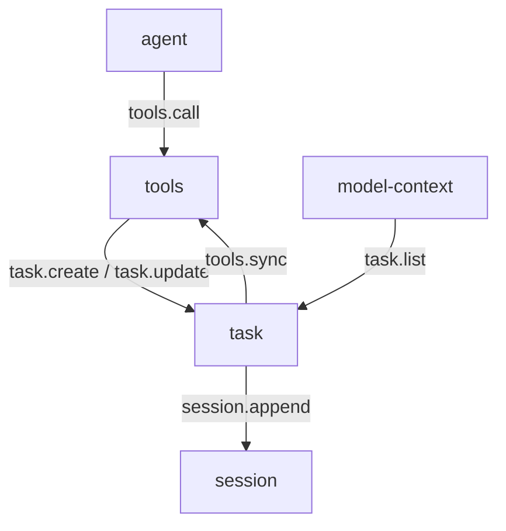

# task

> 状态：目标契约。插件尚未实现，当前实现没有这个能力。
> 涉及能力：`task`
> 依赖：弱依赖 `session`、`tools`

本文是 `task` 插件的设计稿。它描述任务清单、状态机、依赖关系与注入方式。

术语见 [CONTEXT.md](../../../CONTEXT.md)，写作约定见 [00-conventions.md](00-conventions.md)，约束见 [CONSTRAINT.md](../../../CONSTRAINT.md)。

## 1. 职责

**目标契约。**

- 维护一个会话的任务清单。支持创建、更新、列举、清空与查询。
- 把清单状态放进模型上下文，支撑长任务的自我跟踪。
- 校验状态机与依赖关系。非法迁移与依赖环被拒绝。
- 把清单变化写进会话事实，使清单能从记录重建。

清单是模型写给自己看的计划表。它回答"现在该做哪一步"。

## 2. 非职责

- 不做项目管理。清单不跨会话，不跨用户，不共享。
- 不排期。没有截止时间，没有日历，没有工时。
- 不与人协作。没有审批、指派、评论与通知。
- 不替代计划评审。清单是执行期的自跟踪，不是需求文档。
- 不替模型判断任务是否真的完成。状态由模型自己改。

## 3. Manifest

**目标契约。**

```json
{
  "name": "task",
  "version": "0.1.0",
  "protocol": 1,
  "entry": "task",
  "description": "Session task list for tracking multi-step work",
  "autostart": true,
  "priority": 0,
  "provides": ["task"],
  "consumes": [],
  "requires": ["session", "tools"],
  "depends_on": [],
  "commands": [],
  "ui": {
    "entry": "ui/main.js",
    "components": [
      { "tag": "task-list", "mount_id": "list", "slot": "right" }
    ]
  },
  "settings": {
    "get": { "capability": "task", "method": "settings.get" },
    "save": { "capability": "task", "method": "settings.save" },
    "schema": [
      { "key": "max_items", "label": "Maximum items", "type": "number" },
      { "key": "max_render_bytes", "label": "Render byte budget", "type": "number" }
    ]
  }
}
```

**关于 `requires`。**

| 能力 | 用途 | 缺失时 |
|---|---|---|
| `session` | 清单写进会话事实，并从事实重建 | 清单不可用，返回可恢复错误 |
| `tools` | 注册 `task_create`、`task_update`、`task_list` | 清单仍可读，模型无法更新 |

`session` 是关键一项。清单的权威副本在会话事实日志里，没有它就没有清单。

**关于 `ui`。** 一个组件，占 `right` 槽。详见第 9 节。

## 4. 方法与载荷

### 4.1 task.create

新建一个任务项。

输入：

```json
{
  "session_id": "s-1",
  "title": "Add the parser",
  "priority": "high",
  "depends_on": ["t-1"],
  "notes": ""
}
```

| 字段 | 类型 | 必填 | 说明 |
|---|---|---|---|
| `session_id` | 字符串 | 否 | 所属会话。经工具注册表调用时由提供方输入带入 |
| `title` | 字符串 | 是 | 标题。祈使句。最长 200 字符 |
| `priority` | 字符串 | 否 | `high`、`medium`、`low`。缺省 `medium` |
| `depends_on` | 字符串数组 | 否 | 依赖的任务标识 |
| `notes` | 字符串 | 否 | 备注。最长 1024 字符 |

输出：

```json
{
  "item": {
    "id": "t-3",
    "title": "Add the parser",
    "status": "pending",
    "priority": "high",
    "depends_on": ["t-1"],
    "notes": "",
    "created_at": 1760000000000,
    "updated_at": 1760000000000
  },
  "items": [],
  "item_count": 1
}
```

| 字段 | 类型 | 说明 |
|---|---|---|
| `item` | 对象 | 新建的任务项 |
| `items` | 数组 | 更新后的完整清单 |
| `item_count` | 整数 | 清单条目数 |

错误码：`task_not_found`、`task_dependency_cycle`、`task_limit_exceeded`、`bad_arguments`。

### 4.2 task.update

改一个任务项。只写传入的字段。

输入：

```json
{
  "session_id": "s-1",
  "id": "t-3",
  "status": "in_progress",
  "title": "Add the parser",
  "priority": "low",
  "depends_on": [],
  "notes": "已读完设计稿"
}
```

| 字段 | 类型 | 必填 | 说明 |
|---|---|---|---|
| `session_id` | 字符串 | 否 | 所属会话 |
| `id` | 字符串 | 是 | 任务标识 |
| `status` | 字符串 | 否 | 新状态。缺省表示不变 |
| `title` | 字符串 | 否 | 新标题。缺省表示不变 |
| `priority` | 字符串 | 否 | 新优先级。缺省表示不变 |
| `depends_on` | 字符串数组 | 否 | 新依赖集合。给空数组表示清空依赖 |
| `notes` | 字符串 | 否 | 新备注。给空串表示清空备注 |

输出与 `task.create` 同形，`item` 是更新后的任务项。

错误码：`task_not_found`、`task_invalid_state`、`task_invalid_transition`、`task_dependency_cycle`、`task_limit_exceeded`、`bad_arguments`。

### 4.3 task.list

列清单。

输入：

```json
{"session_id": "s-1", "status": "all"}
```

| 字段 | 类型 | 必填 | 说明 |
|---|---|---|---|
| `session_id` | 字符串 | 否 | 所属会话 |
| `status` | 字符串 | 否 | `all`、`pending`、`in_progress`、`completed`、`cancelled`。缺省 `all` |

输出：

```json
{
  "items": [],
  "item_count": 0,
  "counts": {"pending": 0, "in_progress": 0, "completed": 0, "cancelled": 0}
}
```

| 字段 | 类型 | 说明 |
|---|---|---|
| `items` | 数组 | 任务项列表。按标识升序 |
| `item_count` | 整数 | 清单条目数 |
| `counts` | 对象 | 四种状态各自的条目数 |

错误码：`bad_arguments`。

### 4.4 task.clear

清清单。

输入：

```json
{"session_id": "s-1", "scope": "all"}
```

| 字段 | 类型 | 必填 | 说明 |
|---|---|---|---|
| `session_id` | 字符串 | 否 | 所属会话 |
| `scope` | 字符串 | 否 | `all` 清空全部。`closed` 只清掉已完成与已取消。缺省 `all` |

输出：

```json
{"cleared": 3, "items": [], "item_count": 0}
```

| 字段 | 类型 | 说明 |
|---|---|---|
| `cleared` | 整数 | 被清掉的条目数 |
| `items` | 数组 | 清空后的清单 |
| `item_count` | 整数 | 剩余条目数 |

错误码：`bad_arguments`。

### 4.5 task.get

读一个任务项。

输入：

```json
{"session_id": "s-1", "id": "t-3"}
```

| 字段 | 类型 | 必填 | 说明 |
|---|---|---|---|
| `session_id` | 字符串 | 否 | 所属会话 |
| `id` | 字符串 | 是 | 任务标识 |

输出：

```json
{"item": {"id": "t-3", "title": "Add the parser", "status": "pending"}}
```

错误码：`task_not_found`、`bad_arguments`。

### 4.6 任务模型

一个任务项的字段。

| 字段 | 类型 | 说明 |
|---|---|---|
| `id` | 字符串 | 任务标识。会话内唯一，形如 `t-3` |
| `title` | 字符串 | 标题。祈使句。最长 200 字符 |
| `status` | 字符串 | 状态。见第 4.7 节的词表 |
| `priority` | 字符串 | `high`、`medium`、`low` |
| `session_id` | 字符串 | 所属会话 |
| `depends_on` | 字符串数组 | 依赖的任务标识 |
| `notes` | 字符串 | 备注。最长 1024 字符 |
| `created_at` | 整数 | 创建时间。毫秒时间戳 |
| `updated_at` | 整数 | 更新时间。毫秒时间戳 |

标识在会话内递增分配。分配在事实追加之前完成。
重启后从已有事实恢复计数器，新标识不会与已有标识冲突。

### 4.7 状态机

状态词表。

| 状态 | 含义 |
|---|---|
| `pending` | 待办 |
| `in_progress` | 进行中 |
| `completed` | 已完成 |
| `cancelled` | 已取消 |

迁移表。

| 从 | 可到 |
|---|---|
| `pending` | `in_progress`、`cancelled` |
| `in_progress` | `completed`、`pending`、`cancelled` |
| `completed` | `in_progress` |
| `cancelled` | `pending` |

两条硬规则。

| 规则 | 违反时的错误码 |
|---|---|
| 同一时刻最多一条 `in_progress` | `task_invalid_transition` |
| 状态词表外的值不写进事实 | `task_invalid_state` |

`completed` 可以退回 `in_progress`。工作被重新打开是常见情况，不该被挡住。
`cancelled` 只能回到 `pending`。取消不是终局，用户可以恢复。

状态不变的更新不算迁移。改标题、备注、优先级都不受迁移表约束。

### 4.8 依赖与环检测

`depends_on` 是一组任务标识，指向同一会话内的其他任务。

| 规则 | 违反时的错误码 |
|---|---|
| 依赖项必须存在 | `task_not_found` |
| 依赖图不得有环 | `task_dependency_cycle` |
| 任务不能依赖自己 | `task_dependency_cycle` |

环检测在写入前做。对整张图做深度优先搜索，遇到回边就判定成环。
新增或修改依赖后重跑检测。检测到环时整次写入回退，不产生事实。

依赖只表达顺序，不强制执行。依赖项没完成也可以把当前项置为 `in_progress`。
强制会让模型在任务被打断时卡住。

### 4.9 标杆经验的适配改造

外部工程的任务清单不能照搬。

| 外部经验 | 出处 | 改造 |
|---|---|---|
| 用工具描述教模型什么时候建任务 | claude-code-main `src/tools/TodoWriteTool/prompt.ts` | 保留。分成两个工具描述，各自给好坏对照 |
| 一次调用提交整张清单 | ZCode `tool/handlers/todo.ts:135-139` | 不采纳。改成按项增量更新，避免模型重写整张表 |
| 同一时刻只允许一条进行中 | codex `plan_spec.rs:44-47` | 保留。写入前校验，违反返回 `task_invalid_transition` |
| 计划清单的段落注入在开发指令里 | codex `analysis/prompts.md` 第 1.1 节的 `## Planning` 段 | 不采纳。清单进动态轨，不进静态轨，避免破坏缓存边界 |
| 状态只有待办、进行中、已完成 | claude-code-main `src/tools/TodoWriteTool/prompt.ts` | 保留三种，另加 `cancelled` 供用户主动取消 |
| 清单由模型自己维护 | codex `update_plan`、ZCode `TodoWrite` | 保留。运行时自动推断完成度不可靠 |

改造理由有三条。

- 插件之间不直连。清单经 `session` 能力写事实，经工具注册表与模型交互。
- 只有 `(capability, method)` 寻址。模型寻址不到"任务清单"这个插件名。
- 没有广播事件。清单变化只落在会话事实上，不向外推送事件。

## 5. 接缝与调用关系

**目标契约。**



写路径是模型经工具注册表到 task，读路径是组装插件经 `task.list` 取清单。
两条路径都不直连别的插件。

事实写入方向是 task 到 session。task 只追加，不改写已有事实。

## 6. 工具契约

**目标契约。** 插件注册三个工具。

| 工具名 | 风险值 | 标签 | 目标方法 |
|---|---:|---|---|
| `task_create` | 10 | `task` | `task.create` |
| `task_update` | 10 | `task` | `task.update` |
| `task_list` | 10 | `task` | `task.list` |

风险值 10。清单只影响会话自己的计划，不改工作区文件，不发外部请求。

`task.clear` 与 `task.get` 不上架给模型。它们给界面与外部调用方用。
清空是破坏性操作，不该由模型随手调用。

## 7. Prompt 贡献

### 7.1 清单注入

节名 `task`，轨道动态，order 150。

前置改动：在 [prompts/02-system-prompt.md](../../prompts/02-system-prompt.md) 第 2 节的分节词表登记 `task` 节，
在 [prompts/04-runtime-injection.md](../../prompts/04-runtime-injection.md) 第 1 节的注入点清单与第 8 节的动态轨顺序登记它。
节名是平台词汇表里的词，插件不能自己改名。

顺序取 150，在 `workspace_rules` 之后、`skills` 之前。
动态轨按来源强度排序，记忆最靠后因为它最弱。任务清单是强事实，排在技能索引与记忆之前。

注入条件有两个。插件不活动或清单为空时，整节不出现。

清单渲染示例：

```text
## Task list

The session task list. Keep it current: mark a task completed only when the work is actually done.

- [in_progress] t-1 Add the parser — priority: high
- [pending] t-2 Add regression tests for truncated input — priority: medium (depends on t-1)
- [completed] t-3 Record the baseline latency numbers
```

预算：

| 约束 | 默认值 | 超出时的行为 |
|---|---:|---|
| 条数上限 | 20 | `task.create` 返回 `task_limit_exceeded` |
| 渲染字节上限 | 4 KiB | 从尾部裁掉条目，节里写明被裁掉的条数 |

被裁掉的条目要说明，不能静默丢。模型需要知道清单不完整。

### 7.2 与工具的关系

清单由模型维护。插件不替模型判断任务是否完成。

| 方案 | 结论 |
|---|---|
| 模型直接调用工具改清单 | 采用 |
| 运行时从工具调用里自动维护 | 不采用 |

理由有四条。

- 任务的完成标准只有模型知道。运行时从"调用过某个工具"推断完成，会把"跑过一次测试"当成"测试通过"。
- 标杆工程都是模型驱动。codex 的 `update_plan`、ZCode 的 `TodoWrite`、claude-code 的 `TodoWrite` 都由模型调用。
- 自动维护需要一个"这段调用算不算完成某条任务"的判定器。这个判定器没有可靠来源。
- 模型写下的清单和模型读到的清单是同一份。清单因此成为模型的自跟踪记录。

### 7.3 工具描述与好坏对照

描述按 [prompts/03-tool-prompts.md](../../prompts/03-tool-prompts.md) 第 2 节的五段写。
好坏对照按同文第 4 节的形式给。

`task_create` 的描述：

```text
Add one entry to the session task list and return the updated list.

Use this tool to track work that spans several steps, so you and the user can see what is done. Each task needs a short imperative title, and may name the tasks it depends on. The list belongs to this session only.

Good: "Add one task per migration step: migrate the schema, migrate the writer, migrate the reader."
Bad: "Add a single task called 'do the migration' for a three-step migration."

Do not use this tool for a single-step request, a question, or a lookup. Use the tool that answers the request directly instead.
```

`task_update` 的描述：

```text
Update one entry in the session task list and return the updated list.

Only the fields you pass change. Mark a task completed only when the work is actually finished; if it is blocked or half done, leave it in_progress and say what is missing. There may be only one in_progress task at a time, so complete the current one before starting the next.

Good: "Mark 'add the parser' completed and set 'add the parser tests' to in_progress."
Bad: "Mark 'add the parser and its tests' completed before the tests have run."

Do not use this tool to add new tasks. Use the create tool for that.
```

`task_list` 的描述：

```text
List the session task list and return every entry with its status.

Use this tool when you need the current state of the list, for example after the conversation was compacted.
Do not use it to refresh a list you just saw; the list is already in your context.
```

`guidelines` 一条，进静态轨 `tool_discipline` 节。

```text
- task tools: mark a task completed only when the work is actually done; leave a blocked or half-done task in_progress and say what is missing.
```

## 8. 记录与持久化

清单写在会话事实日志里。插件自己不留副本。

事实类型是 `task_item`。它在 [02-session.md](02-session.md) 第 8.5 节里已登记，写入方是 task 能力。

```json
{
  "type": "task_item",
  "role": "host",
  "content": "",
  "meta": {
    "plugin": "task",
    "kind": "task_item",
    "session_id": "s-1",
    "op": "update",
    "item_id": "t-3",
    "item": {
      "id": "t-3",
      "title": "Add the parser",
      "status": "in_progress",
      "priority": "high",
      "depends_on": [],
      "notes": "",
      "created_at": 1760000000000,
      "updated_at": 1760000000000
    }
  }
}
```

| 字段 | 说明 |
|---|---|
| `meta.plugin` | 恒为 `task` |
| `meta.kind` | 恒为 `task_item` |
| `meta.session_id` | 所属会话 |
| `meta.op` | `create`、`update`、`clear` |
| `meta.item_id` | 变更涉及的任务标识 |
| `meta.item` | 变更后的完整任务项。`clear` 时省略 |

投影规则是按 `item_id` 取最后一条 `create` 或 `update` 事实。
`clear` 事实之后只保留它之后的条目。

**选择清单写进会话事实的理由。**

| 方案 | 结论 |
|---|---|
| 写会话事实 | 采用 |
| 写插件自己的存储 | 不采用 |

理由有两条。

1. 清单进模型上下文，模型可见就要记录。清单只在插件自己的存储里，模型看到的内容就没法从会话记录重建。
2. 会话事实是 append-only 的，事实本身就是清单的变更历史。插件自己的存储要另写一套历史与重建逻辑。

**清单变化触发会话事实追加。** 每次变更追加一条事实，一条变更一条，不合并。
追加失败时本次变更整体回退，清单保持原样。
模型不会看到清单说改了而事实里没有。

`task_item` 事实是过程事实，不进模型上下文。
模型看到的清单由组装插件渲染进动态轨，那部分内容随运行时上下文事实一起落盘。

**并发。** 同一个会话的清单变更串行化。插件持有一把会话级写锁。
两个并发更新按到达顺序依次生效，各自追加一条事实。
不做乐观版本检查，也不做冲突合并。清单是单写者的计划表，不是共享文档。

插件重启后从事实重建清单。重建结果与重启前一致。

## 9. WebUI

**目标契约。** 一个组件。

| Component | Mount | Slot | 职责 |
|---|---|---|---|
| `task-list` | `list` | `right` | 显示清单，标记状态，展开备注 |

槽位规则按 [00-conventions.md](00-conventions.md) 第 11 节。同一插槽内插件名加挂载标识唯一。
[manifest.md](../../platform/manifest.md) 第 3 节的表述更严格，需要 Host 侧同步放宽。
选 `right` 不选 `bottom`：清单是多条持续可见的工作状态，右侧栏比底部条合适。
底部条已经用于会话状态。

状态是可重建的完整快照。

```json
{
  "revision": 3,
  "session_id": "s-1",
  "items": [
    {
      "id": "t-1",
      "title": "Add the parser",
      "status": "in_progress",
      "priority": "high",
      "depends_on": [],
      "notes": "",
      "updated_at": 1760000000000
    }
  ],
  "counts": {"pending": 1, "in_progress": 1, "completed": 1, "cancelled": 0}
}
```

命令是瞬时指令，不持久化。

| 命令 | 载荷 | 作用 |
|---|---|---|
| `focus` | `{"id": "t-1"}` | 滚动到某一条 |
| `select` | `{"id": "t-1"}` | 选中某一条 |
| `toggle_detail` | `{"id": "t-1"}` | 展开或收起备注 |

组件不改插件存储。用户勾选状态走 `task.update` 能力调用。
组件只呈现状态与发命令。

## 10. 错误码

**目标契约。** 插件级错误码，前缀 `task_`。

| 错误码 | 形态 | 场景 |
|---|---|---|
| `task_not_found` | 协议错误 | 任务标识不存在，或依赖项不存在 |
| `task_invalid_state` | 协议错误 | 状态值不在词表里 |
| `task_invalid_transition` | 协议错误 | 不允许的状态迁移，或同时有两条进行中 |
| `task_dependency_cycle` | 协议错误 | 依赖图有环，或任务依赖自己 |
| `task_limit_exceeded` | 协议错误 | 条数超上限 |

**目标契约。** 还复用以下平台级错误码。

| 错误码 | 形态 | 场景 |
|---|---|---|
| `bad_arguments` | 协议错误 | 载荷缺失、字段错型、枚举值非法 |
| `handler_error` | 协议错误 | 内部序列化失败 |

## 11. 配置

配置文件在插件工作目录的 `task.json`。

```json
{
  "max_items": 20,
  "max_render_bytes": 4096
}
```

| 字段 | 类型 | 默认值 | 说明 |
|---|---|---|---|
| `max_items` | 整数 | 20 | 清单条目上限 |
| `max_render_bytes` | 整数 | 4096 | 清单渲染字节上限 |

配置不含密钥。任务清单不需要密钥。

Settings 入口用标准设置方法，形态见 [manifest.md](../../platform/manifest.md) 第 4 节。
`task.settings.get` 的输入为空对象，输出是 `values` 包络。
`task.settings.save` 的输入是同一个 `values` 包络，输出是 `{"saved": true}`。

配置改动不影响在途调用。清单本身存在会话事实里，不随插件配置重置。

## 12. 测试要求

按 [00-conventions.md](00-conventions.md) 第 13 节展开。

| 项 | 本插件的用例 |
|---|---|
| 载荷解码 | 缺字段、错类型、空载荷、多余字段均报 `bad_arguments` |
| 成功响应 | 五个方法的响应形状，清单按标识升序 |
| 稳定错误码 | 第 10 节每个插件级错误码各一条用例 |
| 配置持久化 | 配置落盘后重启可读，非法条目被跳过 |
| 事件载荷 | 无。task 不发事件 |
| 纯函数 | 状态迁移判定、环检测、渲染裁剪 |
| 取消路径 | 事实追加期间取消，清单保持原样 |
| 降级路径 | `session` 缺席时返回可恢复错误，`tools` 缺席时清单仍可读 |

补充用例。

| 用例 | 断言 |
|---|---|
| 状态机 | 迁移表里的每条边都被接受，表外的每条边返回 `task_invalid_transition` |
| 状态不变 | 只改标题不触发迁移校验 |
| 非法状态 | 状态词表外的值返回 `task_invalid_state`，清单不变 |
| 单一进行中 | 设第二条 `in_progress` 返回 `task_invalid_transition` |
| 环检测 | 依赖成环时返回 `task_dependency_cycle`，且不产生事实 |
| 自依赖 | 任务依赖自己返回 `task_dependency_cycle` |
| 依赖不存在 | 依赖不存在的标识返回 `task_not_found` |
| 并发更新 | 两个并发更新串行生效，各追加一条事实，清单与事实条数一致 |
| 条数上限 | 超过上限时创建返回 `task_limit_exceeded`，清单不变 |
| 渲染裁剪 | 超字节上限时条目被裁并写出被裁条数 |
| 事实重建 | 重启后从事实重建的清单与重启前一致 |
| 清空语义 | `scope` 为 `closed` 时只清掉已完成与已取消 |
| 事实回退 | 事实追加失败时清单保持原样 |

## 13. 验收标准

| 项 | 检查 |
|---|---|
| 能力名已登记 | `task` 在 [00-conventions.md](00-conventions.md) 第 3 节的能力表里 |
| 错误码唯一 | 第 10 节的码不与平台级码冲突 |
| 不直连其他插件 | 事实经 `session` 能力写，交互经工具注册表 |
| 不用插件名寻址 | 全部调用按 `(capability, method)` |
| 状态标注清楚 | 每节标了目标契约 |
| 方法载荷完整 | 五个方法都有输入、输出、字段表与错误码 |
| 图与代码一致 | 图里的模块名是能力名 |
| 链接有效 | 链接指向存在的文件 |
| 清单可重建 | 插件重启后清单与会话事实一致 |
| 注入有界 | 清单不超条数与字节预算，裁剪有记录 |
| 状态受约束 | 迁移表外的状态变化被拒绝 |

## 14. 未实现

**暂不实现。**

- 任务的跨会话共享。清单只属于一个会话。
- 任务的时间估算。没有工时字段，也没有到期提醒。
- 任务的优先级自动计算。优先级由模型自己给。
- 子任务树。任务之间只有平级的依赖，没有父子层级。
- 清单的归档。历史清单随会话事实一起留在日志里，不单独归档。

## 15. 结构体索引

仅作实现参考。契约的 Go 实现归插件自己所有，字段以 JSON 名为准。

| Go 类型 | 角色 |
|---|---|
| `taskPlugin` | 插件实例，持有 SDK 调用器、会话锁与配置 |
| `sdkCaller` | SDK 调用接口，抽象出 `Call` 与 `CallInContext` |
| `ledger` | 清单账本，按会话维护任务项与写锁 |
| `item` | 单个任务项，含状态、优先级、依赖与时间戳 |
| `machine` | 状态机，负责迁移判定与单一进行中校验 |
| `graph` | 依赖图，负责存在性检查与环检测 |
| `ids` | 标识分配器，按会话发号 |
| `renderer` | 清单渲染器，负责预算裁剪与条目格式化 |
| `store` | 事实写入器，把变更追加成 `task_item` 事实 |
| `projector` | 事实投影器，从事实重建清单 |
| `config` | 插件配置，对应 `task.json` |
| `CreateInput` | `task.create` 入参 |
| `CreateOutput` | `task.create` 出参 |
| `UpdateInput` | `task.update` 入参 |
| `UpdateOutput` | `task.update` 出参 |
| `ListInput` | `task.list` 入参 |
| `ListOutput` | `task.list` 出参 |
| `ClearInput` | `task.clear` 入参 |
| `ClearOutput` | `task.clear` 出参 |
| `GetInput` | `task.get` 入参 |
| `GetOutput` | `task.get` 出参 |
