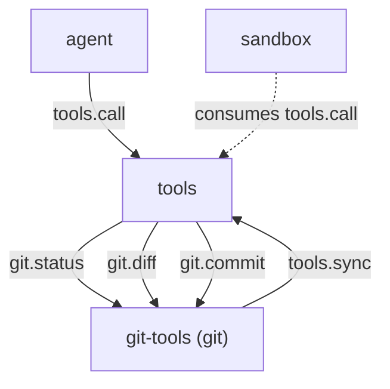

# git-tools

> 状态：目标契约（本文全部章节均为待实现的目标契约）
> 2026-10-24 更新：UI、stage/unstage 拆分、checkout 语义与风险值以 [git 侧边栏与 plan 悬浮窗交接](../../archive/progress/2026-10-24-git-sidebar-plan-handoff.md) 为准；实现前先把两份文档合并。
> 涉及能力：`git`
> 依赖：弱依赖 `tools`，硬依赖 `tools`

术语见 [CONTEXT.md](../../../CONTEXT.md)。写作约定见 [00-conventions.md](00-conventions.md)。
帧格式见 [protocol.md](../../platform/protocol.md)。

## 1. 职责

**目标契约。**

- 在已初始化的仓库里执行受限的版本控制操作。
- 提供状态、差异、历史、提交与分支切换五个能力方法。
- 把自己的工具集合注册到工具注册表。
- 只允许固定子命令集合，参数按向量传给 git 进程。
- 把所有路径参数限制在工作区内。
- 在提交前给出暂存范围的差异摘要。

## 2. 非职责

- 不初始化仓库。仓库必须已经存在。
- 不推送远端，也不拉取。`push` 与 `pull` 不在白名单里。
- 不管理托管平台。不碰 issue、评审与合并请求。
- 不做代码评审。不给评审意见，不打分。
- 不替代 shell 执行 git。需要任意 git 命令时走 shell 能力。
- 不解决冲突。冲突只报告，不自动处理。
- 不做变基与合并。不改写历史。
- 不写会话记录。记录归 session 插件。

## 3. Manifest

**目标契约。** 插件包为 `plugins/git-tools/`。

```json
{
  "name": "git-tools",
  "version": "0.1.0",
  "protocol": 1,
  "entry": "git-tools",
  "description": "Scoped version control operations for the workspace repository",
  "autostart": true,
  "priority": 0,
  "provides": ["git"],
  "consumes": [],
  "requires": ["tools"],
  "depends_on": ["tools"],
  "commands": [],
  "ui": null,
  "settings": {
    "get": {"capability": "git", "method": "settings.get"},
    "save": {"capability": "git", "method": "settings.save"},
    "schema": [
      {"key": "git_binary", "label": "Git executable", "type": "string"},
      {"key": "allowed_subcommands", "label": "Allowed subcommands", "type": "list", "item_fields": [{"key": "name", "label": "Name", "type": "string", "required": true}]},
      {"key": "commit_message_template", "label": "Commit message template", "type": "string"},
      {"key": "max_diff_bytes", "label": "Max diff bytes", "type": "number", "min": 1024}
    ]
  }
}
```

**为什么 `requires` 与 `depends_on` 都写 `tools`。**

两个字段表达不同的事。

| 字段 | 语义 | 缺失时的表现 |
|---|---|---|
| `requires` | 弱依赖能力名 | 插件照常启动，注册调用返回可恢复错误 |
| `depends_on` | 硬依赖插件名 | Host 用它安排启动顺序 |

`tools.sync` 是注册工具的前提，所以 tools 必须在场，这是硬依赖。
注册本身是弱依赖：tools 缺席时，插件仍可启动并提供 `git` 能力方法。

**关于 `provides`。** 只声明 `git`。
五个工具的目标能力都是 `git`，由注册表校验这条约束。

## 4. 方法与载荷

工作区锚点由 `tools.call` 的信封透传，不在方法参数里。
路径参数一律相对工作区解析。

### 4.1 git.status

查看工作区与暂存区的状态。

输入：

```json
{
  "path": "."
}
```

| 字段 | 类型 | 必填 | 说明 |
|---|---|---|---|
| `path` | 字符串 | 否 | 工作区内的相对目录，默认 `.`，只看该目录下的变更 |

输出：

```json
{
  "content": "branch: main\nstaged:\n  M src/main.go\nunstaged:\n  M src/util.go\n  ?? notes.md\n",
  "is_error": false,
  "truncated": false,
  "meta": {
    "branch": "main",
    "head": "a1b2c3d4e5f6",
    "detached": false,
    "upstream": "origin/main",
    "ahead": 0,
    "behind": 0,
    "clean": false,
    "staged": [{"path": "src/main.go", "status": "M"}],
    "unstaged": [{"path": "src/util.go", "status": "M"}],
    "untracked": [{"path": "notes.md", "status": "??"}],
    "conflicted": [],
    "in_merge": false,
    "in_rebase": false
  }
}
```

| 字段 | 类型 | 说明 |
|---|---|---|
| `meta.branch` | 字符串 | 当前分支名，处于游离态时为空串 |
| `meta.head` | 字符串 | 当前提交的短哈希 |
| `meta.detached` | 布尔 | 是否处于游离 HEAD |
| `meta.upstream` | 字符串 | 上游分支名，没有上游时为空串 |
| `meta.ahead` | 整数 | 领先上游的提交数 |
| `meta.behind` | 整数 | 落后上游的提交数 |
| `meta.clean` | 布尔 | 工作区与暂存区都没有变更 |
| `meta.staged` | 数组 | 已暂存的变更，每项含 `path` 与 `status` |
| `meta.unstaged` | 数组 | 已修改但未暂存的变更 |
| `meta.untracked` | 数组 | 未跟踪的文件 |
| `meta.conflicted` | 数组 | 未合并的路径 |
| `meta.in_merge` | 布尔 | 是否处于合并过程中 |
| `meta.in_rebase` | 布尔 | 是否处于变基过程中 |

错误码：`bad_arguments`、`git_not_a_repository`、`git_path_invalid`、`git_path_escape`。

### 4.2 git.diff

查看差异。

输入：

```json
{
  "paths": ["src/main.go"],
  "staged": false,
  "against": "",
  "context_lines": 3,
  "max_bytes": 65536
}
```

| 字段 | 类型 | 必填 | 说明 |
|---|---|---|---|
| `paths` | 字符串数组 | 否 | 显式路径列表，为空表示整棵树 |
| `staged` | 布尔 | 否 | 默认 `false`，为 `true` 时看暂存区相对 HEAD 的差异 |
| `against` | 字符串 | 否 | 比较基准，空字符串表示 HEAD |
| `context_lines` | 整数 | 否 | 上下文行数，默认 3，上限 20 |
| `max_bytes` | 整数 | 否 | 返回正文字节上限，默认 65536 |

输出：

```json
{
  "content": "diff --git a/src/main.go b/src/main.go\nindex 1234567..89abcde 100644\n--- a/src/main.go\n+++ b/src/main.go\n@@ -1,3 +1,4 @@\n",
  "is_error": false,
  "truncated": false,
  "meta": {
    "format": "unified",
    "against": "HEAD",
    "staged": false,
    "files_changed": 2,
    "insertions": 40,
    "deletions": 12,
    "binary_files": ["assets/logo.png"],
    "paths": ["src/main.go"],
    "original_bytes": 12000,
    "truncated_bytes": 0,
    "artifact_path": ""
  }
}
```

| 字段 | 类型 | 说明 |
|---|---|---|
| `meta.format` | 字符串 | 差异格式，恒为 `unified` |
| `meta.against` | 字符串 | 实际使用的比较基准 |
| `meta.staged` | 布尔 | 是否看的是暂存区 |
| `meta.files_changed` | 整数 | 变更文件数 |
| `meta.insertions` | 整数 | 新增行数 |
| `meta.deletions` | 整数 | 删除行数 |
| `meta.binary_files` | 数组 | 被判定为二进制的文件路径 |
| `meta.paths` | 数组 | 参与比较的路径 |
| `meta.original_bytes` | 整数 | 完整差异的字节数 |
| `meta.truncated_bytes` | 整数 | 被砍掉的字节数，为 0 表示未截断 |
| `meta.artifact_path` | 字符串 | 完整差异的落盘路径，未落盘时为空串 |

错误码：`bad_arguments`、`git_not_a_repository`、`git_path_invalid`、`git_path_escape`、
`git_output_too_large`。

### 4.3 git.log

查看提交历史。

输入：

```json
{
  "max_count": 20,
  "path": "",
  "branch": "",
  "format": "medium"
}
```

| 字段 | 类型 | 必填 | 说明 |
|---|---|---|---|
| `max_count` | 整数 | 否 | 最多返回条数，默认 20，上限 200 |
| `path` | 字符串 | 否 | 只看影响该路径的提交 |
| `branch` | 字符串 | 否 | 起点分支，默认当前 HEAD |
| `format` | 字符串 | 否 | `medium`、`oneline` 或 `full`，默认 `medium` |

输出：

```json
{
  "content": "a1b2c3d fix: 修正路径越界检查\n  张三 <zhang@example.com>\n  2026-10-20T09:00:00Z\n\n  越界检查改用统一判定。\n",
  "is_error": false,
  "truncated": false,
  "meta": {
    "commits": [
      {
        "hash": "a1b2c3d4e5f6789012345678901234567890ab",
        "short_hash": "a1b2c3d",
        "author": "张三",
        "email": "zhang@example.com",
        "date": "2026-10-20T09:00:00Z",
        "subject": "fix: 修正路径越界检查",
        "body": "越界检查改用统一判定。"
      }
    ],
    "count": 1,
    "truncated": false
  }
}
```

| 字段 | 类型 | 说明 |
|---|---|---|
| `meta.commits` | 数组 | 每个提交含 `hash`、`short_hash`、`author`、`email`、`date`、`subject`、`body` |
| `meta.count` | 整数 | 实际返回条数 |
| `meta.truncated` | 布尔 | 是否因上限截断了历史 |

错误码：`bad_arguments`、`git_not_a_repository`、`git_path_invalid`、`git_path_escape`。

`git.log` 只读历史，不改写历史。`rebase` 与 `filter-branch` 不在白名单里。

### 4.4 git.commit

暂存显式路径并创建一次提交。

输入：

```json
{
  "message": "fix: 修正路径越界检查",
  "paths": ["src/main.go", "src/util.go"],
  "allow_empty": false,
  "allow_template": false
}
```

| 字段 | 类型 | 必填 | 说明 |
|---|---|---|---|
| `message` | 字符串 | 否 | 提交信息原文，为空时用配置的模板渲染 |
| `paths` | 字符串数组 | 是 | 显式文件路径列表，不支持通配，至少一项 |
| `allow_empty` | 布尔 | 否 | 默认 `false`，为 `true` 时允许空提交 |
| `allow_template` | 布尔 | 否 | 默认 `false`，为 `true` 时允许在 `message` 为空时用模板 |

输出：

```json
{
  "content": "committed a1b2c3d\n2 files changed, 40 insertions(+), 12 deletions(-)",
  "is_error": false,
  "truncated": false,
  "meta": {
    "commit": "a1b2c3d4e5f6789012345678901234567890ab",
    "short_hash": "a1b2c3d",
    "branch": "main",
    "staged_paths": ["src/main.go", "src/util.go"],
    "summary": {"files": 2, "insertions": 40, "deletions": 12},
    "message_source": "model",
    "committed_at": "2026-10-20T09:05:00Z"
  }
}
```

| 字段 | 类型 | 说明 |
|---|---|---|
| `meta.commit` | 字符串 | 提交的完整哈希 |
| `meta.short_hash` | 字符串 | 短哈希 |
| `meta.branch` | 字符串 | 提交所在分支 |
| `meta.staged_paths` | 数组 | 本次提交的路径 |
| `meta.summary` | 对象 | 含 `files`、`insertions`、`deletions` |
| `meta.message_source` | 字符串 | `model` 或 `template` |
| `meta.committed_at` | 字符串 | 提交时刻，UTC |

错误码：`bad_arguments`、`git_not_a_repository`、`git_path_invalid`、`git_path_escape`、
`git_commit_empty`、`git_conflict`、`git_command_failed`。

### 4.5 git.checkout

切换分支。

输入：

```json
{
  "branch": "feature/search",
  "create": false,
  "allow_dirty": false
}
```

| 字段 | 类型 | 必填 | 说明 |
|---|---|---|---|
| `branch` | 字符串 | 是 | 目标分支名 |
| `create` | 布尔 | 否 | 默认 `false`，为 `true` 时创建并切换到新分支 |
| `allow_dirty` | 布尔 | 否 | 默认 `false`，为 `true` 时允许工作区有未提交改动 |

输出：

```json
{
  "content": "switched to feature/search\nHEAD is now at a1b2c3d",
  "is_error": false,
  "truncated": false,
  "meta": {
    "branch": "feature/search",
    "previous_branch": "main",
    "previous_head": "0f1e2d3c4b5a",
    "created": false,
    "clean": true,
    "exit_code": 0
  }
}
```

| 字段 | 类型 | 说明 |
|---|---|---|
| `meta.branch` | 字符串 | 切换后的分支名 |
| `meta.previous_branch` | 字符串 | 切换前的分支名 |
| `meta.previous_head` | 字符串 | 切换前的短哈希 |
| `meta.created` | 布尔 | 是否新建了分支 |
| `meta.clean` | 布尔 | 切换后工作区是否洁净 |
| `meta.exit_code` | 整数 | git 子进程的退出码 |

错误码：`bad_arguments`、`git_not_a_repository`、`git_worktree_dirty`、
`git_checkout_failed`、`git_conflict`。

### 4.6 仓库边界

**仓库判定。** 工作区必须落在一个 git 仓库里。
插件从工作区根向上找 `.git`，找不到时返回 `git_not_a_repository`。
插件不执行 `git init`，也不在缺失时创建仓库。

仓库根允许在工作区之外。用户把工作区设成仓库的子目录是常见用法。
**路径参数的锚点始终是工作区**，不是仓库根。

**路径规则。** 与文件插件一致。

| 检查 | 失败错误码 |
|---|---|
| 路径为空 | `git_path_invalid` |
| 路径含 NUL 或控制字符 | `git_path_invalid` |
| 路径以 `/` 开头或是绝对路径 | `git_path_invalid` |
| 路径带盘符或 UNC 前缀 | `git_path_invalid` |
| 路径含空组件、`.` 或 `..` | `git_path_invalid` |
| 路径含 Windows 保留设备名 | `git_path_invalid` |
| 路径以 `-` 开头 | `git_path_invalid` |
| 路径含通配符 `*`、`?`、`[` | `git_path_invalid` |
| 解析后落在工作区外 | `git_path_escape` |

符号链接越界由工作区句柄拒绝，拒绝后映射为 `git_path_escape`。

**为什么不复用文件插件的错误码。** 文件插件用 `path_invalid` 与 `path_escape`。
git 插件用自己的 `git_` 前缀组，避免一个码被两个插件共用。
语义相同，归属不同。

### 4.7 命令白名单

**模型不能直接传 git 命令行。** 五个方法各有结构化参数。
模型能表达的只是"查状态""看差异""提交这批文件"，不是任意命令行。

白名单是插件内部调用 git 时的第二道闸门。

**模型可见的子命令。**

| 子命令 | 用途 | 允许的参数形态 |
|---|---|---|
| `status` | 状态 | `--porcelain`、`--branch`、`-s`、`-u` |
| `diff` | 差异 | `--cached`、`--stat`、`--numstat`、`--name-only`、`--name-status`、`-- <paths>` |
| `log` | 历史 | `--max-count=N`、`--oneline`、`--no-patch`、`-- <path>` |
| `show` | 单个提交 | `--stat`、`--no-patch`、`--format=` |
| `ls-files` | 列文件 | `--others`、`--exclude-standard`、`--cached`、`-- <paths>` |
| `branch` | 分支列表 | `--list`、`-a`、`-v`、`--show-current`，不带分支名参数 |
| `commit` | 提交 | `-m`、`--message=`、`--only`、`--allow-empty`、`-- <paths>` |
| `checkout` | 切换 | `-b`、`--`、分支名 |

**内部子命令。** 插件为实现这五个方法自己执行的 git 调用，允许一个更宽的集合。
这一层不经模型载荷，因此不受模型输入影响。

内部集合含 `rev-parse`、`add`、`restore --staged`、`status --porcelain`、
`diff --cached --stat`、`diff --name-only`、`ls-files`、`config --get`。

`config --get` 只读取仓库的只读配置项，不写配置。

**不允许的子命令。** 出现即返回 `git_command_not_allowed`。

```text
push  pull  fetch  remote  clone  init  merge  rebase  reset  clean
apply  am  cherry-pick  revert  stash  tag  submodule  config  update-index
worktree  gc  fsck  filter-branch  hook  daemon  credential  gui
upload-pack  receive-pack  exec-path  bisect  describe  notes
sparse-checkout  replace  rerere  verify-pack  whatchanged  archive
bundle  fast-export  fast-import  daemon  request-pull  send-email
```

**不允许的参数形态。**

| 形态 | 例子 | 原因 |
|---|---|---|
| 全局配置注入 | `-c`、`--config-env` | 能改写任意 git 配置，包括钩子路径 |
| 仓库位置改写 | `--git-dir`、`--work-tree`、`--namespace`、`--super-prefix` | 能把操作指向任意目录 |
| 外部程序执行 | `--exec-path`、`--upload-pack`、`--receive-pack` | 能指定要执行的外部程序 |
| 钩子相关 | 任何参数里出现 `core.hooksPath` | 能执行任意脚本 |
| 路径穿越 | `--` 之后的路径含 `..` 或绝对路径 | 越出工作区 |
| 以 `-` 开头的路径 | `-- -foo` | 会被 git 当成选项解析 |
| 通配符 | 路径含 `*`、`?`、`[` | 匹配范围不可控 |

**参数以数组传递。** git 进程用 `exec.Command` 启动，命令与参数按向量传入。
**不拼成 shell 字符串**，不经过任何 shell 解析。

理由有三条。

| 风险 | 拼字符串的后果 | 向量传递的结果 |
|---|---|---|
| 元字符 | `;`、`&&`、管道会另起进程 | 元字符只是普通参数内容 |
| 引号与转义 | 不同 shell 的转义规则不一致 | 没有引号这一层 |
| 路径与空白 | 路径里的空格会拆成多个参数 | 每个参数是原子的 |

参数以数组传递还让白名单检查有确定的对象：逐个参数比对，不需要解析命令行文本。

### 4.8 提交信息与暂存范围

**提交信息由模型提供。** `message` 传进来的文本原样写入提交。
插件不润色、不翻译、不追加签名。

`message` 为空时，插件按配置的 `commit_message_template` 渲染。
模板里的 `{summary}` 由插件从暂存差异推导，替换成类似 `src/main.go, src/util.go` 的短语。
只有 `allow_template` 为 `true` 时才允许这条路径。

| `message` | `allow_template` | 结果 |
|---|---|---|
| 非空 | 任意 | 使用模型给的信息 |
| 空 | `true` | 使用模板渲染的信息，`meta.message_source` 为 `template` |
| 空 | `false` | 返回 `bad_arguments` |

**暂存范围由显式路径列表确定。** 插件对 `paths` 里的每个路径做一次暂存。

**不用 `add .` 类的通配暂存。** 通配暂存会把从未读过的文件一起提交。
通配符在路径校验阶段就被拒绝，写操作拿不到能展开的表达式。

**提交范围等于暂存范围。** 暂存区里原有的其他内容不进本次提交，也不被清空。
这类内容留在暂存区，由调用方自己决定后续处理。

**提交前的差异摘要。** 插件在提交前计算这批路径相对 HEAD 的差异统计。
摘要写进返回值的 `meta.summary`，正文也带一行统计。

摘要只给数字与文件列表，不给完整差异。
需要看内容时，模型自己先调 `git.diff`。

**是否需要交互确认。** 不需要。插件没有交互通道。
提交前的把关由两处承担。

| 承担方 | 手段 |
|---|---|
| 裁决方 | 在 `git.commit` 键上独立裁决，可要求用户确认 |
| 模型纪律 | 纪律节要求提交前先看状态与差异 |

**提交失败的处理。**

| 情形 | 结果 |
|---|---|
| 这批路径相对 HEAD 没有差异 | 返回 `git_commit_empty`，暂存区恢复原状 |
| 这批路径里有未合并条目 | 返回 `git_conflict`，不提交 |
| 提交本身失败 | 返回 `git_command_failed`，`meta.stderr` 给出 git 的原话 |

`git_commit_empty` 触发时，插件把本次暂存的动作撤回到调用前的状态。

### 4.9 分支切换

**切换前的工作区洁净检查。** 插件用 `git status --porcelain` 判断。
有未提交改动时，默认为拒绝。

| 工作区状态 | `allow_dirty` | 结果 |
|---|---|---|
| 洁净 | 任意 | 切换 |
| 有改动 | `false` | 返回 `git_worktree_dirty` |
| 有改动 | `true` | 切换，改动被 git 带着走 |

`git_worktree_dirty` 的 `meta.dirty_paths` 列出脏文件。
模型据此知道要先提交还是先丢弃。

**要求确认的表达方式。** 平台没有交互确认帧。
显式确认由模型转达：模型先问用户，得到肯定答复后带 `allow_dirty` 再次调用。
裁决方也可以在 `git.checkout` 键上要求用户确认。

**切换失败后的恢复。** 恢复分两种情况。

| 情况 | 恢复策略 |
|---|---|
| 切换失败，工作区未被改动 | 无需额外动作。git 的切换是原子的，记录里的原分支与原 HEAD 仍然有效 |
| 切换后进入冲突状态 | 不自动回滚，报告 `git_conflict` 并给出恢复提示 |

不自动回滚的理由是回滚本身要动工作区。
在有未提交改动的情况下自动回滚可能丢掉这些改动。
插件只报告，并把可用的恢复命令写进 `meta.recovery`。

```text
meta.recovery: "git checkout -- main"
```

**目标分支不存在。** `create` 为 `false` 时返回 `git_checkout_failed`，
`meta.reason` 写明目标分支不存在。

### 4.10 差异输出与截断

**格式。** git 原生的 unified diff，不做二次加工。

**截断上限。** 软上限是配置的 `max_diff_bytes`，默认 65536。
硬上限是 4194304 字节，超过硬上限且无法落盘时返回 `git_output_too_large`。

**二进制文件。** git 对二进制文件输出一行 `Binary files a/x and b/x differ`。
插件保留这一行，并把路径列进 `meta.binary_files`。

二进制内容不进正文。二进制内容不得进帧。

**大 diff 的落盘策略。** 正文超过软上限时，完整差异写到插件私有目录。

| 项 | 取值 |
|---|---|
| 目录 | `plugins/git-tools/data/diffs/` |
| 文件名 | 差异内容的 SHA-256 前 16 位加 `.diff` 后缀 |
| 落盘时机 | 只在触发截断时写 |
| 清理 | 插件启动时清空该目录 |

`meta.artifact_path` 给出落盘路径，`meta.original_bytes` 给出原始长度，
`meta.truncated_bytes` 给出被砍掉的长度。
三个字段的语义见 [prompts/03-tool-prompts.md](../../prompts/03-tool-prompts.md) 第 2.4 节。

落盘文件不进会话记录，也不进模型上下文。
模型需要完整差异时自己用文件工具读。

### 4.11 标杆经验的适配改造

外部工程的 git 能力不能照搬，要按 LiteAgent 的硬约束改造。

| 外部经验 | 出处 | 改造 |
|---|---|---|
| 用只读策略表判定 git 子命令是否安全 | ZCode `analysis/git.md` 第 1.4 节 | 改成固定白名单加固定参数形态，不做逐 flag 的穷举 |
| 目录里有 `.git` 陷阱时拒绝放行 | ZCode `analysis/git.md` 第 1.3 节 | 保留。仓库判定与路径判定同时做，`.git` 目录本身不作为路径参数 |
| 收集 git 信息时清洗远端地址 | codex `analysis/git.md` 第 2 节 | 保留清洗规则，但 v1 不采集远端地址 |
| 注入 `safe.bareRepository=explicit` | codex `analysis/git.md` 第 1 节 | 采纳。每个内部 git 调用都带这个配置 |
| 在内存里镜像变更算 turn diff | codex `analysis/git.md` 第 3 节 | 不采纳。差异直接来自 git，插件不镜像文件内容 |
| 用文件系统做 checkpoint 代替 git | ZCode `analysis/git.md` 第 2 节 | 不采纳。检查点是平台级能力，不属于本插件 |

改造理由有四条。

- 插件之间不直连。git 是外部可执行文件，不是插件。
- 只有 `(capability, method)` 寻址。模型寻址不到 git 子命令。
- 没有广播事件。git 插件不向外推送变更事件。
- Host 不解释 payload。插件返回的 `meta` 字段由插件自己定义。

`safe.bareRepository=explicit` 的作用是防止隐式发现的 bare 仓库劫持 git 行为。
这条配置由插件在内部调用时统一注入，模型无法覆盖。

## 5. 接缝与调用关系

**目标契约。**



`git.commit` 与 `git.checkout` 是写操作。
它们是否由 sandbox 裁决待定。sandbox 的消费清单不含 `git.*`，落地前需先扩充，见 [08-sandbox.md](08-sandbox.md) 第 4 节。
`git.status`、`git.diff`、`git.log` 是只读操作。

注册方向是反的。git-tools 启动时调用 `tools.sync` 上架五个工具。

## 6. 工具契约

**目标契约。**

| 工具名 | 风险值 | 标签 | 目标方法 |
|---|---:|---|---|
| `git_status` | 10 | `git`、`read` | `git.status` |
| `git_diff` | 10 | `git`、`read` | `git.diff` |
| `git_log` | 10 | `git`、`read` | `git.log` |
| `git_commit` | 60 | `git`、`write` | `git.commit` |
| `git_checkout` | 60 | `git`、`write` | `git.checkout` |

风险刻度见 [05-tools.md](05-tools.md) 第 6.3 节。

三个只读工具取 10，落在 0 到 19 的只读区间。
两个写工具取 60，落在 50 到 79 的显著修改区间。
写操作的风险值高于只读操作，且不取 80 以上的档。

不取 80 以上的原因是这个插件不执行任意代码。
它只调用固定子命令集合，不提供自由命令行的入口。

五个工具的目标能力都是 `git`，即本插件 `provides` 的能力。

## 7. Prompt 贡献

**目标契约。** 每个工具各有一份描述与一组纪律。

规格见 [prompts/03-tool-prompts.md](../../prompts/03-tool-prompts.md) 第 2 节。
五段顺序是首句、行为语义、边界、防绕过、When 双举。

描述里的数值从配置插值，不写死。

### 7.1 git_commit 的 description

```text
Stage the given paths and create one commit in the current repository, returning the
commit id and a summary of what was staged.

Only the paths you list are staged and committed. Other staged content stays staged and
is left out of this commit. The message you pass is stored verbatim. The repository must
already exist; this tool never initializes one and never pushes anything.

Staging paths with no change returns git_commit_empty and nothing is committed.
Unmerged paths return git_conflict and nothing is committed. A path outside the
workspace is rejected with git_path_escape. The result carries the staged summary, the
commit id, and the paths that went into the commit.

Use this tool to record a change you have already made with the file tools. Do not use
it to stage everything, to write a message for changes you have not read, or to publish
anything.
```

五段对应关系如下。

| 段 | 落在哪一句 |
|---|---|
| 首句 | 第一行 |
| 行为语义 | 第二段，讲暂存范围、提交范围、提交信息与不推送 |
| 边界 | 第三段，讲空提交、冲突与越界三类失败 |
| 防绕过 | 第三段末句，讲为什么不手写 git 命令行 |
| When 双举 | 最后一段 |

### 7.2 git_commit 的 guidelines

```text
- git_commit: read git_status and git_diff first; never write a commit message from memory.
- git_commit: list the paths explicitly; a wildcard stage can sweep in files you never read.
- git_commit: the message is stored verbatim, so write it in the imperative and keep it to one line.
- git_diff: check the diff of the paths you are about to change before you change them.
- git_status: read it before you commit; it shows what is staged and what is not.
```

### 7.3 其他工具的 description 骨架

`git_status` 的首句与 When 双举。

```text
Show the state of the current repository: the branch, the staged changes, the unstaged
changes, and the untracked files.

Read the status of a workspace repository and return the branch, the head commit, the
staged and unstaged changes, and the untracked files.

Use this tool to find out what changed before you act. Do not use it to read the content
of a change; use git_diff for that.
```

`git_diff` 的首句与 When 双举。

```text
Show the difference between the working tree, the staged area, and a given base
commit.

Differences are returned in unified format. Text longer than 65536 bytes is truncated,
and the full diff is written to a file whose path is reported in artifact_path. Binary
files are listed in binary_files and their content is never included.

Use this tool to review what changed before you commit or before you edit. Do not use it
to read a whole file; use the file tools for that.
```

`git_log` 的首句与 When 双举。

```text
Show recent commits of the current repository, newest first.

Entries are returned newest first, with the commit id, author, date and subject. The
number of entries is capped at 200 by default and can be narrowed to one path.

Use this tool to find when a piece of code changed. Do not use it to search the code
itself; use the file search tools for that.
```

`git_checkout` 的首句与 When 双举。

```text
Switch the working tree to another branch.

The working tree must be clean unless you pass allow_dirty, and the tool reports the
dirty paths otherwise. A failed switch reports git_checkout_failed; a switch that ends
in conflicts reports git_conflict and does not roll back.

Use this tool to move between branches before you start work. Do not use it to discard
changes; the file tools have no discard operation either, so commit or revert first.
```

### 7.4 prompt_snippet

```text
git_status: what changed in the repository
git_diff: review the difference before committing
git_log: recent commits of a path
git_commit: record a change with an explicit path list
git_checkout: switch branches
```

工具名以常量引用，不写死在纪律文本里。
渲染时用注册时的名字，工具卸载后其条目自动消失。

## 8. 记录与持久化

**目标契约。** git-tools 不写会话记录。

提交与切换是模型可见内容。按 [00-conventions.md](00-conventions.md) 第 10 节，
它们必须能从会话记录里重建，这件事由 session 插件完成。

**插件侧只写两类文件。**

| 类别 | 位置 | 清理 |
|---|---|---|
| 配置 | 插件私有目录 | 不清理 |
| 差异落盘 | `plugins/git-tools/data/diffs/` | 插件启动时清空 |

差异落盘文件不进会话记录，也不进模型上下文。
远端地址与提交者邮箱不额外脱敏，它们来自仓库自身。

## 9. WebUI

无。git-tools 不提供组件，不占用任何 Slot。

## 10. 错误码

**目标契约。** 插件级错误码。

| 错误码 | 形态 | 场景 |
|---|---|---|
| `git_not_a_repository` | 协议错误 | 工作区不在 git 仓库里 |
| `git_worktree_dirty` | 协议错误 | 切换分支时工作区有未提交改动 |
| `git_command_not_allowed` | 协议错误 | 子命令或参数形态不在白名单内 |
| `git_commit_empty` | 业务失败 | 待提交路径相对 HEAD 没有差异 |
| `git_checkout_failed` | 协议错误 | 切换分支失败 |
| `git_conflict` | 业务失败 | 存在未合并条目 |
| `git_output_too_large` | 业务失败 | 输出超过硬上限且无法落盘 |
| `git_path_invalid` | 协议错误 | 路径格式不合法 |
| `git_path_escape` | 协议错误 | 路径解析后落在工作区外 |
| `git_binary_not_found` | 协议错误 | 找不到 git 可执行文件 |
| `git_timeout` | 业务失败 | 单次 git 调用内部超时，出现在 `meta.code` |
| `git_command_failed` | 协议错误 | git 子进程非零退出且没有更具体的码 |

**目标契约。** 还复用平台级错误码 `bad_arguments`。
载荷缺字段、字段错型、`format` 与 `context_lines` 取值非法都归它。

业务失败返回 `is_error: true`，错误码放在 `meta.code`。

## 11. 配置

**目标契约。** 配置走 Manifest 声明的 Settings Schema。

| 配置项 | 类型 | 默认 | 说明 |
|---|---|---|---|
| `git_binary` | 字符串 | `git` | git 可执行文件名 |
| `allowed_subcommands` | 列表 | 第 4.7 节的默认集 | 允许的子命令集合 |
| `commit_message_template` | 字符串 | 空 | 提交信息模板，支持 `{summary}` 占位 |
| `max_diff_bytes` | 整数 | 65536 | 差异正文字节上限 |
| `command_timeout_ms` | 整数 | 30000 | 单次 git 调用超时 |
| `require_clean_checkout` | 布尔 | `true` | 切换分支前是否要求洁净工作区 |
| `allow_force_push` | 布尔 | `false` | v1 保留项，恒为 `false` |

**关于 `allow_force_push`。** v1 不允许强制推送，实际上也不允许任何推送。
`push` 不在子命令白名单里，所以这个开关没有可作用的对象。
保留这个字段是为了让 v1 的配置形状与后续版本一致。

**关于 `allowed_subcommands`。** 配置只能收窄，不能扩大。
配置里出现白名单之外的子命令时，插件启动时报错并退回默认集。

**密钥。** git 插件不需要密钥。
凭据由 git 自己的配置管理，不进本插件的配置文件。

**Settings 入口。** 用标准设置方法，形态见 [manifest.md](../../platform/manifest.md) 第 4 节。

`git.settings.get` 的输入为空对象，输出是 `values` 包络。

`git.settings.save` 的输入是同一个 `values` 包络，输出是 `{"saved": true}`。

配置改动不影响在途调用。在途调用继续用开始时的配置快照。

## 12. 测试要求

按 [00-conventions.md](00-conventions.md) 第 13 节展开。

| 项 | 本插件的用例 |
|---|---|
| 载荷解码 | 缺字段、错类型、空载荷、多余字段均报 `bad_arguments` |
| 成功响应 | 五个方法各一条正常路径用例，校验 `meta` 形状 |
| 稳定错误码 | 第 10 节每个错误码各一条用例 |
| 配置持久化 | 配置写入、脱敏读取、`allowed_subcommands` 收窄生效 |
| 事件载荷 | 无。git-tools 不发事件 |
| 纯函数 | 路径归一化、白名单比对、参数形态检查、统计解析 |
| 取消路径 | 父 Context 取消与截止时间到 |
| 降级路径 | `tools` 缺席时 `git` 能力方法仍可被直接调用 |

补充用例。

| 用例 | 断言 |
|---|---|
| 非仓库 | 工作区不在仓库里时返回 `git_not_a_repository` |
| 白名单拒绝 | `push`、`reset --hard`、`remote add` 返回 `git_command_not_allowed` |
| 参数形态拒绝 | `-c`、`--git-dir`、`--exec-path`、`core.hooksPath` 返回 `git_command_not_allowed` |
| 参数不拼 shell | 路径含分号、管道与空格时按单个参数传递，git 收到的是一个路径 |
| 路径越界 | `../outside`、`E:/outside`、`/outside`、UNC 前缀返回 `git_path_invalid` 或 `git_path_escape` |
| 符号链接越界 | 指向工作区外的链接读不到内容 |
| 通配符拒绝 | 路径含 `*` 或 `?` 时返回 `git_path_invalid` |
| 脏工作区拒绝 | 有未提交改动且未给 `allow_dirty` 时返回 `git_worktree_dirty` |
| 脏工作区放行 | 给了 `allow_dirty` 时切换成功，改动仍在 |
| 空提交 | 待提交路径没有差异时返回 `git_commit_empty`，暂存区恢复原状 |
| 暂存范围 | 暂存区里原有的其他内容不进本次提交，也不被清空 |
| 提交摘要 | `meta.summary` 的文件数与增删行数与差异一致 |
| 模板提交 | `message` 为空且 `allow_template` 为 `true` 时用模板渲染，`meta.message_source` 为 `template` |
| 冲突检出 | 存在未合并条目时返回 `git_conflict`，不自动回滚 |
| 切换失败 | 目标分支不存在且未给 `create` 时返回 `git_checkout_failed` |
| 二进制差异 | 二进制文件路径出现在 `meta.binary_files`，正文不含二进制内容 |
| 大差异截断 | 超过 `max_diff_bytes` 时 `truncated` 为 `true`，`artifact_path` 指向落盘文件 |
| 落盘清理 | 插件启动时清空 `diffs/` 目录 |

## 13. 验收标准

| 项 | 检查 |
|---|---|
| 能力名已登记 | `git` 在 [00-conventions.md](00-conventions.md) 第 3 节的能力表里 |
| 错误码全局唯一 | 与平台级码不冲突，与其他插件的码不重复 |
| 方法齐备 | 五个方法有完整的输入、输出与错误契约 |
| 工具与方法对应 | 五个工具各自指向同名方法 |
| 目标能力在 `provides` 内 | 五个工具全部指向 `git` |
| 白名单生效 | 白名单外的子命令与参数形态被拒绝 |
| 参数不拼 shell | 命令与参数按向量传递，不经 shell 解析 |
| 路径不越界 | 绝对路径、盘符、UNC、`..`、通配符都被拒绝 |
| 暂存范围显式 | 提交只覆盖显式路径列表，不使用通配暂存 |
| 脏工作区被挡 | 未给 `allow_dirty` 时切换被拒绝 |
| 冲突只报告 | 冲突不自动回滚，只报告路径与恢复提示 |
| 风险值分层 | 写操作的风险值高于只读操作 |
| 不直连其他插件 | 跨插件交互只经能力调用 |
| 不用插件名寻址 | 文档中不出现按插件名调用的描述 |

## 14. 未实现

**暂不实现。**

- 推送与拉取。`push` 与 `pull` 不在白名单里。
- 变基与合并。`rebase` 与 `merge` 不在白名单里。
- 标签。`tag` 不在白名单里。
- 子模块。`submodule` 不在白名单里。
- 补丁应用。`apply` 与 `am` 不在白名单里。
- 冲突解决。冲突只报告路径与恢复提示。
- 远程地址管理。`remote` 不在白名单里。
- 凭据管理。插件不读也不写 git 的凭据配置。
- 贮藏。`stash` 不在白名单里。
- 工作树管理。`worktree` 不在白名单里。
- 交互式 rebase 与编辑提交信息。插件没有交互通道。
- 提交签名。签名由 git 自己配置，插件不传签名参数。

## 15. 结构体索引

仅作实现参考。契约的 Go 实现归插件自己所有，字段以 JSON 名为准。

| Go 类型 | 角色 |
|---|---|
| `plugin` | 插件实例，持有配置与仓库定位器 |
| `config` | 配置快照，含白名单、上限与超时 |
| `Definition` | 工具定义 |
| `RegisterInput` | 单条注册定义 |
| `SyncInput` | 全量同步入参 |
| `SyncOutput` | 全量同步结果 |
| `ProviderInput` | 转发给提供方的载荷 |
| `Result` | 工具结果包络 |
| `Caller` | SDK 调用接口 |
| `statusIn` | `git.status` 的参数 |
| `statusOut` | `git.status` 的结果，含分支与变更列表 |
| `changeEntry` | 单条变更，含路径与状态码 |
| `diffIn` | `git.diff` 的参数 |
| `diffOut` | `git.diff` 的结果，含统计与落盘路径 |
| `logIn` | `git.log` 的参数 |
| `logOut` | `git.log` 的结果，含提交列表 |
| `commitEntry` | 单条提交，含哈希、作者、日期与标题 |
| `commitIn` | `git.commit` 的参数 |
| `commitOut` | `git.commit` 的结果，含提交哈希与摘要 |
| `checkoutIn` | `git.checkout` 的参数 |
| `checkoutOut` | `git.checkout` 的结果，含原分支与恢复提示 |
| `repository` | 仓库定位器，向上找 `.git` 并做仓库判定 |
| `pathPolicy` | 路径规则，校验形态并做工作区越界判定 |
| `commandPolicy` | 子命令与参数形态白名单 |
| `runner` | git 进程调用器，按向量传参并注入安全配置 |
| `outputBudget` | 输出预算，记录总量、截断量与落盘路径 |
