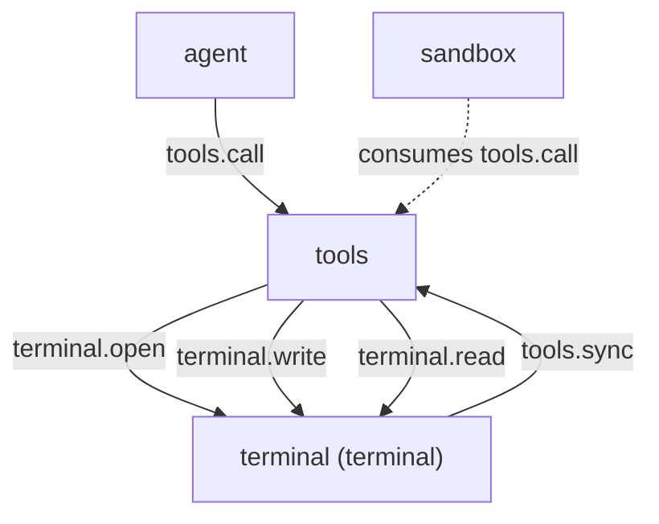

# terminal

> 状态：目标契约（本文全部章节均为待实现的目标契约）
> 涉及能力：`terminal`
> 依赖：弱依赖 `tools`

术语见 [CONTEXT.md](../../../CONTEXT.md)。写作约定见 [00-conventions.md](00-conventions.md)。
帧格式见 [protocol.md](../../platform/protocol.md)。

## 1. 职责

**目标契约。**

- 维护可复用的终端会话。
- 支持启动会话、发送命令、读取增量输出、发送输入、关闭会话。
- 支持后台任务。命令不阻塞调用方。
- 提供 `terminal` 能力方法，供工具注册表分发。
- 把自己的工具集合注册到工具注册表。
- 输出按字节偏移读取，丢掉的字节数必须可见。

终端会话与平台会话不是一回事。终端会话标识叫 `terminal_id`。
平台会话标识叫 `session_id`，由 `tools.call` 的信封透传，两者不共用命名。

## 2. 非职责

- 不裁决权限。裁决由 sandbox 在接缝上独立完成。
- 不替代同步命令执行。同步执行是 shell 能力的事。
- 不维护跨会话的 shell 状态。每个会话是独立进程。
- 不做终端模拟的完整实现。不还原 ANSI 状态与光标位置。
- 不做远程终端。不连别的机器。
- 不做跨平台 shell 切换。shell 由平台与配置决定。
- 不提供标签页。一个标签页就是一个会话。
- 不写会话记录。记录归 session 插件。

## 3. Manifest

**目标契约。** 插件包为 `plugins/terminal/`。

```json
{
  "name": "terminal",
  "version": "0.1.0",
  "protocol": 1,
  "entry": "terminal",
  "description": "Persistent terminal sessions with incremental output reads",
  "autostart": true,
  "priority": 0,
  "provides": ["terminal"],
  "consumes": [],
  "requires": ["tools"],
  "depends_on": [],
  "commands": [],
  "ui": null,
  "settings": {
    "get": {"capability": "terminal", "method": "settings.get"},
    "save": {"capability": "terminal", "method": "settings.save"},
    "schema": [
      {"key": "default_shell_unix", "label": "Default shell (Unix)", "type": "string"},
      {"key": "default_shell_windows", "label": "Default shell (Windows)", "type": "string"},
      {"key": "max_sessions", "label": "Max sessions", "type": "number", "min": 1},
      {"key": "buffer_max_bytes", "label": "Buffer max bytes", "type": "number", "min": 1024},
      {"key": "interactive_blocklist", "label": "Blocked interactive programs", "type": "list", "item_fields": [{"key": "name", "label": "Name", "type": "string", "required": true}]}
    ]
  }
}
```

**为什么 `requires` 只写 `tools`。**

插件的主体是 `terminal` 能力方法，工具注册只是副作用。
`requires` 表达弱依赖：tools 缺席时插件照常启动，方法仍可被直接调用。

**关于 `depends_on`。** 空。插件启动不依赖任何硬依赖插件。
`tools.sync` 缺席时注册调用返回可恢复错误，不影响能力方法。

**关于 `provides`。** 只声明 `terminal`。
五个工具的目标能力都是 `terminal`，由注册表校验这条约束。

## 4. 方法与载荷

工作区锚点由 `tools.call` 的信封透传，不在方法参数里。
会话的初始工作目录相对该锚点解析。

### 4.1 terminal.open

启动一个终端会话。

输入：

```json
{
  "name": "build",
  "shell": "",
  "cwd": ".",
  "env": {}
}
```

| 字段 | 类型 | 必填 | 说明 |
|---|---|---|---|
| `name` | 字符串 | 否 | 人类可读标签，默认空串 |
| `shell` | 字符串 | 否 | 配置里的 shell 键名，空表示用平台默认 shell |
| `cwd` | 字符串 | 否 | 会话初始工作目录，工作区相对路径，默认 `.` |
| `env` | 对象 | 否 | 环境变量覆盖，键值都是字符串 |

`shell` 取的是配置里登记的键名，不是可执行文件路径。
模型不能指向任意可执行文件。

输出：

```json
{
  "content": "terminal term-1 ready\nshell: /bin/bash\ncwd: E:/project",
  "is_error": false,
  "truncated": false,
  "meta": {
    "terminal_id": "term-1",
    "name": "build",
    "shell": "/bin/bash",
    "shell_type": "posix",
    "cwd": "E:/project",
    "pid": 12345,
    "status": "active",
    "created_at": "2026-10-20T09:00:00Z",
    "buffer_bytes": 0,
    "dropped_bytes": 0
  }
}
```

| 字段 | 类型 | 说明 |
|---|---|---|
| `meta.terminal_id` | 字符串 | 会话标识，形如 `term-1` |
| `meta.name` | 字符串 | 回显的标签 |
| `meta.shell` | 字符串 | 实际启动的 shell 可执行文件 |
| `meta.shell_type` | 字符串 | `posix`、`powershell` 或 `cmd` |
| `meta.cwd` | 字符串 | 会话初始工作目录，绝对路径 |
| `meta.pid` | 整数 | shell 进程号 |
| `meta.status` | 字符串 | `active` 或 `closed` |
| `meta.created_at` | 字符串 | 建立时刻，UTC |
| `meta.buffer_bytes` | 整数 | 当前缓冲里的字节数 |
| `meta.dropped_bytes` | 整数 | 已经丢掉的字节数 |

错误码：`bad_arguments`、`terminal_unsupported_platform`、`terminal_session_limit`、
`terminal_command_failed`。

`terminal_command_failed` 表示 shell 进程启动失败。

### 4.2 terminal.write

向会话写入命令或原始输入。

输入：

```json
{
  "terminal_id": "term-1",
  "mode": "command",
  "data": "go test ./...",
  "background": false,
  "wait_ms": 5000,
  "max_bytes": 32768
}
```

| 字段 | 类型 | 必填 | 说明 |
|---|---|---|---|
| `terminal_id` | 字符串 | 是 | 会话标识 |
| `mode` | 字符串 | 否 | `command` 或 `input`，默认 `command` |
| `data` | 字符串 | 是 | 命令文本或原始输入，不能含 NUL |
| `background` | 布尔 | 否 | 默认 `false`，为 `true` 时不等待命令结束 |
| `wait_ms` | 整数 | 否 | 等待新输出的时长，默认 0，上限取配置的 `read_wait_max_ms` |
| `max_bytes` | 整数 | 否 | 返回正文字节上限，默认 32768 |

`mode` 为 `command` 时，`data` 作为命令行写入，末尾补一个换行。
`mode` 为 `input` 时，`data` 原样写入，不补换行。

输出：

```json
{
  "content": "ok  \tgithub.com/example/pkg\t0.4s\n",
  "is_error": false,
  "truncated": false,
  "meta": {
    "terminal_id": "term-1",
    "mode": "command",
    "background": false,
    "bytes": 28,
    "offset": 0,
    "next_offset": 28,
    "total_bytes": 28,
    "original_bytes": 28,
    "truncated_bytes": 0,
    "status": "running",
    "exit_code": null,
    "started_at": "2026-10-20T09:00:01Z",
    "finished_at": null
  }
}
```

| 字段 | 类型 | 说明 |
|---|---|---|
| `meta.terminal_id` | 字符串 | 会话标识 |
| `meta.mode` | 字符串 | 实际生效的写入模式 |
| `meta.background` | 布尔 | 是否以后台方式提交 |
| `meta.bytes` | 整数 | 本次返回的字节数 |
| `meta.offset` | 整数 | 本次读取的起始偏移 |
| `meta.next_offset` | 整数 | 下次读取应从此偏移开始 |
| `meta.total_bytes` | 整数 | 会话累计产生的输出字节数 |
| `meta.original_bytes` | 整数 | 可读到的完整输出字节数 |
| `meta.truncated_bytes` | 整数 | 被砍掉的字节数，为 0 表示未截断 |
| `meta.status` | 字符串 | `running`、`exited`、`failed` 或 `timeout` |
| `meta.exit_code` | 整数 | 命令退出码，命令未结束时为空 |
| `meta.started_at` | 字符串 | 命令开始时刻，UTC |
| `meta.finished_at` | 字符串 | 命令结束时刻，未结束时为空 |

错误码：`bad_arguments`、`terminal_not_found`、`terminal_closed`、`terminal_timeout`。

`wait_ms` 到期但没有新输出不是错误。调用正常返回，
`meta.status` 给出当前状态。

### 4.3 terminal.read

按字节偏移读取增量输出。

输入：

```json
{
  "terminal_id": "term-1",
  "offset": 0,
  "max_bytes": 65536,
  "wait_ms": 30000
}
```

| 字段 | 类型 | 必填 | 说明 |
|---|---|---|---|
| `terminal_id` | 字符串 | 是 | 会话标识 |
| `offset` | 整数 | 否 | 已读到的绝对字节偏移，默认 0 |
| `max_bytes` | 整数 | 否 | 返回正文字节上限，默认 65536 |
| `wait_ms` | 整数 | 否 | 等待新输出的时长，默认 0，上限取配置的 `read_wait_max_ms` |

输出：

```json
{
  "content": "ok  \tgithub.com/example/pkg\t0.4s\nPASS\n",
  "is_error": false,
  "truncated": false,
  "meta": {
    "terminal_id": "term-1",
    "offset": 0,
    "next_offset": 36,
    "total_bytes": 36,
    "buffer_start_offset": 0,
    "dropped_bytes": 0,
    "original_bytes": 36,
    "truncated_bytes": 0,
    "status": "exited",
    "exit_code": 0,
    "started_at": "2026-10-20T09:00:01Z",
    "finished_at": "2026-10-20T09:00:06Z",
    "cwd": "E:/project"
  }
}
```

| 字段 | 类型 | 说明 |
|---|---|---|
| `meta.offset` | 整数 | 本次读取的起始偏移 |
| `meta.next_offset` | 整数 | 下次读取应从此偏移开始 |
| `meta.total_bytes` | 整数 | 会话累计产生的输出字节数 |
| `meta.buffer_start_offset` | 整数 | 缓冲里最早还保留着的字节偏移 |
| `meta.dropped_bytes` | 整数 | 已经丢掉的字节数 |
| `meta.original_bytes` | 整数 | 本次可读到的完整输出字节数 |
| `meta.truncated_bytes` | 整数 | 被砍掉的字节数，为 0 表示未截断 |
| `meta.status` | 字符串 | `running`、`exited`、`failed` 或 `timeout` |
| `meta.exit_code` | 整数 | 命令退出码，命令未结束时为空 |
| `meta.started_at` | 字符串 | 命令开始时刻，UTC |
| `meta.finished_at` | 字符串 | 命令结束时刻，未结束时为空 |
| `meta.cwd` | 字符串 | 会话当前工作目录 |

错误码：`bad_arguments`、`terminal_not_found`、`terminal_closed`、
`terminal_buffer_overflow`。

### 4.4 terminal.close

关闭一个会话。

输入：

```json
{
  "terminal_id": "term-1",
  "force": false
}
```

| 字段 | 类型 | 必填 | 说明 |
|---|---|---|---|
| `terminal_id` | 字符串 | 是 | 会话标识 |
| `force` | 布尔 | 否 | 默认 `false`，为 `true` 时立即杀掉进程树 |

输出：

```json
{
  "content": "terminal term-1 closed\nexit_code: 0",
  "is_error": false,
  "truncated": false,
  "meta": {
    "terminal_id": "term-1",
    "closed": true,
    "exit_code": 0,
    "final_output_bytes": 36,
    "closed_at": "2026-10-20T09:10:00Z"
  }
}
```

| 字段 | 类型 | 说明 |
|---|---|---|
| `meta.closed` | 布尔 | 是否已关闭 |
| `meta.exit_code` | 整数 | 关闭时 shell 的退出码 |
| `meta.final_output_bytes` | 整数 | 关闭时缓冲里的字节数 |
| `meta.closed_at` | 字符串 | 关闭时刻，UTC |

错误码：`bad_arguments`、`terminal_not_found`、`terminal_closed`。

### 4.5 terminal.list

列出会话。

输入：

```json
{
  "include_closed": false
}
```

| 字段 | 类型 | 必填 | 说明 |
|---|---|---|---|
| `include_closed` | 布尔 | 否 | 默认 `false`，为 `true` 时包含已关闭的会话 |

输出：

```json
{
  "content": "term-1  build   posix  running  /bin/bash  E:/project  36B\n",
  "is_error": false,
  "truncated": false,
  "meta": {
    "sessions": [
      {
        "terminal_id": "term-1",
        "name": "build",
        "shell_type": "posix",
        "status": "running",
        "cwd": "E:/project",
        "created_at": "2026-10-20T09:00:00Z",
        "buffer_bytes": 36,
        "dropped_bytes": 0,
        "exit_code": null
      }
    ],
    "count": 1,
    "max_sessions": 4
  }
}
```

| 字段 | 类型 | 说明 |
|---|---|---|
| `meta.sessions` | 数组 | 每个会话含标识、标签、shell 类型、状态、目录与缓冲统计 |
| `meta.count` | 整数 | 会话数 |
| `meta.max_sessions` | 整数 | 配置的会话数上限 |

错误码：`bad_arguments`。

### 4.6 会话模型

**生命周期。** 会话有三个状态。

| 状态 | 含义 |
|---|---|
| `active` | shell 进程活着，可以写入与读取 |
| `closing` | 正在关闭，进程已收到终止信号 |
| `closed` | 进程已退出，缓冲只读 |

`closed` 的会话不能写入与读取，返回 `terminal_closed`。
`terminal.list` 在 `include_closed` 为 `true` 时仍能列出它。

**标识。** `terminal_id` 形如 `term-1`，由插件内单调递增的分配器给出。
标识只在插件进程存活期间有效。

**绑定的工作区。** 会话绑定到 `tools.call` 信封里的工作区。
初始工作目录是该工作区根，`cwd` 参数可以指定工作区内的子目录。

会话的工作目录随 shell 里的 `cd` 变化。
插件通过 shell 报告的当前目录跟踪它，读取时在 `meta.cwd` 给出。

当前目录落在工作区外时，插件不阻断读取。
它在 `meta.cwd` 里给出真实路径，并在正文首行写一句说明。
不静默篡改，模型要知道自己在哪里。

**Shell 类型。** 三种。

| 类型 | 说明 |
|---|---|
| `posix` | Unix 下的常见 shell |
| `powershell` | Windows 下的 PowerShell |
| `cmd` | Windows 下的命令解释器 |

**默认 Shell 的选择规则。** 平台不同，默认值不同。

| 平台 | 选择顺序 |
|---|---|
| Unix | 配置的 `default_shell_unix` 优先，缺省 `/bin/sh`；`$SHELL` 指向的 shell 在允许名单里时用它 |
| Windows | 配置的 `default_shell_windows` 优先，缺省 `powershell.exe`；`pwsh` 在允许名单里且可用时优先它 |

选中的 shell 不在允许名单里时，返回 `terminal_unsupported_platform`。
当前平台找不到任何可用 shell 时也返回这个码。

**模型不能指定任意 shell。** `shell` 字段只接受允许名单里的键名。
允许名单由配置登记，每个条目含键名、可执行文件与启动参数。

**会话数量上限。** 默认 4 个。
超出时返回 `terminal_session_limit`，`meta.max_sessions` 给出上限。

**会话不跨插件重启存活。** 插件进程重启后所有会话丢失。

**进程回收。** 平台没有插件 shutdown 帧，插件被终止时没有优雅收尾的机会。
回收靠操作系统层面。

| 平台 | 手段 |
|---|---|
| Unix | shell 在独立进程组里；插件进程退出后标准输入管道关闭，shell 读到 EOF 自行退出 |
| Windows | 用 Job Object 加 `JOB_OBJECT_LIMIT_KILL_ON_JOB_CLOSE`，插件进程退出时整组被杀掉 |

这套做法与 shell 能力的进程树取消一致，见 [07-shell-tools.md](07-shell-tools.md) 第 4.2 节。

### 4.7 增量读取

**滚动缓冲。** 每个会话有一个上限为 `buffer_max_bytes` 的滚动缓冲。
缓冲保留最近产生的字节，更早的字节被丢掉。

缓冲维护两个偏移。

| 偏移 | 含义 |
|---|---|
| `buffer_start_offset` | 缓冲里最早还保留着的字节的绝对偏移 |
| `total_bytes` | 会话累计产生的输出总字节数 |

**两个方法共用一套偏移语义。** `terminal.write` 与 `terminal.read`
都用同一个滚动缓冲，也都用同一组偏移字段。
`terminal.write` 在写入之后顺带读一段新输出，
所以它返回的 `offset` 与 `next_offset` 和 `terminal.read` 是同一套语义。

**读取规则。** 调用方传入自己已读到的绝对偏移 `offset`。

| 情形 | 处理 |
|---|---|
| `offset` 等于 `buffer_start_offset` | 返回全部保留内容 |
| `offset` 大于 `buffer_start_offset` | 返回从 `offset` 开始的内容 |
| `offset` 小于 `buffer_start_offset` | 请求的字节已被丢掉，返回从 `buffer_start_offset` 开始的内容 |
| `offset` 大于 `total_bytes` | 偏移超前，返回 `bad_arguments` |

**丢了多少字节必须可见。** 第三种情形下，`meta.dropped_bytes` 给出丢失量。

```text
dropped_bytes = buffer_start_offset - offset
```

丢掉的内容不会静默消失。正文首行给出丢失量，
`meta.dropped_bytes` 再给一次，两处都写同一个数。

**溢出。** 缓冲溢出本身是常态，滚动缓冲必然丢字节。
丢掉的内容超过配置的 `max_dropped_bytes` 时，返回 `terminal_buffer_overflow`。

`terminal_buffer_overflow` 的含义是内容已经不可恢复，命令需要重跑。
返回体带 `is_error: true`，正文首行给出丢失量，`meta.dropped_bytes` 同样给出丢失量。

**截断。** 返回内容超过 `max_bytes` 时按字节截断，截断位置对齐到行边界。

| 字段 | 含义 |
|---|---|
| `meta.next_offset` | 只推进到实际返回的字节数，不跳过被砍的部分 |
| `meta.truncated_bytes` | 被砍掉的字节数 |
| 顶层 `truncated` | 是否发生截断 |

被砍的部分还在缓冲里。下次用 `meta.next_offset` 再读一次就能拿到。

**等待语义。** `wait_ms` 大于 0 时，插件在会话没有新输出且命令未结束时最多等这么久。
期间一旦有输出或命令结束就立刻返回。

等待期间父 Context 取消或截止时间到，返回协议级错误码，
会话本身不受影响。

### 4.8 后台任务与完成通知

**主方案：长轮询式增量读取。**

后台命令不阻塞调用方。完成结果通过读取拿到。

```text
1. terminal.write 带 background=true，立即返回
2. 插件内部监视循环排空输出并检测进程退出
3. 调用方用 terminal.read 带 wait_ms 读取
4. 读到 status 为 exited 或 failed 时，这一轮后台任务结束
```

**为什么是这个方案。** 三条约束决定了这个形状。

| 约束 | 后果 |
|---|---|
| 没有广播事件 | 插件不能把"完成"推给任何订阅者 |
| 没有异步调用 | 插件不能返回一个"未来的句柄"让调用方以后去取 |
| Host 不解释 payload | 插件不能把终态塞进别的协议字段里带出去 |

长轮询是一次普通的同步调用。它遵守父 Context 的取消与截止时间，
也不需要 Host 理解终端语义。

**后台监视循环是必须的。** 命令退出检测与输出排空不能依赖调用方还在等待。
没有这个循环，命令结束后输出会堵在管道里，缓冲不再前进。

监视循环做三件事。

| 动作 | 说明 |
|---|---|
| 排空 | 持续读标准输出与标准错误，写进滚动缓冲 |
| 检测 | 进程退出时记录退出码与结束时刻 |
| 记录 | 把终态写进会话自己的状态，不向外推送 |

**终态落在会话状态里。** 会话状态由插件自己维护，
通过 `terminal.read` 与 `terminal.list` 暴露。

| 字段 | 含义 |
|---|---|
| `meta.status` | `running`、`exited`、`failed` 或 `timeout` |
| `meta.exit_code` | 命令退出码 |
| `meta.finished_at` | 命令结束时刻 |

**次方案：监视循环写会话事实。** 让终态进入下一轮上下文的动态轨，
这样模型不用轮询也能知道后台任务结束了。

v1 不落地，三条理由。

| 理由 | 说明 |
|---|---|
| 依赖扩大 | 写会话事实需要 `session` 能力，这会给 Manifest 加一条弱依赖，超出本设计给定的 `requires` |
| 契约未定 | 事实轨的渲染契约还是目标契约，注入位置没有稳定下来，见 [prompts/04-runtime-injection.md](../../prompts/04-runtime-injection.md) 第 1 节 |
| 事实重复 | 终态本来就出现在 `terminal.read` 的返回值里，那是工具结果，session 插件按 [00-conventions.md](00-conventions.md) 第 10 节记录就够了 |

将来落地时，这条事实必须带反注入前缀，
前缀格式见 [prompts/04-runtime-injection.md](../../prompts/04-runtime-injection.md) 第 6 节。

**轮询纪律。** 轮询的节奏由 `wait_ms` 控制，不是忙等。
没有 `wait_ms` 的连续读取，每次都是一次往返。

### 4.9 与 shell 能力的边界

shell 能力做一次性同步执行，terminal 能力做持久会话。两者不重叠。

| 维度 | shell 能力 | terminal 能力 |
|---|---|---|
| 执行次数 | 一次调用一条命令 | 一次调用一条，跨调用累积 |
| 状态 | 无状态，每次新进程 | 有状态，目录与环境跨调用保留 |
| 标准输入 | 不接管道 | 接管道，可交互 |
| 结束语义 | 调用返回时进程已结束 | 调用返回后进程可以继续跑 |
| 超时 | 内部超时终止整棵进程树 | 超时只结束那一条命令，会话保留 |
| 取消 | 取消终止整棵进程树 | 取消只影响当前调用，会话保留 |

**分流规则。**

| 场景 | 走哪个 |
|---|---|
| 一次性、可预期结束、非交互 | shell 能力 |
| 需要交互输入，例如 REPL、密码、确认 | terminal 能力 |
| 需要切目录并保留位置 | terminal 能力 |
| 需要保留后台进程 | terminal 能力 |
| 需要管道与重定向 | shell 能力 |

**避免能力重叠的三条规则。**

1. terminal 不另起一个"执行一条命令并等它结束"的能力名。
   它就是 `terminal.write` 的 `background` 为 `false`。
2. shell 能力不提供会话，也不接受标准输入。
3. 两者各自管理自己的进程，互不复用对方的进程句柄，也不互相调用。

**命令文本的差别。** shell 能力的命令与参数按向量传给进程，不做 shell 解析。
terminal 能力的 `mode` 为 `command` 时，文本由会话里的 shell 自己解析。

这是两个能力的风险差别所在。terminal 的风险值更高。

### 4.10 标杆经验的适配改造

外部工程的终端做法不能照搬，要按 LiteAgent 的硬约束改造。

| 外部经验 | 出处 | 改造 |
|---|---|---|
| 用 `yield_time_ms` 到点返回会话标识 | codex `analysis/shell-terminal.md` 第 5 节 | 改成 `background` 开关加独立的 `terminal.read` |
| 用空写当轮询 | codex `analysis/shell-terminal.md` 第 5.2 节 | 不采纳。空写有歧义，读取走独立的读取方法 |
| 完成后推送通知并另起通知回合 | ZCode `analysis/shell-terminal.md` 第 4 节 | 不采纳。没有广播事件，改成长轮询 |
| 用一次性后台模式管理后台任务 | ZCode `analysis/shell-terminal.md` 第 4 节 | 不采纳。LiteAgent 没有异步调用，没有任务队列 |
| 关闭统一执行后降级成一次性 | codex `analysis/shell-terminal.md` 第 2.2 节 | 部分采纳。能力降级由 sandbox 的缺席处理，不写在工具描述里 |
| 快照模型看到的 shell 与实际执行的 shell | ZCode `analysis/shell-terminal.md` 第 3.2 节 | 采纳。会话建立时记录 shell，返回值里给出 |
| 成功后退出台外时把目录重置回工作区 | ZCode `analysis/shell-terminal.md` 第 1.3 节 | 部分采纳。插件不静默重置，只在输出里说明真实目录 |

改造理由有五条。

- 插件之间不直连。terminal 不去调 shell 能力，也不复用它的进程。
- 只有 `(capability, method)` 寻址。模型寻址不到 shell 的内部方法。
- 没有广播事件。完成通知不能靠推送。
- 没有异步调用。后台任务没有"以后再取"的句柄。
- 二进制内容不得进帧。终端输出按 UTF-8 文本处理，控制序列原样保留。

**控制序列的处理。** ANSI 控制序列原样保留在输出里，不做状态解析。
模型看到的是带控制字符的文本，这与 shell 能力的输出一致。

## 5. 接缝与调用关系

**目标契约。**



`terminal.write` 是否由 sandbox 裁决待定。
sandbox 的消费清单不含 `terminal.*`，落地前需先扩充，见 [08-sandbox.md](08-sandbox.md) 第 4 节。

`terminal.read` 与 `terminal.list` 是只读方法，裁决方可以接管也可以不接管。

注册方向是反的。terminal 启动时调用 `tools.sync` 上架五个工具。

## 6. 工具契约

**目标契约。**

| 工具名 | 风险值 | 标签 | 目标方法 |
|---|---:|---|---|
| `terminal_open` | 80 | `terminal`、`exec` | `terminal.open` |
| `terminal_write` | 90 | `terminal`、`exec` | `terminal.write` |
| `terminal_read` | 10 | `terminal`、`read` | `terminal.read` |
| `terminal_close` | 40 | `terminal`、`write` | `terminal.close` |
| `terminal_list` | 10 | `terminal`、`read` | `terminal.list` |

风险刻度见 [05-tools.md](05-tools.md) 第 6.3 节。

`terminal_open` 取 80，`terminal_write` 取 90，都落在任意代码执行区间。
开出一个 shell 与执行一条命令都是任意代码执行。
`terminal_write` 高一档，因为它写进去的文本由 shell 解析。

`terminal_close` 取 40，落在可逆的本地修改区间。
关闭会杀掉进程，未保存的交互状态会丢，但改动过的文件不受影响。

两个读取方法取 10，落在只读区间。

五个工具的目标能力都是 `terminal`，即本插件 `provides` 的能力。

## 7. Prompt 贡献

**目标契约。** 每个工具各有一份描述与一组纪律。

规格见 [prompts/03-tool-prompts.md](../../prompts/03-tool-prompts.md) 第 2 节。
五段顺序是首句、行为语义、边界、防绕过、When 双举。

描述里的数值从配置插值，不写死。

### 7.1 terminal_write 的 description

```text
Send a command to an open terminal session and return the output it produced.

The session is persistent. Its working directory, environment and background processes
survive between calls. mode=command writes the text as one shell command line;
mode=input writes raw bytes with no newline. background=true returns as soon as the
command is queued. wait_ms caps how long the call waits for new output, 0 by default
and 60000 at most. Output longer than max_bytes is truncated, and the result reports
original_bytes and truncated_bytes.

An interactive program never returns on its own. Run it with background=true and read
the session afterwards, or give it a short wait_ms, or the call blocks until the
command timeout ends it. A command killed by that timeout returns terminal_timeout. A
terminal that no longer exists returns terminal_not_found.

Do not emulate a persistent session through the shell tool; a shell call cannot keep a
process alive across calls.

Use this tool when a command needs a persistent session, interactive input, or a
directory that survives the call. Do not use it for one-shot commands that finish on
their own; the shell tool is simpler for those.
```

五段对应关系如下。

| 段 | 落在哪一句 |
|---|---|
| 首句 | 第一行 |
| 行为语义 | 第二段，讲会话持久、写入模式、后台开关与等待上限 |
| 边界 | 第三段，讲交互程序挂住、超时与找不到会话 |
| 防绕过 | 第四段，讲为什么不绕道 shell |
| When 双举 | 最后一段 |

### 7.2 terminal_write 的 guidelines

```text
- terminal_write: an interactive program never returns; run it with background mode and read the session afterwards.
- terminal_write: the session keeps its working directory between calls; send an explicit cd when you depend on it.
- terminal_read: read the output before sending the next input; a prompt may not have appeared yet.
- terminal_read: poll with a wait_ms instead of a tight loop; every empty read is a round trip.
- terminal_close: close the session when the task is done; a forgotten session holds a process and a buffer.
```

### 7.3 其他工具的 description 骨架

`terminal_open` 的首句与 When 双举。

```text
Open a terminal session that stays alive across calls.

The session starts in the workspace directory and keeps its working directory,
environment and background processes between calls. The shell comes from the deployment
configuration, and only shells on the allowed list can be picked. At most 4 sessions
can be open at once.

Use this tool when a task needs a persistent shell. Do not open a session for a single
command; the shell tool covers that case.
```

`terminal_read` 的首句与 When 双举。

```text
Read new output from a terminal session, starting at the byte offset you already read.

Output is returned as text, and the result carries the next offset to read from. Bytes
older than the buffer have already been dropped, and dropped_bytes says how many. A
drop beyond the configured limit returns terminal_buffer_overflow and the content must
be produced again.

Use this tool to collect the result of a command. Do not use it to read a file; the file
tools serve that purpose.
```

`terminal_close` 的首句与 When 双举。

```text
Close a terminal session and stop the processes running in it.

Closing ends the shell process. Output already produced stays readable until the
session is dropped from the list. force=true kills the process tree immediately.

Use this tool when the task is done with a session. Do not use it to interrupt a command
that still has to finish; read the session first.
```

`terminal_list` 的首句与 When 双举。

```text
List the open terminal sessions with their shell, state, directory and buffer size.

Only sessions of this deployment are listed. Closed sessions appear only when
include_closed is true.

Use this tool to recover a session identifier you lost. Do not use it to read output.
```

### 7.4 prompt_snippet

```text
terminal_open: open a persistent terminal session
terminal_write: run a command in a terminal session
terminal_read: read new output from a terminal session
terminal_close: close a terminal session
terminal_list: list terminal sessions
```

工具名以常量引用，不写死在纪律文本里。
渲染时用注册时的名字，工具卸载后其条目自动消失。

## 8. 记录与持久化

**目标契约。** terminal 不写会话记录，也不维护自己的存储。

终端输出是模型可见内容。按 [00-conventions.md](00-conventions.md) 第 10 节，
它必须能从会话记录里重建，这件事由 session 插件完成。

**终端输出不进插件存储。** 缓冲区是运行期内存，会话关闭即释放。
落盘会把外部内容写进工作区，也会让缓冲上限失去意义。

**会话状态不落盘。** 插件重启后所有会话丢失，这是设计取舍。
会话是短生命周期的运行期对象。

## 9. WebUI

无。terminal 不提供组件，不占用任何 Slot。

## 10. 错误码

**目标契约。** 插件级错误码。

| 错误码 | 形态 | 场景 |
|---|---|---|
| `terminal_not_found` | 协议错误 | 会话标识不存在 |
| `terminal_closed` | 协议错误 | 会话已关闭 |
| `terminal_session_limit` | 协议错误 | 会话数达到上限 |
| `terminal_buffer_overflow` | 业务失败 | 丢失字节数超过上限，内容已不可恢复 |
| `terminal_command_failed` | 协议错误 | shell 进程启动失败，或向已死进程写入失败 |
| `terminal_timeout` | 业务失败 | 命令被内部超时终止 |
| `terminal_unsupported_platform` | 协议错误 | 当前平台没有可用 shell |

**目标契约。** 还复用平台级错误码 `bad_arguments`。
载荷缺字段、字段错型、`mode` 取值非法、偏移超前都归它。

业务失败返回 `is_error: true`，错误码放在 `meta.code`。
`terminal_buffer_overflow` 与 `terminal_timeout` 的正文仍带上下文，不留空串。

## 11. 配置

**目标契约。** 配置走 Manifest 声明的 Settings Schema。

| 配置项 | 类型 | 默认 | 说明 |
|---|---|---|---|
| `default_shell_unix` | 字符串 | `/bin/sh` | Unix 下的默认 shell |
| `default_shell_windows` | 字符串 | `powershell.exe` | Windows 下的默认 shell |
| `allowed_shells` | 列表 | 平台默认集 | 可选 shell 清单，每项含键名与可执行文件 |
| `command_timeout_ms` | 整数 | 120000 | 单条命令的超时 |
| `read_wait_max_ms` | 整数 | 60000 | `wait_ms` 的上限 |
| `buffer_max_bytes` | 整数 | 1048576 | 会话滚动缓冲的上限 |
| `max_dropped_bytes` | 整数 | 1048576 | 允许丢失的字节数，超过报溢出 |
| `max_sessions` | 整数 | 4 | 并发会话上限 |
| `interactive_allowlist` | 列表 | 空 | 允许交互的程序名，非空时只认名单内的 |
| `interactive_blocklist` | 列表 | 空 | 禁止启动的程序名 |

**模型侧上限。** `wait_ms` 的模型侧上限是 60000。
`max_bytes` 的模型侧上限是 1048576。

**交互程序名单。** 名单按命令的首个词判定。

| 规则 | 说明 |
|---|---|
| 判定对象 | `mode` 为 `command` 时 `data` 的首个词 |
| 名单优先级 | `interactive_blocklist` 优先于 `interactive_allowlist` |
| 允许名单为空 | 不做限制 |
| 判定失败 | 命中黑名单返回 `terminal_command_failed` |

这个判定是粗粒度的。它挡得住明显的交互程序，
挡不住命令内部才出现的交互行为。

**密钥。** terminal 插件不需要密钥。

**Settings 入口。** 用标准设置方法，形态见 [manifest.md](../../platform/manifest.md) 第 4 节。

`terminal.settings.get` 的输入为空对象，输出是 `values` 包络。

`terminal.settings.save` 的输入是同一个 `values` 包络，输出是 `{"saved": true}`。

配置改动不影响在途调用。在途调用继续用开始时的配置快照。

## 12. 测试要求

按 [00-conventions.md](00-conventions.md) 第 13 节展开。

| 项 | 本插件的用例 |
|---|---|
| 载荷解码 | 缺字段、错类型、空载荷、多余字段均报 `bad_arguments` |
| 成功响应 | 五个方法各一条正常路径用例，校验 `meta` 形状 |
| 稳定错误码 | 第 10 节每个错误码各一条用例 |
| 配置持久化 | 配置写入、脱敏读取、shell 名单收窄生效 |
| 事件载荷 | 无。terminal 不发事件 |
| 纯函数 | 偏移换算、缓冲滚动、名单比对、shell 选择 |
| 取消路径 | 父 Context 取消与截止时间到，会话保持可用 |
| 降级路径 | `tools` 缺席时 `terminal` 能力方法仍可被直接调用 |

补充用例。

| 用例 | 断言 |
|---|---|
| 增量偏移 | 连续两次读取时第二次的 `offset` 等于第一次的 `next_offset` |
| 偏移超前 | `offset` 大于 `total_bytes` 时返回 `bad_arguments` |
| 缓冲溢出 | 缓冲超过上限后旧偏移的读取返回 `meta.dropped_bytes` 且大于 0 |
| 溢出报错 | 丢失量超过 `max_dropped_bytes` 时返回 `terminal_buffer_overflow` |
| 溢出可见 | `terminal_buffer_overflow` 的正文首行给出丢失量 |
| 截断推进 | 截断时 `next_offset` 只推进到实际返回的字节数 |
| 截断续读 | 用 `next_offset` 再读一次能拿到被砍掉的后半段 |
| 后台完成 | `background` 为 `true` 的命令结束后，`terminal.read` 返回 `status` 为 `exited` 与退出码 |
| 后台不阻塞 | `background` 为 `true` 时 `terminal.write` 立即返回，`status` 为 `running` |
| 等待语义 | `wait_ms` 到期没有新输出时正常返回，不是错误 |
| 等待唤醒 | `wait_ms` 内出现新输出时提前返回 |
| 命令超时 | 超过 `command_timeout_ms` 的命令被终止，返回 `terminal_timeout` |
| 会话上限 | 超过 `max_sessions` 时返回 `terminal_session_limit` |
| 关闭后写入 | 已关闭的会话写入返回 `terminal_closed` |
| 未知会话 | 不存在的标识返回 `terminal_not_found` |
| 交互黑名单 | 黑名单里的程序名被拒绝 |
| 平台兜底 | 找不到任何可用 shell 时返回 `terminal_unsupported_platform` |
| 工作目录 | 会话 `cd` 之后 `meta.cwd` 反映新目录 |

## 13. 验收标准

| 项 | 检查 |
|---|---|
| 能力名已登记 | `terminal` 在 [00-conventions.md](00-conventions.md) 第 3 节的能力表里 |
| 错误码全局唯一 | 与平台级码不冲突，与其他插件的码不重复 |
| 方法齐备 | 五个方法有完整的输入、输出与错误契约 |
| 工具与方法对应 | 五个工具各自指向同名方法 |
| 目标能力在 `provides` 内 | 五个工具全部指向 `terminal` |
| 标识不混淆 | 终端会话用 `terminal_id`，与平台会话的 `session_id` 不共用命名 |
| 增量可读 | 按偏移读取能拿到不重复也不遗漏的内容 |
| 丢失可见 | 丢掉多少字节在正文与 `meta` 里都可见 |
| 后台可完成 | 后台命令结束时能通过读取拿到终态与退出码 |
| 无推送 | 插件不广播事件，也不做异步调用 |
| 边界清楚 | 与 shell 能力的分工在第 4.9 节写死，两边都不提供对方的形态 |
| 风险值分层 | 写入类工具的风险值高于读取类工具 |
| 不直连其他插件 | 跨插件交互只经能力调用 |
| 不用插件名寻址 | 文档中不出现按插件名调用的描述 |

## 14. 未实现

**暂不实现。**

- 完整终端模拟。不实现 ANSI 状态机，不跟踪光标位置，不还原屏幕。
- 多标签页。一个标签页就是一个会话，不做标签页布局。
- 终端录制与回放。不存输入输出历史。
- 跨平台 shell 切换。shell 由平台与配置决定。
- 远程终端。不连别的机器。
- 会话持久化。插件重启后会话丢失。
- 工作区外的目录。会话不越出工作区，但也不强制拦住在工作区内的 cd。
- 交互程序识别。不做程序行为探测，只按首个词匹配名单。
- 管道与重定向的图形化表达。命令文本由 shell 自己解析。
- 会话共享。不提供把一个会话接到另一个会话的机制。

## 15. 结构体索引

仅作实现参考。契约的 Go 实现归插件自己所有，字段以 JSON 名为准。

| Go 类型 | 角色 |
|---|---|
| `plugin` | 插件实例，持有配置与会话表 |
| `config` | 配置快照，含 shell、超时、缓冲与名单 |
| `Definition` | 工具定义 |
| `RegisterInput` | 单条注册定义 |
| `SyncInput` | 全量同步入参 |
| `SyncOutput` | 全量同步结果 |
| `ProviderInput` | 转发给提供方的载荷 |
| `Result` | 工具结果包络 |
| `Caller` | SDK 调用接口 |
| `openIn` | `terminal.open` 的参数 |
| `openOut` | `terminal.open` 的结果，含 shell 与目录 |
| `writeIn` | `terminal.write` 的参数 |
| `writeOut` | `terminal.write` 的结果，含偏移与状态 |
| `readIn` | `terminal.read` 的参数 |
| `readOut` | `terminal.read` 的结果，含偏移、丢失量与终态 |
| `closeIn` | `terminal.close` 的参数 |
| `closeOut` | `terminal.close` 的结果，含退出码 |
| `listIn` | `terminal.list` 的参数 |
| `listOut` | `terminal.list` 的结果，含会话列表 |
| `session` | 一个终端会话，持有进程、缓冲与状态 |
| `sessionRegistry` | 会话表，按标识查找并计数 |
| `idAllocator` | 会话标识分配器 |
| `shellSelector` | 按平台与配置选择 shell |
| `shellSpec` | shell 规格，含键名、可执行文件、参数与类型 |
| `processRunner` | 进程启动器，负责进程组与 Job Object |
| `ringBuffer` | 滚动缓冲，记录起点偏移与总量 |
| `watcher` | 后台监视循环，排空输出并检测退出 |
| `interactivePolicy` | 交互程序名单判定，按首个词匹配 |
