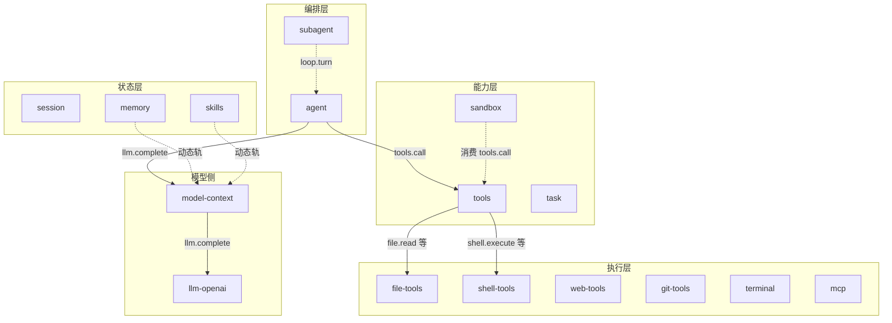

# 插件设计稿

> 状态：当前实现与目标契约混合
> 说明：每份设计稿逐节标注状态。实现细节以 `plugins/<name>/` 为准。

本目录是 LiteAgent 全部插件的设计稿。

它包含已实现的插件与计划新增的插件。每份设计稿的深度足以支撑实现。

平台协议在 [protocol.md](../../platform/protocol.md) 与 [manifest.md](../../platform/manifest.md)。写作约定在 [00-conventions.md](00-conventions.md)。

## 1. 文档索引

### 1.1 约定

| 文档 | 内容 |
|---|---|
| [00-conventions.md](00-conventions.md) | 命名、Manifest、消费链、错误码、Wire 类型、设计稿模板 |

### 1.2 已实现插件

| 文档 | 插件 | 能力 | 状态 |
|---|---|---|---|
| [01-agent.md](01-agent.md) | agent | `loop`、`agent` | 当前实现 |
| [02-session.md](02-session.md) | session | `session` | 当前实现 |
| [03-llm-openai.md](03-llm-openai.md) | llm-openai | `llm` | 当前实现 |
| [04-model-context.md](04-model-context.md) | model-context | `model-context` | 当前实现 |
| [05-tools.md](05-tools.md) | tools | `tools` | 当前实现 |
| [06-file-tools.md](06-file-tools.md) | file-tools | `file` | 当前实现 |
| [07-shell-tools.md](07-shell-tools.md) | shell-tools | `shell` | 当前实现 |
| [08-sandbox.md](08-sandbox.md) | sandbox | `sandbox` | 当前实现，三态裁决 |

### 1.3 计划新增插件

| 文档 | 插件 | 能力 | 优先级 |
|---|---|---|---|
| [09-subagent.md](09-subagent.md) | subagent | `subagent` | 高 |
| [10-memory.md](10-memory.md) | memory | `memory` | 中 |
| [11-skills.md](11-skills.md) | skills | `skills` | 中 |
| [12-mcp.md](12-mcp.md) | mcp | `mcp` | 中 |
| [13-task.md](13-task.md) | task | `task` | 中 |
| [14-web-tools.md](14-web-tools.md) | web-tools | `web` | 中 |
| [15-git-tools.md](15-git-tools.md) | git-tools | `git` | 低 |
| [16-terminal.md](16-terminal.md) | terminal | `terminal` | 低 |

## 2. 插件地图



分层只表示职责，不表示路由。实际路由按 `(capability, method)`。

## 3. 接缝全景

接缝是多方共同参与的 `(capability, method)`。

下表区分当前实现与目标契约。当前实现里只有 `llm.complete` 是一条真正的消费链。

| 接缝 | 参与方 | 语义 | 状态 |
|---|---|---|---|
| `llm.complete` | model-context → llm-openai | 组装在最前，下游看到真实模型输入 | 当前实现 |
| `tools.call` | agent → sandbox → tools | 记录、裁决、分发 | 当前实现，sandbox 缺席时退化为 agent → tools |
| `file.read` 等 | tools → file-tools | tools 按 `target_capability` 转发 | 当前实现 |
| `shell.execute` | tools → shell-tools | 同上 | 当前实现 |
| `loop.turn` | agent | 发起方 | 当前实现 |
| `file.write` 等 | tools → sandbox → file-tools | 直连高危能力也过裁决 | 当前实现 |
| `shell.execute` | tools → sandbox → shell-tools | 同上 | 当前实现 |
| `loop.turn` | subagent → agent | 子代理经这里起独立会话 | 当前实现 |

链序按插件顶层 `priority` 递减。`priority` 是插件级单值，Manifest 的 `consumes[]` 条目不带独立 priority。

| 插件 | `priority` | 链中角色 | 参与的接缝 |
|---|---:|---|---|
| model-context | 2000 | Consumer | `llm.complete` |
| session | 1000 | 不参与 | 无（不声明 `consumes`） |
| tools | 0 | Provider | `tools.call` |
| llm-openai | 0（缺省） | Provider | `llm.complete` |
| agent | 0（缺省） | 发起方 | 无（不声明 `consumes`） |
| file-tools | 0（缺省） | Provider | 无（tools 转发） |
| shell-tools | 0（缺省） | Provider | 无（tools 转发） |
| sandbox | 500 | Consumer | 当前实现：`tools.call`、`file.write`、`file.replace`、`file.patch`、`shell.execute` |

sandbox 消费 5 个键。其余设计稿提到的 `file.read`、`web.fetch`、`git.commit`、`git.checkout`、`terminal.write` 不在 sandbox 的消费清单内，落地前需先收敛。

## 4. 插槽分配

插槽在当前实现里一个只归一个插件。多个插件要组件，就要先放宽这条规则。

| 插件 | 组件 | 槽位 | 状态 |
|---|---|---|---|
| session | session-history | left | 当前实现 |
| session | session-chat | center | 当前实现 |
| session | session-trace | right | 当前实现 |
| session | session-dock | bottom | 当前实现 |
| skills | skills-list | left | 目标契约，与 session 冲突 |
| sandbox | sandbox-confirm | right | 目标契约，与 session 冲突 |
| memory | memory-browser | right | 目标契约，与 session 冲突 |
| task | task-list | right | 目标契约，与 session 冲突 |

放宽方向：插槽变成区域，区域内按插件名排序挂载。实例身份不变，仍是 `plugin_name + mount_id`。

这条改动落在 Host Shell 的挂载登记表，不改插件契约。

sandbox 排在第一批落地，它要占 `right` 槽，而 `right` 已被 session 占用。
所以插槽共享是**第一批**的前置条件，不是第二批。
其余要新槽位的插件（skills、memory、task）排在第二批及以后。

详见 [00-conventions.md](00-conventions.md) 第 11 节。

## 5. 降级矩阵

| 部署 | 效果 |
|---|---|
| 无 model-context | 编排插件的基线直达模型 |
| 无 sandbox | 全部工具调用无裁决。缺席即放行，调用直接到 Provider |
| 无 tools | `tools.call` 返回 `method_not_found`，编排插件跳过工具阶段。tools 在场但工具名未注册时是 `tool_not_found` |
| 无工具提供方 | `tools.list` 为空，模型不带工具 |
| 无 memory | 动态轨不含记忆节 |
| 无 skills | 动态轨不含技能节 |
| 无 subagent | 委派工具不在册，模型看不到委派能力 |
| 无 task | 任务清单能力不可用 |

缺席一律降级，不阻断对话。消费链上声明了 `consumes` 但未激活的插件同样按缺席处理，该跳被跳过。

## 6. 状态说明

| 标注 | 含义 |
|---|---|
| 当前实现 | 代码里已生效 |
| 目标契约 | 已定下、待实现 |
| 暂不实现 | 本轮明确排除 |

设计稿里的每一节都按这三类标注。读的时候先看标注，再看内容。

## 7. 落地顺序

```text
第一批：sandbox
  理由：它决定工具调用要不要过检查。其余插件都可以在无裁决状态下先跑。
  状态：三态裁决、规则集与审计已落地。确认流与确认面板未落地。
        插件是可选件，autostart 为 false，从插件中心启动后进链。

第二批：task、skills
  理由：两者都是纯增量，不改动现有调用链。

第三批：subagent、memory
  subagent v2 已实现；memory 仍待实现。两者都要改会话记录格式与动态轨。

第四批：web-tools、mcp
  理由：两者都扩展工具面，需要工具契约先稳定。

第五批：git-tools、terminal
  理由：与现有工具重叠度低，收益排在后面。
```

## 8. 跨插件前置条件

新插件不是各自独立的。有八项契约改动必须先落地。

| 前置条件 | 谁改 | 谁依赖 |
|---|---|---|
| 工具定义增加 `tool_name` 字段 | tools | mcp |
| 工具定义增加 `guidelines` 与 `prompt_snippet` | tools | 全部工具提供方。已实现的 file-tools 与 shell-tools 也没有这两个字段 |
| `tools.list` 支持按 `tags` 过滤 | tools | mcp |
| 插槽可共享 | Host Shell | sandbox、memory、task、skills |
| 上下文组装的显式 `track` 字段 | model-context | skills、memory、task、sandbox |
| model-context 增加出站能力调用与 `requires` 更新 | model-context | memory（`memory.recall`）、skills、task（`task.list`） |
| agent 增加 `memory.extract` 调用与任务状态写入 | agent | memory、task |
| sandbox 消费集是否扩充 | sandbox | web-tools、git-tools、terminal |

还有三项词汇表登记。它们是加一行的事，但不做就拼不上。

| 登记项 | 登记在哪 | 谁依赖 |
|---|---|---|
| 动态轨节名 `policy`、`task` | Prompt 分节词表 | sandbox、task |
| 事实类型 `sandbox_decision`、`memory_item`、`task_item`、`subagent_spawned`、`subagent_finished` | session 的类型词汇表 | sandbox、memory、task、subagent |
| 规则作用域 `command_pattern` 与工具入参保留键 `confirm_token` | 工具契约与规则 Schema | sandbox、全部工具提供方 |

## 9. 与现有插件文档的关系

`plugins/<name>/communication.md` 是插件自己的跨插件 JSON 规范。

本目录是设计稿。设计稿可以比实现走得更远，但每处都要标清楚状态。

文档同步规则见 [CONSTRAINT.md](../../../CONSTRAINT.md) 第 1 节。
