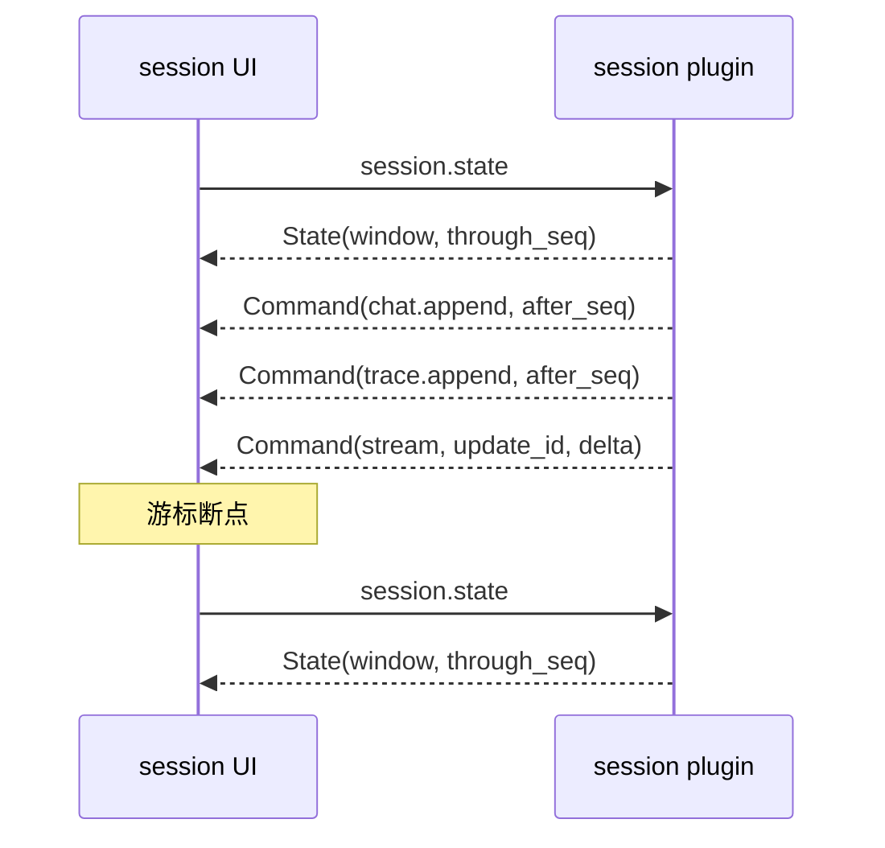

# WebUI 长会话性能设计与实现

> 状态：当前实现
> 说明：第一批已实现，窗口分页已落地。

范围：WebUI 传输、Session UI State、Session 插件推送、前端渲染。

相关契约：[plugins/session/communication.md](../../plugins/session/communication.md)。

## 1. 背景

长程任务持续写入工具结果和流式文本。浏览器出现无响应，内存达到几百 MB。

问题不在模型推理，也不在 HTTP 通道。根因是两条热路径都按全量工作。会话越长，成本增长越快。

## 2. 根因

### 2.1 每次 append 推送完整 State

旧实现中，`append` 会重建完整 Chat State 和 Trace State。

- 每个打开会话都重新读取整份 JSONL。
- Chat State 携带全部消息。
- Trace State 携带全部 Fact，包括完整工具输出。
- 每次 append 触发一次完整投影。

实测 20 次 append 写入约 1.9 MiB，却向浏览器推送约 39 MiB。最后一次 append 单次推送 3.85 MiB。

### 2.2 流式帧携带累计全文

旧实现每个 flush 都发送累计正文、reasoning 和工具参数。

前端收到后，对累计全文重新解析并重建 DOM。解析成本随正文长度线性增长，总成本随流式帧数二次增长。

476 KB、7,000 行的草稿每帧耗时 130 ms～181 ms。

### 2.3 前端每次推送做全量比较

消息和 Fact 按 `seq` 不可变，但旧代码仍对每条消息执行 `JSON.stringify` 比较。

3.2 MiB 会话下，10 次 1 KB append 出现 737 ms、1,057 ms 的长任务。heap 峰值 120 MB。

空闲后 heap 回落到 28 MB。这不是对象泄漏，而是分配风暴和全量副本。

### 2.4 挂载和重连重复拉取完整 State

`session-history`、`session-chat`、`session-trace` 各自调用 `session.state`。

`state` 响应同时包含 `history`、`chats`、重复的 `chat` 和完整 `trace`。1.7 MiB 会话单次响应 10.28 MiB。

## 3. 目标与不变量

本次实现保持以下不变量：

- State 是可重建的窗口快照。
- Command 是两次快照之间的增量。
- 增量携带 `after_seq`、`through_seq` 或 `update_id`。
- 接收端发现游标断点就重新读取 State。
- Command 不重放；State 是唯一恢复路径。
- UI 窗口不是模型上下文。完整 Fact Log 仍是审计和模型上下文的真源。
- Host 传输保持 HTTP + NDJSON，不引入 WebSocket。

## 4. 设计

### 4.1 State 快照与增量 Command

完整 State 只在以下时机发送：

- Mount 首次挂载；
- 选择会话或切换工作区；
- `session.refresh`；
- 重连 resync；
- `cancel_requested` 等低频结构变化。

正常 append 只发送三个增量 Command：

| Command | 内容 |
|---|---|
| `chat.append` | 新增消息、当前 Turn 状态 |
| `trace.append` | 新增 Fact |
| `dock.append` | Turn、usage 增量、最新 context/request 摘要 |

`after_seq` 必须等于接收端当前的 `through_seq`。不一致时，前端调用 `session.state` 重新读取完整窗口。

### 4.2 流式增量

`StreamDelta` 携带 `update_id`、`reset`、`content_delta`、`reasoning_delta` 和 `status`。

- 新 Step 的第一帧发送 `reset=true`，携带当前完整正文。
- 后续帧只发送增量。
- 完整草稿仍保存在 ChatState 的 `stream` 字段，供重连恢复。
- 客户端发现 `update_id` 不连续，调用 `session.state` 重新同步。

### 4.3 窗口与分页

ChatState 和 TraceState 都有窗口预算：

| 项 | 预算 |
|---|---:|
| Chat 消息数 | 200 |
| Chat 正文字节 | 约 2 MiB |
| Trace Fact 数 | 200 |
| Trace 字节 | 约 2 MiB |

窗口携带 `first_seq` 和 `has_more`。

更早的数据通过分页方法读取：

- `session.messages` 读取更早的 Chat 消息。
- `session.facts` 读取更早的审计 Fact。

前端首次只显示窗口内最新 60 条 Trace。用户向上加载本地剩余记录。本地耗尽后，再请求服务端更早的一页。

append 到达时，前端按同样的预算裁剪窗口。裁剪从最旧一端开始，并保留至少一条记录。

### 4.4 前端渲染

前端改动集中在 `plugins/session/ui/main.js`：

- 消息和 Fact 按 `seq` 复用 DOM 节点。
- 删除对整条消息和整个 Fact 的 `JSON.stringify`。
- 流式帧用两帧 `requestAnimationFrame` 合并。
- 草稿 Markdown 冻结已结算块，只重解析最后两个块。
- 已冻结块使用 `content-visibility: auto` 跳过离屏布局。
- 工具结果、reasoning、tool_calls 和 context 块在展开时创建正文。
- Chat 窗口裁剪和 Trace 窗口裁剪都保留滚动位置。

### 4.5 数据流



## 5. 实现清单

### 5.1 Session 插件

| 内容 | 文件 |
|---|---|
| Append 类型与推送 | [ui_state.go](../../plugins/session/ui_state.go) |
| append 入口与游标 | [store.go](../../plugins/session/store.go) |
| 分页方法注册 | [main.go](../../plugins/session/main.go) |
| 增量协议文档 | [communication.md](../../plugins/session/communication.md) |

关键实现：

- `publishChatAppend`、`publishTraceAppend`、`publishDockAppend` 直接使用本批 Fact，不重读 JSONL。
- `updateStream` 比较前后快照，只发送新增文本。
- `windowChatMessages`、`windowedTraceState` 同时执行条数和字节预算。
- `messages`、`facts` 按 `before_seq` 返回更早一页。

### 5.2 前端

| 内容 | 文件 |
|---|---|
| 增量合并与窗口 | [main.js](../../plugins/session/ui/main.js) |
| Markdown 冻结块 | [main.js](../../plugins/session/ui/main.js) |
| 工具与 reasoning 懒渲染 | [main.js](../../plugins/session/ui/main.js) |
| 滚动与加载更早 | [main.js](../../plugins/session/ui/main.js) |

### 5.3 附带清理

本次同时删除 `pluginsdk/toolcontract`。

`tools`、`file-tools`、`shell-tools` 各自定义本地 wire 类型。JSON 契约仍由 [plugins/tools/communication.md](../../plugins/tools/communication.md) 定义。

这样工具契约不再进入平台 SDK。

## 6. 实测结果

测试环境：本机隔离实例，`127.0.0.1:2399`。数据通过真实 `/bridge/call` 与 `/bridge/ui` 链路写入和读取。

### 6.1 推送量

| 场景 | 旧实现 | 新实现 |
|---|---:|---:|
| 96 KiB append 的单次推送 | 3.85 MiB（第 20 次） | 194 KiB（每次恒定） |
| 1 MiB append | 5.9 MiB | 2.05 MiB |
| 100 帧流式，最终 50 KiB | 2.55 MiB | 77 KiB |
| 服务端 append 处理 | 约 220 ms | 约 5 ms |

新实现的 append 推送量只与本批新增内容有关。旧值取 20 次 append 序列的末次；新值在 10 次 append 中保持恒定。

### 6.2 浏览器

| 指标 | 旧实现 | 新实现 |
|---|---:|---:|
| 小 append 长任务 | 0.7 s～1.1 s | 约 50 ms～65 ms |
| 500 KB 草稿的单帧渲染 | 整段重解析 130 ms～181 ms | 小增量 33 ms～41 ms |
| 测试页 heap | 峰值 120 MB | 约 10 MB～35 MB |

### 6.3 窗口分页

用 250 条消息的会话验证：

- ChatState 返回 200 条消息，`has_more=true`。
- TraceState 返回 200 条 Fact，`total=251`。
- `session.messages` 补齐剩余 50 条。
- `session.facts` 补齐剩余 51 条。
- 新 append 到达后，前端裁剪回 200 条并保留最新记录。

字节预算用两条约 1.2 MiB 的消息验证。窗口只保留最后一条，`has_more=true`。

## 7. 边界与后续

### 7.1 仍然存在的成本

- 首次打开、选择和 refresh 仍由服务端扫描完整 JSONL。窗口只限制响应体，不限制扫描成本。
- Chat 与 Trace 对新工具内容各发一份。Trace 可改为摘要加展开时取详情。
- `splitRichBlocks` 仍扫描完整草稿。下一步可从冻结偏移开始，只解析尾部。
- 小 append 的渲染仍有约 50 ms～65 ms 长任务。后续可继续降低。
- 窗口大小和字节预算目前是常量，尚未做成配置。

### 7.2 Host 侧

本次未改 Host 传输。宿主队列丢帧时，前端依靠游标断点触发 resync。

后续建议：

- 记录每个连接的推送字节、最大帧、队列深度和丢弃次数。
- 连接队列满时，为 Command 提供 resync 信号，或关闭连接让客户端重连。
- 评估 State latest-wins 合并。实现前必须确认 State 与 Command 的相对顺序。

### 7.3 不属于本次范围

- 模型上下文压缩和 `session.derive` 的全量读取。
- 浏览器虚拟列表。当前先用窗口、懒渲染和折叠控制内存。
- 跨进程的事件重放。

## 8. 验证

已执行：

```text
go test ./... -count=1
go vet ./...
node --check plugins/session/ui/main.js
```

全部通过。

浏览器验证覆盖：

- 250 条消息的窗口与加载更早；
- Trace 窗口与加载更早；
- append 后窗口裁剪；
- 字节预算裁剪；
- 流式增量合并；
- Dock 增量更新；
- 断点 resync。

复测脚本位于 `.tmp-e2e/perf/`，包括 `delta-measure.mjs`、`stream-delta-check.mjs` 和 `make-window-session.mjs`。该目录不进版本库。

## 9. 相关文件

- Session 契约：[plugins/session/communication.md](../../plugins/session/communication.md)
- Session 实现：[plugins/session/ui_state.go](../../plugins/session/ui_state.go)
- Session 前端：[plugins/session/ui/main.js](../../plugins/session/ui/main.js)
- WebUI 传输：[internal/webui/publisher.go](../../internal/webui/publisher.go)
- 工具契约：[plugins/tools/communication.md](../../plugins/tools/communication.md)
