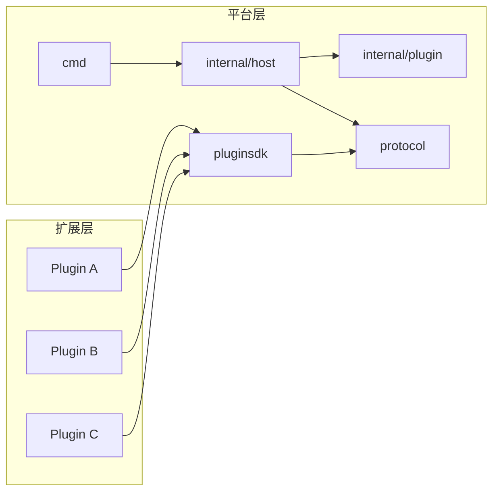
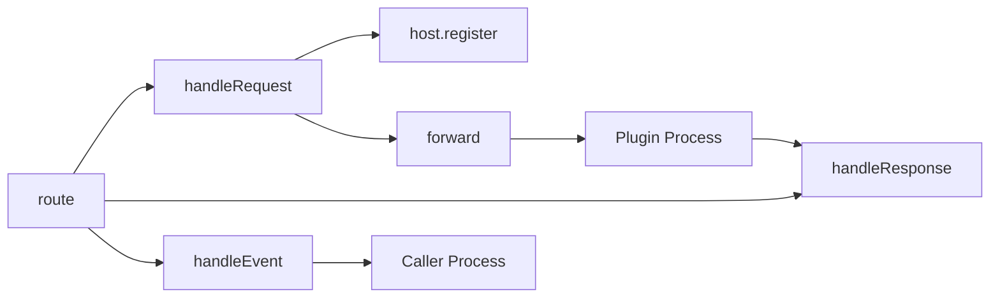
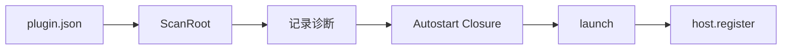
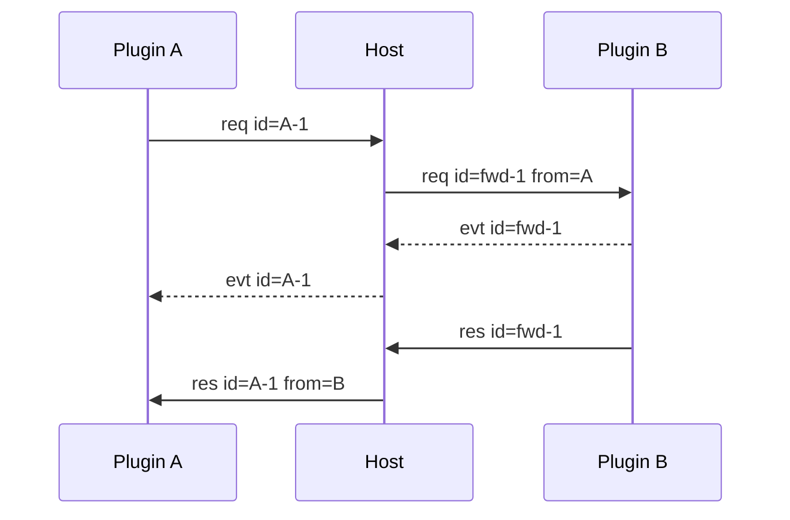
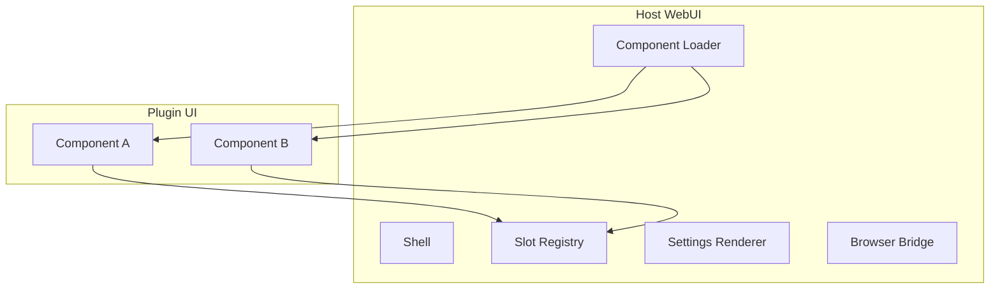
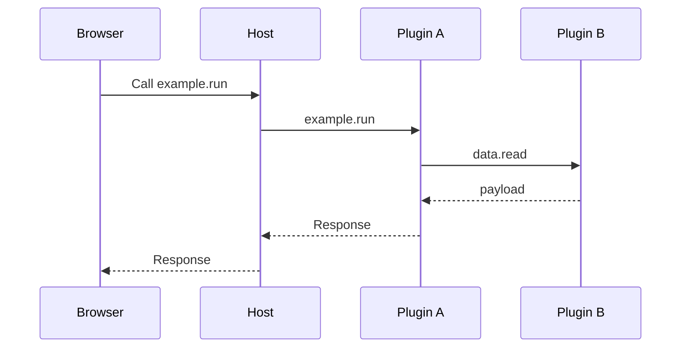

# 项目开发文档

本文面向 Host、pluginsdk 和 Manifest 的开发者。内容覆盖平台模块、结构体、路由、WebUI 和插件扩展点。

插件业务契约不在本文展开。插件的方法、payload、状态和前端通信写在 `plugins/<name>/`。

## 1. 分离原则

LiteAgent 分为平台层和扩展层。



平台层定义如何连接。扩展层定义做什么。

项目整体文档提到具体插件时，只能作为示例。示例不构成 Host 依赖。

## 2. 平台模块

### 2.1 职责

| 模块 | 主要职责 | 关键入口 |
|---|---|---|
| `cmd/liteagent-server` | 组装 Host 与 WebUI，管理 HTTP 生命周期 | `run()` |
| `internal/host` | Plugin Instance、执行上下文、路由、pending 闭环 | `host.Run()` |
| `internal/plugin` | Manifest 发现和 autostart 排序 | `ScanRoot()` |
| `internal/webui` | Browser Bridge、UI Push 和静态资源 | `NewServer()` |
| `protocol` | Frame 编解码和稳定错误码 | `Frame` |
| `pluginsdk` | 插件注册、Call、Event | `Plugin` |
| `utils` | 平台小工具 | 路径和系统判断 |

### 2.2 Host 内部



`Host` 保存插件进程、能力属主、pending 项和进程代际。进程退出时，Host 为相关调用合成错误 Response。

### 2.3 Plugin Runtime

Plugin Runtime 只负责 Frame 读写和 handler 分发。

```text
stdin
  → ReadFrame
  → dispatch
  → handler
  → Response
  → stdout

Outbound Call
  → pending[id]
  → Response / attributed Event
```

业务逻辑由 handler 实现。pluginsdk 不理解 handler payload。

## 3. 平台结构体

### 3.1 类型边界

平台结构体分为三层：

| 层次 | 含义 | 修改要求 |
|---|---|---|
| 线契约 | 跨进程 JSON 和 Frame 字段 | 先改协议和版本 |
| 平台契约 | Manifest、SDK 调用面 | 同步更新平台文档 |
| Host 私有 | 进程索引、pending、锁 | 可以内部重构 |

插件业务结构体属于扩展层。它们不得进入平台结构体目录。

### 3.2 protocol

| 类型 | 字段或职责 |
|---|---|
| `Frame` | version、id、type、from、context_id、路由键、payload、error |
| `FrameVersion` | 当前线协议版本 |
| `FrameMaxSize` | 最大 JSON body |

`Frame` 是 Host 与 Plugin 的唯一公共线结构。

### 3.3 internal/plugin

| 类型 | 字段或职责 |
|---|---|
| `Manifest` | name、version、protocol、entry、priority、能力、依赖、consumes、commands、UI |
| `UIManifest` | UI 静态贡献 |
| `UIComponent` | Component 和 Mount 声明 |
| `SettingsManifest` | Settings 调用地址和表单声明 |
| `SettingsMethod` | Settings Capability Call 地址 |
| `SettingsField` | 单个 Settings 表单字段 |
| `ConsumesMethod` | Consumer 参与的 `(capability, method)` |
| `Command` | 命令帮助信息 |
| `Discoveries` | 扫描结果和诊断 |
| `Discovery` | 插件目录与 Manifest |
| `Diagnostic` | 非致命错误诊断 |

Manifest 的目标 Schema 见 [manifest.md](manifest.md)。

### 3.4 internal/host

| 类型 | 字段或职责 |
|---|---|
| `Host` | Plugin Instance 索引、执行上下文、路由表、pending、关闭状态 |
| `proc` | Plugin Instance 进程、stdio、代际、配置代、生命周期和注册项 |
| `wait` | caller、target、context_id、原 id、Event 回调 |
| `ExecutionContext` | 根、父级、Capability 绑定、参与者 |
| `ContextBinding` | Capability、Plugin Instance 和固定 Generation |
| `PluginInstanceSnapshot` | 实例标识、插件名、配置代、五态状态、代际、注册项和失败信息 |
| `PluginSnapshot` | 按插件名分组的实例列表和默认展示实例 |
| `CallResult` | Response 与归因 Events |
| `TraceFunc` | Frame 观测回调 |

这些类型是 Host 私有实现。插件不依赖它们。

### 3.5 pluginsdk

| 类型 | 字段或职责 |
|---|---|
| `Plugin` | handler 表、pending、stdio |
| `Request` | 入站 id、context_id、capability、method、payload |
| `Event` | 归因 id、context_id、主题、payload |
| `Handler` | handler 函数和描述 |
| `Registration` | 已注册路由键 |
| `WebUI` | 本插件 mount 的目标驱动接口 |

`WebUI` 的目标方法见 [pluginsdk.md](pluginsdk.md)。

### 3.6 插件结构体

插件结构体只写在插件文档中。每个插件至少整理：

| 分类 | 内容 |
|---|---|
| 方法 payload | Request 和 Response JSON |
| 领域对象 | 插件自己的持久化或业务对象 |
| 临时对象 | Event、Draft、Preview |
| 私有对象 | 锁、缓存、解析器状态 |
| WebUI 对象 | State、Command、View payload |

插件文档使用 JSON 字段名描述契约，不把 Go 私有类型名当作公共协议。

## 4. Manifest 和装配



Manifest 负责静态信息。运行时路由真源是 `host.register` 上报的 `(capability, method)`。

Manifest 和插件启动错误只记录诊断。单个插件失败不中止 Host，也不阻止其他插件继续加载。

每条诊断同时进入命令行窗口和 WebUI。命令行输出 `plugin`、`path`、`code` 和 `message`。WebUI 使用非模态悬浮窗展示，不阻断其他组件。

UI 和 Settings 也是插件贡献。Host 只读取声明，不解释插件业务状态。

## 5. Frame 生命周期

### 5.1 跨插件 Call



Host 改写 id，并保留调用方原始 id。Response 到达后，pending 项删除。

存在 `context_id` 时，Host 先校验调用方是上下文参与者。Capability 绑定决定目标 Plugin Instance 和 Generation。Generation 不一致时拒绝调用。Response 和归因 Event 保留同一执行上下文。

### 5.2 Event

归因 Event 属于在途 Call。无 id 的 Event 当前不进行通用扇出。

Event payload 对 Host 不透明。插件负责定义 Event 主题和字段。

### 5.3 错误闭环

```text
路由失败       Host 合成 Response
handler 失败   SDK 写 error_code
插件退出       Host 合成 plugin_down
调用方退出     Host 丢弃其 pending
```

每条 Request 最终只得到一条 Response。

执行上下文关闭时，该上下文的 pending 调用统一返回 `context_closed`。插件进程退出仍返回 `plugin_down`。

## 6. WebUI 平台

### 6.1 组成



Component A 和 Component B 是示例。插件可以贡献任意数量的 Component。

### 6.2 驱动关系

Plugin Runtime 驱动自己拥有的 Component：

```text
SetState(mountID, state)
SendCommand(mountID, command, payload)
```

浏览器上行使用 Capability Call。Host 不创建第二套业务路由。

### 6.3 数据边界

| 数据 | 归属 |
|---|---|
| Shell、Slot、Loader、Browser Bridge | Host |
| Component DOM 和生命周期 | 插件 |
| State 的业务含义 | 插件 |
| Command 的业务含义 | 插件 |
| 持久化记录 | 插件 |

Host 不保存业务 State。浏览器刷新后，插件 Runtime 负责重建自己的 State。

WebUI 是可重启的交互端。业务执行和状态真源都在后端。浏览器关闭不影响运行中的业务。

### 6.4 浏览器传输

```text
POST /bridge/call
GET  /bridge/ui
```

`POST /bridge/call` 返回 NDJSON Event 和最终 Response。`GET /bridge/ui` 接收 State、Command 和 Diagnostic。

浏览器断开后，HTTP Request Context 会取消后端 Call。Host 为原 Request 保留唯一终态。未发送的 Event 和 Response 被丢弃。

Browser Envelope 见 [webui.md](webui.md)。

## 7. 插件扩展点

插件通过 Manifest 贡献四类能力：

| 扩展点 | 说明 |
|---|---|
| Capability | 运行时业务方法 |
| Commands | 人类可发现的命令帮助 |
| UI Components | Web Component 和 Mount |
| Settings | 配置 Schema 和保存方法 |

这些扩展点彼此独立。插件可以只提供 Capability，不提供 UI。

## 8. 示例边界

下面的流程只展示平台如何组合插件，不代表仓库中的固定产品：



真实插件的组合方式见 `plugins/README.md` 和各插件文档。

## 9. 测试策略

| 层面 | 测试重点 |
|---|---|
| `protocol` | 编解码、超长 Frame、非法类型 |
| `pluginsdk` | handler 分发、pending、归因 Event |
| `internal/host` | 路由、from 注入、死亡闭环 |
| `internal/plugin` | Manifest、路径、autostart 排序 |
| WebUI Bridge | Call 闭环、State/Command、断线 |
| 插件 | 由各插件文档定义 |

## 10. 变更纪律

平台改动按以下顺序检查：

1. Go 类型和方法；
2. `docs/protocol.md`、`docs/pluginsdk.md` 或 `docs/manifest.md`；
3. `docs/development.md`；
4. 受影响插件的 `communication.md`；
5. 测试。

插件改动只更新该插件文档。只有平台契约变化时，才修改项目整体文档。
