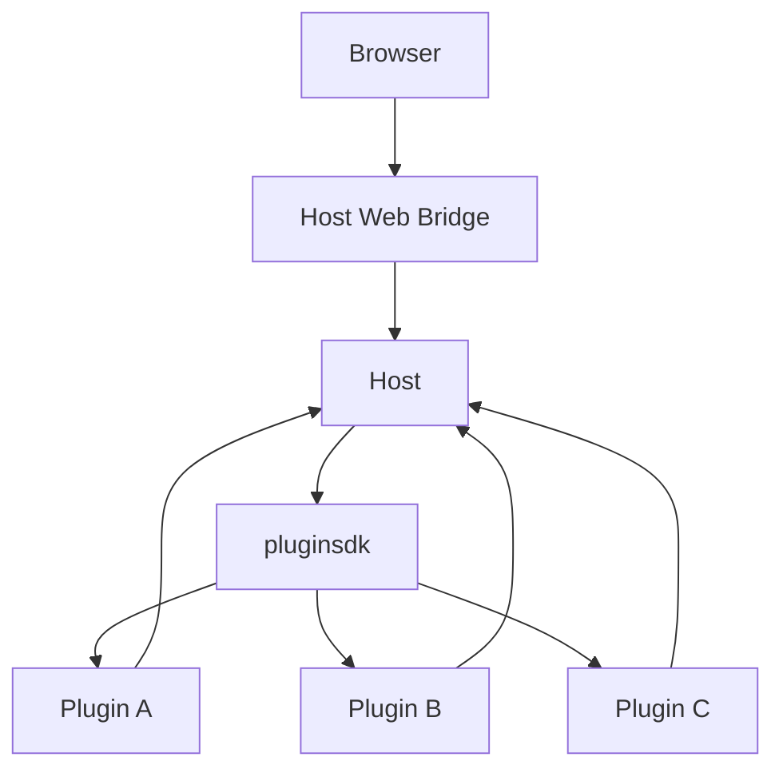
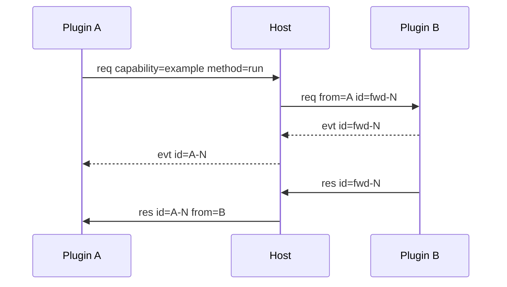

# Architecture

LiteAgent is a thin host kernel surrounded by out-of-process plugins. The host provides platform capabilities only. Plugins provide business capabilities and speak to the host through one frame protocol.

_English edition of [ARCHITECTURE.md](../../ARCHITECTURE.md). If the two diverge, the Chinese document is authoritative._

## 1. Shape



Plugin A, B and C are structural examples. The project does not prescribe plugin kinds, nor does it require that all plugins add up to a particular product.

Plugins are separate executables. They never open a channel to another plugin; every call goes through the host, which is the single router and the owner of call bookkeeping.

## 2. Platform modules

| Module | Responsibility | Not its job |
|---|---|---|
| `protocol` | Frame encoding, version and error codes | Business data |
| `pluginsdk` | Registration, Call, Event, plugin UI hooks | Page layout |
| `internal/host` | Plugin instances, execution contexts, frame routing, pending calls, external call entry | Business policy |
| `internal/plugin` | Manifest discovery and autostart ordering | Running business logic |
| `internal/webui` | Shell, mount bootstrap, static assets, browser bridge | Plugin business state |
| `cmd/liteagent-server` | Assembles host and WebUI, manages HTTP lifecycle | Business implementation |

`plugins/` is the extension layer. Capabilities, data models and UI are defined by each plugin directory.

## 3. Frame routing



The routing key is `(capability, method)`. The host injects `from` for provenance; plugins never fill it in. Plugin names are not part of routing.

Execution contexts add a second layer of scheduling. They bind a capability to a plugin instance: calls without a context go to the default instance, calls with a context go to the bound instance. An instance does not change the plugin's identity.

## 4. The call pipeline

A plugin can declare that it consumes a method. Consumers run in priority order before the provider:

1. The host picks the highest-priority active consumer at or below the current position.
2. That consumer may rewrite the payload and call `Proceed()`. A successful handoff cannot be repeated; a failed one may be retried.
3. The host repeats until no consumer is left, then delivers the call to the provider.

Two consumers with the same priority for the same method are an error (`consume_priority_conflict`), not an ordering guess. A pipeline may take at most 64 hops and may not revisit an instance, which turns accidental loops into `pipeline_loop`.

`model-context` (`priority: 2000`) and `sandbox` (`priority: 500`) are ordinary consumers built this way. Context compaction and permission checks therefore live outside the kernel.

### Absence means passthrough

If a method is declared as consumed but no consumer instance is active, the host skips the hop and delivers the call straight to the provider of that key. The platform provides no mandatory interception: absence is a deployment decision, not a security guarantee. A call fails with `method_not_found` only when neither a consumer nor a provider exists.

## 5. Extension model

Each plugin decides three things for itself:

- which capabilities it provides;
- how it stores business state;
- which components render its frontend.

The host never reads plugin business state. It loads static assets and routes calls, state and commands to the right target.

```text
Plugin Manifest      static declaration
Plugin Runtime       business execution
Plugin Component     business presentation
Plugin Storage       business persistence
```

All four belong to the plugin. Platform documents define only their interfaces to the host.

## 6. Web UI

```text
Host WebUI
├── Host Shell
├── Slot Registry
├── Component Loader
├── Settings Renderer
└── Browser Bridge

Plugin Web Component
├── setData(state)
├── runCommand(command, payload)
├── connectedCallback()
└── disconnectedCallback()
```

Components are owned by plugins; the host only loads and connects them. A component's business state contract lives in the plugin's own documentation.

Slots in v1 are `top`, `left`, `center`, `right` and `bottom`.

## 7. Message boundary

The host understands platform fields only:

```text
id
type
from
context_id
capability
method
payload
error_code
error_msg
```

`payload` is opaque to the host. Method payloads, facts, view state and business errors are defined by plugin documents.

## 8. Directory map

| Contract | Location |
|---|---|
| Frame | `protocol/` |
| Plugin SDK | `pluginsdk/` |
| Host routing | `internal/host/` |
| Web UI | `internal/webui/` |
| Manifest | `internal/plugin/` |
| Platform docs | `docs/` |
| Plugin contracts | `plugins/<name>/` |

## 9. Scope of v1

v1 targets a local browser, with multiple pages allowed to connect at once. Multi-user support, remote access, cross-device sync, a plugin marketplace and arbitrary third-party code sandboxing are out of scope.

Plugin instances and execution contexts support registration, binding and call propagation. Scheduling quotas, live migration and instance-state recovery are not implemented.
