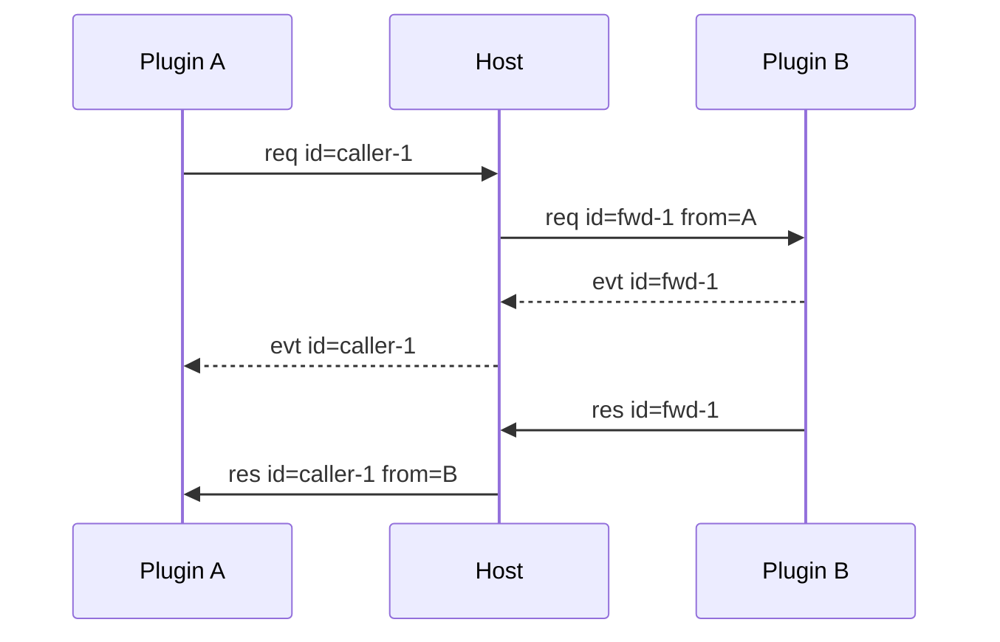

# Host–Plugin Protocol

This document defines the wire contract between the host and out-of-process plugins. The browser protocol is separate (see [webui.md](../platform/webui.md)); the two are versioned independently.

It describes the current implementation. The host-side method list is in section 5; the SDK surface is in [pluginsdk.md](../platform/pluginsdk.md).

_English edition of [docs/platform/protocol.md](../platform/protocol.md). If the two diverge, the Chinese document is authoritative._

## 1. Transport

Plugins talk to the host over stdio. Each frame is encoded as:

```text
4-byte big-endian length
UTF-8 JSON body
```

The JSON body is capped at 16 MiB (`protocol.FrameMaxSize`). The current frame version is 2.

A length header of 0 or above the cap makes the reader return `frame_too_large`. Writers check the cap after marshalling.

## 2. Frame

### 2.1 Fields

```go
type Frame struct {
    Version    int             `json:"version"`
    ID         string          `json:"id"`
    Type       string          `json:"type"`
    From       string          `json:"from,omitempty"`
    ContextID  string          `json:"context_id,omitempty"`
    Capability string          `json:"capability,omitempty"`
    Method     string          `json:"method,omitempty"`
    Payload    json.RawMessage `json:"payload,omitempty"`
    Reason     string          `json:"reason,omitempty"`
    Priority   int             `json:"priority,omitempty"`
    ErrorCode  string          `json:"error_code"`
    ErrorMsg   string          `json:"error_msg"`
}
```

| Field | Requirement |
|---|---|
| `version` | currently `2` |
| `id` | correlates a request with its response |
| `type` | `req`, `res`, `evt` or `cancel` |
| `from` | injected by the host with the real origin |
| `context_id` | optional execution context |
| `capability` | request subject |
| `method` | request subject |
| `payload` | business JSON |
| `reason` | cancellation reason for `cancel` |
| `priority` | pipeline position, managed by the host |
| `error_code` | empty string on success |
| `error_msg` | empty string on success |

Plugins leave `from` empty on outbound frames; the host fills in the plugin name on delivery.

`error_code` and `error_msg` have no `omitempty`; they appear in JSON even on success.

`context_id` is an optional runtime extension. A plugin sets it only after joining an execution context. The host validates participant identity and preserves the field on responses and attributed events. Contexts do not affect calls that carry no `context_id`.

### 2.2 Host-side field rewriting

The host is the only party allowed to rewrite frame fields. What a plugin sees has already been rewritten:

| Field | Rule |
|---|---|
| `from` | real origin plugin name on delivery; `host` for host-synthesized frames |
| `id` | `fwd-N` when forwarded across plugins; restored to the caller's id on the way back |
| `context_id` | responses and attributed events take the context recorded in the pending entry |
| `priority` | requests carry the priority of the current hop; responses and events carry the target hop's priority |
| `error_code` | stable code on failure, empty string on success |

`from` is always a plugin name and never participates in routing. A plugin cannot forge its origin through the payload.

### 2.3 ID namespaces

| Prefix | Owner | Purpose |
|---|---|---|
| `fwd-N` | host | internal id for cross-plugin forwarding |
| `host-N` | host | id of a call initiated by the host |
| `<plugin>-N` | plugin | id of a call initiated by the plugin itself |

`N` comes from a single host `seq` counter shared across the three namespaces. A plugin always sees forwarded ids as `fwd-N`.

### 2.4 Generation checks

Every plugin instance has a monotonically increasing `gen` counter, incremented on each process restart.

When the host reads a frame from a plugin, it compares the generation of the process that produced it with the instance's current generation. A mismatch means the frame came from a previous process activation; the host drops it and logs.

This keeps late frames from a dead process out of the new process's routing and pending state.

## 3. Message types

### 3.1 Request

A request asks the peer to run one `capability.method`. Every request receives exactly one response.

```json
{
  "version": 2,
  "id": "caller-1",
  "type": "req",
  "capability": "example",
  "method": "run",
  "priority": 2147483647,
  "payload": {}
}
```

Self-calls are legal; the host still runs them through normal routing.

`priority` is written by the host. The initial value is `2147483647` (`FramePriorityMax`). A plugin cannot choose the next hop.

### 3.2 Response

A response carries the same id as its request. On success the result is in `payload`.

```json
{
  "version": 2,
  "id": "caller-1",
  "type": "res",
  "from": "provider-plugin",
  "capability": "example",
  "method": "run",
  "payload": {},
  "error_code": "",
  "error_msg": ""
}
```

On failure `error_code` is non-empty and `payload` is not a result.

### 3.3 Event

Events do not open a call loop.

| Kind | `id` | Meaning | Host behaviour |
|---|---|---|---|
| Attributed event | non-empty | belongs to an in-flight call | restores the caller id, then delivers |
| Broadcast event | empty | no specific receiver | logged and dropped |

```json
{
  "version": 2,
  "id": "caller-1",
  "type": "evt",
  "from": "provider-plugin",
  "capability": "example",
  "method": "chunk",
  "payload": {
    "channel": "content",
    "delta": "hi"
  }
}
```

If no pending entry matches an event, the host logs and drops it. Events never produce a response.

### 3.4 Cancel

`cancel` cancels an in-flight request. It does not produce its own response; the original request still ends with exactly one response.

```json
{
  "version": 2,
  "id": "caller-1",
  "type": "cancel",
  "from": "caller-plugin",
  "context_id": "ctx-1",
  "capability": "example",
  "method": "run",
  "reason": "cancelled"
}
```

The host translates the call id into the target-side id and forwards it. The target SDK cancels the handler context. If the grace period expires, the host synthesizes a terminal response.

`reason` is either `cancelled` or `deadline_exceeded`; any other value is normalized to `cancelled`.

The grace period is `DefaultCancelGrace`, currently 2 seconds. After it expires the host synthesizes a terminal response with `call_cancelled` or `call_deadline_exceeded`.

## 4. Routing

The routing key is:

```text
capability.method
```

There is no target-plugin field. Plugin names appear only in `from`, logs, id prefixes and the dependency graph.

Routing has two layers:

```text
capability.method → Plugin
execution context → Plugin Instance
```

Without a context, calls go to the default plugin instance. With a context binding, calls go to the bound instance at a pinned generation. A plugin instance is a process activation identity; it does not change the plugin identity carried by `from`.



The host allocates internal `fwd-N` ids for cross-plugin requests and restores the original id on the way back.

### 4.1 Route table

The only writer of the route table is the `(capability, method)` pair reported through `host.register`. `provides` in the manifest is used for observation and assembly, not for writing routes.

Re-registering the same key inside one plugin is last-wins. A conflict across plugins puts the key in `rejected` and leaves the owner unchanged.

A route owner must declare the capability in `provides`. Consumers register for the pipeline but never take over route ownership.

If a consumer starts before its provider, the route stays unowned until the real provider registers.

### 4.2 Consumer pipeline

The pipeline chains consumers and the provider from high to low `priority`. The priority comes from the manifest and defaults to `0`.

On a business request the host sets `priority` to `FramePriorityMax` and selects a candidate:

1. The candidate must be an `active` plugin instance.
2. It must either register the `(capability, method)` or declare it in the manifest's `consumes`.
3. On the first hop, if any consumer declares the method, only consumers are considered.
4. Instances already visited are skipped.
5. Candidates above the current ceiling are skipped.

The highest-priority candidate wins. Two candidates with the same priority for one key make the host return `consume_priority_conflict`.

After selection, the host marks the instance visited, adds one hop, and lowers the ceiling to the selected priority minus one.

A pipeline is capped at 64 hops (`PipelineMaxHops`); exceeding it returns `pipeline_hops_exceeded`.

If no candidate is found and an instance was already visited, the host returns `pipeline_loop`.

### 4.3 Absence means passthrough

When the pipeline finds no candidate, the host does not fail immediately. It falls back to the route table:

1. If the key has a route owner, deliver the call straight to it.
2. If the key is not in the route table, return `method_not_found`.

The effect: when a manifest declares a `consumes` entry but no consumer is active, the host skips that hop. `method_not_found` is returned only when neither consumer nor provider exists.

### 4.4 Proceed

A consumer can hand the call to the next hop after doing its work. That is `host.proceed`.

On receiving `host.proceed` the host:

1. Finds the pending entry by `call_id`. If it is missing, owned by someone else, or not part of a pipeline, return `method_not_found`.
2. Checks whether the call already proceeded; a second attempt returns `flow_already_proceeded`.
3. Selects the next hop in its own goroutine, so the host read loop is not blocked.
4. Forwards the request with a new `fwd-N` id, setting `from` to the current consumer's plugin name.
5. Relays events attributed to the next hop back to the current consumer.
6. Answers the `host.proceed` call with the next hop's response.

Downstream events are re-attributed by the SDK through `EmitWithID`, so the original caller still receives stream deltas.

If no next hop is found, the host returns `route_failed`; if the route owner for that key is also inactive, it returns `plugin_not_ready`.

## 5. Host methods

Every host method uses `capability=host`. The host dispatches only the methods below; anything else is synthesized as `method_not_found`.

| Method | Input | Output |
|---|---|---|
| `host.register` | `handlers[]`, each with `capability`, `method` and optional `name`, `description` | `accepted[]`, `rejected[]` |
| `host.proceed` | `call_id`, optional `payload` | the next hop's payload |
| `host.plugins` | none | `plugins[]` snapshot |
| `host.ui.state` | `mount_id`, `state` | `{}`; `ui_not_mounted` when no browser is connected or the queue is full |
| `host.ui.command` | `mount_id`, `command`, `payload` | `{}`; same error as above |
| `host.context.create` | `parent_id`, `bindings` | `context` |
| `host.context.bind` | `context_id`, `capability`, `instance_id` | `{bound:true}` |
| `host.context.close` | `context_id` | `{closed:true}` |
| `host.instance.create` | `plugin_name`, optional `instance_id`, `config_revision` | `instance` |
| `host.instance.close` | `instance_id` | `{closed:true}` |
| `host.instance.restart` | `instance_id` | `instance` |

`name` and `description` are for display and diagnostics only. The host stores just `(capability, method)`.

The browser cannot call this layer; the browser bridge rejects any request with `capability=host`.

### 5.1 host.register

```json
{
  "handlers": [
    {"capability": "example", "method": "run", "name": "run", "description": "Run an example operation"}
  ]
}
```

The response puts each key into `accepted` or `rejected`; both arrays contain `{capability, method}`.

Keys with an empty `capability` or `method` go straight to `rejected`.

After a successful registration the instance moves from `loading` to `active` and its failure message is cleared. Registrations are stored sorted by `capability`, then `method`.

A payload that is not valid JSON returns `bad_payload` and moves the instance to `failed`.

### 5.2 host.plugins

Returns a snapshot grouped by plugin name:

| Field | Meaning |
|---|---|
| `name` | plugin name |
| `version` | manifest version |
| `state` | aggregate state, taken from the selected instance |
| `selected_instance_id` | instance shown by default |
| `instances[]` | all instances of the plugin |
| `enabled` | whether the plugin may start |
| `missing` | the name appears only in a dependency reference; the plugin itself was not found |
| `provides` | capabilities declared in the manifest |
| `depends_on` | hard dependencies declared in the manifest |

Each `instances[]` entry has `instance_id`, `plugin_name`, `config_revision`, `state`, `generation`, `registrations[]`, `failure_code` and `failure_message`.

Each `registrations[]` entry has `capability`, `method`, and optional `name` and `description`.

`selected_instance_id` sorts by state first, then by ascending instance id:

| State | Weight |
|---|---|
| `active` | 0 |
| `failed` | 1 |
| `loading` | 2 |
| `stopping` | 3 |
| `inactive` | 4 |

With no instances, `selected_instance_id` is empty and the state is `inactive`.

The snapshot never exposes local paths.

### 5.3 host.context.create

```json
{
  "parent_id": "ctx-1",
  "bindings": {"llm": "llm-a"}
}
```

`bindings` maps a capability to a plugin instance id. The host records the target instance's current generation when the binding is created.

`parent_id` is opaque to the host. The parent must exist and be open, and the creator must be its owner or a participant.

Child contexts inherit the parent's bindings and participant set; a binding with the same name in the child overrides the inherited one.

The `context` in the response contains:

| Field | Meaning |
|---|---|
| `id` | context id, shaped like `ctx-N` |
| `owner` | instance id of the creator |
| `root_id` | root context id |
| `parent_id` | parent context id, omitted when there is none |
| `bindings` | capability → binding object |
| `closed` | whether the context is closed |

A binding object has `capability`, `instance_id` and `generation`. The participant set is not returned.

Binding validation:

- capability and instance id must be non-empty, otherwise `context_binding_invalid`;
- the instance must exist, otherwise `instance_not_found`;
- if the capability already has a route owner and the target instance's plugin is not that owner, return `context_binding_invalid`.

After a provider restart, bindings pinned to the old generation return `context_binding_invalid`; calling `host.context.bind` again pins the new generation.

Config revisions belong to plugin instances. Instance binding provides config isolation, so contexts no longer store a global revision.

### 5.4 host.context.bind

```json
{
  "context_id": "ctx-1",
  "capability": "llm",
  "instance_id": "llm-a"
}
```

Only the context owner may change bindings. A missing context returns `context_not_found`, a closed one `context_closed`, and a mismatched owner `context_owner_mismatch`.

### 5.5 host.context.close

Closes a context and all of its children. The host terminates related pending calls and deletes the closed contexts.

In-flight calls on a closed context return `context_closed`; a plugin process exit still returns `plugin_down`.

Only the owner may close a context; a mismatch returns `context_owner_mismatch`.

### 5.6 host.instance.create

```json
{
  "plugin_name": "example-plugin",
  "instance_id": "example-plugin:instance:1",
  "config_revision": "rev-1"
}
```

When `instance_id` is omitted the host generates `<plugin_name>:instance:<N>` from its own counter.

`config_revision` is the plugin's own config generation marker. The host records and forwards it without interpreting it.

The default instance uses the plugin name as its id. One plugin may run several instances at once.

| Failure | Code |
|---|---|
| empty `plugin_name` | `bad_arguments` |
| host already closed | `host_closed` |
| instance id exists | `instance_exists` |
| plugin not discovered | `plugin_not_mounted` |
| plugin disabled | `plugin_disabled` |

### 5.7 host.instance.close and host.instance.restart

`host.instance.close` stops one instance without affecting other instances of the same plugin. An unknown instance returns `instance_not_found`; closing twice is idempotent.

`host.instance.restart` replaces the process under the same instance id. An unknown instance returns `instance_not_found`; one that is stopping returns `instance_closed`.

Both wait for in-flight calls first, with a `DefaultShutdownGrace` of 2 seconds. Calls that miss the deadline return `plugin_down`.

A restart increments the instance generation, so context bindings pinned to the old generation stop working.

## 6. Pending call lifecycle

When a plugin issues a call it registers:

```text
pending[call_id] = response channel
```

When the host forwards it, it registers:

```text
pending[fwd_id] = caller / original_id / target / context_id
```

When the response arrives, the host restores the caller's id and removes the entry. A cancel keeps the entry until the original request reaches its single terminal state; after the grace period the host synthesizes it. If the plugin process exits, the host synthesizes `plugin_down`.

Pending entries have two owners. `WaitPlugin` means plugin A calls plugin B and the host only relays and restores ids. `WaitHost` means the host initiated the call or a `Proceed` produced it; the result returns through an in-memory channel.

On process exit the host fails every pending entry that targets the instance, and also clears entries where the instance is the caller, so nothing waits for a response that can never arrive.

## 7. Error codes

### 7.1 Table

| Code | Source | Meaning |
|---|---|---|
| `host_closed` | Host | host shut down |
| `route_failed` | Host | routing failed |
| `method_not_found` | Host/SDK | no handler |
| `plugin_not_mounted` | Host | plugin not mounted |
| `plugin_down` | Host | plugin process exited |
| `plugin_disabled` | Host | plugin disabled |
| `plugin_not_ready` | Host | provider not accepting calls yet |
| `timeout` | reserved | call timed out |
| `call_cancelled` | SDK/Host | Go context cancelled |
| `call_deadline_exceeded` | SDK/Host | Go context deadline exceeded |
| `handler_error` | SDK | handler returned a plain error |
| `server_closed` | SDK/Host | connection or server closed |
| `bad_payload` | Host/plugin | JSON contract violation |
| `bad_arguments` | plugin | invalid arguments |
| `frame_too_large` | transport | frame exceeds the cap |
| `capability_conflict` | Host | capability ownership conflict |
| `consume_priority_conflict` | Host | two consumers share a priority for one method |
| `flow_already_proceeded` | SDK/Host | the same call proceeded twice |
| `pipeline_loop` | Host | pipeline revisited an instance |
| `pipeline_hops_exceeded` | Host | pipeline exceeded the hop limit |
| `ui_not_mounted` | Host/WebUI | mount missing, no browser, or queue full |
| `ui_owner_mismatch` | Host/WebUI | mount owner mismatch |
| `instance_not_found` | Host | unknown instance |
| `instance_exists` | Host | duplicate instance id |
| `instance_closed` | Host | instance already closed |
| `context_not_found` | Host | unknown context |
| `context_closed` | Host | context already closed |
| `context_owner_mismatch` | Host | context owner mismatch |
| `context_participant_mismatch` | Host | caller is not a context participant |
| `context_binding_invalid` | Host | capability binding is stale or invalid |

Plugins produce stable codes with `pluginsdk.ErrCode`. A plain `error` maps to `handler_error`.

### 7.2 Codes without a live path

Two codes exist in the constant table but no code path currently produces them:

| Code | Status |
|---|---|
| `capability_conflict` | cross-plugin registration conflicts go into `rejected` instead |
| `plugin_disabled` | the host exposes no way to disable a plugin; `enabled` is always true |

`timeout` is used internally for "call not pending"; normal paths never write it into a frame.

## 8. Versioning

The wire version lives in `Frame.version`; the manifest version lives in `plugin.json.protocol`. They evolve independently. Changing frame fields or routing semantics bumps the frame version; changing the manifest contract bumps the manifest version.

The browser-side protocol has its own version; see [webui.md](../platform/webui.md) section 7.

## 9. Implementation map

| Content | File |
|---|---|
| Frame and codec | `protocol/frame.go` |
| Stable error codes | `protocol/errors.go` |
| Host routing and route table | `internal/host/transport.go` |
| Pipeline and Proceed | `internal/host/pipeline.go` |
| Pending calls and process state | `internal/host/host.go` |
| Cancellation and grace periods | `internal/host/cancel.go` |
| Instances and execution contexts | `internal/host/runtime.go` |
| Plugin snapshot | `internal/host/snapshot.go` |
| SDK Call/Event | `pluginsdk/plugin.go` |
| SDK error helpers | `pluginsdk/errors.go` |
