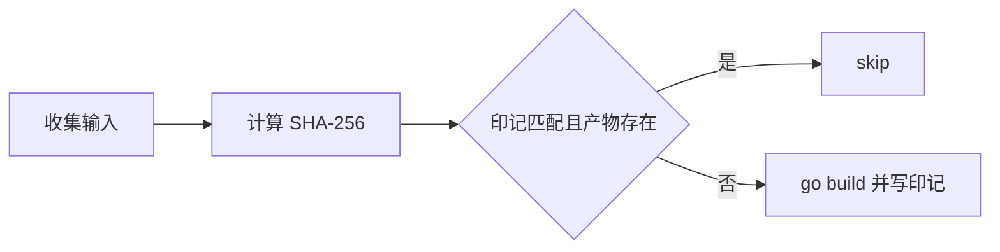

# 构建文档

本文说明 LiteAgent 的构建流程、产物布局和增量缓存机制。面向需要本地运行、打包发布或新增构建目标的开发者。

构建脚本只做编译和拷贝，不生成任何插件契约。插件的 `plugin.json`、`ui/` 和 README 以 `plugins/<name>/` 为唯一真源（ADR-0021）。

## 1. 构建前提

| 依赖 | 版本要求 | 用途 |
|---|---|---|
| Go | 满足 go.mod 声明（当前 go 1.25.6） | 编译 Host 与插件 |
| Bash | 3.2 及以上 | `scripts/build.sh` |
| PowerShell | 5.1 及以上 | `scripts/build.ps1`（Windows） |
| Git | 可选 | 注入版本号，缺失时回退 `dev` |
| Node.js | 可选 | `--verify` 中的浏览器测试 |

Go 模块代理和构建缓存沿用本机默认配置。脚本不修改 `GOCACHE`、`GOPATH` 或 `GOFLAGS`。

## 2. 快速开始

macOS 和 Linux 使用 Bash 脚本：

```bash
bash scripts/build.sh                  # 增量构建
bash scripts/build.sh --clean          # 清空 dist 后全量构建
bash scripts/build.sh --verify         # 先跑测试，再构建
bash scripts/build.sh --only agent     # 只构建指定目标
bash scripts/build.sh --list           # 列出当前发布目标
```

Windows 使用 PowerShell 脚本，参数一一对等：

```powershell
powershell -File scripts\build.ps1
powershell -File scripts\build.ps1 -Clean
powershell -File scripts\build.ps1 -Verify
powershell -File scripts\build.ps1 -Only agent
powershell -File scripts\build.ps1 -List
```

构建完成后运行产物：

```bash
./dist/liteagent-server                # 默认监听 127.0.0.1:2333
```

监听地址可用环境变量 `LITEAGENT_HTTP_ADDR` 覆盖。Host 按以下顺序查找插件目录：可执行文件旁的 `plugins/`，然后是当前工作目录的 `plugins/`。

## 3. 构建目标

发布目标由 `scripts/shipped-plugins.conf` 单一清单定义，两个脚本共用同一份配置。当前收录：

| 目标 | 类型 | 产物 |
|---|---|---|
| `liteagent-server` | Host 可执行 | `dist/liteagent-server` |
| `plugin:agent` | 插件可执行 | `dist/plugins/agent/agent` |
| `plugin:session` | 插件可执行 | `dist/plugins/session/session` |
| `plugin:llm-openai` | 插件可执行 | `dist/plugins/llm-openai/llm-openai` |
| `plugin:model-context` | 插件可执行 | `dist/plugins/model-context/model-context` |
| `plugin:tools` | 插件可执行 | `dist/plugins/tools/tools` |
| `plugin:file-tools` | 插件可执行 | `dist/plugins/file-tools/file-tools` |
| `plugin:shell-tools` | 插件可执行 | `dist/plugins/shell-tools/shell-tools` |
| `plugin:sandbox` | 插件可执行 | `dist/plugins/sandbox/sandbox` |

清单分三组：`core` 是 autostart 根插件；`tools` 供后续加入非 autostart 的 Tool Provider，当前为空；`optional` 是随发行版交付但不随 Host 启动的插件，从插件中心手动启动后生效。没有 `plugin.json` 的目录不是可挂载插件，脚本跳过并汇总告警，不会进入 dist。

## 4. 产物布局

```text
dist/
├── liteagent-server            Host 可执行（静态嵌入 WebUI）
├── README.md                   平台说明
├── CONTEXT.md                  平台术语
├── plugins/
│   ├── README.md               插件目录总览
│   ├── agent/
│   │   ├── agent               插件可执行
│   │   ├── plugin.json         Manifest（entry 已改写为裸名）
│   │   ├── config.json         配置种子，构建不覆写
│   │   ├── config.example.json 配置模板
│   │   └── README.md           插件文档
│   ├── llm-openai/             同上结构
│   ├── model-context/
│   │   ├── model-context       插件可执行
│   │   ├── plugin.json
│   │   ├── config.json         配置种子，构建不覆写
│   │   ├── config.example.json 配置模板
│   │   └── README.md
│   ├── tools/
│   │   ├── tools               插件可执行
│   │   ├── plugin.json
│   │   └── README.md
│   ├── file-tools/             同上结构
│   ├── shell-tools/
│   │   ├── shell-tools         插件可执行
│   │   ├── plugin.json
│   │   ├── config.json         解释器策略
│   │   ├── config.example.json
│   │   └── README.md
│   ├── sandbox/                可选件，不随 Host 启动
│   │   ├── sandbox             插件可执行
│   │   ├── plugin.json
│   │   ├── config.json         风险档与默认动作
│   │   ├── config.example.json
│   │   ├── rules.json          规则集，运行期写入
│   │   └── README.md
│   └── session/
│       ├── session             插件可执行
│       ├── plugin.json
│       ├── ui/main.js          插件静态资源
│       ├── sessions/           运行期会话和 Workspace Registry
│       └── README.md
└── .build-cache/               增量哈希印记，不参与运行
```

WebUI 静态资源通过 `go:embed` 编译进 `liteagent-server`，不在 dist 中单独落文件。dist 中的 `plugin.json` 由源码拷贝后仅改写 `entry`：源码是 Windows 优先写法（`"entry": "<name>.exe"`），Unix 产物取裸名。

## 5. 增量构建机制

脚本为每个目标计算一份输入哈希，命中且产物存在时跳过编译。



哈希输入按目标类型区分：

| 输入 | 覆盖目标 |
|---|---|
| 模块内 Go 依赖目录（`go list -deps` 过滤本模块） | 全部 |
| `go.mod`、`go.sum` | 全部 |
| 插件自己的 `plugin.json` | 该插件 |
| `internal/webui/static/**` | 仅 `liteagent-server` |

静态资源进入服务器哈希是必需项：它们被 `go:embed` 编进二进制，漏掉会导致只改前端却复用旧二进制。

哈希按文件内容计算，不看修改时间。`touch` 不会触发重建，真实内容变化才会。以下资产每次构建都刷新，不依赖哈希：`plugin.json`、`ui/`、`README.md`、`segments.json`、`config.example.json`。

印记写在 `dist/.build-cache/<target>.sha256`。它与 Go 自身的 `GOCACHE` 是两层：前者决定是否调用 `go build`，后者决定 `go build` 是否复用编译结果。删除印记不会破坏正确性，只会退回全量编译。

## 6. 用户数据保留

`--clean` 会先暂存以下用户数据，重建后原样写回：

| 数据 | 路径 |
|---|---|
| llm-openai 配置（含 API Key） | `dist/plugins/llm-openai/config.json` |
| agent 配置（scheme 选择） | `dist/plugins/agent/config.json` |
| model-context 配置 | `dist/plugins/model-context/config.json` |
| shell-tools 解释器策略 | `dist/plugins/shell-tools/config.json` |
| sandbox 风险档与默认动作 | `dist/plugins/sandbox/config.json` |
| sandbox 规则集 | `dist/plugins/sandbox/rules.json` |
| 会话记录 | `dist/plugins/session/sessions/` |
| Workspace Registry | `dist/plugins/session/sessions/workspaces.json` |

非 `--clean` 构建不会清空 dist，保留逻辑是空操作。不再发布的插件目录仍会被裁剪。

旧版本的 `dist/plugins/workspace/workspaces.json` 会在裁剪前迁移到 `dist/plugins/session/sessions/workspaces.json`。`--clean` 同样会暂存并恢复该文件。

## 7. 配置种子规则

插件配置按以下优先级落位，构建过程不写入、不改写任何密钥：

1. dist 中已有的 `config.json`；
2. 仓库内 `plugins/<name>/config.json`（已被 gitignore，仅本机有效）；
3. 插件自带的 `config.example.json` 模板。

llm-openai 首次构建只有空密钥模板，需要启动后通过设置接口或直接编辑 `dist/plugins/llm-openai/config.json` 填入密钥。后续构建保留该文件。

## 8. 版本标识

构建时执行 `git describe --tags --always --dirty` 取得版本串，通过 `-ldflags "-X main.version=..."` 注入 `liteagent-server`。非 Git 环境或直接 `go build` 时回退为 `dev`。版本号打印在启动日志第一行：

```text
liteagent-server ea5752b-dirty
```

插件版本以各自 `plugin.json` 的 `version` 字段为准，不经构建注入。

## 9. 构建前验证

`--verify` 在触碰 dist 之前依次执行：

```bash
go vet ./...
go test ./...
node --test internal/webui/*.test.mjs   # 无 node 时告警跳过
```

任一命令失败即中止构建。测试通过同时会预热 Go 构建缓存，随后的编译更快。日常迭代可以跳过 `--verify`；发布前建议执行 `bash scripts/build.sh --clean --verify`。

## 10. 新增构建目标

把一个插件加入发布布局的步骤：

1. 在 `plugins/<name>/` 提供 `plugin.json` 和 `main.go`；
2. 在 `scripts/shipped-plugins.conf` 的 `core`、`tools` 或 `optional` 组追加名字；
3. 执行 `bash scripts/build.sh`，确认产物出现在 `dist/plugins/<name>/`；
4. 同步 `plugins/README.md` 第 7 节的清单。

脚本不生成 Manifest，也不推断插件列表。清单、源码和文档三处保持一致。

## 11. 故障排查

| 现象 | 原因 | 处理 |
|---|---|---|
| `cp: config.example.json: No such file or directory` | 旧脚本引用已删除的模板 | 已修复；确保插件带有模板，否则脚本告警跳过 |
| 改了前端但 dist 行为没变 | 静态资源未进哈希（旧脚本缺陷） | 已修复；或执行 `--clean` |
| 目标反复重建 | `dist/.build-cache` 被清或 `go list` 失败 | 检查 `go env`，执行 `--clean` |
| `unknown flag: xxx` | 参数拼写错误 | 用 `--list` 确认脚本可用参数 |
| Windows 删除 dist 失败 | 终端停在 dist 内或进程占用 | 关闭相关终端，停止 `liteagent-server.exe` |
| 警告列出无 `plugin.json` 的插件 | 清单收录了未成形目录 | 从 conf 移除，或补齐 `plugin.json` |

## 12. 设计约定

- 插件目录是唯一真源，脚本只编译和拷贝，不生成契约（ADR-0021）；
- `dist/` 在 `.gitignore` 中，不进入版本库；
- 构建脚本不注入、不改写 API Key；
- 平台文档只描述构建机制，插件业务配置由插件文档定义；
- 两个脚本保持参数与行为对等，改动需同步。
