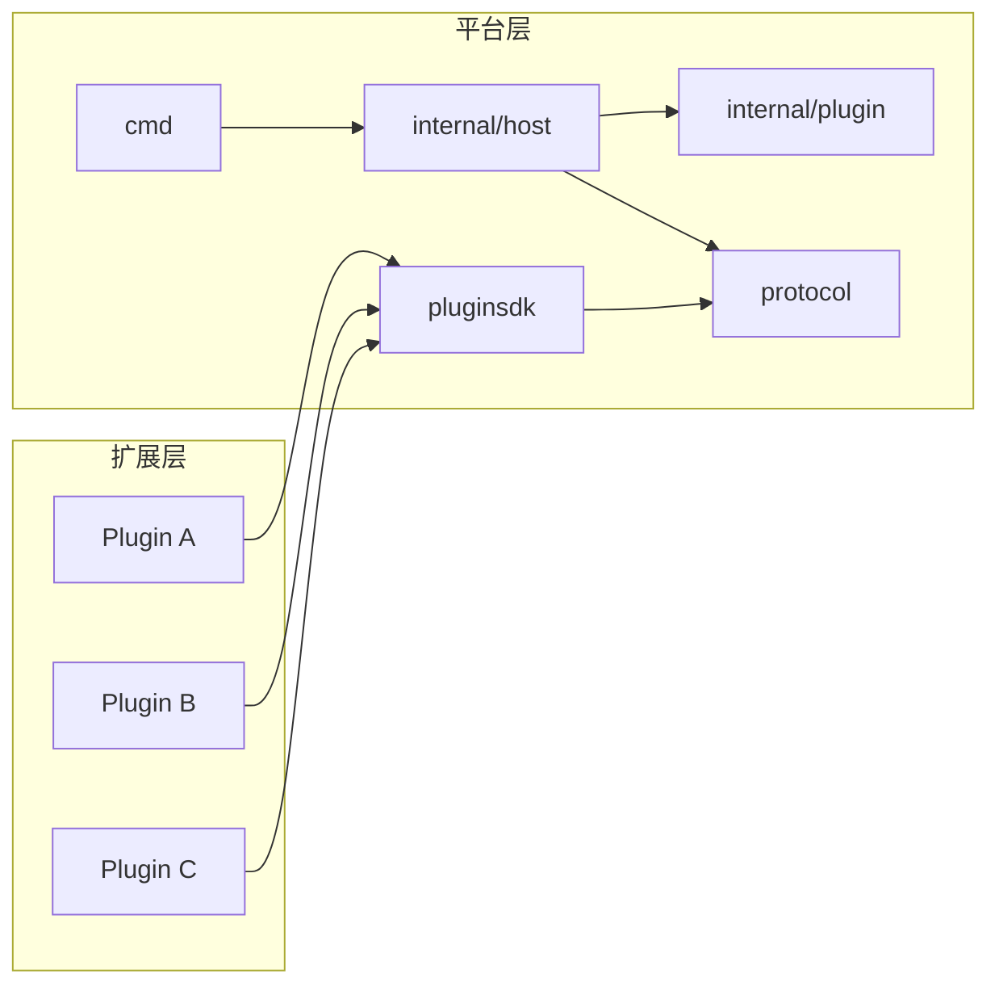
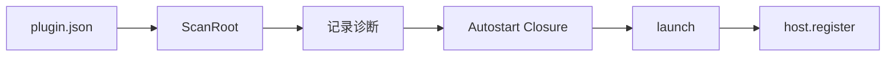
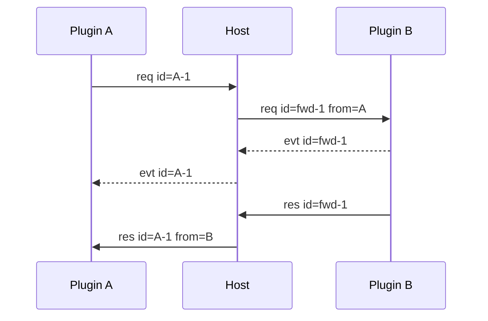
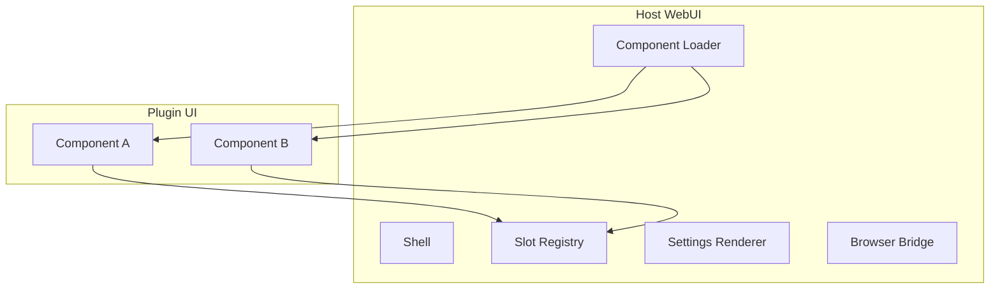
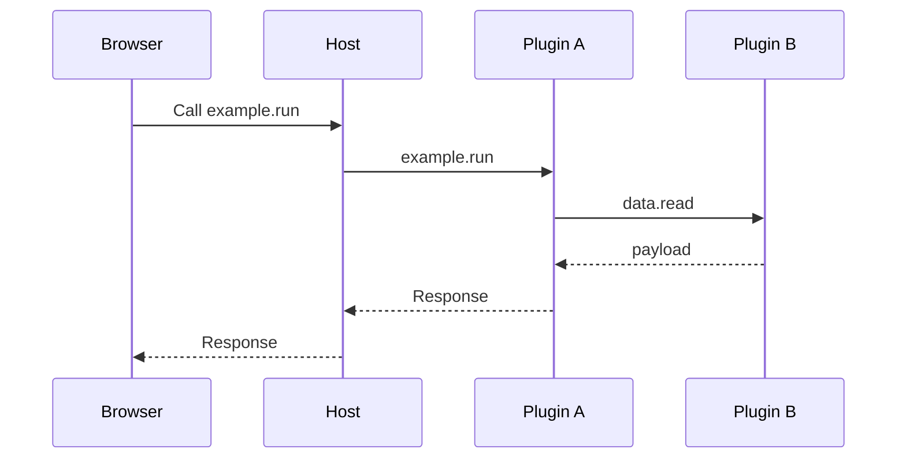

# 项目开发文档

本文面向 Host、pluginsdk 和 Manifest 的开发者。内容覆盖平台分层、跨包约定和进程入口。

各包的实现细节在 [internal/](internal/README.md)：

| 包 | 文档 |
|---|---|
| `internal/host` | [internal/host.md](internal/host.md) |
| `internal/plugin` | [internal/plugin.md](internal/plugin.md) |
| `internal/webui` | [internal/webui.md](internal/webui.md) |

插件业务契约不在本文展开。插件的方法、payload、状态和前端通信写在 `plugins/<name>/`。

## 1. 分离原则

LiteAgent 分为平台层和扩展层。



平台层定义如何连接。扩展层定义做什么。

项目整体文档提到具体插件时，只能作为示例。示例不构成 Host 依赖。

依赖方向是单向的。`pluginsdk` 只依赖 `protocol`。`internal/host` 依赖 `protocol` 和 `internal/plugin`。`internal/webui` 依赖 `internal/host` 和 `internal/plugin`。

平台树不 import 任何插件包。插件之间不互相 import。

## 2. 平台模块

| 模块 | 主要职责 | 关键入口 | 实现文档 |
|---|---|---|---|
| `cmd/liteagent-server` | 组装 Host 与 WebUI，管理 HTTP 生命周期 | `run()` | 本文第 9 节 |
| `internal/host` | Plugin Instance、执行上下文、路由、pending 闭环 | `host.New()` + `(*Host).Start()` | [internal/host.md](internal/host.md) |
| `internal/plugin` | Manifest 发现和 autostart 排序 | `ScanRoot()` | [internal/plugin.md](internal/plugin.md) |
| `internal/webui` | Browser Bridge、UI Push 和静态资源 | `NewServer()` | [internal/webui.md](internal/webui.md) |
| `protocol` | Frame 编解码和稳定错误码 | `Frame` | [protocol.md](protocol.md) |
| `pluginsdk` | 插件注册、Call、Event | `Plugin` | [pluginsdk.md](pluginsdk.md) |

`host.New` 只构造 Host，不启动任何进程；调用方在此期间接好 UI Publisher 和 trace 回调，再调用
`Host.Start` 按 autostart 闭包挂载插件。顺序反了会让插件启动期的 `ui.state` 拿到 `ui_not_mounted`。

### 2.1 线契约只有一份

Frame 结构在平台树里只存在一份，定义在 `protocol/frame.go`。`internal/host/constant.go` 用类型别名和常量别名引用它。

同样的做法适用于错误码。`protocol/errors.go` 是字符串值的唯一来源，`internal/host/constant.go` 和 `pluginsdk/errors.go` 只是别名。

## 3. 平台结构体

平台结构体分为三层：

| 层次 | 含义 | 修改要求 |
|---|---|---|
| 线契约 | 跨进程 JSON 和 Frame 字段 | 先改协议和版本 |
| 平台契约 | Manifest、SDK 调用面 | 同步更新平台文档 |
| Host 私有 | 进程索引、pending、锁 | 可以内部重构 |

插件业务结构体属于扩展层。它们不得进入平台结构体目录。

各包的结构体清单在对应的实现文档里：

| 包 | 文档 |
|---|---|
| `protocol` | [protocol.md](protocol.md) 第 2 节 |
| `internal/plugin` | [internal/plugin.md](internal/plugin.md) 第 3 节 |
| `internal/host` | [internal/host.md](internal/host.md) 第 3 节 |
| `pluginsdk` | [pluginsdk.md](pluginsdk.md) 第 1 节 |
| `internal/webui` | [internal/webui.md](internal/webui.md) 第 3 节 |

插件结构体只写在插件文档中。每个插件至少整理：

| 分类 | 内容 |
|---|---|
| 方法 payload | Request 和 Response JSON |
| 领域对象 | 插件自己的持久化或业务对象 |
| 临时对象 | Event、Draft、Preview |
| 私有对象 | 锁、缓存、解析器状态 |
| WebUI 对象 | State、Command、View payload |

插件文档使用 JSON 字段名描述契约，不把 Go 私有类型名当作公共协议。

## 4. Manifest 和装配



Manifest 负责静态信息。运行时路由真源是 `host.register` 上报的 `(capability, method)`。

Manifest 和插件启动错误只记录诊断。单个插件失败不中止 Host，也不阻止其他插件继续加载。

每条诊断同时进入命令行窗口和 WebUI。命令行输出 `plugin`、`path`、`code` 和 `message`。WebUI 使用非模态悬浮窗展示，不阻断其他组件。

UI 和 Settings 也是插件贡献。Host 只读取声明，不解释插件业务状态。

扫描、校验和闭包计算的细节见 [internal/plugin.md](internal/plugin.md)。

## 5. Frame 生命周期

### 5.1 跨插件 Call



Host 改写 id，并保留调用方原始 id。Response 到达后，pending 项删除。

存在 `context_id` 时，Host 先校验调用方是上下文参与者。Capability 绑定决定目标 Plugin Instance 和 Generation。Generation 不一致时拒绝调用。Response 和归因 Event 保留同一执行上下文。

### 5.2 Event

归因 Event 属于在途 Call。无 id 的 Event 当前不进行通用扇出。

Event payload 对 Host 不透明。插件负责定义 Event 主题和字段。

### 5.3 错误闭环

```text
路由失败       Host 合成 Response
handler 失败   SDK 写 error_code
插件退出       Host 合成 plugin_down
调用方退出     Host 丢弃其 pending
```

每条 Request 最终只得到一条 Response。

执行上下文关闭时，该上下文的 pending 调用统一返回 `context_closed`。插件进程退出仍返回 `plugin_down`。

路由、pending 与取消的细节见 [internal/host.md](internal/host.md)。

## 6. WebUI 平台

### 6.1 组成



Component A 和 Component B 是示例。插件可以贡献任意数量的 Component。

### 6.2 驱动关系

Plugin Runtime 驱动自己拥有的 Component：

```text
SetState(mountID, state)
SendCommand(mountID, command, payload)
```

浏览器上行使用 Capability Call。Host 不创建第二套业务路由。

### 6.3 数据边界

| 数据 | 归属 |
|---|---|
| Shell、Slot、Loader、Browser Bridge | Host |
| Component DOM 和生命周期 | 插件 |
| State 的业务含义 | 插件 |
| Command 的业务含义 | 插件 |
| 持久化记录 | 插件 |

Host 不保存业务 State。浏览器刷新后，插件 Runtime 负责重建自己的 State。

WebUI 是可重启的交互端。业务执行和状态真源都在后端。浏览器关闭不影响运行中的业务。

### 6.4 浏览器传输

```text
GET  /bridge/bootstrap
POST /bridge/call
POST /bridge/pick-directory
GET  /bridge/ui
POST /bridge/plugins/rescan
POST /bridge/plugins/{plugin}/start
POST /bridge/plugins/{plugin}/stop
```

`GET /bridge/bootstrap` 返回插件快照、Mount 列表和 Diagnostic 快照，是 Shell 的启动入口。
`POST /bridge/call` 返回 NDJSON Event 和最终 Response。`GET /bridge/ui` 接收 State、Command 和 Diagnostic。
`POST /bridge/pick-directory` 打开 Host 所在机器的文件夹选择框，返回绝对路径。
三个管理接口返回最新 Bootstrap，供 Shell 更新插件快照和 Mount 列表。

所有 `POST` 端点校验 `Origin` 同源；跨源返回 403，不带 `Origin` 的请求放行。

浏览器断开后，Host 停止写回，但不取消后端 Call。后端继续执行，未发送的 Event 和 Response 被丢弃。

UI 流建立后 Host 先发送 hello。重连后的 hello 触发 Shell resync，重新读取 Bootstrap 和插件状态。Host 不重放断线期间的事件。

Browser Envelope 见 [webui.md](webui.md)。实现细节见 [internal/webui.md](internal/webui.md)。

## 7. 插件扩展点

插件通过 Manifest 贡献四类能力：

| 扩展点 | 说明 |
|---|---|
| Capability | 运行时业务方法 |
| Commands | 人类可发现的命令帮助 |
| UI Components | Web Component 和 Mount |
| Settings | 配置 Schema 和保存方法 |

这些扩展点彼此独立。插件可以只提供 Capability，不提供 UI。

## 8. 示例边界

下面的流程只展示平台如何组合插件，不代表仓库中的固定产品：



真实插件的组合方式见 `plugins/README.md` 和各插件文档。

## 9. cmd/liteagent-server

`run()` 是进程入口的全部逻辑，返回退出码。

| 步骤 | 行为 |
|---|---|
| 1 | 打印版本号到 stderr |
| 2 | 扫描插件目录，建立 Mount Registry |
| 3 | 打印扫描诊断到 stderr |
| 4 | 监听 HTTP 地址。失败则退出码 1 |
| 5 | 构造 Host，注入 trace 回调 |
| 6 | 构造 WebUI Server，接上 Host 作为插件管理器 |
| 7 | 把 WebUI Server 装进 Host 的 UI Publisher |
| 8 | 启动 Host，挂载 autostart 插件 |
| 9 | 打印已挂载插件名 |
| 10 | 启动 HTTP 服务，打印访问 URL |
| 11 | 等待信号或服务错误 |
| 12 | 优雅关闭 HTTP 服务，再关闭 Host |

插件目录的定位规则是：优先取可执行文件旁的 `plugins/`，否则用当前工作目录的 `plugins/`。没有命令行参数。

监听地址由 `LITEAGENT_HTTP_ADDR` 覆盖，默认 `127.0.0.1:2333`。绑定到通配地址时打印的 URL 仍显示回环地址。

进程捕获 `os.Interrupt` 和 `SIGTERM`。捕获 SIGTERM 是为了让容器停止时也能执行 `defer h.Close()`，避免残留插件进程。

stdout 留给对话界面，日志全部走 stderr。

## 10. 锁与并发

平台层有四把锁：

| 锁 | 保护范围 |
|---|---|
| `Host.mu` | 实例索引、路由表、pending 表、上下文表、快照数据 |
| `Host.lifecycleMu` | 串行化重新扫描、启动、停止 |
| `proc.mu` | 单个实例的 stdin 写入 |
| `pipelineState.mu` | 流水线游标、已访问集合、Proceed 记录 |

跨包约定：

- 读路径用 `RLock`，写路径用 `Lock`。
- 任何路径都不在持有 `proc.mu` 时去拿 `Host.mu`。
- 写回插件的合成应答一律在锁外发出。
- `trace` 回调在锁外调用。

各锁的细节见 [internal/host.md](internal/host.md) 第 17 节。

## 11. 测试策略

| 层面 | 测试重点 |
|---|---|
| `protocol` | 目前只覆盖 cancel 帧往返。超长 Frame 和非法类型尚无测试 |
| `pluginsdk` | handler 分发、pending、归因 Event |
| `internal/host` | 路由、from 注入、死亡闭环 |
| `internal/plugin` | Manifest、路径、autostart 排序 |
| WebUI Bridge | Call 闭环、State/Command、断线 |
| 浏览器脚本 | `internal/webui/*.test.mjs`，由 `node --test` 驱动 |
| 插件 | 由各插件文档定义 |

浏览器侧的 Go 测试文件负责在 `go test` 中驱动 `node --test`。目前覆盖 `lite-agent`、`loader` 和 `plugins` 三套。`settings.test.mjs` 没有 Go 驱动，只能手动跑。

各包已有测试固定住的行为和未被固定的行为，分别列在各实现文档末尾。

## 12. 变更纪律

平台改动按以下顺序检查：

1. Go 类型和方法；
2. `docs/platform/protocol.md`、`docs/platform/pluginsdk.md` 或 `docs/platform/manifest.md`；
3. `docs/platform/development.md` 和受影响的 `docs/platform/internal/*.md`；
4. 受影响插件的 `communication.md`；
5. 测试。

插件改动只更新该插件文档。只有平台契约变化时，才修改项目整体文档。
