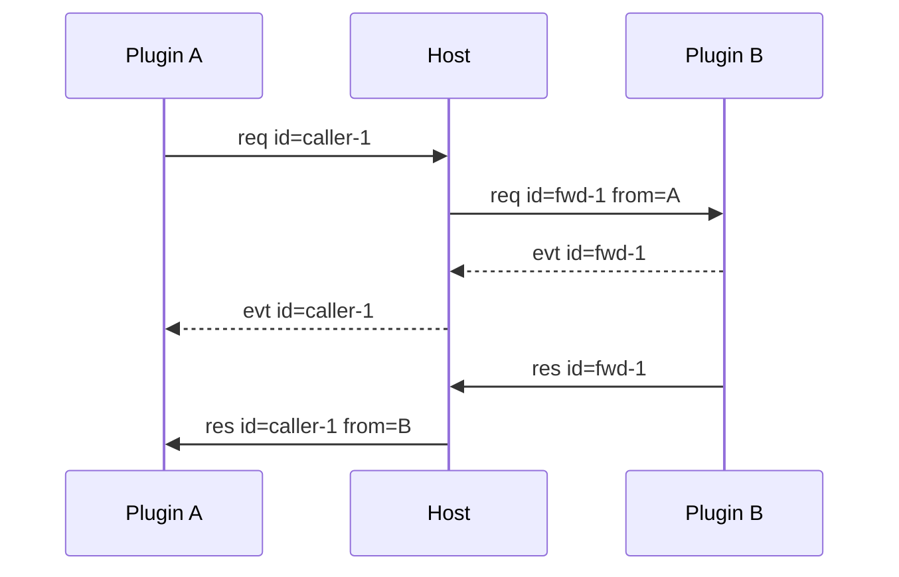

# Host 与 Plugin 通信协议

本文定义 Host 与进程外 Plugin 的线契约。浏览器协议见 [webui.md](webui.md)。两类协议独立版本化。

本文描述当前实现。Host 侧的公开方法清单见第 5 节，SDK 调用面见 [pluginsdk.md](pluginsdk.md)。

## 1. 传输

Plugin 通过 stdio 与 Host 通信。每条 Frame 的线格式如下：

```text
4-byte big-endian length
UTF-8 JSON body
```

JSON body 最大 16 MiB，即 `protocol.FrameMaxSize`。Frame 版本当前为 2。

长度头为 0 或大于上限时，读端返回 `frame_too_large`。写入端在 marshal 后先查上限。

## 2. Frame

### 2.1 字段

```go
type Frame struct {
    Version    int             `json:"version"`
    ID         string          `json:"id"`
    Type       string          `json:"type"`
    From       string          `json:"from,omitempty"`
    ContextID  string          `json:"context_id,omitempty"`
    Capability string          `json:"capability,omitempty"`
    Method     string          `json:"method,omitempty"`
    Payload    json.RawMessage `json:"payload,omitempty"`
    Reason     string          `json:"reason,omitempty"`
    Priority   int             `json:"priority,omitempty"`
    ErrorCode  string          `json:"error_code"`
    ErrorMsg   string          `json:"error_msg"`
}
```

| 字段 | 要求 |
|---|---|
| `version` | 当前填 2 |
| `id` | Request/Response 闭环标识 |
| `type` | `req`、`res`、`evt` 或 `cancel` |
| `from` | Host 注入真实来源 |
| `context_id` | 可选执行上下文标识 |
| `capability` | Request 主题 |
| `method` | Request 主题 |
| `payload` | 业务 JSON |
| `reason` | `cancel` 的取消原因 |
| `priority` | Host 管理的流水线位置 |
| `error_code` | 成功时为空字符串 |
| `error_msg` | 成功时为空字符串 |

插件出站 Frame 不填 `from`。Host 在投递时注入插件名。

`error_code` 与 `error_msg` 没有 `omitempty`，成功时也会出现在 JSON 里。

`context_id` 是可选的运行期扩展。插件只在已加入某个执行上下文时填写该字段。Host 校验参与者身份，并在 Response 和归因 Event 中保留该字段。上下文不影响无 `context_id` 的既有调用。

### 2.2 Host 侧的字段改写

Host 是唯一有权改写 Frame 字段的一方。插件看到的字段已经过下列改写。

| 字段 | 改写规则 |
|---|---|
| `from` | 投递时填入真实来源插件名。Host 合成帧填 `host` |
| `id` | 跨插件转发时改成 `fwd-N`，回程改成调用方原始 id |
| `context_id` | Response 与归因 Event 用 pending 记录的上下文覆盖 |
| `priority` | Request 填当前跳的优先级。Response 与 Event 回填目标跳的优先级 |
| `error_code` | 失败时写稳定错误码，成功时为空串 |

`from` 永远是插件名，不参与路由。插件无法通过 payload 伪造来源。

有一处例外：`host.proceed` 转发的下一跳，`from` 填调用方的 Plugin Instance id，而不是插件名。

### 2.3 id 命名空间

| 前缀 | 归属 | 用途 |
|---|---|---|
| `fwd-N` | Host | 跨插件转发的内部 id |
| `host-N` | Host | Host 主动发起的 Call id |
| `<plugin>-N` | 插件 | 插件自己发起的 Call id |

`fwd-N` 和 `host-N` 由 Host 内部的 `seq` 计数器单调递增，两者共享同一个计数器。

`<plugin>-N` 由 SDK 进程内的独立计数器生成，从 1 开始。插件名是前缀。

`N` 还用于自动生成的实例 id，形如 `<plugin>:instance:<N>`。该值取自 Host 的同一个 `seq` 计数器。

### 2.4 Generation 校验

每个 Plugin Instance 有一个只增不减的 `gen` 计数。进程重启时计数加一。

Host 读到插件的 Frame 时，先比较 Frame 所属进程的 `gen` 与当前实例的 `gen`。不一致说明这条 Frame 来自上一次进程激活，Host 直接丢弃并记日志。

这条规则保证旧进程的迟到 Frame 不会污染新进程的路由和 pending。

## 3. 消息类型

### 3.1 Request

Request 要求对端执行一次 `capability.method`。每条 Request 必须得到一条 Response。

```json
{
  "version": 2,
  "id": "caller-1",
  "type": "req",
  "capability": "example",
  "method": "run",
  "priority": 2147483647,
  "payload": {}
}
```

自调用合法。Host 仍按统一路由流程环回。

`priority` 由 Host 写入，初始值为 `2147483647`，即 `FramePriorityMax`。插件不能指定下一跳。

### 3.2 Response

Response 与 Request 使用同一 id。成功结果放在 `payload`。

```json
{
  "version": 2,
  "id": "caller-1",
  "type": "res",
  "from": "provider-plugin",
  "capability": "example",
  "method": "run",
  "payload": {},
  "error_code": "",
  "error_msg": ""
}
```

失败时 `error_code` 非空。`payload` 不作为结果。

### 3.3 Event

Event 不建立新的调用闭环。

| 类型 | id | 语义 | 当前 Host 行为 |
|---|---|---|---|
| 归因 Event | 非空 | 属于一次在途 Call | 还原调用方 id 后投递 |
| 广播 Event | 空 | 无指定接收方 | 记录日志后丢弃 |

归因 Event 示例：

```json
{
  "version": 2,
  "id": "caller-1",
  "type": "evt",
  "from": "provider-plugin",
  "capability": "example",
  "method": "chunk",
  "payload": {
    "channel": "content",
    "delta": "你"
  }
}
```

Event 命中的 pending 不存在时，Host 记日志后丢弃。Event 不产生任何 Response。

### 3.4 Cancel

`cancel` 取消一次在途 Request。它不产生独立 Response。原 Request 最终仍产生唯一 Response。

```json
{
  "version": 2,
  "id": "caller-1",
  "type": "cancel",
  "from": "caller-plugin",
  "context_id": "ctx-1",
  "capability": "example",
  "method": "run",
  "reason": "cancelled"
}
```

Host 将 Call id 翻译为目标侧 id 后转交 Provider。目标 SDK 取消 Handler Context。超过取消宽限期时，Host 合成终态 Response。

`reason` 只能是 `cancelled` 或 `deadline_exceeded`。其它值一律归一为 `cancelled`。

取消宽限期是 `DefaultCancelGrace`，当前为 2 秒。宽限期到期后 Host 合成终态 Response，错误码为 `call_cancelled` 或 `call_deadline_exceeded`。

## 4. 路由

路由键是：

```text
capability.method
```

Host 不提供目标插件字段。插件名只用于 `from`、日志、id 前缀和依赖图。

路由分为两层：

```text
capability.method → Plugin
execution context → Plugin Instance
```

无执行上下文时，调用进入默认 Plugin Instance。存在上下文绑定时，调用进入绑定实例和固定 Generation。Plugin Instance 是进程激活身份，不改变 `from` 的插件身份语义。



Host 为跨插件 Request 分配内部 `fwd-N` id。Response 返回调用方时恢复原始 id。

### 4.1 路由表

路由表的唯一写入口是 `host.register` 上报的 `(capability, method)`。Manifest 的 `provides` 只用于观测和装配，不写路由表。

同一插件重复注册同键时采用最后一次。跨插件冲突时，冲突键进入 `rejected`，属主不变。

Route Owner 是该键的 `host.register` 上报方。判定分三种情况：

| 情况 | 结果 |
|---|---|
| 键已有别的属主，本插件不声明 `consumes` | 进 `rejected`，属主不变 |
| 键已有别的属主，本插件声明了 `consumes` | 进 `accepted`，本插件作为 Consumer 参与流水线，不抢属主 |
| 键还没有属主 | 本插件成为属主 |

第三种情况有一个例外。本插件既不声明该 Capability 的 `provides`，又声明了该方法的 `consumes` 时，它只作为 Consumer 参与。路由归属保持为空。

这就是 Consumer 先于 Provider 启动的场景。真正的 Provider 注册后成为 Owner。

### 4.2 Consumer 流水线

流水线按 `priority` 从高到低串联 Consumer 与 Provider。优先级来自 Manifest 的 `priority`，缺省为 `0`。

Host 收到业务 Request 后，把 `priority` 置为 `FramePriorityMax`，然后选择候选：

1. 候选必须是 `active` 状态的 Plugin Instance。
2. 候选要么已注册该 `(capability, method)`，要么在 Manifest 的 `consumes` 中声明了该方法。
3. 首跳若 Manifest 中存在该方法的 Consumer 声明，则只考虑 Consumer。
4. 已访问过的实例被跳过。
5. 优先级高于当前上界的候选被跳过。

选中的候选是优先级最高者。同一键上出现多个同优先级候选时，Host 返回 `consume_priority_conflict`。

选中后，Host 记录该实例为已访问，跳数加一，下一跳的优先级上界降为当前优先级减一。

流水线最多 64 跳，即 `PipelineMaxHops`。超限返回 `pipeline_hops_exceeded`。

找不到候选且存在已访问的实例时，Host 返回 `pipeline_loop`。

### 4.3 缺席即放行

流水线选不到候选时，Host 不直接报错。它回退到路由表：

1. 路由表里有该键的 Route Owner，就把调用直接交给它。
2. 路由表里没有该键，返回 `method_not_found`。

这条规则的效果是：Manifest 声明了 `consumes` 但当前没有活跃 Consumer 时，Host 跳过这一跳。只有 Consumer 和 Provider 都不存在时，调用才返回 `method_not_found`。

### 4.4 Proceed

Consumer 处理完业务逻辑后，可以把调用交给下一跳。这就是 `host.proceed`。

Host 收到 `host.proceed` 后：

1. 按 `call_id` 找到 pending 项。找不到、属主不是调用方或该 pending 不在流水线中时，返回 `method_not_found`。
2. 检查该 Call 是否已经 Proceed 过。重复 Proceed 返回 `flow_already_proceeded`。
3. 在独立 goroutine 中选择下一跳候选，避免阻塞 Host 的读循环。
4. 用新的 `fwd-N` id 把 Request 转发给下一跳。
5. 下一跳的归因 Event 直接回送给当前 Consumer。
6. 下一跳的 Response 到达后，Host 用它应答本次 `host.proceed` Call。

payload 不是合法 JSON 时返回 `bad_payload`，不进入后续步骤。

下一跳的 `from` 填当前 Consumer 的 Plugin Instance id。默认实例下它等于插件名。

下游 Event 由 SDK 转成 `EmitWithID` 重新归属到原始业务 Call，因此调用方仍能收到流式增量。

下一跳选不到候选时，Host 返回 `route_failed`。若该键的 Route Owner 也不活跃，则返回 `plugin_not_ready`。

## 5. Host 方法

所有 Host 方法的 `capability` 都是 `host`。Host 只分派下面列出的方法，未知方法合成 `method_not_found`。

| 方法 | 输入 | 输出 |
|---|---|---|
| `host.register` | `handlers[]`（每项含 `capability`、`method`，可选 `name`、`description`） | `accepted[]`、`rejected[]` |
| `host.proceed` | `call_id`、可选 `payload` | 下一跳的 payload |
| `host.plugins` | 无 | `plugins[]` 状态快照 |
| `host.ui.state` | `mount_id`、`state` | `{}`；无浏览器连接或队列已满时返回 `ui_not_mounted` |
| `host.ui.command` | `mount_id`、`command`、`payload` | `{}`；无浏览器连接或队列已满时返回 `ui_not_mounted` |
| `host.context.create` | `parent_id`、`bindings` | `context` |
| `host.context.bind` | `context_id`、`capability`、`instance_id` | `{bound:true}` |
| `host.context.close` | `context_id` | `{closed:true}` |
| `host.instance.create` | `plugin_name`、可选 `instance_id`、`config_revision` | `instance` |
| `host.instance.close` | `instance_id` | `{closed:true}` |
| `host.instance.restart` | `instance_id` | `instance` |

`name` 和 `description` 只用于展示和诊断，不参与路由。Host 只把 `(capability, method)` 写进路由表。

浏览器不能调用这一层。Browser Bridge 直接拒绝 `capability` 为 `host` 的请求。

### 5.1 host.register

```json
{
  "handlers": [
    {"capability": "example", "method": "run", "name": "run", "description": "Run an example operation"}
  ]
}
```

应答把每个键放进 `accepted` 或 `rejected`。两个数组的元素都是 `{capability, method}`。

`capability` 或 `method` 为空的键直接进 `rejected`。

注册成功后，该实例的状态从 `loading` 变为 `active`，失败信息清空。注册项按 `capability`、`method` 排序后保存。

失败情形：

| 情形 | 错误码 |
|---|---|
| payload 不是合法 JSON | `bad_payload` |
| 上报方不是已知实例 | `plugin_not_mounted` |
| 实例不在 `loading` 或 `active` 状态 | `plugin_not_ready` |

payload 解析失败时该实例转为 `failed`，失败码是 `bad_payload`。

### 5.2 host.plugins

按插件名返回分组快照。每项包含：

| 字段 | 含义 |
|---|---|
| `name` | 插件名 |
| `version` | Manifest 版本 |
| `state` | 聚合状态，取自被选中的实例 |
| `selected_instance_id` | 默认展示的实例 id |
| `instances[]` | 该插件的全部实例 |
| `enabled` | 插件是否允许启动 |
| `missing` | 该名字只出现在依赖引用中，插件本身未发现 |
| `provides` | Manifest 声明的能力 |
| `depends_on` | Manifest 声明的硬依赖 |

`instances[]` 每项包含 `instance_id`、`plugin_name`、`config_revision`、`state`、`generation`、`registrations[]`、`failure_code` 和 `failure_message`。

`registrations[]` 每项包含 `capability`、`method`，以及可选的 `name` 和 `description`。

`selected_instance_id` 的选取规则是先按状态排序，再按实例 id 升序：

| 状态 | 排序权重 |
|---|---|
| `active` | 0 |
| `failed` | 1 |
| `loading` | 2 |
| `stopping` | 3 |
| `inactive` | 4 |

该插件没有任何实例时，`selected_instance_id` 为空，状态为 `inactive`。

快照不返回本地路径。

### 5.3 host.context.create

```json
{
  "parent_id": "ctx-1",
  "bindings": {"llm": "llm-a"}
}
```

`bindings` 的值是 Plugin Instance id。Host 建立绑定时自动记录目标实例当前的 Generation。

`parent_id` 对 Host 是不透明标识。父上下文必须存在且未关闭，创建者必须是父上下文的属主或参与者。

子上下文继承父上下文的绑定和参与者集合。同名绑定被子上下文自己的绑定覆盖。

应答中的 `context` 包含：

| 字段 | 含义 |
|---|---|
| `id` | 上下文 id，形如 `ctx-N` |
| `owner` | 创建者实例 id |
| `root_id` | 根上下文 id |
| `parent_id` | 父上下文 id，无父时省略 |
| `bindings` | Capability 到绑定对象的映射 |
| `closed` | 是否已关闭 |

绑定对象包含 `capability`、`instance_id` 和 `generation`。参与者集合不出现在应答里。

绑定校验规则：

- Capability 和实例 id 都必须非空，否则 `context_binding_invalid`。
- 实例必须存在，否则 `instance_not_found`。
- 若该 Capability 已有路由属主，且目标实例的插件名不是属主，返回 `context_binding_invalid`。

Provider 重启后，旧 Generation 的绑定返回 `context_binding_invalid`。重新执行 `host.context.bind` 会固定到新 Generation。

配置代属于 Plugin Instance。实例绑定形成配置隔离，Context 不再保存全局配置代。

### 5.4 host.context.bind

```json
{
  "context_id": "ctx-1",
  "capability": "llm",
  "instance_id": "llm-a"
}
```

只有上下文属主可以改绑定。上下文不存在返回 `context_not_found`，已关闭返回 `context_closed`，属主不符返回 `context_owner_mismatch`。

### 5.5 host.context.close

关闭指定上下文及其全部子上下文。Host 终止相关 pending，并删除已关闭上下文。

被关闭上下文上的在途调用返回 `context_closed`。插件进程退出仍返回 `plugin_down`。

只有上下文属主可以关闭。属主不符返回 `context_owner_mismatch`。

### 5.6 host.instance.create

```json
{
  "plugin_name": "example-plugin",
  "instance_id": "example-plugin:instance:1",
  "config_revision": "rev-1"
}
```

`instance_id` 省略时，Host 自动生成 `<plugin_name>:instance:<N>`，`N` 取自 Host 的自增计数器。

`config_revision` 是插件自己的配置代标识。Host 只记录和透传，不解释内容。

默认实例以插件名作为实例 id。同一插件可以同时存在多个实例。

失败情形：

| 情形 | 错误码 |
|---|---|
| `plugin_name` 为空 | `bad_arguments` |
| Host 已关闭 | `host_closed` |
| 实例 id 已存在 | `instance_exists` |
| 插件未被发现 | `plugin_not_mounted` |
| 插件被禁用 | `plugin_disabled` |

### 5.7 host.instance.close 与 host.instance.restart

`host.instance.close` 停止一个实例，不影响同插件的其他实例。实例不存在返回 `instance_not_found`。实例已经进入 `stopping` 时再次关闭返回成功，不重复执行停机流程。

`host.instance.restart` 用同一实例 id 换一个新进程。实例不存在返回 `instance_not_found`，正在停止返回 `instance_closed`。

两者都会先等待在途 Call 完成，宽限期为 `DefaultShutdownGrace`，当前 2 秒。超时未完成的 Call 返回 `plugin_down`。

重启后实例的 Generation 加一。指向旧 Generation 的上下文绑定随即失效。

## 6. Pending 闭环

Plugin 发起 Call 时登记：

```text
pending[call_id] = response channel
```

Host 转发时登记：

```text
pending[fwd_id] = caller/original_id/target/context_id
```

Response 到达后，Host 恢复调用方 id 并删除 pending。Cancel 保留 pending，等待原 Request 的唯一终态。超过取消宽限期时，Host 合成终态。插件进程退出时，Host 合成 `plugin_down`。

pending 分两种归属。`WaitPlugin` 是插件 A 调插件 B，Host 只中转并还原 id。`WaitHost` 是 Host 主动发起或 Proceed 产生，结果走内存 channel 回调用方。

进程退出时，Host 把该实例作为目标的 pending 全部失败掉，错误码是 `plugin_down`。该实例作为调用方的 pending 也从表中移除，但不再回写应答，因为调用方已经收不到任何内容。

## 7. 错误码

### 7.1 错误码表

| 错误码 | 来源 | 含义 |
|---|---|---|
| `host_closed` | Host | Host 已关闭 |
| `route_failed` | Host | 路由失败 |
| `method_not_found` | Host/SDK | 方法不存在 |
| `plugin_not_mounted` | Host | 插件未挂载 |
| `plugin_down` | Host | 插件进程已退出 |
| `plugin_disabled` | Host | 插件已禁用 |
| `plugin_not_ready` | Host | Provider 尚未接收新 Call |
| `timeout` | 预留 | 调用超时 |
| `call_cancelled` | SDK/Host | Go Context 已取消 |
| `call_deadline_exceeded` | SDK/Host | Go Context 超过期限 |
| `handler_error` | SDK | handler 未指定错误码 |
| `server_closed` | SDK/Host | 连接或服务关闭 |
| `bad_payload` | Host/插件 | JSON 契约错误 |
| `bad_arguments` | Host/插件 | 参数不合法 |
| `frame_too_large` | 传输 | Frame 超过上限 |
| `capability_conflict` | Host | 能力属主冲突 |
| `consume_priority_conflict` | Host | 同一 `(capability, method)` 上有多个同优先级 Consumer |
| `flow_already_proceeded` | SDK/Host | 同一次 Call 重复 `host.proceed` |
| `pipeline_loop` | Host | 流水线绕回已访问的插件实例 |
| `pipeline_hops_exceeded` | Host | 流水线跳数超过上限 |
| `ui_not_mounted` | Host/WebUI | Mount 不存在，或当前没有浏览器连接、推送队列已满 |
| `ui_owner_mismatch` | Host/WebUI | Mount 属主不匹配 |
| `instance_not_found` | Host | Plugin Instance 不存在 |
| `instance_exists` | Host | Plugin Instance 标识已存在 |
| `instance_closed` | Host | Plugin Instance 已关闭 |
| `context_not_found` | Host | 执行上下文不存在 |
| `context_closed` | Host | 执行上下文已关闭 |
| `context_owner_mismatch` | Host | 执行上下文属主不匹配 |
| `context_participant_mismatch` | Host | 调用方不是上下文参与者 |
| `context_binding_invalid` | Host | Capability 实例绑定不合法 |

插件使用 `pluginsdk.ErrCode` 产生稳定错误码。普通 `error` 最终映射为 `handler_error`。

### 7.2 当前未接线的错误码

有两个错误码在常量表里存在，但当前没有任何代码路径产生它们。

| 错误码 | 现状 |
|---|---|
| `capability_conflict` | 跨插件注册冲突进 `rejected`，不产生该错误码 |
| `plugin_disabled` | Host 没有对外的插件禁用入口，`enabled` 恒为真 |

`timeout` 只在 Host 内部表示“Call 不在 pending 中”，正常路径不会把它写进 Frame。

## 8. 版本

线协议版本由 `Frame.version` 表达。Manifest 版本由 `plugin.json.protocol` 表达。两者独立演进。

破坏 Frame 字段或路由语义时升级 Frame 版本。破坏 Manifest 契约时升级 Manifest 版本。

浏览器侧的协议版本是另一个值，见 [webui.md](webui.md) 第 7 节。

## 9. 实现对应

| 内容 | 文件 |
|---|---|
| Frame 和编解码 | `protocol/frame.go` |
| 稳定错误码 | `protocol/errors.go` |
| Host 路由 | `internal/host/transport.go` |
| 路由表和注册 | `internal/host/transport.go` |
| 流水线与 Proceed | `internal/host/pipeline.go` |
| pending 和进程状态 | `internal/host/host.go` |
| 取消与宽限期 | `internal/host/cancel.go` |
| Plugin Instance 和执行上下文 | `internal/host/runtime.go` |
| 插件快照 | `internal/host/snapshot.go` |
| SDK Call/Event | `pluginsdk/plugin.go` |
| SDK 错误辅助 | `pluginsdk/errors.go` |
