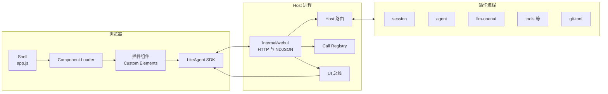
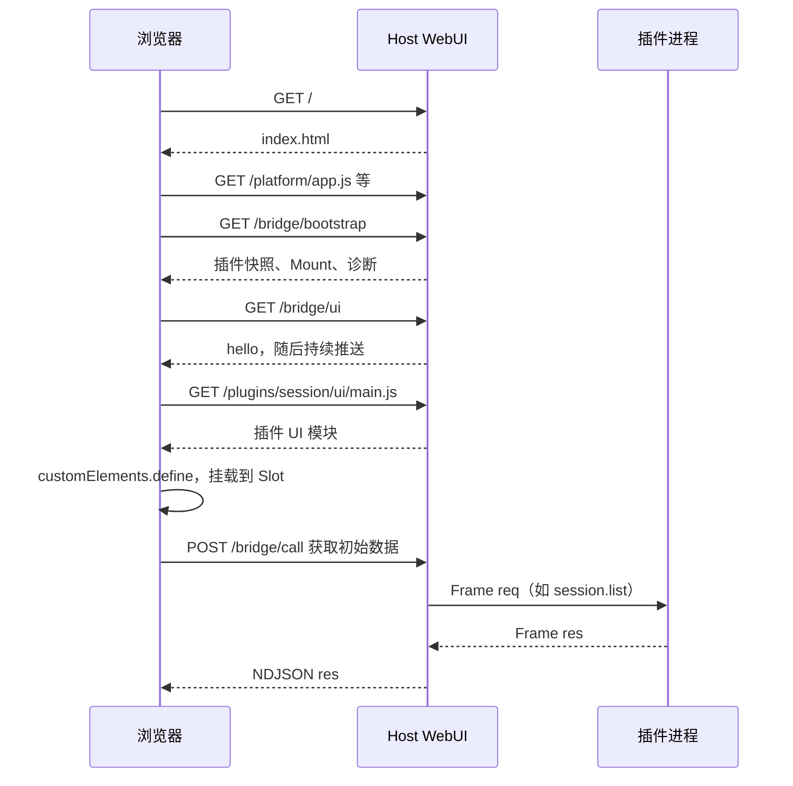
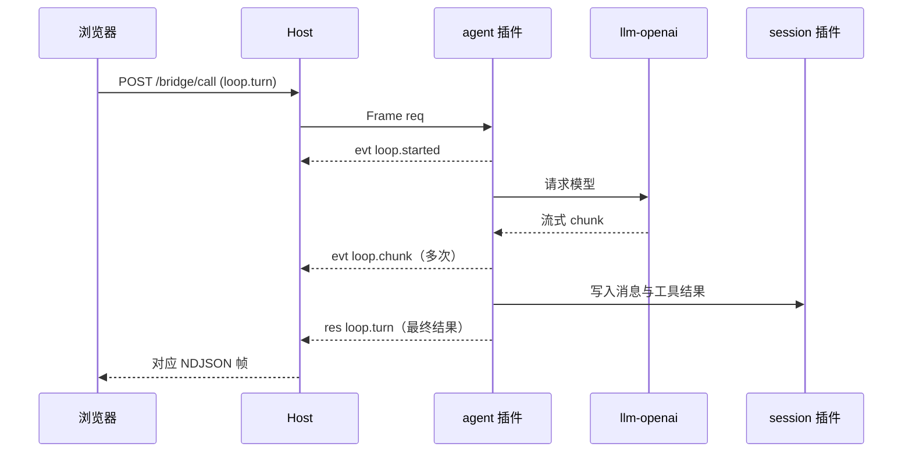
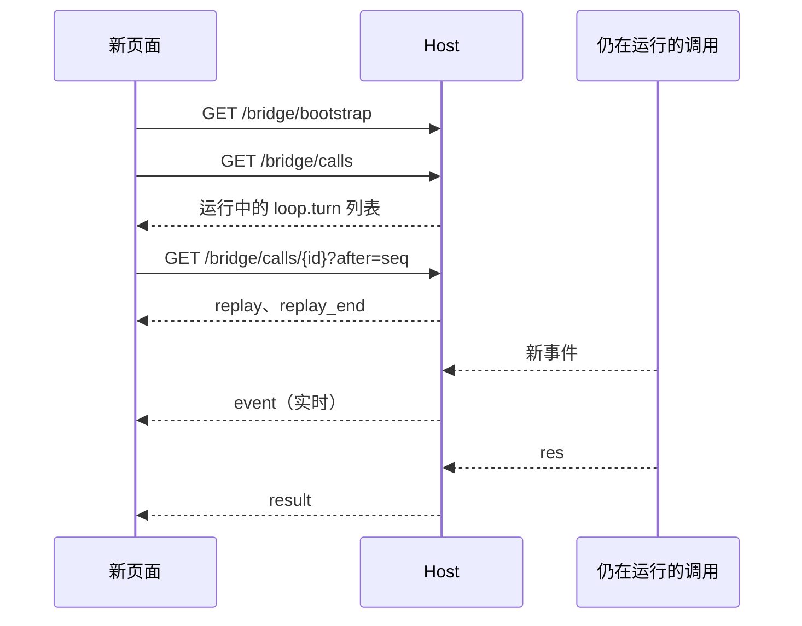

# WebUI 运行机制

本文面向想理解 WebUI 工作机制的开发者。内容覆盖页面加载、面板挂载、调用执行和刷新恢复，最后解释渲染发生在哪一端。

本文描述当前实现。逐字段的线协议见 [webui.md](webui.md)，Host 侧实现细节见 [internal_webui.md](internal_webui.md)。

## 1. 边界：谁执行，谁渲染

### 1.1 三层职责

WebUI 由浏览器、Host 和插件进程三层组成。三层的职责严格分开。

| 层 | 负责 | 不负责 |
|---|---|---|
| 浏览器 | DOM 渲染、用户输入、观察流重连 | 业务执行、持久化 |
| Host | HTTP 服务、调用路由、事件缓冲、UI 推送 | 业务规则、页面渲染 |
| 插件进程 | 业务执行、状态维护、写会话日志 | 浏览器连接、DOM 更新 |

业务执行从不发生在浏览器里。浏览器只做三件事：发调用、收事件、渲染界面。

### 1.2 两个容易混淆的词

**投影**：session 插件把会话事实（fact）变换成消息列表或模型上下文。产物是 JSON，不是 HTML。

**恢复**：页面重连后重新取数据、重新挂观察流。不是后端帮页面补渲染。

一句话总结：**会话状态和运行在后端，界面在浏览器。刷新能继续，是因为后端保留了状态和事件，不是后端渲染了页面。**

## 2. 组件与代码位置

### 2.1 进程与连接



浏览器与 Host 之间只有 HTTP。Host 与插件之间走 Frame 协议，见 [protocol.md](protocol.md)。

### 2.2 文件地图

| 路径 | 职责 |
|---|---|
| `internal/webui/server.go` | HTTP 路由、安全响应头、静态资源 |
| `internal/webui/registry.go` | Mount Registry、插件 UI 入口校验、资源解析 |
| `internal/webui/bootstrap.go` | Bootstrap 数据结构 |
| `internal/webui/bridge.go` | Browser Call 的 NDJSON 闭环 |
| `internal/webui/wire.go` | 浏览器请求与应答的编解码 |
| `internal/webui/calls.go` | Call Registry、事件缓冲、订阅与 attach 快照 |
| `internal/webui/calls_http.go` | `/bridge/calls` 与 `/bridge/calls/{id}` |
| `internal/webui/publisher.go` | UI 总线、重放环、诊断推送 |
| `internal/webui/management.go` | 插件扫描与启停 |
| `internal/webui/static/lite-agent.js` | 浏览器 SDK，导出单例 `LiteAgent` |
| `internal/webui/static/app.js` | Shell 编排：Bootstrap、UI 推送分发、插件中心 |
| `internal/webui/static/loader.mjs` | Mount 装载、tab 分组 |
| `internal/webui/static/plugins.mjs`、`settings.mjs` | 插件中心与设置表单渲染 |
| `plugins/session/ui/store.js` | 会话状态、调用恢复、增量轮询 |
| `plugins/session/ui/chat.js`、`history.js`、`trace.js` | 会话 UI 组件 |

静态资源通过 `go:embed` 编进 `liteagent-server`。浏览器拿到的 JS、CSS 与插件目录里的文件一致。

## 3. 页面启动与面板挂载

### 3.1 启动顺序

打开 `http://127.0.0.1:2333` 后，Shell 按固定顺序启动。



对应代码在 `app.js` 的 `bootstrap()`（[app.js:419](../../internal/webui/static/app.js)）。步骤是：

1. 建 Mount Loader，收集五个 Slot 元素。
2. 订阅 SDK 的 UI、诊断、状态、resync 事件。
3. 请求 `/bridge/bootstrap`，拿到插件快照、Mount 列表和诊断快照。
4. 按 Bootstrap 对齐 Mount。
5. 建立 `/bridge/ui` 观察流，接收后续推送。

`index.html` 固定提供 `top`、`left`、`center`、`right`、`bottom` 五个 Slot。`top` 由 Host 顶栏占用，插件只能使用其余四个。

### 3.2 Bootstrap 快照

`/bridge/bootstrap` 返回三块内容：

| 字段 | 内容 |
|---|---|
| `plugins` | 插件名、版本、状态、实例、注册的 Capability、依赖、Mount |
| `mounts` | `mount`、`tag`、`slot`、`entry` 四项 |
| `diagnostics` | 发现期与运行期的诊断快照 |

Bootstrap 只给平台元数据，不给业务 State。插件面板的数据要由组件自己发调用获取。

Shell 在装载前过滤状态。插件状态是 `inactive`、`failed` 或 `stopping` 时，对应 Mount 不装载（[app.js:267](../../internal/webui/static/app.js)）。插件启动成功后，下一次 Bootstrap 对齐会补上 Mount。

### 3.3 Mount 装载

Mount 的唯一标识是 `plugin:id`。Loader 按 `entry` 去重，同一个入口只导入一次。

装载步骤：

1. 动态 `import(entry)`，拉取插件 UI 模块。
2. 等待 `customElements.whenDefined(tag)`，超时时间 10 秒。
3. 创建元素，写入 `dataset.mountKey`，追加到 Slot。
4. 元素插入 DOM 时触发 `connectedCallback`，组件在此时发起初始调用。

单个 Mount 失败只影响它自己。导入失败、标签超时或 Slot 不存在会写一条 `ui_mount_failed` 诊断，其他 Mount 继续装载。失败的 entry 不缓存，下次对齐会重试。

### 3.4 Tab 分组

同一个 Slot 里有两个以上非浮层 Mount 时，Loader 自动组成 tab 组。

- 排序先看组件类的 `static tabOrder`，再看 Bootstrap 顺序。
- 当前 tab 存 `localStorage["liteagent.tab.<slot>"]`。
- 隐藏的组件仍然挂载，也继续接收推送；切换只改 `hidden`。
- 成员变为可见时派发 `liteagent:tab-show`，懒刷新的面板可以监听它。
- 声明 `static overlay = true` 的组件不参与分组。

以当前版本为例，右侧栏的 Facts、Context 和 Git 面板自动成为一个 tab 组。

## 4. 浏览器调用

### 4.1 请求

浏览器发起的每次调用都是一个 JSON 请求。

```json
{
  "version": 1,
  "id": "ui-call-8f2c",
  "type": "req",
  "capability": "loop",
  "method": "turn",
  "payload": {
    "session_id": "s-1",
    "user_input": "解释一下 WebUI"
  }
}
```

规则在 `wire.go` 的 `decodeBrowserCall`（[wire.go:34](../../internal/webui/wire.go)）：

- 版本必须是 1，其他值返回 400；
- `id`、`capability`、`method` 必填；
- 不允许出现 `from` 字段，浏览器不能伪造发起方；
- `capability` 是 `host` 时直接拒绝，浏览器不能调用平台管理方法；
- 请求体上限 16 MiB，payload 为空时归一为 `{}`。

所有 `POST` 端点校验同源。带 `Origin` 且 host 不一致时返回 403。

### 4.2 NDJSON 应答

`POST /bridge/call` 返回 NDJSON，每行一帧。

```text
{"version":1,"id":"ui-call-8f2c","type":"evt","capability":"loop","method":"chunk","payload":{"channel":"content","delta":"Web"}}
{"version":1,"id":"ui-call-8f2c","type":"evt","capability":"loop","method":"chunk","payload":{"channel":"content","delta":"UI"}}
{"version":1,"id":"ui-call-8f2c","type":"res","capability":"loop","method":"turn","payload":{"session_id":"s-1"}}
```

应答由零到多条 `evt` 加一条 `res` 组成。`evt` 是进度信号，可以丢。`res` 是唯一终态，不可以丢。

### 4.3 后端流程

`serveBrowserCall` 的处理顺序（[bridge.go:24](../../internal/webui/bridge.go)）：

1. 解码请求，非法请求在这里结束，Host 不会调用后端。
2. 在 Call Registry 里建一条记录，状态为 `running`。
3. 用 `context.WithoutCancel(r.Context())` 启动后端调用。
4. 后端每产生一个事件，先写入 Registry，再尝试写回浏览器。
5. 收到终态后写入 Registry，再写回浏览器。

第 3 步是关键。HTTP 请求的 Context 在页面刷新、关闭或断网时会取消。Host 主动剥离了取消信号，所以后端调用继续执行。

### 4.4 背压与断线

浏览器只是观察者，写不出去不影响调用。

- 写回队列容量是 64。队列满时丢弃事件，不阻塞后端。
- 终态应答不丢，它会阻塞到写出去或浏览器离开。
- 浏览器断开只结束这条 HTTP 响应，Registry 里的调用继续运行。
- 失败的调用会生成一条诊断，用户主动取消除外。

要真正取消业务，必须调用插件显式提供的取消方法，例如 `loop.cancel`。

## 5. 调用注册表与恢复

### 5.1 记录结构

Call Registry 以浏览器请求 id 为键，保存调用的一切可恢复信息。

| 字段 | 用途 |
|---|---|
| `capability`、`method`、`request` | 刷新后识别这是哪个会话的调用 |
| `status` | `running`、`finished`、`failed` |
| `events` | 浏览器形状的事件帧，带递增 `seq` |
| `final` | 终态应答 |
| `firstSeq`、`nextSeq`、`truncated` | 当前缓冲窗口 |

缓冲上限是 8192 条或 1 MiB，超出后丢最旧事件并标记 `truncated`。有事件的调用在结束后保留 10 分钟。没有事件的普通调用在结束时立即删除。

### 5.2 查询与 attach

页面恢复分两步。

**第一步**：`GET /bridge/calls` 列出可 attach 的调用，运行中的排前面，其余按开始时间倒序。

**第二步**：`GET /bridge/calls/{id}?after=<seq>` 跟随单条调用，帧顺序固定：

```text
replay      调用元数据与缓冲窗口
event        seq 大于 after 的缓冲事件，可能多条
replay_end  重放结束
event       运行中继续推送的实时事件
ping        每 15 秒一条
result      终态应答，随后关流
```

`after` 缺省或为 0 时重放全部保留事件。订阅登记与缓冲写入在同一把锁内完成，attach 不会漏事件。

调用不存在或已过期时返回 404，错误码是 `call_not_found`。此时界面回落到持久化消息。

### 5.3 截断的含义

`replay.truncated` 为 true 表示 Host 已丢弃旧事件。客户端不能假设重放是完整的，应该用持久化消息校正界面。

会话 UI 的做法是先渲染重放草稿，再在 `replay_end` 时用已落盘消息裁掉重复前缀。

## 6. UI 事件总线

### 6.1 帧类型

`/bridge/ui` 是 Host 向浏览器推送的平台通道。连接建立后先收到 `hello`。

| 类型 | 用途 | 进入重放环 |
|---|---|---|
| `hello` | 连接建立，首帧 | 否 |
| `ui` + `kind=state` | 插件 State 推送 | 否 |
| `ui` + `kind=command` | 插件 Command 推送 | 否 |
| `call` | 调用生命周期，`phase` 为 `started` 或 `finished` | 是 |
| `diagnostic` | 诊断推送 | 是 |
| `resync` | 游标缺口，客户端应重新拉快照 | 否 |
| `ping` | 心跳 | 否 |

`ui` 帧带 `mount` 定位组件，Shell 找到对应元素后调用 `setData` 或 `runCommand`。

`call` 与 `diagnostic` 带 `rseq`，从 1 单调递增。重放环上限 512 条。

### 6.2 重连与重放

SDK 断线后自动重连，等待时间按 `1s → 2s → 4s → 8s → 10s` 递增，收到 `hello` 后清零。

重连时把最后看到的 `rseq` 作为 `after` 传给 `/bridge/ui`。Host 重放缺口内的 `call` 与 `diagnostic`。游标缺口过大时，Host 发 `resync`，SDK 触发 Shell 重新读取 Bootstrap 和会话快照。

插件 UI State 和 Command 不进重放环。它们由 `resync()` 或组件重新取数恢复。

每条连接有独立队列，容量 64。某个页面消费过慢时，Host 只关闭这条连接，其他页面不受影响。

### 6.3 浏览器 SDK

`lite-agent.js` 导出单例 `LiteAgent`，是页面与 Host 之间的唯一客户端。常用接口：

| 方法 | 用途 |
|---|---|
| `call(capability, method, payload, onEvent)` | 发起调用，`onEvent` 接收 `evt` |
| `listCalls()` | 读取可 attach 的调用快照 |
| `watchCall(callId, onFrame, options)` | 跟随单条调用，`options.after` 指定 seq |
| `onUI(handler)` | 订阅 State 与 Command 推送 |
| `onCall(handler)` | 订阅调用生命周期 |
| `onDiagnostic(handler)` | 订阅诊断 |
| `onStatus(handler)` | 订阅连接状态 |
| `onResync(handler)` | 订阅重连信号 |

SDK 的 `call` 成功时返回 `res.payload`。失败时抛出的 Error 带 `code` 和完整的 `response`。

## 7. 端到端：一次会话 Turn

### 7.1 发送与流式输出

用户点发送后，流程如下。



浏览器侧的状态在 `store.js` 的 `sendTurn`（[store.js:1007](../../plugins/session/ui/store.js)）：

1. 建一条本地 turn 记录，状态为 `streaming`。
2. 调 `loop.turn`，传入 workspace、session_id、user_input 和 model。
3. 收到 `started` 事件时采纳新会话 id。
4. 收到 `chunk` 事件时把 `delta` 追加到草稿文本，并发出本地事件。
5. 收到最终结果后，用结果里的消息覆盖草稿，再刷新会话历史。

浏览器拼接每个片段并渲染。后端只发增量数据。

### 7.2 持久化与轮询

agent 每完成一步就把消息和工具结果写进 session 日志。浏览器每 2 秒调一次 `session.info`，对比 `fact_count` 和 `message_count`。

计数增加时，页面重新拉取 `session.messages`，并裁掉草稿里已持久化的前缀（[store.js:941](../../plugins/session/ui/store.js)）。这样流式草稿和持久化历史始终一致。

### 7.3 刷新后的恢复

刷新会断开浏览器与调用之间的 NDJSON，但不会断开调用本身。



页面侧的 `recoverCalls()` 负责重建（[store.js:508](../../plugins/session/ui/store.js)）：

1. 找出 `capability=loop`、`method=turn`、`status=running` 的调用。
2. 用请求里的 `session_id` 重建本地 turn。
3. 用 `watchCall` 从 `after` 处接上事件流。
4. `replay_end` 时校正草稿与已持久化消息。
5. `result` 到达时收尾。

还有一条兜底路径。UI 总线会在调用结束时广播 `call`、`phase=finished`。恢复出来的 turn 就算观察流意外关闭，也能收到收尾信号。

### 7.4 切换、误操作与停止

- **切换会话**：只是重新拉另一份投影，正在运行的流不受影响。
- **切换右侧 tab**：Loader 只改 `hidden`，组件继续挂载并接收推送。
- **关闭运行中的会话 tab**：界面拒绝关闭，按钮处于禁用状态。
- **刷新页面**：重新走 3.1 的启动与 7.3 的恢复。
- **停止生成**：显式调用 `loop.cancel`，这是唯一的取消路径。

这些行为共同解释了为什么反复刷新、反复切换都不会打断会话。

## 8. 渲染发生在哪里

### 8.1 后端只发数据

Host 和插件输出的都是 JSON。典型事件长这样：

```json
{"type":"evt","capability":"loop","method":"chunk","payload":{"channel":"content","delta":"渲染"}}
```

后端不返回 HTML，不操作浏览器 DOM，也不做服务端模板。静态文件由 `go:embed` 提供，那是发文件，不是渲染。

### 8.2 前端如何更新 DOM

渲染链路只有三步：

```text
事件 delta → store 中的草稿文本 → 组件重绘
```

具体到会话 UI：`sendTurn` 的 `onEvent` 把 delta 拼进 `turn.assistantText`，然后发出 `chunk` 事件。`session-chat` 组件收到后做增量渲染；完整重绘由 `state` 事件触发（[chat.js:445](../../plugins/session/ui/chat.js)）。

刷新后也一样。页面先调 `session.messages` 拉历史，再由组件渲染；运行中的调用通过 attach 流继续推送增量。

### 8.3 “投影”的含义

session 插件把事实投影成两类数据：

| 投影目标 | 消费者 |
|---|---|
| 消息列表 | 浏览器界面 |
| 模型上下文 | agent 的下一轮请求 |

两种投影都发生在后端，但产物都是 JSON。浏览器再把它变成 DOM。所以“后端投影”不等于“后端渲染”。

## 9. 失败模式与边界

| 现象 | 原因 | 处理 |
|---|---|---|
| 刷新后仍在生成 | 调用不随 HTTP 断开，这是设计行为 | 无需处理，页面自动重挂 |
| 插件面板不显示 | 插件非 `active`，或 Mount 校验失败，或入口导入失败 | 看诊断面板里的 `ui_*` 码 |
| 调用返回 `call_not_found` | 调用已超过 10 分钟保留期，或 id 不存在 | 回落到持久化消息 |
| `replay.truncated` 为 true | 事件超过 8192 条或 1 MiB | 用持久化消息校正界面 |
| 服务重启后进行中的 turn 消失 | Call Registry 是内存态 | 重新发送；已落盘步骤保留 |
| 写回浏览器的事件缺失 | 队列满时丢弃事件 | 终态与持久化数据仍然可靠 |

需要特别注意服务重启这条边界。刷新页面能恢复，是因为 Host 进程还在。Host 重启后，Call Registry 清空，进行中的调用中断。已经写入 session 日志的部分不会丢。

## 10. 新增一个插件面板

### 10.1 Manifest

面板在 `plugin.json` 的 `ui` 段声明。下面的清单只展示这一段。

```json
{
  "name": "my-panel",
  "ui": {
    "entry": "ui/main.js",
    "components": [
      { "tag": "my-panel-board", "mount_id": "board", "slot": "right" }
    ]
  }
}
```

四条校验规则在 `registry.go` 的 `buildSpec`（[registry.go:179](../../internal/webui/registry.go)）：

| 字段 | 规则 | 失败诊断 |
|---|---|---|
| `tag` | 合法 Custom Element 名 | `ui_tag_invalid` |
| `tag` | 以 `<插件名>-` 开头 | `ui_tag_prefix_mismatch` |
| `mount_id` | 匹配 `[a-z0-9_-]+`，插件内唯一 | `ui_mount_id_invalid`、`ui_mount_duplicate` |
| `slot` | `left`、`center`、`right`、`bottom` | `ui_slot_invalid`、`ui_slot_reserved` |

第二条容易踩坑。插件名改成 `git-tool` 后，原来的 `git-board` 标签就失效了，必须改成 `git-tool-board`。

### 10.2 组件接口

组件是普通 Custom Element，按需实现以下成员。

| 成员 | 时机 | 用途 |
|---|---|---|
| `connectedCallback()` | 元素插入 DOM | 发调用取初始数据 |
| `setData(state)` | 收到 `kind=state` 推送 | 更新界面 |
| `runCommand(command, payload)` | 收到 `kind=command` 推送 | 执行临时行为 |
| `resync()` | 重连后 | 重新读取状态 |
| `static tabTitle` | 装载时读取 | tab 文案 |
| `static tabOrder` | 装载时读取 | tab 排序 |
| `static overlay` | 装载时读取 | 退出 tab 分组 |

组件不实现业务 API。它通过 `LiteAgent.call(capability, method, payload)` 调插件方法。

### 10.3 上线流程

1. 在 `plugins/<name>/` 放好 `plugin.json` 和 `ui/` 资源。
2. 把插件名加入 `scripts/shipped-plugins.conf`。
3. 构建并启动 Host。Host 扫描可执行文件旁的 `plugins/`，没有该目录时回退到工作目录下的 `plugins/`。
4. 打开插件中心，确认插件为 `active`。
5. 刷新页面，Shell 会在 Bootstrap 对齐时装载新 Mount。
6. Manifest 热改，或把构建好的插件目录直接放进扫描目录后，点“重新扫描”即可，不必重启 Host。

## 11. 安全约束

- 默认只监听 `127.0.0.1:2333`，可用 `LITEAGENT_HTTP_ADDR` 覆盖。
- 所有 `POST` 端点要求同源，不带 `Origin` 的请求放行，供 curl 和测试使用。
- 响应带 `nosniff`、`no-referrer`、`no-cache` 和严格 CSP。
- 插件 UI 资源禁止路径穿越，符号链接解析后必须仍在插件目录内。
- 浏览器不能调用 `host` capability，不能伪造 `from`。
- 插件 JS 按本机可信代码处理，v1 不提供沙箱隔离。

## 12. 相关文档

| 文档 | 内容 |
|---|---|
| [webui.md](webui.md) | 浏览器侧线协议：路由、帧格式、错误码 |
| [internal_webui.md](internal_webui.md) | Host 侧实现细节：Registry、闭包、队列、重放环 |
| [protocol.md](protocol.md) | Host 与插件之间的 Frame 协议 |
| [plugin-dev.md](plugin-dev.md) | 插件开发流程 |
| [WebUI 长会话性能](../design/webui-long-session-performance.md) | 长会话下的快照与增量设计 |
