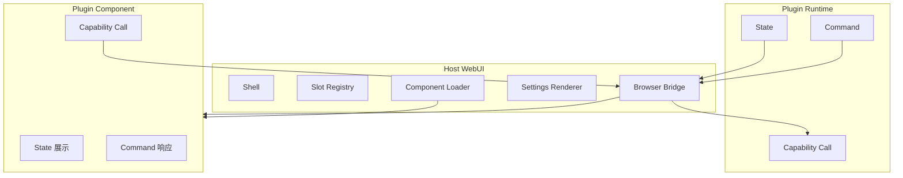

# WebUI

WebUI 是 Host 的平台展示面。Host 提供 Shell、Slot、Loader 和 Browser Bridge。插件提供自己的 Custom Element。Plugin Runtime 驱动自己拥有的 Component。

组件业务含义由插件文档定义。本文只定义 Host 与插件前端之间的平台接口。

## 1. 技术栈

```text
HTML
CSS Variables
ES Modules
Custom Elements
Shadow DOM
原生 DOM API
Go HTTP / embedded FS
自研 Web Bridge
```

v1 不引入浏览器框架、npm、打包器和 iframe。

## 2. 组成



## 3. Component Interface

每个 Component 统一实现：

```js
setData(state)
runCommand(command, payload)
connectedCallback()
disconnectedCallback()
```

可选实现 `resync()`。UI 连接重连后，Shell 调用已挂载组件的 `resync()` 重新读取状态；组件未实现时，Shell 重新挂载组件，由 `connectedCallback` 重新取数。

State 决定 Component 当前是什么。Command 决定 Component 此刻做什么。两类 payload 都由插件定义。

Component 在 `connectedCallback` 中通过 Capability Call 获取初始数据。Plugin Runtime 后续使用 `SetState` 更新。Component 不实现独立的业务 API。

WebUI 只负责交互和展示。业务执行、业务状态和持久化都位于后端 Plugin Runtime。浏览器不是应用状态属主。

## 4. Mount

静态 Mount 来自 `plugin.json.ui.components`。

```text
MountKey = plugin_name + mount_id
```

Slot 为：

```text
top
left
center
right
bottom
```

Host Shell 只决定布局位置。Host 不解释 Component 的业务内容。v1 的 `top` 由 Host 控件保留，插件使用其余四个 Slot。

`mount_id` 只定位实例，不参与业务路由。插件继续使用自己的业务 id 关联记录。

Loader 按 `entry` 去重加载。单个 entry 导入失败或标签定义超时，只跳过对应 Mount。失败会写入本地 Diagnostic，其他 Mount 继续加载。
失败的 entry 不会被缓存，下次 `load()`（即下一次 bootstrap 或 rescan）会重新尝试，不需要刷新页面。

`load()` 是对齐而不是追加：不在新 Mount 列表里的元素会被移除，Slot 不会残留已经下线的 Mount。

## 5. pluginsdk WebUI

目标 Go Interface：

```go
func (u *WebUI) SetState(mountID string, state json.RawMessage) error
func (u *WebUI) SendCommand(mountID string, command string, payload json.RawMessage) error
```

内部目标地址由 pluginsdk 生成：

```text
current_plugin_name + mountID
```

插件不能向其他插件的 mount 发送 State 或 Command。

`SetState` 对应：

```js
component.setData(state)
```

`SendCommand` 对应：

```js
component.runCommand(command, payload)
```

## 6. State 和 Command

State 应可由 Plugin Runtime 重建。Command 可以是临时行为。

```json
{
  "revision": 12,
  "view": {},
  "status": "ready"
}
```

上面的 JSON 只是平台示例。`view` 的字段和 `status` 的取值由插件定义。

Command 示例：

```json
{
  "command": "scroll",
  "payload": {
    "position": "bottom"
  }
}
```

插件文档必须列出自己的 State、Command 和 payload。

## 7. Browser Bridge

v1 使用 HTTP 和 NDJSON 流：

```text
GET  /                    Host Shell
GET  /platform/...        Host Shell 自身的 JS/CSS
GET  /plugins/...         插件 UI 资源目录
GET  /bridge/bootstrap    Plugin、Mount、Slot 和 Diagnostic
POST /bridge/call         Capability Call
POST /bridge/pick-directory  选择本地文件夹
GET  /bridge/ui           State、Command 和 Diagnostic
POST /bridge/plugins/rescan
POST /bridge/plugins/{plugin}/start
POST /bridge/plugins/{plugin}/stop
```

服务默认监听 `127.0.0.1:2333`。`LITEAGENT_HTTP_ADDR` 可以覆盖监听地址。启动后输出实际 URL，不自动打开浏览器。监听失败时启动退出。

所有 `POST` 端点都要求同源：带 `Origin` 且 host 与请求不一致时返回 403。
不带 `Origin` 的请求（curl、测试）放行。这是为了让启停插件这类无 body、无自定义 content type 的接口不会被跨站表单触发。

### Bootstrap

```json
{
  "version": 1,
  "slots": ["top", "left", "center", "right", "bottom"],
  "plugins": [
    {
      "name": "example-plugin",
      "version": "1.0.0",
      "state": "active",
      "selected_instance_id": "example-plugin",
      "instances": [
        {
          "instance_id": "example-plugin",
          "generation": 1,
          "state": "active",
          "registrations": [{"capability": "example", "method": "run"}]
        }
      ],
      "enabled": true,
      "provides": ["example"],
      "depends_on": [],
      "mounts": [{"plugin": "example-plugin", "id": "main"}]
    }
  ],
  "mounts": [],
  "diagnostics": [
    {
      "plugin": "example-plugin",
      "path": "plugin.json",
      "code": "manifest_unknown_field",
      "message": "unknown field: pages"
    }
  ]
}
```

Bootstrap 返回插件状态、静态 Mount 和当前 Diagnostic 快照，不返回业务 State。

`plugins[]` 按插件名分组。`instances[]` 列出该插件的全部 Plugin Instance。Provider `state` 使用 `inactive`、`loading`、`active`、`stopping` 或 `failed`。

`selected_instance_id` 指出默认展示的实例。插件中心可以选择其他实例。`enabled` 表示插件是否允许启动；`missing` 表示依赖目标未发现。`provides`、`depends_on` 和 `mounts` 只返回静态 Manifest 信息。快照不包含插件目录或可执行文件路径。

### Browser Request

```json
{
  "version": 1,
  "id": "ui-call-1",
  "type": "req",
  "capability": "example",
  "method": "run",
  "payload": {}
}
```

浏览器不提交 `from`。Host 内部注入可信连接身份。

### Response

```json
{
  "version": 1,
  "id": "ui-call-1",
  "type": "res",
  "capability": "example",
  "method": "run",
  "from": "example-plugin",
  "payload": {},
  "error_code": "",
  "error_msg": ""
}
```

`POST /bridge/call` 返回 NDJSON。零到多个归因 Event 后必须有一条 Response。

浏览器断开只停止写回，不取消后端 Call。Host 继续等待后端唯一终态，并丢弃无法写入的 Event 和 Response。Host 不缓存结果，也不支持按 Call ID 重放。

取消业务必须调用插件显式定义的取消方法（例如 `loop.cancel`）；刷新或关闭页面不会隐式取消。

### 目录选择

`POST /bridge/pick-directory` 打开 Host 所在机器的文件夹选择框，请求体为空。
该接口属于 Host 平台，不经过插件 Capability。
浏览器原生文件夹选择只返回句柄或相对路径，因此由 Host 返回绝对路径。
用户选中目录时返回：

```json
{"path": "/Users/example/project"}
```

用户取消时返回：

```json
{"cancelled": true}
```

Host 在 macOS、Windows 和 Linux 上调用系统选择器。
Linux 需要 `zenity` 或 `kdialog`。
平台不支持时返回 501，选择器执行失败时返回 500。
错误响应为 JSON，包含 `error.code` 和 `error.message`。
错误码为 `folder_picker_unsupported` 或 `folder_picker_failed`。
该接口与其它 `POST` 端点一样要求同源。

### Diagnostic Push

```json
{
  "version": 1,
  "id": "diag-1",
  "type": "diagnostic",
  "diagnostic": {
    "plugin": "example-plugin",
    "path": "ui/main.js",
    "code": "asset_missing",
    "message": "asset not found"
  }
}
```

Diagnostic 与 UI Push 共用 `/bridge/ui` 连接和有界队列。它不要求 Mount。

### UI State Push

```json
{
  "version": 1,
  "id": "ui-push-18",
  "type": "ui",
  "mount": {
    "plugin": "example-plugin",
    "id": "main"
  },
  "kind": "state",
  "payload": {
    "revision": 12
  }
}
```

### UI Command Push

```json
{
  "version": 1,
  "id": "ui-push-19",
  "type": "ui",
  "mount": {
    "plugin": "example-plugin",
    "id": "main"
  },
  "kind": "command",
  "command": "scroll",
  "payload": {
    "position": "bottom"
  }
}
```

### Browser SDK

`LiteAgent.call` 返回 Promise。成功时 resolve 最终 Response 的 `payload`。失败时 reject 带 `code` 的 Error。`onEvent` 接收归因 Event Frame。

`LiteAgent.pickDirectory` 返回 Promise。成功时 resolve `{path}` 或 `{cancelled:true}`。失败时 reject 带 `code` 的 Error。

`onUI` 接收 State 和 Command Push。`onDiagnostic` 接收 Diagnostic。`onStatus` 接收 `connecting`、`connected` 和 `reconnecting`。断线后 SDK 按指数退避自动重连 `/bridge/ui`。

`onResync` 在已连接过一次后重新收到 hello 时触发。Shell 据此重新读取 Bootstrap 和插件状态。

### Hello

每条 `/bridge/ui` 连接建立后，Host 先发送一条 hello Frame。

```json
{
  "version": 1,
  "id": "ui-push-1",
  "type": "hello"
}
```

第一条 hello 表示首次连接。之后的 hello 表示断线重连，SDK 触发 `onResync`。

### 多连接

Host 允许多个页面同时连接 `/bridge/ui`。每个连接有独立队列，State、Command 和 Diagnostic 广播给所有连接。新连接不会关闭旧连接，旧页面不会冻结。

## 8. 顺序与恢复

UI Push 使用每个活动连接的有界 FIFO 队列。Publisher 入队后立即返回，不等待浏览器回执。

同一 Mount 的推送保持入队顺序。两个 HTTP 流之间不保证全局顺序。State 使用插件定义的 `revision` 丢弃旧值。插件必须保证 revision 跨进程重启仍递增，否则重连后的新状态会被当成旧值丢弃。Command 需要顺序时，由插件 payload 中的序号处理。

某个连接离线或队列已满时，Host 标记并关闭该连接，其他连接不受影响。
SDK 重连后收到 hello 并触发 resync。Host 不会缓存业务 State，也不会重放 Command。
当没有任何连接接受推送时，`host.ui.state` / `host.ui.command` 返回 `ui_not_mounted`，由插件决定重试还是降级。
Diagnostic 快照单独保存在内存中，上限 256 条，超出后丢弃最旧的。

Host 向所有活动 UI 连接广播推送。连接建立和关闭互不影响。浏览器关闭和重启不影响后端 Call。

刷新或重启后不重放事件。Component 重新调用插件读取方法，Plugin Runtime 重建 State。Shell 重新读取 Bootstrap，恢复当前 Diagnostic 快照。

断线重连后，SDK 触发 resync。Shell 重新读取 Bootstrap，组件通过 `resync()` 或重新挂载重新读取状态。Host 不重放断线期间的 Push。

悬浮窗关闭只影响当前浏览器显示。Host 不删除对应诊断。

## 9. Diagnostic 悬浮窗

Host Shell 拥有 Diagnostic 悬浮窗。它与插件 Component 分离。

悬浮窗遵循以下规则：

- 使用非模态浮层；
- 不显示遮罩；
- 不抢占键盘焦点；
- 不拦截其他组件的鼠标事件；
- 可手动关闭；
- 多条诊断使用可折叠堆栈；
- 相同 `plugin + path + code` 自动合并；
- 不展示 Secret 明文。

命令行窗口始终显示完整诊断。悬浮窗只负责提醒，不承担错误恢复操作。

## 10. Settings Renderer

插件中心提供 `Settings` 页签。页面读取 Manifest 中的 `settings.schema`，并用现有 Browser Call 执行 `settings.get` 和 `settings.save`。

页面支持 `string`、`secret`、`number` 和 `boolean` 控件。`required` 只显示必填提示，不阻止提交。每个插件独立读取和保存。

Secret 输入不回显明文。已有 Secret 显示“已配置”，空输入是否覆盖由插件定义。保存失败时保留当前输入。

## 11. 插件中心

Host Shell 的顶栏提供统一的 `插件中心` 入口。中心包含三个页签：

- `插件`：扫描和启停管理；
- `设置`：Settings Renderer；
- `依赖关系`：Host 与插件拓扑图。

插件页按名称展示插件，并列出全部实例。用户可选择一个实例查看 Generation、注册项和失败信息。用户可手动重新扫描，也可启动或停止单个插件。

启动只对硬依赖做提示，不做拦截。`depends_on` 用来安排启动顺序，不用来许可：调用按 `(capability, method)` 路由，Host 不需要知道目标插件是否活着，缺依赖照样启动，缺失依赖记入诊断。停止先进入 `stopping`，并等待旧 Call 完成。依赖停止时不级联停止依赖方；后续依赖调用返回 `plugin_not_ready`。

依赖图由 Bootstrap 中的插件快照和 `depends_on` 生成。Host 节点使用虚线连接已发现插件，表示装载和路由。

硬依赖实线从依赖方指向被依赖插件。缺失节点显示为 `missing`。实例选择只改变详情展示，不改变依赖图。图下保留同方向的文本关系列表。

点击插件节点后，右侧显示 Capability、硬依赖、被依赖方和 UI Mount。节点高亮当前插件及其一跳关系。

管理接口返回最新 Bootstrap。成功后 Shell 更新插件快照并按新列表对齐 Mount：新增的 Mount 被装载，Bootstrap 中已消失的 Mount 被卸载。面板关闭只影响当前浏览器显示，不改变插件状态。

## 12. 安全约束

- 默认只监听 `127.0.0.1:2333`；
- 所有 `POST` 端点校验 `Origin` 同源，跨源请求返回 403；不带 `Origin` 的请求放行；
- UI 资源目录全部允许，不做 allowlist 或 MIME 白名单；
- 浏览器不能调用 Host 平台管理方法；
- 浏览器不能伪造 `from`；
- Host 校验 mount 属主；
- UI 发布权限由可信 `from` 和 Mount 属主校验确定；
- Secret 不回显；
- v1 插件 JS 是本机可信代码，不提供沙箱隔离。

## 13. 实现状态

当前实现包括 Manifest、启动扫描、运行时手动扫描、Mount Registry、Host Shell、五 Slot、Component Loader、Plugin 状态快照、插件中心、Settings Renderer、依赖关系图、手动启停、Bootstrap、插件 UI 资源服务、Browser Call、UI Push 和 Diagnostic Push。

当前代码缺少：

- 文件监听自动加载；
- 自动重启；
- 启停状态持久化。

## 14. 长会话性能

UI State 采用窗口快照加增量 Command。设计、实测和边界见 [WebUI 长会话性能](../design/webui-long-session-performance.md)。
