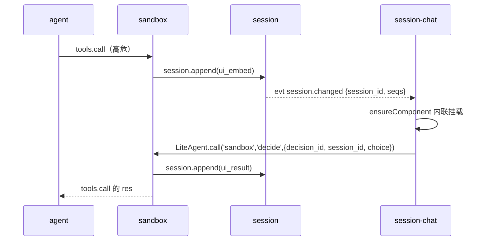

# WebUI 基础设施设计 handoff

**日期**：2026-10-13。**阶段**：设计收口，未固化进规范文档，未开始实现。
**阶段目标**：host + llm-openai + session + agent 的最小实现，含 WebUI 基础设施。

接手者先读 §1 引用文档，再读 §2 增量决策。§2 尚未写入任何文档，本文是这些决策的唯一真源。

---

## 1. 已有文档（引用，勿重复）

| 路径 | 内容 |
|------|------|
| [docs/webui.md](../webui.md) | WebUI 主设计：注册、渲染、PanelOp、协议桥。§5 已对齐代码，§6 是 Loader 契约 |
| [docs/future/ui-medium.md](../future/ui-medium.md) | Medium 概念来源，出站展示与入站交互的初稿 |
| [docs/protocol.md](../protocol.md) | Frame 契约，功能平面通信的唯一真源 |
| [plugins/session/communication.md](../../plugins/session/communication.md) 等 | 各插件功能通信规划 |
| [internal/host/constant.go](../../internal/host/constant.go) | UISlots、PanelOp、Presentation 常量 |
| [docs/manifest.md](../manifest.md) | manifest.ui 字段说明 |

---

## 2. 本次会话的增量决策（未入文档）

### 2.1 已拍板

1. **不绑框架**。组件用 Web Components。「类 Vue」只指挂载模型：声明式 mount、props 下行、事件上行。不引入 Vue 或 React 运行时。
2. **混合驱动**。会话正文走数据驱动，UI 是 session 真源的投影。瞬时交互件走指令驱动。
3. **展示以插件自有组件为主**。无 UI 插件的降级卡是通用按钮卡，实现在 session-chat，不在宿主 Shell。
4. **槽位定名** top、bottom、left、center、right。center 对齐 `host.SlotCenter`。不用 mid。

### 2.2 两层嵌入面

「容器」分两层。两层的组件契约相同：Custom Elements、`setData`、`LiteAgent.call`。

| 嵌入面 | 属主 | 机制 | 放什么 | 例 |
|--------|------|------|--------|-----|
| Shell 五槽 | 宿主 Shell | manifest.ui 静态 mount + PanelOp | 插件级面板 | session-rail、session-trace、状态条 |
| 会话流内联 | session-chat | `ui_embed` 事实，经 session 真源投影 | 与对话过程绑定的内容与交互件 | sandbox 审批卡 |

要点：

- 会话内的交互件不发 PanelOp。插件把交互件作为事实写进 session（`session.append`）。
- session-chat 渲染到该事实时，按组件标签前缀找到插件的 ui entry 并内联挂载。
- 按钮回调是普通 Call：`LiteAgent.call('sandbox', 'decide', {decision_id, session_id, choice})`。
- 插件不直接改他方 DOM。属主 UI 按 `ui_embed` 契约挂载外来组件。不存在任意展示委托。
- PanelOp 职责收缩为 shell 级面板。会话内交互件一律走 `ui_embed`。

### 2.3 ui_embed 协议

```json
{
  "type": "ui_embed",
  "component": "sandbox-approval",
  "props": { "decision_id": "…", "summary": "…", "risk": "high" },
  "reply": { "capability": "sandbox", "method": "decide" }
}
```

- fact 类型新增 `ui_embed`（请求）与 `ui_result`（终态）。session 保持纯存储，`derive()` 不投影这两类。
- `reply` 给降级卡用。组件加载失败时，session-chat 按 `reply` 渲染通用按钮卡。软失败。
- session-chat 新增 `ensureComponent(tag)`：标签前缀 → 插件 → ui entry 导入。
- **挂起-决策模式**：挂起点在功能平面，调用方阻塞等 `decision_id`。展示是旁路。终态写 `ui_result` 留痕。此模式覆盖后续的审批、确认、消歧场景。

### 2.4 sandbox 参考时序



### 2.5 多会话规则

1. 事实按 session 隔离。两个会话同时待批，卡片各在各的会话流，互不碰撞。
2. `decision_id` 全局唯一。`decide` 必带 `session_id`。sandbox 校验与挂起的 turn 一致，不符则拒绝。
3. 卡片状态以事实日志为真源。刷新、切换会话、新开客户端都从 `session.query` 重建。
4. 每条 `ui_embed` 必须有终态 `ui_result`。取值含 `timeout`、`cancelled`。turn 取消时 sandbox 补终态事实。
5. `session.changed` 事件带 `session_id`。各 session-chat 只更新自己的流。依赖 Host 广播扇出（webui.md §13 已列）。
6. 同会话多个待决按事实顺序渲染，互不合并。v0 同会话 turn 串行，通常同时只有一个。
7. 「当前会话」只是 session UI 的视图选择。sandbox 的挂起状态绑定 `session_id`，不绑定视图。

---

## 3. 待拍板（不阻塞主线）

1. fact 命名：`ui_embed` 与 `ui_result`，还是 `card` 与 `card_result`。倾向前者。
2. 终态呈现：折叠为一行结果，还是原样只禁用按钮。推迟到 session UI 实现时定，不进契约。

---

## 4. 下一步

1. 把 §2 固化进 `docs/webui.md`（新章节：两层嵌入面、ui_embed、多会话）。更新 `plugins/session/communication.md` 的 fact 类型表。
2. 代码规划：`internal/webui`（registry、validate、loader、bridge）、`webui/static` Shell、LiteAgent SDK、session-chat 的 embed loader。
3. 实现顺序建议：Host WebUI 静态托管与协议桥 → session 三槽 UI → `loop.turn` 走通 → 挂起-决策形态（sandbox，后续阶段）。

---

## 5. 工作区状态（注意）

- 分支 `main`，远程 `https://github.com/Alphazer01214/my-go-lite-agent`。
- 工作区有大量未提交 WIP：`cmd/liteagent-server` 重构、`internal/host` 新测试、三份 `plugins/*/communication.md` 未跟踪。近期提交皆为 `tmp`。
- 本 handoff 的提交只含本文档。接手者勿动上述 WIP，除非用户另有指示。
- 开发环境：Windows 11，Go 项目。

---

## 6. Suggested skills

接手者在下列时机调用 Skill 工具：

- **codebase-design** — 设计 `internal/webui` 模块接口时。
- **domain-modeling** — 更新 CONTEXT.md 术语（ui_embed、两层嵌入面）时。
- **doc-style** — 写或改 webui.md 等中文技术文档时。
- **tdd** — 开始实现最小闭环时。
- **prototype** — 验证 Loader 与 embed 行为时（可选）。
