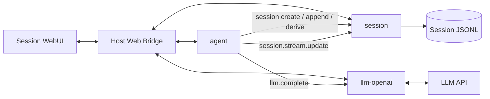
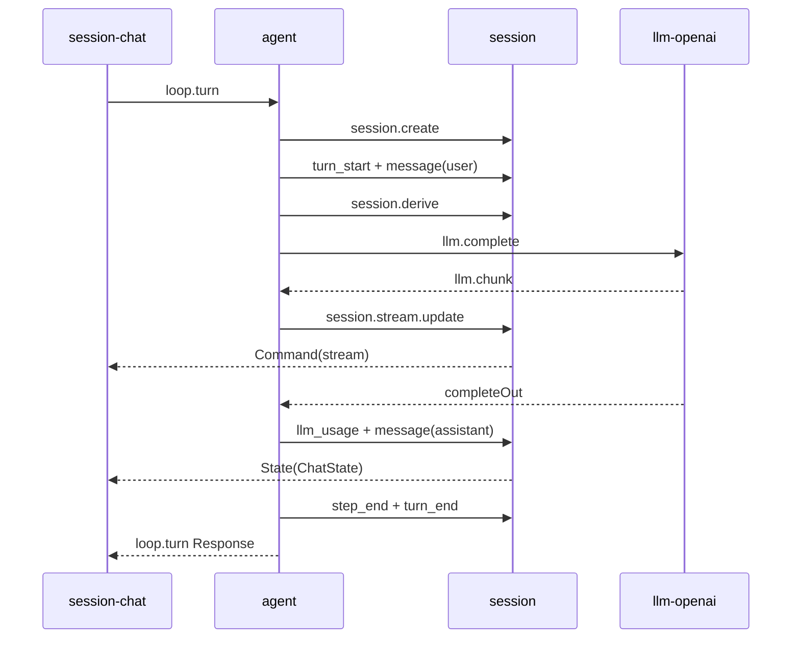

# agent、llm-openai 与 session 最小组合开发日志

日期：2026-10-15  
分支：`webui`  
范围：Turn 闭环、Session Fact、流式状态和 Session WebUI  
状态：最小组合已实现。工具插件和多 LLM 实例隔离不在本次范围。

## 1. 本次结论

`agent + llm-openai + session` 已形成可启动的最小业务闭环。

本次完成：

1. Agent 生成 `turn_id` 和 `step_id`；
2. Session Fact 写入稳定的运行元数据；
3. Agent 累积 `llm.chunk`；
4. Agent 调用 `session.stream.update`；
5. Session 发布 Stream Command 和可重建 UI State；
6. Session 提供三个 WebUI Component；
7. 配置修改不影响运行中的 Call；
8. 取消时保存已累计 assistant 正文。

插件实现只依赖 `pluginsdk`。插件代码没有导入 `internal/host`。

## 2. 运行结构



Host 只提供 Frame、路由、pending 和 WebUI 传输。Turn 编排属于 Agent。配置解释属于 LLM 插件。持久化和 UI State 属于 Session。

## 3. Turn 过程



最小组合没有工具插件时，Agent 跳过工具阶段。

## 4. Session Fact

当前序列：

```text
session_start
turn_start
message(user)
step_start
request_header
llm_usage
message(assistant)
message(tool)*
step_end
turn_end
```

`turn_id` 和 `step_id` 写入 Fact `meta`。assistant reasoning 写入最终 message 的 `meta`。LLM usage 写入 `llm_usage` Fact。

Stream Delta 不写入 JSONL。最终 assistant `message` Fact 是正文真源。

## 5. 流式状态

Agent 使用 Stream Accumulator 合并：

- content delta；
- reasoning delta；
- tool call delta。

Agent 生成 `StreamSnapshot`，并调用：

```text
session.stream.update
```

Session 按 `(turn_id, step_id)` 丢弃较旧的 `update_id`。Session 只保存当前 Draft，并向 `session-chat` 发送 `Command("stream", snapshot)`。

最终 assistant message 到达后，Session 清除 Draft。

## 6. WebUI

`session/plugin.json` 现在声明：

| Component | Slot |
|---|---|
| `session-history` | left |
| `session-chat` | center |
| `session-trace` | right |

`plugins/session/ui/main.js` 提供三个 Custom Element。

Session 新增 `session.state`，用于刷新后重建：

- History State；
- ChatState；
- Trace State。

`session-chat` 负责 `loop.turn` 和 `loop.cancel`。Agent 和 llm-openai 不直接渲染正文。

## 7. 配置快照

Agent 和 llm-openai 在 Call 开始时捕获配置快照。

配置修改规则：

```text
运行中的 Call 继续使用旧快照
新 Call 使用新配置
```

配置保存现在立即生效。旧的 deferred config 机制已删除。

多会话使用不同 LLM 实例的隔离仍由未来的 Plugin Instance 和 Execution Context 提供。

## 8. 代码修改

主要落点：

```text
plugins/agent/stream.go
plugins/agent/turn.go
plugins/agent/config.go
plugins/session/ui_state.go
plugins/session/store.go
plugins/session/main.go
plugins/session/ui/main.js
plugins/session/plugin.json
plugins/llm-openai/config.go
plugins/llm-openai/openai.go
```

## 9. 测试

新增覆盖：

- Stream Accumulator 合并 content、reasoning 和 tool delta；
- Turn 写入 `turn_id`、`step_id`、usage 和 reasoning；
- Turn 发布 streaming 与 complete 快照；
- 取消时保存累计 assistant 正文；
- Session 丢弃旧 `update_id`；
- assistant message 清除 Stream Draft；
- `session.state` 重建三个 UI State；
- 配置快照不被运行后修改影响；
- 配置修改从后续 Call 生效。

命令：

```text
go test ./...
go test -race ./plugins/agent ./plugins/session ./plugins/llm-openai ./pluginsdk
go vet ./plugins/agent ./plugins/session ./plugins/llm-openai
node --check plugins/session/ui/main.js
go build ./cmd/liteagent-server
git diff --check
```

HTTP 冒烟确认：

- 插件列表包含 `agent`、`llm-openai`、`session`；
- Mount 列表包含 `history`、`chat`、`trace`；
- Session UI 入口返回 `200`；
- 插件 UI 无注册诊断。

扫描器仍报告 `context-manager` 和 `filetools` 缺少 Manifest。这两个目录早于本次组合，不属于最小运行组合。

## 10. 非目标

本次没有实现：

- 工具插件加载和执行；
- `memory.assemble`；
- 多 LLM Plugin Instance；
- 会话级模型配置隔离；
- Host 调度队列；
- 多浏览器状态同步；
- Session 导出和回滚。

## 11. 下一步

下一步准备三插件最小启动配置和端到端冒烟：

1. 隔离只包含三个插件的启动目录；
2. 配置 LLM 环境变量；
3. 启动 liteagent-server；
4. 从 Session Chat 执行一次真实 Turn；
5. 验证 JSONL、Stream Draft 和刷新恢复；
6. 记录真实调用日志。

插件契约分别见 [agent 通信契约](../../plugins/agent/communication.md)、[llm-openai 通信契约](../../plugins/llm-openai/communication.md) 和 [session 通信契约](../../plugins/session/communication.md)。
