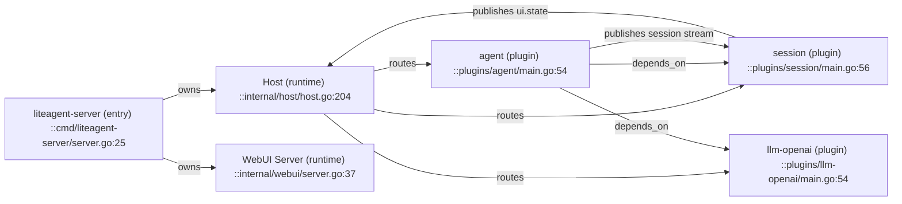
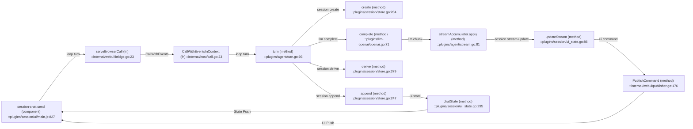
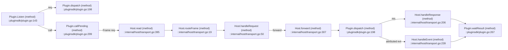
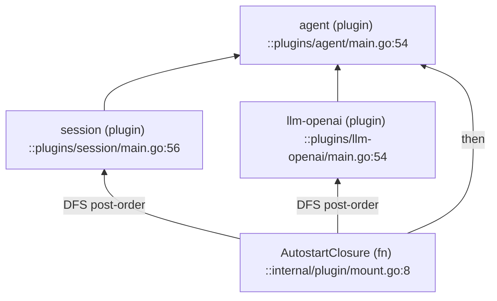

# 依赖与调用图

本文按 L0、L1 和核心 L3 展示关系。节点可在 [INDEX.md](INDEX.md) 中定位。

## 1. L0 与 L1



## 2. Turn 主链



## 3. Frame 路由



## 4. 启动关系



箭头由依赖方指向被依赖插件。启动图使用相同方向。

## 5. 取消与异常

```mermaid
flowchart LR
  CancelUI["session-chat.cancel (component) ::plugins/session/ui/main.js:848"] -->|loop.cancel| Cancel["cancel (method) ::plugins/agent/turn.go:139"]
  Cancel --> State["turnState.markCancelled (method) ::plugins/agent/turn.go:33"]
  State --> Run["runTurn (method) ::plugins/agent/turn.go:259"]
  Run -->|turn_end(cancelled)| Append["session.append ::plugins/session/store.go:247"]
  Run -->|turn_end(error)| Append
  Append --> StatePush["chatState ::plugins/session/ui_state.go:295"]
  StatePush -->|State Push| CancelUI
```

## 6. 边说明

| 边 | 含义 | 证据 |
|---|---|---|
| Host → Plugin | 装载、路由、pending | `internal/host/` |
| Agent → Session | `depends_on` 与调用 | `plugins/agent/plugin.json` |
| Agent → LLM | `depends_on` 与调用 | `plugins/agent/plugin.json` |
| LLM → Agent | `llm.chunk` 归因事件 | `plugins/llm-openai/main.go:60` |
| Session → WebUI | UI State、Command | `internal/webui/publisher.go:147` |
| WebUI → Host | Browser Call | `internal/webui/bridge.go:23` |
