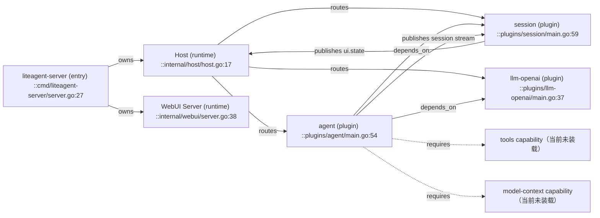
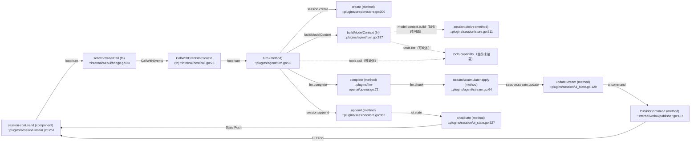
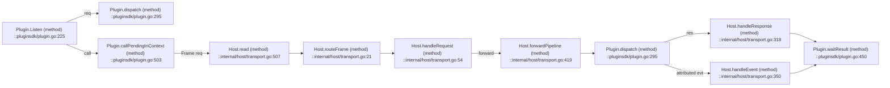

# 依赖与调用图

本文按 L0、L1 和核心 L3 展示关系。节点可在 [INDEX.md](INDEX.md) 中定位。

## 1. L0 与 L1



## 2. Turn 主链



`Build` 的两条虚线是弱依赖：两者不可用时 Turn 仍然继续，但会把原因写进 `request_header.meta.degraded`。

## 3. Frame 路由



## 4. 启动关系


箭头由依赖方指向被依赖插件。启动图使用相同方向。

入口先构造 Host、接好 UI Publisher，再调用 `Host.Start` 挂载插件
（`cmd/liteagent-server/server.go:46` → `:53` → `:55`）。顺序反了会让插件启动期的 `ui.state` 拿到 `ui_not_mounted`。

## 5. 取消与异常

```mermaid
flowchart LR
  CancelUI["session-chat.cancel (component) ::plugins/session/ui/main.js:1289"] -->|loop.cancel| Cancel["cancel (method) ::plugins/agent/turn.go:156"]
  Cancel --> State["turnState.markCancelled (method) ::plugins/agent/turn.go:33"]
  State --> Run["runTurn (method) ::plugins/agent/turn.go:351"]
  Run -->|turn_end(cancelled)| Append["session.append ::plugins/session/store.go:363"]
  Run -->|turn_end(error)| Append
  Append --> StatePush["chatState ::plugins/session/ui_state.go:627"]
  StatePush -->|State Push| CancelUI
```

## 6. 边说明

| 边 | 含义 | 证据 |
|---|---|---|
| Host → Plugin | 装载、路由、pending | `internal/host/` |
| Agent → Session | `depends_on` 与调用 | `plugins/agent/plugin.json` |
| Agent → LLM | `depends_on` 与调用 | `plugins/agent/plugin.json` |
| Agent → Model Context | 弱依赖 `model-context.build`，缺失时回退并标记 degraded | `plugins/agent/turn.go:243` |
| Agent → Tools | 弱依赖 `tools.list/call`，缺失时跳过并标记 degraded | `plugins/agent/turn.go:280` |
| LLM → Agent | `llm.chunk` 归因事件 | `plugins/llm-openai/main.go:43` |
| Session → WebUI | UI State、Command | `internal/webui/publisher.go:155` |
| WebUI → Host | Browser Call | `internal/webui/bridge.go:23` |