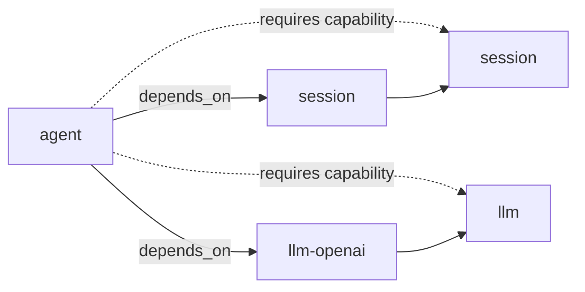
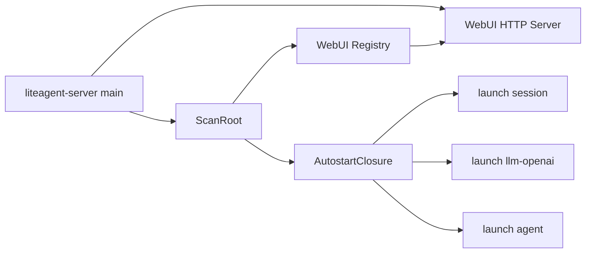
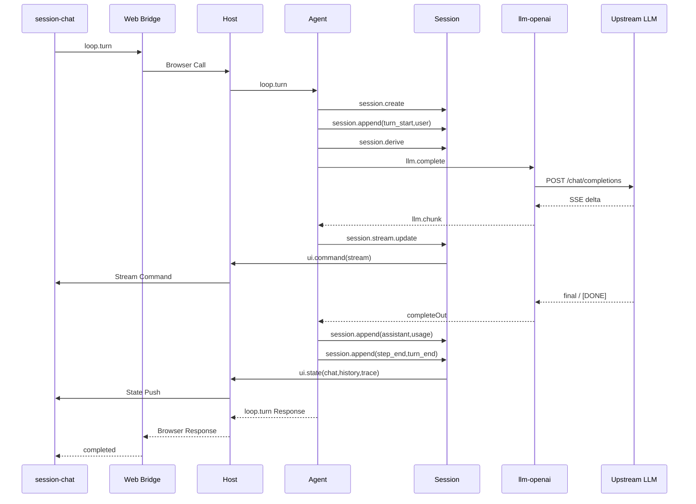
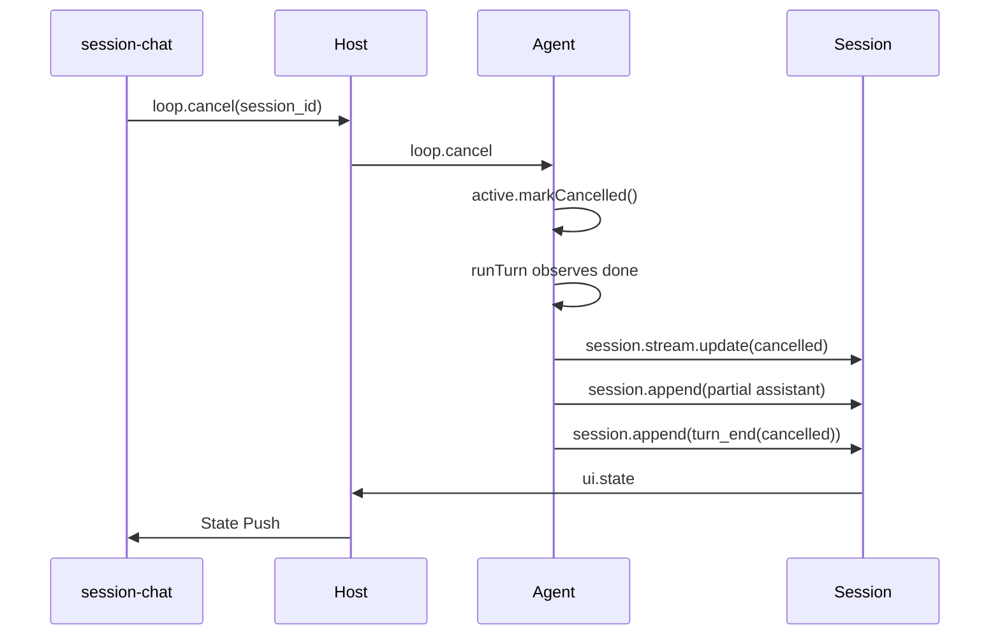

# Host 与核心插件运行图

本文解释 Host、`session`、`llm-openai` 和 `agent` 的当前实现。代码证据优先于既有文档。

范围是启动、对话、取消、异常收口和 UI Push。工具插件不是本轮核心。

## 1. 分层职责

| 单元 | 层次 | 提供能力 | 主要职责 |
|---|---|---|---|
| Host | L0 | Frame 路由 | 进程管理、pending、Context 和 UI Push |
| session | L1 | `session` | Fact Log、模型上下文和 UI State |
| llm-openai | L1 | `llm` | OpenAI-compatible Completion |
| agent | L1 | `loop`、`agent` | Turn 编排、工具和取消 |
| WebUI | L1 | HTTP Bridge | Browser Call、Mount 和实时推送 |

Host 不实现对话业务。插件之间不直连，调用都经 Host 路由。

## 2. 静态依赖

`agent` 是唯一声明硬依赖的核心插件。它依赖 `session` 和 `llm-openai`。



`depends_on` 决定启动顺序。`requires` 只声明弱依赖能力，不参与 Frame 路由。

能力路由仍以 `(capability, method)` 为键。插件名只用于身份和日志。

## 3. 启动过程

启动入口先扫描 Manifest，再组装 Host 和 WebUI，最后才挂载插件。
插件一启动就可能推送 `ui.state`，所以 UI Publisher 必须在挂载之前接好。

```text
ScanRoot
→ NewRegistry
→ TCP Listen
→ Host.New
→ SetUIPublisher(NewServer)
→ Host.Start
→ AutostartClosure
→ register provides
→ launch session
→ launch llm-openai
→ launch agent
→ HTTP Serve
```

当前自动启动顺序是：

```text
session → llm-openai → agent
```

这个顺序由 `agent.depends_on` 的 DFS 后序产生。



进程启动后，各插件向 Host 上报 Handler。Host 把 `(capability, method)` 写入路由表。

## 4. 对话运行过程

一次 `loop.turn` 的完整链路如下。

```text
Browser
→ WebUI Bridge
→ Host
→ agent
→ session
→ llm-openai
→ Upstream LLM
→ agent Stream Accumulator
→ session.stream.update
→ Host UI Push
→ Browser
```

更细的步骤是：

1. `session-chat` 发送 `loop.turn`。
2. Bridge 把 Browser Request 转成 Host Call。
3. Host 按 `loop.turn` 路由到 `agent`。
4. Agent 创建或复用 Session。
5. Agent 写入 `turn_start` 和用户消息。
6. Agent 用 `session.derive` 投影模型上下文。
7. Agent 查询可选工具。
8. Agent 调用 `llm.complete`。
9. `llm-openai` 请求上游模型。
10. 模型增量以 `llm.chunk` 返回。
11. Agent 累计正文、reasoning 和 tool calls。
12. Agent 发送 `session.stream.update`。
13. Session 推送 Stream Command 到 Chat Mount。
14. 最终结果写入 Session Fact。
15. Session 推送 Chat、History 和 Trace State。
16. Agent 写入 `turn_end`。
17. Bridge 把 `loop.turn` Response 返回浏览器。



## 5. 取消过程

取消只作用于一个 Session 的活动 Turn。

```text
session-chat
→ loop.cancel
→ agent.turnState.done
→ runTurn 取消分支
→ 保存已累计 assistant
→ turn_end(cancelled)
→ Session State Push
→ 输入框恢复
```

`llm-openai` 的上游传输不接收本轮取消信号。当前实现先结束 Agent Turn，再保存流式草稿。



## 6. 异常收口

Turn 写入 `turn_start` 后发生错误时，Agent 写入 `turn_end(error)`。

这保证 Session 不会停留在 `running`。原始错误仍返回 Browser Call。

## 7. UI State 路径

Session 同时维护 Fact Log 和临时 Stream Snapshot。

| 事件 | Stream | State |
|---|---|---|
| 模型增量 | 更新 Command | 不落盘 |
| assistant 落盘 | 清除 Stream | Chat、Trace |
| create、select | 无 | History、Chat、Trace |
| turn_end | 清除 Stream | Chat、Trace |

浏览器不决定当前 Session。选中 Session 由 Session Runtime 维护。

## 8. 阅读入口

建议按以下顺序读代码：

1. `cmd/liteagent-server/server.go`；
2. `internal/host/transport.go`；
3. `plugins/agent/turn.go`；
4. `plugins/session/ui_state.go`；
5. `plugins/llm-openai/openai.go`。

符号定位见 [INDEX.md](INDEX.md)。调用图见 [DEPENDENCY.md](DEPENDENCY.md)。
