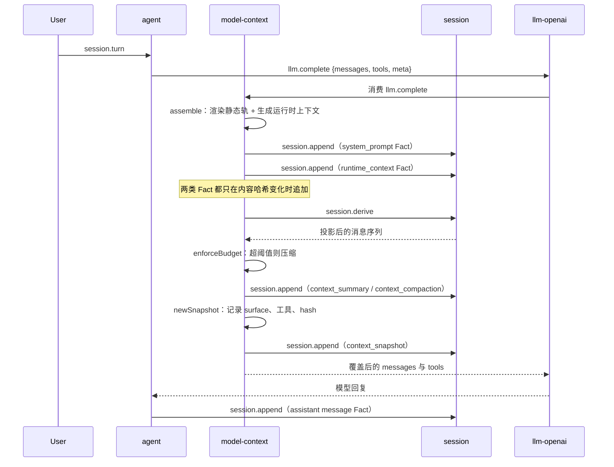

# session 与 model-context 如何应用这些 prompt

> 状态：目标契约
> 说明：本文回答"这些 prompt 文本从文件到模型，中间经过谁"。资产内容见 [12-assets.md](12-assets.md)，阶段划分见 [09-plan.md](09-plan.md)。
> 2026-10-30 更新：当前实现由 `prompter` 承担本文中 model-context 的组装职责，本文的 model-context 段落按目标契约阅读。

## 1. 职责切分

一句话：**session 是账本，model-context 是会计。**

| 插件 | 对 prompt 的职责 | 不负责 |
|---|---|---|
| `session` | 存。接收 model-context 写来的 Fact，按 seq 追加到 JSONL 日志 | 不渲染任何 prompt 文本，不理解节、轨道、变量 |
| `model-context` | 渲染与投影。读配置、渲染静态轨、组装运行时上下文、写 Fact、投影出模型输入、做预算与压缩、写快照 | 不持有会话历史的事实，历史只在 session 里 |
| `tools` | 供料。提供工具定义、描述、schema | 不决定工具出现在 prompt 的哪一节 |
| `agent` | 触发。发起 turn、消费 `llm.complete`、执行工具调用 | 不拼 prompt |
| `llm-openai` | 发送。把 `messages` 与 `tools` 发给上游 | 不改内容 |

这个切分是本项目已经跑通的形态，来源是 deepseek-harness-x 的 "Model-visible means logged"，见 [11-vendor-picks.md](11-vendor-picks.md) 第 2.4 节。

关键约束：**session 不理解 prompt 语义。** session 只按 `meta.kind` 区分两种消息，`system_prompt` 与 `runtime_context`（`plugins/session/types.go:78-79`）。它认得这两个标签，但不知道里面是什么节、什么变量。session 的投影规则见 `plugins/session/derive.go:9-20`。

## 2. 完整时序

一次 turn 内的实际顺序：



三处值得说明。

**写 Fact 排在读投影之前。** `prepare()` 先写再重新 `derive`（`plugins/model-context/builder.go:316-325`）。写完必须重新投影，否则这次请求用的还是旧的 system prompt。

**内容哈希变化才追加。** `writeContextFacts()` 比对当前 Fact 的哈希与本次渲染的哈希，相同就不写（`plugins/model-context/builder.go:260-288`）。这条让 Session 日志不会随轮次膨胀，同时保证"模型可见即已记录"。

**快照写在最后。** `context_snapshot` 记录的是**实际送出去的那份**消息的 surface、工具哈希与消息哈希。它是事后记录，不是计划。

## 3. 投影顺序

`session.derive` 把 Fact 投影成模型输入。顺序固定（`plugins/session/derive.go:114-153`）：

| 位置 | 内容 | 角色 |
|---|---|---|
| 1 | system prompt（最新的 `model-context` 写入的） | system |
| 2 | 活跃摘要（`context_summary`，`Active` 为真） | system |
| 3 | 运行时上下文快照 | user |
| 4 | 普通消息（未被摘要遮蔽的） | 按原角色 |
| 5 | 工具结果替换 | — |

两个细节：

**摘要插在 system prompt 之后、运行时上下文之前。** 模型先看到"这是接续的会话"，再看到当前环境事实。顺序反了会让环境事实看起来像在总结之前就有的旧信息。

**旧工具结果被确定性替换。** 保留最后 `fullTool` 个（默认 8）完整结果，更早的替换成 `[tool result omitted; N bytes; see seq=X]`。原文在 session 日志里还在，只是不进模型输入。

这直接影响 prompt 资产的写法：**工具结果会消失，所以纪律不能依赖工具结果本身。** `tool_discipline` 节里的条目必须自足，不能写"参照上一次 file_read 的结果"。

## 4. 资产落点映射

[12-assets.md](12-assets.md) 里的每一项资产，落到哪一环：

| 资产 | 载体 | 落点 | 生效路径 |
|---|---|---|---|
| 静态轨八节 | `prompt_sections` 配置 | `model-context` 的 `assemble()` → system prompt Fact | 路径一（只改配置） |
| 工具描述与参数默认值 | 工具 `Definition.Description` 与 `InputSchema` | `tools` 字段，随请求发给模型 | 路径二（改插件源码） |
| 工具纪律条目 | 静态轨 `tool_discipline` 节 | 同静态轨 | 路径一手写，路径三自动生成 |
| 运行时上下文 | 代码生成 | runtime context Fact（user 角色） | 已生效 |
| 压缩 prompt | 辅助调用的最后一条 user 消息 | 压缩路径 | 路径三 |
| 恢复消息 | 压缩后插入的 user 消息 | 压缩路径 | 路径三 |
| 子代理画像 | 子代理的 prompt 组装 | 子代理插件 | 待插件落地 |
| 委派元指令 | 委派工具的 `description` | 委派工具 | 待插件落地 |
| 注入信封 | 渲染层包裹 | 运行时上下文 Fact、用户输入 | 路径三 |
| 标签转义 | 渲染层 | 运行时上下文、用户输入 | 路径三 |

**`{{workspace}}`、`{{mode}}`、`{{scheme}}` 三个变量的落点。** 它们目前只在 `assemble()` 注入（`plugins/model-context/builder.go:168-173`），静态轨的任意节都能用。

但**不应该**在静态轨用。静态轨用工作区变量，等于让前缀随工作区变化，缓存永远不命中。运行时上下文已经提供工作区路径。

三个变量的正确用法：

| 变量 | 正确落点 | 错误落点 |
|---|---|---|
| `{{workspace}}` | 运行时上下文的 `Environment` 段 | 静态轨任何节 |
| `{{mode}}` | 运行时上下文的 `Mode` 段 | 同上 |
| `{{scheme}}` | 运行时上下文的 `Scheme` 段 | 同上 |

路径一之后，静态轨的三个变量一个都不该用。全部内容要么静态，要么运行时上下文。

## 5. 路径一：只改配置

**做什么。** 写 `plugins/model-context/config.json`，内容取 [12-assets.md](12-assets.md) 第 3 节。

**为什么先做这条。** 它是唯一一条不需要改 Go 代码就能生效的路径，而且收益最直接。模型当前拿到的 system prompt 只有三行：

```text
You are an AI agent powered by LiteAgent.
You are a coding agent. Your working directory is {{workspace}}.
Use tools when they are needed. Never invent file contents. Keep file and command operations inside the workspace. Report concrete results, errors and remaining risks.
```

来源：`plugins/model-context/config.go:10-16` 的 `defaultPromptSections()`。

这三行覆盖了"别编文件内容""别越界"两条，其余全靠模型默认。改配置之后，模型第一次拿到完整的运行时语义、任务观、工具纪律和输出格式。

**验收。**

| 项 | 怎么查 |
|---|---|
| 配置被读到 | `model-context.inspect` 的 breakdown 里 `system_prompt_tokens` 从约 50 涨到 1500 左右 |
| 静态轨稳定 | 连续 10 轮 `system_prompt_hash` 不变 |
| 边界有效 | 换工作区后 `system_prompt_hash` 不变，`runtime_context_hash` 变 |
| 变量守卫生效 | 配置里写 `{{workspace}}` 时请求失败，错误码 `bad_arguments` |

**注意。** 配置文件读的是插件目录下的 `config.json`。插件进程的工作目录由 `internal/host/proc.go:15` 设为插件自身目录，不是 Host 的 CWD。

## 6. 路径二：改工具描述

**做什么。** 替换 `plugins/file-tools/main.go` 与 `plugins/shell-tools/main.go` 里每个 `Definition` 的 `Description` 与 `InputSchema` 参数描述，内容取 [12-assets.md](12-assets.md) 第 4 节。

**为什么重要。** 工具描述是模型选择工具的唯一依据。当前描述有一处会直接导致失败：

```text
"Execute one executable process and return exit code, stdout, stderr, duration and truncation metadata. " +
"No shell parsing is performed: pipes, redirection, && and shell built-ins are not interpreted. " + ...
```

出处：`plugins/shell-tools/main.go:83-90`。

"not interpreted" 是一句否定式说明。模型对否定式说明的遵循度低于"用这个，不要用那个"。它知道管道不工作，但仍会写 `grep x file | head -5`，因为那是它的默认习惯。

改写后是正面表述加替代动作：

```text
Pass the program's own flags; do not append `| grep`, `> file` or `&&`.
```

**还有一处是描述与实现不一致。** `file_read` 的 `max_bytes` schema 上限是 1048576，实际默认值是 65536（`plugins/file-tools/read.go:73`），描述里没写默认值。模型不传这个参数时会按 1MB 预期，实际拿到 64KB，然后看到 `truncated: true` 却不知道为什么。

其余七处默认值缺失见 [12-assets.md](12-assets.md) 第 4 节的表。

**验收。**

| 项 | 怎么查 |
|---|---|
| 默认值可见 | 每个带上限的参数，描述里都有默认值 |
| 矛盾消失 | 全文检索 `max_bytes`，schema 上限与描述默认值不打架 |
| 工具纪律不重复 | 描述里没有的内容，纪律节里也不重复 |

## 7. 路径三：改代码

三条独立的改动，可以分开做。

### 7.1 轨道字段

**做什么。** `promptSection` 加 `track` 字段，缺省时按 `order < 0` 推断。渲染时静态轨进 system prompt Fact，动态轨进 runtime context Fact。

**为什么。** 现在静态轨和动态轨是隐含约定——靠"作者知道哪些变量是动态的"。加显式字段之后，静态轨出现动态变量能直接失败，错误码 `prompt_variable_not_allowed`。

**依赖。** 无。这是路径三的第一块。

**落点。** `plugins/model-context/types.go:36-40`（结构）、`plugins/model-context/prompt.go:56-95`（渲染）、`plugins/model-context/builder.go:167-236`（组装）。

### 7.2 工具纪律自动生成

**做什么。** 工具定义加 `guidelines`（字符串数组）与 `prompt_snippet`（字符串）两个字段。`tool_discipline` 节改为按在册工具动态渲染。

**为什么。** 现在的纪律节是手写固定文本。卸载一个工具后，它的条目还在 prompt 里，模型会尝试调用不存在的工具。这是"prompt 描述不存在的工具"——九家基准工程全线防御的反模式。

**依赖。** 7.1 不依赖它，但它依赖工具注册表能拿到 `guidelines`。注册表在 `plugins/tools/registry.go:35`，工具定义在 `plugins/file-tools/main.go` 与 `plugins/shell-tools/main.go`。

**落点。** `plugins/tools/registry.go:35` 的 `persistedTool`、`plugins/model-context/builder.go` 的 `assemble()`。

### 7.3 注入信封与转义

**做什么。** 运行时上下文加 `<runtime_context>` 包裹，用户输入加 `<user_query>` 包裹，用户可控文本中的保留标签正则转义。

**为什么。** 运行时上下文现在是一条裸 `user` 消息。模型无法区分"框架给的事实"和"用户说的话"。用户输入同样没有边界。

转义是必需的：没有转义，`AGENTS.md` 里的 `</runtime_context>` 就能提前闭合信封，后面内容就变成框架事实。

**依赖。** 无。但 7.1 之后信封更好放——动态轨和静态轨分开，信封只包动态轨。

**落点。** `plugins/model-context/builder.go:224`（运行时上下文渲染）、`plugins/model-context/prompt.go:31-54`（插值，顺带做转义）。

## 8. 当前实现的三个具体问题

按修复价值排序。

### 8.1 Mode 与 Scheme 渲染出两个相同的段

`plugins/agent/turn.go:565` 传的是 `Mode: scheme, Scheme: scheme`。`assemble()` 分别渲染成 `## Mode` 和 `## Scheme` 两段，内容完全一样（`plugins/model-context/builder.go:202-211`）。

模型看到两个内容相同的标题，会浪费注意力判断它们的区别。

改法二选一：只保留 `## Mode`（`scheme` 的语义就是"工具方案"），或者让两者承载不同信息（`mode` 是交互模式，`scheme` 是工具集方案）。

### 8.2 工具纪律无处安放

工具定义只有 `description` 与 `input_schema` 两个模型侧字段（`plugins/tools/registry.go:35` 的 `persistedTool`）。跨调用纪律只能塞进 `description`，导致描述变成大杂烩，或者纪律无处可放只能手写进静态轨。

这是路径三 7.2 的直接原因。

### 8.3 截断不可解释

`file_read` 的结果有 `truncated` 布尔，`meta` 里有 `size`、`line_count`、`line_start`、`line_end`，但没有"被砍掉多少"。`shell_execute` 有 `stdout_bytes` 与 `stdout_truncated`，超出部分不落盘、拿不回来。

模型看到 `truncated: true` 只能猜。它要么重读同一区间（浪费一轮），要么以为文件就这么长（判断错）。

改法：工具结果加 `original_bytes`、`truncated_bytes`、`artifact_path` 三个字段。`file_read` 容易，它已经有 `meta.size` 和 `meta.line_count`。`shell_execute` 难——超出部分要落盘才能给路径，这是新增行为。

## 9. 观测

每一项 prompt 改动都要能被验证。项目已有三个观察入口：

| 入口 | 看什么 |
|---|---|
| `model-context.build` | 干跑下一次请求，返回渲染后的 messages、工具表、token 估算。不写 Fact，不调模型。 |
| `model-context.inspect` | 按快照或 session 还原消息，返回 breakdown：system prompt、运行时上下文、摘要、session、工具各占多少 token。 |
| `model-context.compact` | 手工触发压缩，看压缩前后 token 对比。 |

`context_snapshot` Fact 里还有 `system_prompt_hash`、`runtime_context_hash`（运行时上下文的）、`messages_hash`、`tools_hash`。静态轨改动后，第一个 hash 变、后三个不变，就是预期行为。

debug 视图和模型实际收到的内容必须走同一条渲染函数。禁止调试路径另写一套简化版——这是 pi 的做法，见 [07-assembly-cache.md](07-assembly-cache.md) 第 6 节。

## 10. 验收

| 项 | 检查方式 | 责任路径 |
|---|---|---|
| 静态轨字节稳定 | 连续 10 轮 `system_prompt_hash` 不变 | 路径一 |
| 边界有效 | 换工作区时静态轨哈希不变，运行时上下文哈希变 | 路径一 + 7.1 |
| 无动态事实泄漏 | 静态轨全文不出现工作区绝对路径、日期、模式名 | 路径一 |
| 大写词限量 | 静态轨只出现 `NOT`、`ONLY`、`EXACT` | 路径一 |
| 工具默认值可见 | 每个带上限的参数，描述里有默认值 | 路径二 |
| 工具不在场即消失 | 卸载一个工具后，纪律节不含该工具条目 | 路径三 7.2 |
| 静态轨拒绝动态变量 | 静态轨出现 `{{workspace}}` 时渲染失败 | 路径三 7.1 |
| 注入有信封 | 运行时上下文与用户输入都有标签包裹 | 路径三 7.3 |
| 标签不可伪造 | 用户输入含 `</runtime_context>` 时落盘为 `&lt;/runtime_context&gt;` | 路径三 7.3 |
| 截断可解释 | 产生截断的结果带 `original_bytes` 与 `truncated_bytes` | 路径三 |
| 调试同源 | 调试装配结果与模型收到的请求逐字节相同 | 已有 |
| 可重建 | 按快照还原出的消息哈希与记录一致 | 已有 |

## 11. 下一步

| 顺序 | 动作 | 产出 |
|---|---|---|
| 1 | 写 `plugins/model-context/config.json` | 静态轨八节生效，模型行为立刻改善 |
| 2 | 改两个工具插件的 `Description` 与参数描述 | 工具选择与参数填写准确率提升 |
| 3 | 加 `track` 字段 | 缓存边界显式化，静态轨与动态轨可分别演进 |
| 4 | 加 `guidelines` 字段 | 纪律随工具在场性出现，卸载工具不留残条 |
| 5 | 加注入信封与转义 | 模型能区分框架事实与用户内容，外部内容不能伪造边界 |
| 6 | 修 Mode/Scheme 重复 | 运行时上下文少一个重复段 |
| 7 | 压缩路径接模型摘要 | 摘要保留意图，不再只是正文首段 |

前三步不需要新的设计决策，照着 [12-assets.md](12-assets.md) 的文本改即可。
