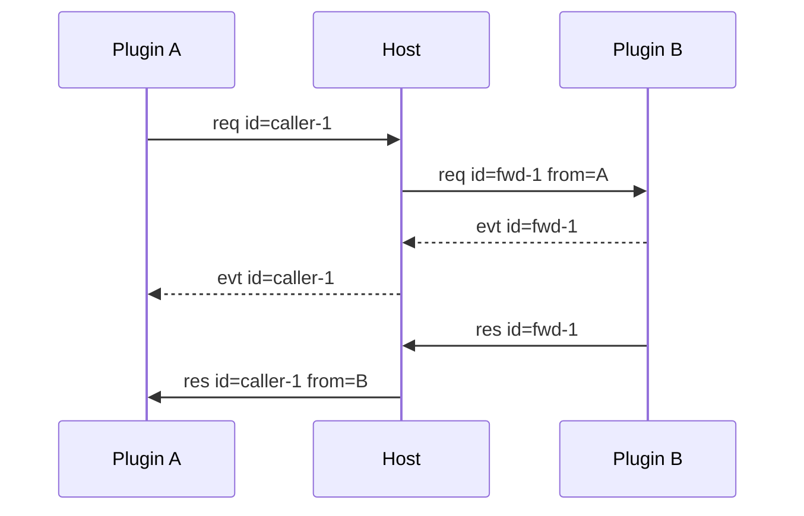

# Host 与 Plugin 通信协议

本文定义 Host 与进程外 Plugin 的线契约。浏览器协议见 [webui.md](webui.md)。两类协议独立版本化。

## 1. 传输

Plugin 通过 stdio 与 Host 通信。每条 Frame 的线格式如下：

```text
4-byte big-endian length
UTF-8 JSON body
```

JSON body 最大 16 MiB。Frame 版本当前为 2。

## 2. Frame

```go
type Frame struct {
    Version    int             `json:"version"`
    ID         string          `json:"id"`
    Type       string          `json:"type"`
    From       string          `json:"from,omitempty"`
    ContextID  string          `json:"context_id,omitempty"`
    Capability string          `json:"capability,omitempty"`
    Method     string          `json:"method,omitempty"`
    Payload    json.RawMessage `json:"payload,omitempty"`
    Priority   int             `json:"priority,omitempty"`
    ErrorCode  string          `json:"error_code"`
    ErrorMsg   string          `json:"error_msg"`
}
```

| 字段 | 要求 |
|---|---|
| `version` | 当前填 2 |
| `id` | Request/Response 闭环标识 |
| `type` | `req`、`res`、`evt` 或 `cancel` |
| `from` | Host 注入真实来源 |
| `context_id` | 可选执行上下文标识 |
| `capability` | Request 主题 |
| `method` | Request 主题 |
| `payload` | 业务 JSON |
| `reason` | `cancel` 的取消原因 |
| `priority` | Host 管理的流水线位置 |
| `error_code` | 成功时为空字符串 |
| `error_msg` | 成功时为空字符串 |

插件出站 Frame 不填 `from`。Host 在投递时注入插件名。

`context_id` 是可选的运行期扩展。插件只在已加入某个执行上下文时填写该字段。Host 校验参与者身份，并在 Response 和归因 Event 中保留该字段。上下文不影响无 `context_id` 的既有调用。

## 3. 消息类型

### 3.1 Request

Request 要求对端执行一次 `capability.method`。每条 Request 必须得到一条 Response。

```json
{
  "version": 2,
  "id": "caller-1",
  "type": "req",
  "capability": "example",
  "method": "run",
  "priority": 2147483647,
  "payload": {}
}
```

自调用合法。Host 仍按统一路由流程环回。

### 3.2 Response

Response 与 Request 使用同一 id。成功结果放在 `payload`。

```json
{
  "version": 2,
  "id": "caller-1",
  "type": "res",
  "from": "provider-plugin",
  "capability": "example",
  "method": "run",
  "payload": {},
  "error_code": "",
  "error_msg": ""
}
```

失败时 `error_code` 非空。`payload` 不作为结果。

### 3.3 Event

Event 不建立新的调用闭环。

| 类型 | id | 语义 | 当前 Host 行为 |
|---|---|---|---|
| 归因 Event | 非空 | 属于一次在途 Call | 还原调用方 id 后投递 |
| 广播 Event | 空 | 无指定接收方 | 记录日志后丢弃 |

归因 Event 示例：

```json
{
  "version": 2,
  "id": "caller-1",
  "type": "evt",
  "from": "provider-plugin",
  "capability": "example",
  "method": "chunk",
  "payload": {
    "channel": "content",
    "delta": "你"
  }
}
```

### 3.4 Cancel

`cancel` 取消一次在途 Request。它不产生独立 Response。原 Request 最终仍产生唯一 Response。

```json
{
  "version": 2,
  "id": "caller-1",
  "type": "cancel",
  "from": "caller-plugin",
  "context_id": "ctx-1",
  "capability": "example",
  "method": "run",
  "reason": "cancelled"
}
```

Host 将 Call id 翻译为目标侧 id 后转交 Provider。目标 SDK 取消 Handler Context。超过取消宽限期时，Host 合成终态 Response。

`reason` 只能是 `cancelled` 或 `deadline_exceeded`。

## 4. 路由

路由键是：

```text
capability.method
```

Host 不提供目标插件字段。插件名只用于 `from`、日志、id 前缀和依赖图。

路由分为两层：

```text
capability.method → Plugin
execution context → Plugin Instance
```

无执行上下文时，调用进入默认 Plugin Instance。存在上下文绑定时，调用进入绑定实例和固定 Generation。Plugin Instance 是进程激活身份，不改变 `from` 的插件身份语义。



Host 为跨插件 Request 分配内部 `fwd-N` id。Response 返回调用方时恢复原始 id。

## 5. Host 方法

当前实现支持：

| 方法 | 输入 | 输出 |
|---|---|---|
| `host.register` | `handlers[]` | `accepted[]`、`rejected[]` |
| `host.plugins` | 无 | `plugins[]` 状态快照 |
| `host.ui.state` | `mount_id`、`state` | `{}` |
| `host.ui.command` | `mount_id`、`command`、`payload` | `{}` |
| `host.context.create` | `parent_id`、`bindings` | `context` |
| `host.context.bind` | `context_id`、`capability`、`instance_id` | `{bound:true}` |
| `host.context.close` | `context_id` | `{closed:true}` |
| `host.instance.create` | `plugin_name`、可选 `instance_id`、`config_revision` | `instance` |
| `host.instance.close` | `instance_id` | `{closed:true}` |
| `host.instance.restart` | `instance_id` | `instance` |

`host.register` 是路由表的唯一写入口。同一插件重复注册同键时采用最后一次。跨插件冲突会进入 `rejected`。

`host.plugins` 按插件名返回分组快照。每项包含 `name`、可选 `version`、`state`、`selected_instance_id`、`instances`、`enabled`、可选 `provides` 和可选 `depends_on`。

Provider `state` 只使用 `inactive`、`loading`、`active`、`stopping` 或 `failed`。`instances[]` 保存每个 Plugin Instance 的标识、Generation、Config Revision、注册项和失败信息。缺失的 `depends_on` 目标使用 `missing: true`。快照不返回本地路径。

执行上下文是 Host 的通用调度范围。Host 不解释会话、子代理等插件业务术语。`parent_id` 对 Host 是不透明标识。

`host.context.close` 会关闭指定上下文及其全部子上下文。Host 终止相关 pending，并删除已关闭上下文。

`bindings` 把 Capability 绑定到 Plugin Instance。请求仍使用 `capability → instance_id`。Host 建立绑定时自动记录当前 Generation。子上下文继承父上下文的绑定和 Generation。

响应中的 `bindings` 使用：

```json
{
  "llm": {
    "capability": "llm",
    "instance_id": "llm-a",
    "generation": 2
  }
}
```

Provider 重启后，旧 Generation 的绑定返回 `context_binding_invalid`。重新执行 `host.context.bind` 会固定到新 Generation。配置代属于 Plugin Instance。实例绑定形成配置隔离，Context 不再保存全局配置代。

Host 方法常量只保留当前 `dispatchHost` 实际分派的方法。未实现能力不进入公共契约。

## 6. Pending 闭环

Plugin 发起 Call 时登记：

```text
pending[call_id] = response channel
```

Host 转发时登记：

```text
pending[fwd_id] = caller/original_id/target/context_id
```

Response 到达后，Host 恢复调用方 id 并删除 pending。Cancel 保留 pending，等待原 Request 的唯一终态。超过取消宽限期时，Host 合成终态。插件进程退出时，Host 合成 `plugin_down`。

## 7. 错误码

| 错误码 | 来源 | 含义 |
|---|---|---|
| `host_closed` | Host | Host 已关闭 |
| `route_failed` | Host | 路由失败 |
| `method_not_found` | Host/SDK | 方法不存在 |
| `plugin_not_mounted` | Host | 插件未挂载 |
| `plugin_down` | Host | 插件进程已退出 |
| `plugin_disabled` | Host | 插件已禁用 |
| `plugin_not_ready` | Host | Provider 尚未接收新 Call |
| `timeout` | 预留 | 调用超时 |
| `call_cancelled` | SDK/Host | Go Context 已取消 |
| `call_deadline_exceeded` | SDK/Host | Go Context 超过期限 |
| `handler_error` | SDK | handler 未指定错误码 |
| `server_closed` | SDK/Host | 连接或服务关闭 |
| `bad_payload` | Host/插件 | JSON 契约错误 |
| `bad_arguments` | 插件 | 参数不合法 |
| `frame_too_large` | 传输 | Frame 超过上限 |
| `capability_conflict` | Host | 能力属主冲突 |
| `ui_not_mounted` | Host/WebUI | Mount 不存在 |
| `ui_owner_mismatch` | Host/WebUI | Mount 属主不匹配 |
| `instance_not_found` | Host | Plugin Instance 不存在 |
| `instance_exists` | Host | Plugin Instance 标识已存在 |
| `instance_closed` | Host | Plugin Instance 已关闭 |
| `context_not_found` | Host | 执行上下文不存在 |
| `context_closed` | Host | 执行上下文已关闭 |
| `context_owner_mismatch` | Host | 执行上下文属主不匹配 |
| `context_participant_mismatch` | Host | 调用方不是上下文参与者 |
| `context_binding_invalid` | Host | Capability 实例绑定不合法 |

插件使用 `pluginsdk.ErrCode` 产生稳定错误码。普通 `error` 最终映射为 `handler_error`。

## 8. 版本

线协议版本由 `Frame.version` 表达。Manifest 版本由 `plugin.json.protocol` 表达。两者独立演进。

破坏 Frame 字段或路由语义时升级 Frame 版本。破坏 Manifest 契约时升级 Manifest 版本。

## 9. 实现对应

| 内容 | 文件 |
|---|---|
| Frame 和编解码 | `protocol/frame.go` |
| 稳定错误码 | `protocol/errors.go` |
| Host 路由 | `internal/host/transport.go` |
| pending 和进程状态 | `internal/host/host.go` |
| Plugin Instance 和执行上下文 | `internal/host/runtime.go` |
| SDK Call/Event | `pluginsdk/plugin.go` |
