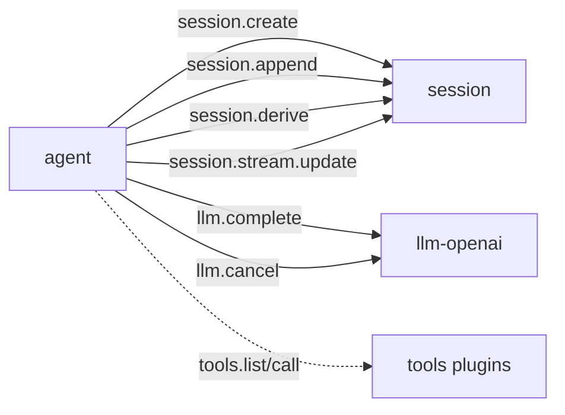

# agent 通信契约

本文是该插件跨插件 JSON 的规范来源。调用方按本文维护自己的适配类型。

本文记录 `agent` 的方法、payload、跨插件调用和 WebUI 交互。JSON 字段是公共契约。Go 私有类型名不是公共契约。

## 1. 对外方法

| 方法 | 用途 | 状态 |
|---|---|---|
| `loop.turn` | 执行一次 Turn | 当前实现 |
| `loop.cancel` | 取消 Session 的活动 Turn | 当前实现 |
| `agent.config.get` | 读取配置 | 当前实现 |
| `agent.config.set` | 更新配置 | 当前实现 |
| `agent.settings.get` | Settings Renderer 读取 | 当前实现 |
| `agent.settings.save` | Settings Renderer 保存 | 当前实现 |

## 2. loop.turn

### 输入

```json
{
  "input": "分析这个项目",
  "session_id": "s-123",
  "workspace": "E:/project",
  "max_steps": 32,
  "allowed_tools": ["read_file"]
}
```

| 字段 | 必填 | 说明 |
|---|---|---|
| `input` | 是 | 用户输入 |
| `session_id` | 否 | 为空时创建 Session |
| `workspace` | 否 | 工具工作目录 |
| `max_steps` | 否 | 覆盖配置值 |
| `allowed_tools` | 否 | 非空时只保留交集工具 |

### Response

```json
{
  "session_id": "s-123",
  "reply": "最终正文",
  "steps": 2,
  "cancelled": false,
  "usage": {
    "prompt_tokens": 100,
    "completion_tokens": 20,
    "total_tokens": 120
  },
  "seqs": [1, 2, 3]
}
```

`seqs` 是本 Turn 写入的 Session seq 列表。取消时保存已累计 assistant 正文，并写入 `turn_end(cancelled)`。

`loop.turn` 写入 `turn_start` 后发生错误时，当前实现会写入 `turn_end(error)`。`meta.error` 保存原始错误。Browser Call 仍返回原始错误。

## 3. loop.cancel

输入：

```json
{
  "session_id": "s-123"
}
```

输出：

```json
{
  "session_id": "s-123",
  "cancelled": true
}
```

每个 Session 同时最多一个活动 Turn。`loop.cancel` 只取消该 Session 的活动 Turn。

## 4. Agent 配置

`agent.config.get` 输出：

```json
{
  "default_scheme": "tool_calling",
  "max_steps": 128
}
```

`agent.config.set` 输入字段均可省略：

```json
{
  "default_scheme": "tool_calling",
  "max_steps": 64
}
```

当前实现中，空字符串和非正数不覆盖原值。每次 Turn 在开始时捕获配置快照。配置修改不影响运行中的 Turn，并从下一次 Turn 开始生效。

## 5. 下游调用



最小组合直接使用 `session.derive`。工具插件缺失时跳过工具阶段。

## 6. Session Fact 序列

当前实现写出：

```text
turn_start
message(user)
step_start
request_header
llm_usage
message(assistant)
message(tool)*
step_end
turn_end
```

`turn_id`、`step_id` 和 `plugin` 写入对应 Fact 的 `meta`。

当前实现补充：

- `turn_id`、`step_id` 放入 Fact `meta`；
- `llm_usage` 写入 Session；
- assistant reasoning 写入最终 message 的 `meta`；
- 不写 `stream_chunk`；
- 取消时保存已累计 assistant 正文。

## 7. 流式通信

Agent 消费 `llm.chunk`，不再向浏览器透传该私有 payload。

当前链路：

```text
llm.chunk
→ Agent Stream Accumulator
→ StreamSnapshot
→ session.stream.update
→ session Runtime
→ Command(stream)
→ session-chat
```

`StreamSnapshot`：

```json
{
  "session_id": "s-123",
  "turn_id": "t-1",
  "step_id": "st-2",
  "update_id": 17,
  "message": {
    "role": "assistant",
    "content": "当前累计正文",
    "reasoning": "",
    "tool_calls": []
  },
  "status": "streaming"
}
```

`stream_chunk` 不持久化。Agent 会合并快速 Delta，首个 Delta 立即发布，之后最多每 24 个 Delta 或 100 ms 发布一次。最终 complete 和取消快照始终发布。最终 assistant `message` Fact 是正文真源。

## 8. WebUI 交互

| Component | 操作 | Capability |
|---|---|---|
| `session-chat` | 发送用户输入 | `loop.turn` |
| `session-chat` | 取消当前 Turn | `loop.cancel` |
| `session-chat` | 显示临时正文 | session 的 `Command(stream)` |
| `session-chat` | 显示最终正文 | session 的 `State(ChatState)` |

Agent 没有顶层 Component。Agent 不直接调用 `setData` 或 `runCommand`。

## 9. 错误

| 场景 | 行为 |
|---|---|
| `input` 为空 | `bad_arguments` |
| Session 创建或写入失败 | 返回错误 |
| LLM 调用失败 | 返回 `llm_upstream` 或下游错误 |
| 工具失败 | 写 tool error，继续 Turn |
| 达到 `max_steps` | 写 `turn_end(max_steps)` |
| 取消 | 中止 LLM Call，并写 `turn_end(cancelled)` |
| 插件退出 | Host 合成 `plugin_down`；Session 可补写 `turn_end(error)` |

## 10. 结构体索引

| Go 类型 | 角色 |
|---|---|
| `turnState` | 单 Session 活动 Turn |
| `turnIn` | `loop.turn` 输入 |
| `turnOut` | `loop.turn` 输出 |
| `cancelIn/cancelOut` | 取消输入输出 |
| `config/configSetIn` | 配置 |
| `chatMessage` | LLM 上下文消息 |
| `toolCall/toolSpec` | LLM 和工具描述 |
| `llmCompleteIn/llmCompleteOut` | LLM 调用子集 |
| `sessionCreateIn/sessionAppendIn` | Session 调用子集 |
| `streamSnapshot/streamAccumulator` | 流式累积和 Session 更新 |
