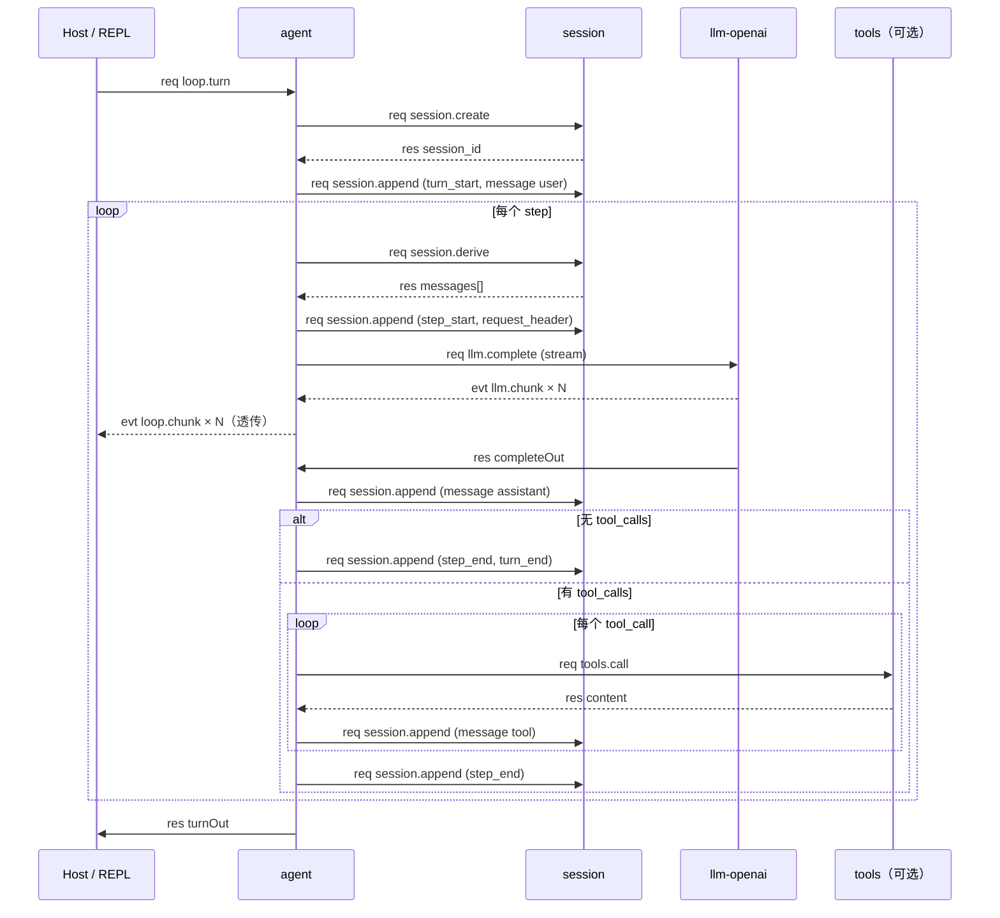
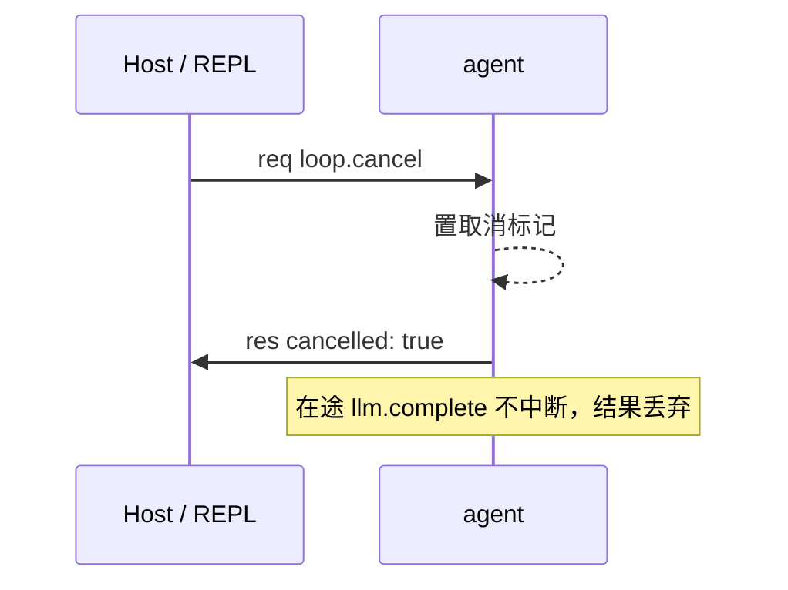

# agent 通信流程

本文是 agent 的通信规划：插件间调用、插件与 Host 交互。名词见 [CONTEXT.md](../../CONTEXT.md)，线契约见 [docs/protocol.md](../../docs/protocol.md)。能力清单与配置见 [README](README.md)。

## 通信总览

agent 是 turn 的编排者。入站只收 `loop.*`，出站调用 session 与 llm。

| 方向 | 对端 | 能力 | 说明 |
|------|------|------|------|
| 入站 | Host / REPL | `loop.turn`、`loop.cancel` | 对话入口 |
| 入站 | Host / REPL | `agent.config.get` / `set` | 编排配置 |
| 出站 | session | `session.create`、`append`、`derive` | 会话写读 |
| 出站 | llm | `llm.complete` | 补全，流式 |
| 出站（可选） | memory | `memory.assemble` | 缺失时回落 `session.derive` |
| 出站（可选） | tools | `tools.list`、`tools.call` | 缺失时纯对话 |

最小启动目标里 memory 与 tools 不存在。agent 对二者软依赖：调用失败即降级，不阻断 turn。

## 入站能力

### loop.turn

一轮编排。payload：

```json
{
  "input": "hello",
  "session_id": "",
  "workspace": "",
  "max_steps": 12,
  "allowed_tools": []
}
```

- `input` 必填，空则 `bad_arguments`。
- `session_id` 空则先 `session.create`，回程带回新 id。
- `max_steps` 缺省取配置，再缺省 128。
- 同一 session 的 turn 串行；不同 session 并行。

返回 `turnOut`：

```json
{
  "session_id": "...",
  "reply": "...",
  "steps": 2,
  "cancelled": false,
  "usage": {"prompt_tokens": 0, "completion_tokens": 0, "total_tokens": 0},
  "seqs": [1, 2, 3]
}
```

### loop.cancel

payload `{"session_id": "..."}`。置在途 turn 的取消标记，返回 `{"session_id": "...", "cancelled": true}`。无在途 turn 时返回 `cancelled: false`。

取消不中断在途 `llm.complete`。LLM 结果到达后丢弃，turn 以 `cancelled: true` 收尾。

### agent.config.get / set

查看或修改 `default_scheme` 与 `max_steps`。turn 在途时 `set` 延后生效。

## 出站调用

一轮 turn 的出站顺序固定。下表按发生次序：

| 次序 | 能力 | payload 要点 | 返回 |
|------|------|--------------|------|
| 1 | `session.create` | `{"workspace": ...}` | `{"session_id": "..."}` |
| 2 | `session.append` | `turn_start` + `message(user)` 两条 fact | `{"seqs": [...]}` |
| 3 | `memory.assemble` | `{"session_id": ...}` | `{"messages": [...]}` |
| 3′ | `session.derive` | `{"session_id": ...}` | `{"messages": [...]}` |
| 4 | `session.append` | `step_start` + `request_header` | `{"seqs": [...]}` |
| 5 | `llm.complete` | `{"messages": [...], "tools": ..., "stream": true}` | `completeOut` |
| 6 | `session.append` | `message(assistant)`，含 `tool_calls` | `{"seqs": [...]}` |
| 7 | `tools.call` | `{"name", "arguments", "workspace", "call_id"}` | `{"content": "..."}` |
| 8 | `session.append` | `message(tool)`、`step_end`、`turn_end` | `{"seqs": [...]}` |

说明：

- 次序 3 先试 `memory.assemble`。返回空或失败则走 3′ `session.derive`。
- 次序 5～8 循环至 `max_steps` 或模型不再发起 tool call。
- `llm.complete` 的 `messages` 为 OpenAI chat 形状。`tools` 为 OpenAI function 数组，由 `tools.list` 结果转换而来。
- 每次 `session.append` 返回的 `seqs` 记入 `turnOut.seqs`。

## 事件

agent 发出一种归因 evt：

| evt | 归因 | payload |
|-----|------|---------|
| `loop.chunk` | 入站 `loop.turn` 的 req id | 透传 `llm.chunk` 的 payload |

`loop.chunk` 的 payload 形状（与 llm-openai 一致）：

```json
{"channel": "content", "delta": "…"}
{"channel": "reasoning", "delta": "…"}
{"channel": "tool_call", "index": 0, "id": "…", "type": "function", "function": {"name": "…", "arguments": "…"}}
```

agent 不改写 payload，只换主题名。调用方按 `channel` 过滤展示。

## 时序

### 一轮 turn



### 取消 turn



## 与 Host 的交互

| 项 | 约定 |
|----|------|
| 启动上报 | `Serve()` 时经 `host.register` 上报 handler 键 |
| 出站 Call id | 形如 `agent-<seq>`；Host 改写 `fwd-<seq>`，回程还原 |
| 入站 req id | Host 分配；handler 原样回显，`loop.chunk` 也用该 id 归因 |
| `from` | Host 注入，插件不填 |
| 对端死亡 | Host 合成 `plugin_down` res 闭环，agent 直接失败该 turn |
| 无超时 | 调用不设超时；防挂死靠死亡闭环 |

## 错误码

| code | 产生方 | 触发 |
|------|--------|------|
| `bad_arguments` | agent | `input` 为空、payload 非法 |
| `handler_error` | agent | 内部错误、响应解析失败 |
| `session_not_found` | session | 透传 |
| `llm_upstream` | llm-openai | 透传 |
| `plugin_down` | Host | session 或 llm 进程死亡 |
| `method_not_found` | Host / SDK | 目标能力未注册（可选能力降级的判定依据） |
