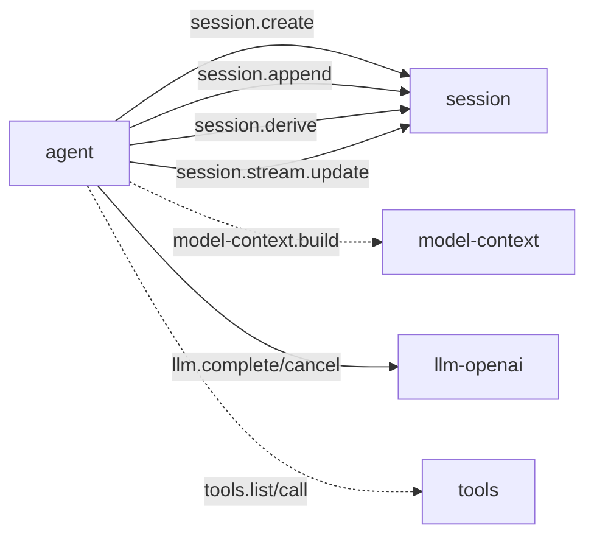

# agent 通信契约

本文是该插件跨插件 JSON 的规范来源。调用方按本文维护自己的适配类型。

本文记录 `agent` 的方法、payload、跨插件调用和 WebUI 交互。JSON 字段是公共契约。Go 私有类型名不是公共契约。

## 1. 对外方法

| 方法 | 用途 | 状态 |
|---|---|---|
| `loop.turn` | 执行一次 Turn | 当前实现 |
| `loop.cancel` | 取消 Session 的活动 Turn | 当前实现 |
| `agent.config.get` | 读取配置 | 当前实现 |
| `agent.config.set` | 更新配置 | 当前实现 |
| `agent.settings.get` | Settings Renderer 读取 | 当前实现 |
| `agent.settings.save` | Settings Renderer 保存 | 当前实现 |

## 2. loop.turn

### 输入

```json
{
  "input": "分析这个项目",
  "session_id": "s-123",
  "workspace_id": "ws-123",
  "workspace": "E:/project",
  "max_steps": 32,
  "allowed_tools": ["file_read"],
  "denied_tools": ["shell_execute"],
  "parent_session_id": "s-parent",
  "origin": "subagent",
  "delegation_depth": 1
}
```

| 字段 | 必填 | 说明 |
|---|---|---|
| `input` | 是 | 用户输入 |
| `session_id` | 否 | 为空时创建 Session |
| `workspace_id` | 否 | 创建 Session 时绑定的 Workspace |
| `workspace` | 否 | Workspace 路径一致性校验 |
| `max_steps` | 否 | 覆盖配置值 |
| `allowed_tools` | 否 | 非空时只保留交集工具 |
| `denied_tools` | 否 | 从交集或全集中移除工具 |
| `parent_session_id` | 否 | 子 Agent 的父 Session |
| `origin` | 否 | Session 来源，例如 `subagent` |
| `delegation_depth` | 否 | 委派深度 |

### Response

```json
{
  "session_id": "s-123",
  "reply": "最终正文",
  "steps": 2,
  "cancelled": false,
  "usage": {
    "prompt_tokens": 100,
    "completion_tokens": 20,
    "total_tokens": 120
  },
  "seqs": [1, 2, 3]
}
```

`seqs` 是本 Turn 写入的 Session seq 列表。取消时保存已累计 assistant 正文，并写入 `turn_end(cancelled)`。

`loop.turn` 写入 `turn_start` 后发生错误时，当前实现会写入 `turn_end(error)`。`meta.error` 保存原始错误。Browser Call 仍返回原始错误。

## 3. loop.cancel

输入：

```json
{
  "session_id": "s-123"
}
```

输出：

```json
{
  "session_id": "s-123",
  "cancelled": true
}
```

每个 Session 同时最多一个活动 Turn。`loop.cancel` 只取消该 Session 的活动 Turn。

## 4. Agent 配置

`agent.config.get` 输出：

```json
{
  "default_scheme": "tool_calling",
  "max_steps": 128
}
```

`agent.config.set` 输入字段均可省略：

```json
{
  "default_scheme": "tool_calling",
  "max_steps": 64
}
```

当前实现中，空字符串和非正数不覆盖原值。每次 Turn 在开始时捕获配置快照。配置修改不影响运行中的 Turn，并从下一次 Turn 开始生效。
新值同时写入插件目录下的 `config.json`；写盘失败时返回 `handler_error`，此时内存里的新值已经生效但没有持久化。

## 5. 下游调用



`model-context` 和 `tools` 是弱依赖：能力缺失时回退到 `session.derive`，或跳过工具阶段。
回退不是静默的：`request_header` 的 `meta` 会带上 `degraded`，内容是降级原因
（`model-context unavailable: …` 或 `tools unavailable: …`）。这样调用方能从 Session 日志里看到本轮降级过。

Agent 每次 Turn 都调用 `session.info` 读取 Session 已绑定的 `workspace_id` 和规范路径。

`workspace` 为空时直接使用 Session 值。显式给出时必须与 Session 值指向同一目录，否则返回 `bad_arguments`。Session 没有 Workspace 时同样返回 `bad_arguments`（消息为 `session workspace is required`）。

Agent 在 `tools.call` 中传递 `session_id`、规范 `workspace` 和模型提供的 `call_id`。Provider 应以 `session_id` 重新解析 Workspace，不信任调用路径。

## 6. Session Fact 序列

当前实现写出：

```text
turn_start
message(user)
step_start
request_header
llm_usage
message(assistant)
message(tool)*
step_end
turn_end
```

`turn_id`、`step_id` 和 `plugin` 写入对应 Fact 的 `meta`。

`request_header` 的 `meta` 字段：

| 字段 | 含义 |
|---|---|
| `step` | 当前步序号 |
| `model_context_id` | `model-context.build` 返回的上下文标识；回退时为空 |
| `token_estimate` | `model-context.build` 的估算；回退时为 0 |
| `degraded` | 仅在回退时出现，说明降级原因 |

`step_end` 的 `meta.reason` 取值：

| 值 | 含义 |
|---|---|
| `completed` | 本步没有工具调用，Turn 正常收束 |
| `tool_calls` | 本步有工具调用且全部执行完毕，继续下一步 |
| `cancelled` | 工具执行途中被取消，本步在此收口并结束 Turn |

工具循环中途取消时，assistant Fact 已经记下了本步的全部 `tool_calls`，但只有执行到的那几个有了结果。
因此此时写 `step_end(cancelled)` 并结束 Turn，不再写 `step_end(tool_calls)`——
否则 Session 里会留下没有对应结果的 `tool_call_id`，下游按 id 配对时会错。

当前实现补充：

- `turn_id`、`step_id` 放入 Fact `meta`；
- `llm_usage` 写入 Session；
- assistant reasoning 写入最终 message 的 `meta`；
- 不写 `stream_chunk`；
- 取消时保存已累计 assistant 正文。

## 7. 流式通信

Agent 消费 `llm.chunk`，不再向浏览器透传该私有 payload。

当前链路：

```text
llm.chunk
→ Agent Stream Accumulator
→ StreamSnapshot
→ session.stream.update
→ session Runtime
→ Command(stream)
→ session-chat
```

`StreamSnapshot`：

```json
{
  "session_id": "s-123",
  "turn_id": "t-1",
  "step_id": "st-2",
  "update_id": 17,
  "message": {
    "role": "assistant",
    "content": "当前累计正文",
    "reasoning": "",
    "tool_calls": []
  },
  "status": "streaming"
}
```

`stream_chunk` 不持久化。Agent 会合并快速 Delta，首个 Delta 立即发布，之后最多每 24 个 Delta 或 100 ms 发布一次。最终 complete 和取消快照始终发布。最终 assistant `message` Fact 是正文真源。

## 8. WebUI 交互

| Component | 操作 | Capability |
|---|---|---|
| `session-chat` | 发送用户输入 | `loop.turn` |
| `session-chat` | 取消当前 Turn | `loop.cancel` |
| `session-chat` | 显示临时正文 | session 的 `Command(stream)` |
| `session-chat` | 显示最终正文 | session 的 `State(ChatState)` |

Agent 没有顶层 Component。Agent 不直接调用 `setData` 或 `runCommand`。

## 9. 错误

| 场景 | 行为 |
|---|---|
| `input` 为空 | `bad_arguments` |
| Session 创建或写入失败 | 返回错误 |
| LLM 调用失败 | 返回 `llm_upstream` 或下游错误 |
| 工具失败 | 写 tool error 和 `is_error`，继续 Turn |
| 达到 `max_steps` | 最后一步仍有工具调用时写 `turn_end(max_steps)`；最后一步正常收束时写 `turn_end(completed)` |
| 取消 | 中止 LLM Call；工具执行途中取消时先写 `step_end(cancelled)`，再写 `turn_end(cancelled)` |
| `config.set` / `settings.save` 写盘失败 | 返回 `handler_error`，内存值已生效但未持久化 |
| 插件退出 | Host 合成 `plugin_down`；Session 可补写 `turn_end(error)` |

## 10. 结构体索引

| Go 类型 | 角色 |
|---|---|
| `turnState` | 单 Session 活动 Turn |
| `turnIn` | `loop.turn` 输入 |
| `turnOut` | `loop.turn` 输出 |
| `cancelIn/cancelOut` | 取消输入输出 |
| `config/configSetIn` | 配置 |
| `chatMessage` | LLM 上下文消息 |
| `toolCall/toolSpec` | LLM 和工具描述 |
| `llmCompleteIn/llmCompleteOut` | LLM 调用子集 |
| `sessionCreateIn/sessionAppendIn` | Session 调用子集 |
| `streamSnapshot/streamAccumulator` | 流式累积和 Session 更新 |
