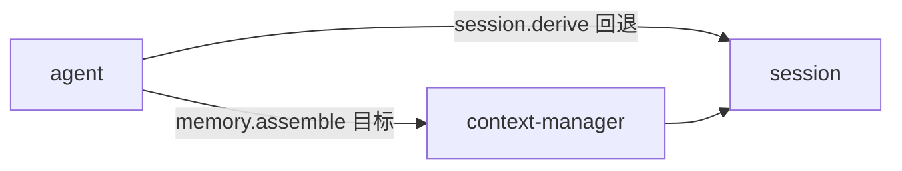

# context-manager 通信契约

`context-manager` 当前没有已注册方法。本文记录原型边界和目标通信。

## 1. 实现状态

当前包名是 `contextmanager`。源码不是可执行插件，缺少：

- `main()`；
- `plugin.json`；
- `pluginsdk.Plugin`；
- `host.register`；
- 已注册 `(capability, method)`；
- WebUI assets。

因此当前没有可用的通信方法。

## 2. 原型类型

| 类型 | 字段 | 状态 |
|---|---|---|
| `History` | `messages` | 未导出，不可由包外构造 |
| `chatMessage` | `role/content/tool_calls/tool_call_id` | 私有副本 |
| `toolCall` | `id/type/function` | 私有副本 |
| `tool` | `type/function` | 私有副本 |

`compact(messages)` 当前直接返回输入。它没有压缩算法和稳定输出契约。

## 3. 目标方法

目标 Capability：

```text
memory.assemble
```

计划输入：

```json
{
  "session_id": "s-123"
}
```

计划输出：

```json
{
  "messages": [
    {
      "role": "user",
      "content": "分析项目"
    }
  ],
  "covered_through_seq": 20
}
```

该方法尚未实现。Agent 当前会尝试调用它，失败后回退到 `session.derive`。

## 4. 调用关系



目标实现可以读取 Session Fact，但必须通过 Capability Call。它不能直连 Session 文件。

## 5. 前端交互

当前没有 Component。第一阶段没有 Settings。

## 6. 待定契约

实现前需要确定：

- 压缩策略；
- 摘要 Fact 的生成者；
- `covered_through_seq` 的语义；
- 工具结果截断规则；
- 与 `session.derive` 的职责分界；
- 错误和降级行为。
