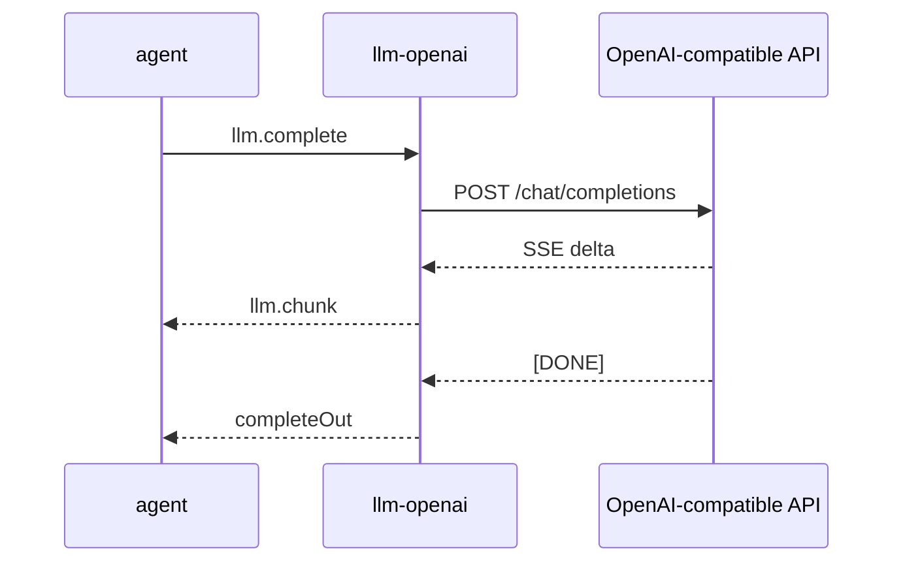

# llm-openai 通信契约

本文是该插件跨插件 JSON 的规范来源。调用方按本文维护自己的适配类型。

本文记录 `llm-openai` 的方法、payload、Event 和前端通信。

## 1. 对外方法

| 方法 | 用途 | 状态 |
|---|---|---|
| `llm.complete` | OpenAI-compatible Completion | 当前实现 |
| `llm.cancel` | 取消指定 Call | 当前实现 |
| `llm.config.get` | 读取模型配置 | 当前实现 |
| `llm.config.set` | 更新模型配置 | 当前实现 |
| `llm.models.list` | 读取模型目录与默认模型 | 当前实现 |
| `llm.models.set` | 整体替换模型目录与默认模型 | 当前实现 |

## 2. llm.complete

### 输入

```json
{
  "messages": [
    {
      "role": "user",
      "content": "分析这个项目"
    }
  ],
  "tools": [
    {
      "type": "function",
      "function": {
        "name": "file_read",
        "description": "Read a file",
        "parameters": {
          "type": "object",
          "properties": {
            "path": {
              "type": "string"
            }
          }
        }
      }
    }
  ],
  "model": "deepseek-chat",
  "temperature": 0.2,
  "max_tokens": 4096,
  "stream": true,
  "call_id": "t-1-s1"
}
```

| 字段 | 必填 | 说明 |
|---|---|---|
| `messages` | 是 | OpenAI chat messages |
| `tools` | 否 | function tools |
| `model` | 否 | 本次请求使用的模型 ID；省略时用 `default_model`。ID 决定路由到哪个端点，目录里没有的 ID 返回 `bad_arguments` |
| `temperature` | 否 | 采样温度 |
| `max_tokens` | 否 | 最大生成 token |
| `stream` | 否 | nil 时默认 true |

### Response

```json
{
  "content": "最终正文",
  "reasoning": "最终推理",
  "tool_calls": [
    {
      "id": "call-1",
      "type": "function",
      "function": {
        "name": "file_read",
        "arguments": "{\"path\":\"README.md\"}"
      }
    }
  ],
  "finish_reason": "tool_calls",
  "usage": {
    "prompt_tokens": 100,
    "completion_tokens": 20,
    "total_tokens": 120
  },
  "model": "deepseek-chat",
  "context_window": 65536
}
```

`model` 是实际使用的模型。`context_window` 取自模型目录，未知时为 `0`。
流式模式下，Response 仍返回累计后的完整结果。Event 只用于实时增量。

一次调用打到哪个供应商由模型 ID 决定：目录里每个模型自带 `base_url` 和 `api_key`，
不同模型可以指向不同供应商。

## 3. llm.cancel

输入：

```json
{ "call_id": "t-1-s1" }
```

输出：

```json
{ "call_id": "t-1-s1", "cancelled": true }
```

`call_id` 由 Agent 传入 `llm.complete`。取消会中止对应上游 HTTP 请求。

`cancelled` 表示"此刻确实有一个在途 completion 被中止了"。`call_id` 不在飞行中时返回 `cancelled: false`——
即使它随后才注册，取消仍会生效：`llm.cancel` 会把这个 id 记进一个有界缓冲（上限 256 条），
`llm.complete` 注册时发现它已被标记就立即中止自己。这样既覆盖了调用启动竞态，又不会因为大量无效取消而无限增长。

## 4. llm.chunk Event

Event 使用 Request 的 id。`capability.method` 是 `llm.chunk`。

### Text delta

```json
{
  "channel": "content",
  "delta": "你"
}
```

`channel` 可以是：

| channel | 内容 |
|---|---|
| `content` | 正文 delta |
| `reasoning` | 推理 delta |

### Tool call delta

```json
{
  "channel": "tool_call",
  "index": 0,
  "id": "call-1",
  "type": "function",
  "function": {
    "name": "read_file",
    "arguments": "{\"path\":"
  }
}
```

工具调用按 `index` 合并。`id`、`type` 和 `name` 可能在首个 delta 后补全。`arguments` 按顺序追加。

`llm.chunk` 是 llm-openai 私有传输格式。WebUI 不直接消费它。Agent 会把它累计成统一 Stream Snapshot。

## 5. 上游请求

非流式模式请求：

```text
POST {model.base_url}/chat/completions
Authorization: Bearer {model.api_key}
Content-Type: application/json
```

`{model.base_url}` 与 `{model.api_key}` 取自本次请求所选模型的目录条目；
密钥为空时不发送 `Authorization` 头。

流式模式额外设置：

```text
Accept: text/event-stream
```

响应按 `data:` 行解析。`[DONE]` 结束流。单个非流式请求超时是 5 分钟。流式请求没有总超时。

## 6. 配置方法

### llm.config.get

当前输出：

```json
{
  "base_url": "https://api.deepseek.com/v1",
  "api_key": "api***key",
  "model": "deepseek-chat",
  "models": [
    {
      "id": "deepseek-chat",
      "label": "DeepSeek Chat",
      "context_window": 65536,
      "base_url": "https://api.deepseek.com/v1",
      "api_key": "api***key"
    },
    {
      "id": "gpt-4o",
      "label": "GPT-4o",
      "context_window": 128000,
      "base_url": "https://api.openai.com/v1",
      "api_key": "sk-***oai"
    }
  ],
  "default_model": "deepseek-chat"
}
```

`models` 每项含自己的 `base_url` 与脱敏后的 `api_key`。
顶层 `base_url`、`api_key`、`model` 是旧字段，镜像默认模型条目，保留给现有调用方读取。

### llm.config.set

输入字段均可省略：

```json
{
  "base_url": "https://api.openai.com/v1",
  "api_key": "new-secret",
  "model": "gpt-test",
  "models": [
    {
      "id": "gpt-test",
      "label": "GPT Test",
      "context_window": 131072,
      "base_url": "https://api.openai.com/v1",
      "api_key": "new-secret"
    }
  ],
  "default_model": "gpt-test"
}
```

`models` 存在时整体替换模型目录；`model` 或 `default_model` 指向目录中不存在的 ID 时会补一条同名条目，
沿用此前默认条目的端点与密钥。顶层 `base_url`/`api_key` 是旧字段：`models` 存在时填给没有自己端点的条目，
`models` 缺省时更新默认模型那一条。条目里显式写的端点永远优先。

条目级 `api_key` 是三态字段：不传表示保留同 ID 条目的原密钥，空串表示清除，其它值覆盖；
把 `llm.config.get` 读到的脱敏值原样传回等价于保留，脱敏值永不落盘。
每次 `llm.complete` 在调用开始时捕获配置快照。配置修改不影响运行中的 Call，并从下一次 Call 开始生效。
新值会写入 `config.json`；校验失败时不做任何修改。

### llm.models.list

输入空对象。输出：

```json
{
  "default_model": "deepseek-chat",
  "models": [
    {
      "id": "deepseek-chat",
      "label": "DeepSeek Chat",
      "context_window": 65536
    }
  ]
}
```

模型目录的每项只暴露 `id`、`label`、`context_window`；端点和密钥不出现在该方法的输出里。

### llm.models.set

输入：

```json
{
  "models": [
    {
      "id": "deepseek-chat",
      "label": "DeepSeek Chat",
      "context_window": 65536,
      "base_url": "https://api.deepseek.com/v1",
      "api_key": "api***key"
    },
    {
      "id": "gpt-4o",
      "label": "GPT-4o",
      "context_window": 128000,
      "base_url": "https://api.openai.com/v1",
      "api_key": "sk-***oai"
    }
  ],
  "default_model": "deepseek-chat"
}
```

输出与 `llm.models.list` 相同。`models` 必须非空，ID 必须唯一；`default_model` 省略时取第一项，指向目录外时返回 `bad_arguments`。
新 ID 必须自带 `base_url`；已存在的 ID 省略 `base_url` 时沿用原端点。`api_key` 三态规则与 `llm.config.set` 相同。

旧配置只有 `model` 时，启动会迁移为单模型目录；旧的顶层 `base_url`/`api_key` 会填进没有自己端点的条目。
`OPENAI_MODEL` 会覆盖默认模型，并在不在目录中时追加一项；`OPENAI_BASE_URL`/`OPENAI_API_KEY` 只覆盖默认模型那一条。

每个条目的 `base_url` 在三条输入路径（`config.json`、环境变量、`llm.config.set`）上都会去掉首尾空白和末尾 `/`，
因此不会拼出 `…/v1//chat/completions`。

新值会写入插件目录下的 `config.json`，包括明文 `api_key`。写盘失败时返回 `handler_error`，
此时内存里的新值已经生效但没有持久化。`config.json` 已被 `.gitignore` 排除，请自行保护文件权限。

### llm.settings.get

供 Host Settings Renderer 读取。输出：

```json
{
  "values": {
    "models": [
      {
        "id": "deepseek-chat",
        "label": "DeepSeek Chat",
        "context_window": 65536,
        "base_url": "https://api.deepseek.com/v1",
        "api_key": "api***key"
      },
      {
        "id": "gpt-4o",
        "label": "GPT-4o",
        "context_window": 128000,
        "base_url": "https://api.openai.com/v1",
        "api_key": "sk-***oai"
      }
    ],
    "default_model": "deepseek-chat"
  }
}
```

`models` 是设置页的模型目录行编辑器：每行一个模型，各自带自己的端点和脱敏后的 `api_key`。
脱敏值不回显明文，同时充当“保持不变”的占位符。`default_model` 用于联动下拉。

### llm.settings.save

输入：

```json
{
  "values": {
    "models": [
      {
        "id": "deepseek-chat",
        "label": "DeepSeek Chat",
        "context_window": 65536,
        "base_url": "https://api.deepseek.com/v1",
        "api_key": "api***key"
      },
      {
        "id": "gpt-4o",
        "label": "GPT-4o",
        "context_window": 128000,
        "base_url": "https://api.openai.com/v1",
        "api_key": "sk-new-secret"
      }
    ],
    "default_model": "deepseek-chat"
  }
}
```

- `models` 必须非空，ID 必须唯一；新 ID 必须自带 `base_url`，已存在的 ID 省略时沿用原端点。
- 行内 `api_key` 三态规则与 `llm.config.set` 相同：不传保留，空串清除，其它值覆盖，
  把读到的脱敏值传回等价于保留。改模型 ID 视为新条目，但脱敏值仍能匹配回原密钥。
- `default_model` 为空时取第一项，指向目录外时返回 `bad_arguments`。
- 保存会写入 `config.json`，包括明文 `api_key`；成功后 Host 派发 `liteagent:settings-saved`，
  `session-history` 重新读取 `llm.models.list` 刷新新会话模型下拉。

## 7. 调用关系



`llm-openai` 不调用 `session`。

## 8. 错误

| 场景 | 错误码 |
|---|---|
| `messages` 为空 | `bad_arguments` |
| JSON 解码失败 | `bad_arguments` |
| `model` 不在目录中 | `bad_arguments` |
| 目录校验失败（空目录、重复 ID、缺 `base_url`、负窗口） | `bad_arguments`（`llm.config.set` 为 `handler_error`） |
| HTTP 建连或上游失败 | `llm_upstream` |
| 上游非 2xx | `llm_upstream` |
| JSON marshal 失败 | `handler_error` |
| 写 `config.json` 失败 | `handler_error` |

Event 发送失败不影响最终 Response。当前实现会忽略 emit error。

## 9. 前端通信

| UI 面 | 方向 | 方法 |
|---|---|---|
| Settings 读取 | UI → Plugin | `llm.config.get` |
| Settings 保存 | UI → Plugin | `llm.config.set` |
| 插件中心设置读取 | Host Settings Renderer → Plugin | `llm.settings.get` |
| 插件中心设置保存 | Host Settings Renderer → Plugin | `llm.settings.save` |
| 新会话模型下拉 | `session-history` → Plugin | `llm.models.list` |
| 模型目录管理 | 插件中心设置页 | `llm.settings.get/save` |
| LLM 正文 | Plugin → Agent | `llm.chunk` |
| LLM 最终结果 | Plugin → Agent | `llm.complete` Response |

llm-openai 没有 `setData` 或 `runCommand` 调用。`session-history` 只读取模型目录作为可选协作者；
能力不可用时隐藏选择器，Session 仍按 llm-openai 自己的默认模型运行。模型目录的编辑在插件中心设置页完成，
保存成功后 Host 派发 `liteagent:settings-saved` 触发 `session-history` 刷新下拉。

## 10. 结构体索引

| Go 类型 | 角色 |
|---|---|
| `chatMessage` | 模型消息 |
| `toolCall` | 工具调用 |
| `tool` | 工具描述 |
| `completeIn` | Completion 输入 |
| `completeOut` | 最终输出 |
| `chunkText` | content/reasoning delta |
| `chunkToolCall` | tool call delta |
| `config` | 磁盘和运行配置；顶层 `base_url`/`api_key`/`model` 是旧字段 |
| `modelConfig` | 模型目录条目：模型 + 自己的端点与密钥 |
| `modelEntryIn` | 目录条目输入；`api_key` 是三态指针 |
| `modelSummary` | `llm.models.list` 的目录摘要，不含端点与密钥 |
| `configGetOut/configSetIn` | 配置方法 payload |
