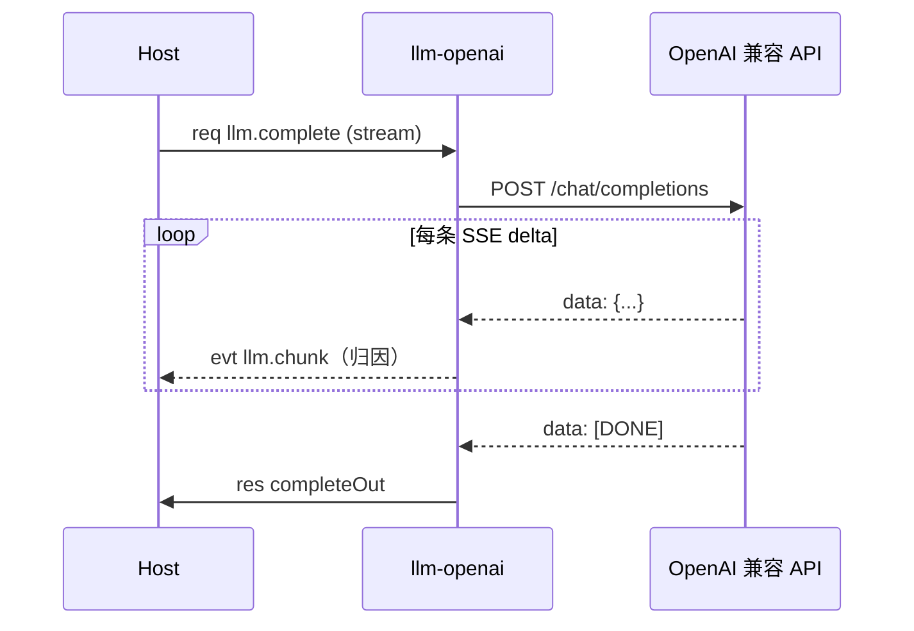
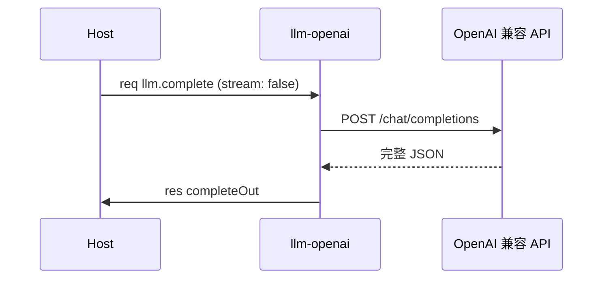

# llm-openai 通信流程

本文是 llm-openai 的通信规划：插件间调用、插件与 Host 交互。名词见 [CONTEXT.md](../../CONTEXT.md)，线契约见 [docs/protocol.md](../../docs/protocol.md)。能力清单与配置见 [README](README.md)。

## 通信总览

llm-openai 无状态。不读写 session，不 Call 其它插件。唯一出站是归因 evt `llm.chunk`。

| 方向 | 对端 | 能力 | 说明 |
|------|------|------|------|
| 入站 | agent | `llm.complete` | 补全，默认流式 |
| 入站 | Host / REPL | `llm.config.get` / `set` | 模型配置 |
| 出站 | 调用方 | `llm.chunk`（evt） | 流式片段，归因 |
| 外部 | OpenAI 兼容 API | HTTP | `POST /chat/completions` |

## 入站能力

### llm.complete

payload（`completeIn`）：

```json
{
  "messages": [{"role": "user", "content": "hello"}],
  "tools": [{"type": "function", "function": {"name": "...", "parameters": {}}}],
  "model": "",
  "temperature": 0.7,
  "max_tokens": 0,
  "stream": true
}
```

- `messages` 必填，空则 `bad_arguments`。
- `stream` 省略即 `true`。流式时上游带 `stream_options.include_usage`。
- `model` 空则取配置。

返回（`completeOut`）：

```json
{
  "content": "...",
  "reasoning": "...",
  "tool_calls": [{"id": "...", "type": "function", "function": {"name": "...", "arguments": "..."}}],
  "finish_reason": "stop",
  "usage": {"prompt_tokens": 0, "completion_tokens": 0, "total_tokens": 0}
}
```

`finish_reason` 取上游值。上游未给时按结果推断：有 `tool_calls` 则 `tool_calls`，否则 `stop`。

### llm.config.get / set

查看或修改 `base_url`、`api_key`、`model`。`get` 对密钥掩码。complete 在途时 `set` 延后生效并写盘。

## 事件

llm.complete 在流式模式下持续发出归因 evt `llm.chunk`。归因 id 即入站 req 的 id。

三种 payload 形状：

```json
{"channel": "content", "delta": "…"}
{"channel": "reasoning", "delta": "…"}
{"channel": "tool_call", "index": 0, "id": "…", "type": "function", "function": {"name": "…", "arguments": "…"}}
```

| channel | 来源 | 说明 |
|---------|------|------|
| `content` | `delta.content` | 正文增量 |
| `reasoning` | `delta.reasoning_content` | 推理增量 |
| `tool_call` | `delta.tool_calls` | 增量形状，按 `index` 累加 |

`tool_call` 的 delta 语义与上游一致：`id`、`function.name` 通常只在首个增量出现，`function.arguments` 分片追加。完整拼装以 res 里的 `tool_calls` 为准。

## 时序

### 流式 complete



### 非流式 complete



非流式不发 `llm.chunk`。

## 与 Host 的交互

| 项 | 约定 |
|----|------|
| 启动上报 | `Serve()` 时经 `host.register` 上报 handler 键 |
| 出站 Call | 无。唯一出站是 evt |
| 归因 evt id | 用入站 req 的 id；Host 负责归因转发 |
| 对端调用方死亡 | Host 丢弃无法投递的 evt；llm-openai 无感 |
| 无超时 | 上游 HTTP 流不设客户端超时，读到 `[DONE]` 或连接断为止 |

## 配置来源

启动时环境变量优先于 `config.json`：

| 环境变量 | 配置键 | 说明 |
|----------|--------|------|
| `OPENAI_BASE_URL` | `base_url` | API 根地址 |
| `OPENAI_API_KEY` | `api_key` | Bearer 密钥 |
| `OPENAI_MODEL` | `model` | 模型名 |

## 错误码

| code | 产生方 | 触发 |
|------|--------|------|
| `bad_arguments` | llm-openai | `messages` 为空、payload 非法 |
| `llm_upstream` | llm-openai | HTTP 非 2xx、网络失败、响应解析失败 |
| `handler_error` | llm-openai | 其余内部错误 |
| `plugin_down` | Host | llm-openai 进程死亡时给调用方合成 |
