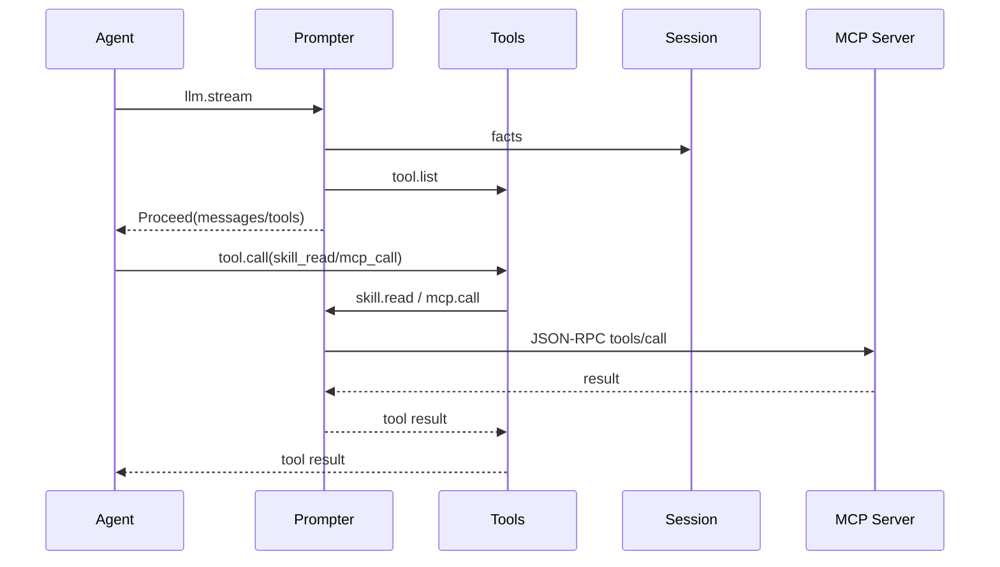

# prompter 通信契约

本文定义 Prompter 的消费链、检查接口、Skills/MCP Provider、UI 和设置。

## 1. 方法与能力

| 能力.方法 | 说明 |
|---|---|
| `session.create` | 消费，补初始 system/runtime facts |
| `llm.stream` | 消费，装配 messages/tools 后 Proceed |
| `prompter.context.get` | 返回最近一次或派生的 LLM 可见上下文 |
| `prompter.resources.list` | 返回 Skills / MCP 状态 |
| `prompter.resources.refresh` | 重新扫描 Skills、重连 MCP |
| `prompter.settings.get/save` | 读写设置 |
| `prompter.mcp.config.get/save` | 读写 MCP server JSON 配置 |
| `skill.info` | 返回 `skill_read` 工具定义 |
| `skill.read` | 读取指定 skill 的 SKILL.md |
| `mcp.info` | 返回 `mcp_call` 工具定义 |
| `mcp.call` | 调用 stdio MCP server 工具 |

## 2. `prompter.context.get`

请求：

```json
{"session_id": "s-1"}
```

`session_id` 可省略，省略时返回最近一次装配的会话。
Context 面板始终传入当前活动会话的 `session_id`。
活动会话由 Session UI 的 `liteagent:session-changed` 信号提供。

响应：

```json
{
  "session_id": "s-1",
  "turn_id": "t-1",
  "model": "deepseek-chat",
  "source": "live",
  "assembled_at": "RFC3339",
  "usage": {
    "prompt_tokens": 12345,
    "completion_tokens": 678,
    "total_tokens": 13023,
    "context_window": 128000,
    "percent": 9.6,
    "message_count": 42,
    "tool_count": 7,
    "tool_catalog_generation": 12
  },
  "messages": [
    {"seq": 1, "role": "system", "text": "...", "truncated": false}
  ],
  "tools": [
    {"name": "file_read", "description": "...", "parameters": {}}
  ],
  "snapshot": {
    "surface_seqs": [1, 2],
    "system_prompt_hash": "...",
    "runtime_context_hash": "...",
    "messages_hash": "...",
    "tool_catalog_generation": 12,
    "tool_names": ["file_read"]
  }
}
```

`source` 取 `live` / `derived` / `none`。

三个 token 字段来自该会话最近一条 `usage` Fact，由 Agent 在每次模型调用后写入。
没有 `usage` Fact 时三个字段省略，`percent` 也为 0。
`live` 视图只采用 `turn_id` 与缓存装配一致的用量。
不返回 token 估算值，也不返回消息级 token 数。

## 3. Skills

### 3.1 `skill.info`

返回：

```json
{
  "capability": "skill",
  "tools": [
    {
      "name": "skill_read",
      "description": "Load the full SKILL.md ...",
      "parameters": {
        "type": "object",
        "properties": {"name": {"type": "string"}},
        "required": ["name"]
      },
      "method": "read"
    }
  ]
}
```

两个 skills 目录都为空时不返回工具。

### 3.2 `skill.read`

Tools 转发的 Provider 输入：

```json
{
  "arguments": {"name": "repo-search"},
  "workspace": "E:/project",
  "session_id": "s-1",
  "call_id": "call-1"
}
```

结果：

```json
{
  "content": "---\nname: repo-search\n...",
  "is_error": false,
  "truncated": false,
  "meta": {
    "name": "repo-search",
    "source": "workspace",
    "path": "E:/project/.liteagent/skills/repo-search/SKILL.md"
  }
}
```

错误码：`skill_not_found`、`skill_unavailable`、`skill_read_failed`。

## 4. MCP

### 4.1 `prompter.mcp.config.get/save`

`get` 返回：

```json
{
  "servers": [
    {
      "name": "filesystem",
      "enabled": true,
      "transport": "stdio",
      "command": "npx",
      "args": ["-y", "@modelcontextprotocol/server-filesystem", "."],
      "env": {"KEY": "value"},
      "cwd": "",
      "timeout_ms": 30000
    }
  ]
}
```

`save` 请求使用同一结构，响应 `{"saved": true}`。
只支持 `transport=stdio`；配置保存后异步重连。

### 4.2 `mcp.info`

返回通用：

```json
{
  "capability": "mcp",
  "tools": [
    {
      "name": "mcp_call",
      "description": "Call a tool exposed by an MCP server...",
      "parameters": {
        "type": "object",
        "properties": {
          "server": {"type": "string"},
          "tool": {"type": "string"},
          "arguments": {"type": "object"}
        },
        "required": ["server", "tool"]
      },
      "method": "call"
    }
  ]
}
```

没有启用 server 时不返回工具。

### 4.3 `mcp.call`

Provider 输入：

```json
{
  "arguments": {
    "server": "filesystem",
    "tool": "read_file",
    "arguments": {"path": "README.md"}
  },
  "session_id": "s-1",
  "call_id": "call-1"
}
```

结果使用统一 Tool Result 包络：

```json
{
  "content": "file contents...",
  "is_error": false,
  "truncated": false,
  "meta": {"server": "filesystem", "tool": "read_file", "duration_ms": 12}
}
```

错误码：`mcp_config_invalid`、`mcp_server_unavailable`、`mcp_call_failed`。

## 5. `prompter.resources.list`

请求：

```json
{"workspace": "E:/project"}
```

响应：

```json
{
  "updated_at": "RFC3339",
  "workspace": "E:/project",
  "skills_global_dir": "/skills",
  "skills_workspace_dir": ".liteagent/skills",
  "skills": [
    {
      "name": "repo-search",
      "description": "Search the repository",
      "source": "workspace",
      "path": "E:/project/.liteagent/skills/repo-search/SKILL.md",
      "enabled": true
    }
  ],
  "skill_errors": [],
  "mcp": {
    "enabled": true,
    "timeout_ms": 30000,
    "servers": [
      {
        "name": "filesystem",
        "transport": "stdio",
        "status": "connected",
        "enabled": true,
        "tools": [{"name": "read_file", "description": "..."}],
        "last_error": ""
      }
    ]
  }
}
```

MCP `status` 取 `disabled` / `unconfigured` / `connecting` / `connected` / `error`。

## 6. Settings

`prompter.settings.get`：

```json
{
  "values": {
    "skills_global_dir": "/skills",
    "skills_workspace_dir": ".liteagent/skills",
    "mcp_enabled": true,
    "mcp_timeout_ms": 30000
  }
}
```

`save` 请求使用同一 `values` 包络；保存原子写入 `config.json`，只合并这些字段。

## 7. UI

| 组件 | mount_id | slot |
|---|---|---|
| `prompter-context` | `context` | `right` |
| `prompter-resources` | `resources` | `bottom`（收起为按钮，点击打开模态浮层） |

状态推送：

```text
WebUI.SetState("context", {
  session_id, turn_id, model,
  usage: {prompt_tokens, completion_tokens, total_tokens, message_count, tool_count, ...},
  updated_at
})
```

组件命令：

| command | 行为 |
|---|---|
| `refresh` | 重新拉取数据 |

底部面板的 Refresh 会先调用 `prompter.resources.refresh`，再重新读取状态。
MCP 配置编辑通过 `prompter.mcp.config.get/save`。

## 8. 调用关系



## 9. 实现状态

已实现：skills 目录扫描、`skill_read`、MCP stdio client、`mcp_call`、MCP JSON 配置、资源面板、上下文查看和设置。
未实现：MCP HTTP、per-tool 工具定义、MCP 自动重连、用户选择可见 message、上下文压缩。
