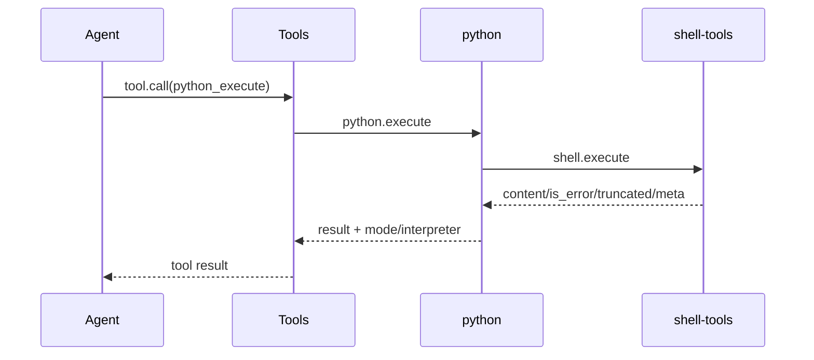

# python 通信契约

本文定义 `python` Capability 的方法，以及它调用 `shell.execute` 的载荷。

## 1. 方法

| 方法 | 说明 |
|---|---|
| `python.info` | 返回 `python_execute` 的工具定义 |
| `python.execute` | 执行内联代码或脚本文件 |

`python_execute` 的 `method` 是 `execute`。

## 2. Provider 输入

`tools.call` 转发的输入：

```json
{
  "arguments": {
    "code": "print('hello')",
    "path": "",
    "args": [],
    "cwd": ".",
    "env": {},
    "timeout_ms": 120000,
    "max_output_bytes": 1048576
  },
  "session_id": "s-1",
  "workspace": "E:/project",
  "call_id": "call-1",
  "meta": {}
}
```

`code` 与 `path` 必须二选一。
`cwd` 与 `env` 原样传给 shell-tools；工具层不做路径越界检查。

## 3. 调用 shell.execute

code 模式：

```json
{
  "arguments": {
    "command": "python3",
    "args": ["-", "arg1"],
    "cwd": ".",
    "env": {},
    "stdin": "print('hello')",
    "timeout_ms": 120000,
    "max_output_bytes": 1048576
  },
  "session_id": "s-1",
  "workspace": "E:/project",
  "call_id": "call-1",
  "meta": {}
}
```

path 模式：

```json
{
  "arguments": {
    "command": "python3",
    "args": ["E:/project/script.py", "arg1"],
    "cwd": ".",
    "env": {},
    "timeout_ms": 120000,
    "max_output_bytes": 1048576
  },
  "session_id": "s-1",
  "workspace": "E:/project",
  "call_id": "call-1",
  "meta": {}
}
```

## 4. 结果

返回 shell-tools 的结果，并在 `meta` 中增加：

```json
{
  "mode": "code",
  "interpreter": "python3"
}
```

path 模式额外包含 `path`，值为调用方传入的相对路径或绝对路径。
`content`、`is_error`、`truncated` 与 shell-tools 完全一致。

## 5. 错误

| 错误码 | 场景 |
|---|---|
| `bad_arguments` | code/path 不满足二选一、code 含 NUL 或超限、args 含 NUL |
| `path_invalid` | 脚本路径不合法 |
| `path_not_found` | 脚本不存在 |
| `path_is_directory` | 脚本路径是目录 |
| `interpreter_not_found` | shell-tools 返回 `command_not_found` |
| `shell_unavailable` | shell Capability 不可用 |

其余 shell-tools 错误原样透传。

## 6. 调用关系



## 7. 实现状态

当前实现为同步执行；不提供持久 REPL、包安装或流式输出。
