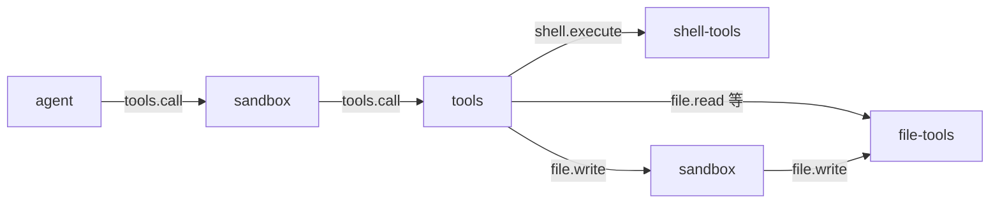

# sandbox 通信契约

本文只记录当前实现。目标契约见 [docs/design/plugins/08-sandbox.md](../../docs/design/plugins/08-sandbox.md)。

## 1. 能力与接缝

| 面 | 内容 |
|---|---|
| `provides` | `sandbox` |
| `consumes` | `tools.call`、`file.write`、`file.replace`、`file.patch`、`shell.execute` |
| `priority` | 500 |
| `requires` | `session`、`tools` |
| `depends_on` | `tools` |

本插件是 Consumer，不是 Tool Provider。它不注册工具，也不执行文件与命令操作。

## 2. 调用图



`tools` 分发后对目标能力的调用会重新进链，所以直连高危能力的调用也过裁决。

## 3. 接缝载荷

两个接缝的载荷都是扁平结构，意图字段与内容字段同级。

`tools.call` 载荷：

```json
{
  "name": "file_write",
  "arguments": {"path": "README.md", "content": "x"},
  "session_id": "s-1",
  "workspace": "E:/project",
  "workspace_id": "ws-1",
  "call_id": "call-1",
  "mode": "coding"
}
```

`file.write` 等提供方接缝载荷：

```json
{
  "arguments": {"path": "README.md", "content": "x"},
  "session_id": "s-1",
  "workspace": "E:/project",
  "workspace_id": "ws-1",
  "call_id": "call-1",
  "mode": "coding"
}
```

| 字段 | 说明 |
|---|---|
| `name` | 工具名。只在 `tools.call` 上出现。 |
| `arguments` | 工具参数对象。 |
| `session_id` | 会话标识。会话级规则按它匹配。 |
| `workspace` | 工作区路径。相对路径按它解析。 |
| `workspace_id` | 工作区标识。 |
| `call_id` | 调用标识。写进审计条目。 |
| `mode` | 调用模式。当前不参与判定。 |

接缝载荷由别的插件定义。本插件解码时忽略未知字段，接缝新增字段不会打断裁决。

## 4. 裁决结果

| 动作 | 行为 |
|---|---|
| `allow` | 原样放行。 |
| `modify` | 改写 `arguments` 后放行。 |
| `deny` | 短路返回，不进下一跳。 |

`confirm` 还没有实现。风险档里的 `confirm` 目标动作当前按 `deny` 执行。

### 4.1 拒绝的返回形态

拒绝返回的是 Tool Result 包络，`is_error` 为 `true`。它不是协议错误，模型能读到原因。

```json
{
  "content": "Tool call denied by policy.\nTool: file_write\nRisk: 80\nReason: risk 80 falls in band 50-79, action deny\nRule: r-3",
  "is_error": true,
  "truncated": false,
  "meta": {
    "code": "sandbox_denied",
    "sandbox_decision": "deny",
    "rule_id": "r-3",
    "reason": "risk 80 falls in band 50-79, action deny",
    "risk": 80,
    "tool": "file_write",
    "target_capability": "file",
    "target_method": "write"
  }
}
```

| `meta` 字段 | 说明 |
|---|---|
| `code` | 固定是 `sandbox_denied`。 |
| `sandbox_decision` | 四态动作之一。当前只有 `deny` 会短路。 |
| `rule_id` | 命中的规则。没有规则命中时是空串。 |
| `reason` | 判定依据。 |
| `risk` | 工具风险值。查不到时是 70。 |
| `tool` | 工具名。直连接缝上按目标方法反查。 |
| `target_capability` | 目标能力名。 |
| `target_method` | 目标方法名。 |

### 4.2 改写

`modify` 规则带 `modified_arguments` 模板。模板是覆盖层：模板点名的键被替换，模板没点名的键保留。改写后的完整参数发给提供方。

## 5. 风险解析

本插件调用 `tools.list` 读注册表里的 `risk`，结果缓存 5 秒。

| 情形 | 风险值 |
|---|---|
| 工具在注册表里 | 注册表声明的 `risk`。 |
| 工具不在注册表里 | 70。 |
| `tools.list` 调用失败 | 70。 |

直连高危接缝按目标能力与目标方法反查工具名。

## 6. 规则模型

一条规则由一个动作与一组匹配条件组成。

```json
{
  "rule_id": "r-3",
  "action": "deny",
  "scope": {
    "tool": "shell_execute",
    "capability": "shell",
    "method": "execute",
    "path_glob": "E:/project/**",
    "command_pattern": "rm -rf *"
  },
  "priority": 100,
  "lifetime": "persistent",
  "ttl_seconds": 0,
  "note": "禁止递归删除"
}
```

| 条件 | 语义 |
|---|---|
| `tool` | 工具名全等匹配。 |
| `capability` | 目标能力名全等匹配。 |
| `method` | 目标方法名全等匹配。 |
| `path_glob` | 参数里的 `path` 做通配匹配。 |
| `command_pattern` | 参数里的 `command` 加 `args` 做前缀与通配匹配。 |

一条规则里的多个条件是合取。全部满足才命中。

`path_glob` 支持 `*`、`**` 与 `?`。`*` 不跨目录分隔符，`**` 跨。相对路径按 `workspace` 解析。

`command_pattern` 按空白切分成词元。词元逐位匹配命令词元，模式可以提前结束，所以 `rm -rf *` 覆盖 `rm -rf build`。

### 6.1 匹配优先级

| 序号 | 规则 | 说明 |
|---:|---|---|
| 1 | 动作优先级 | `deny` 高于 `modify`，`modify` 高于 `allow`。 |
| 2 | 同动作比权重 | `priority` 大的先。 |
| 3 | 同权重比范围 | 范围窄的先。 |
| 4 | 同范围比标识 | `rule_id` 字典序小的先。 |

拒绝优先于改写。一条更宽的 `allow` 规则不能救回一条更窄的 `deny` 规则。

### 6.2 规则只升不降

| 操作 | 结果 |
|---|---|
| 新增一条更宽的 `allow` 规则 | `sandbox_rule_invalid` |
| 新增一条更窄的规则 | 成功 |
| 把一条 `deny` 规则的动作改成别的 | `sandbox_rule_invalid` |
| 删除一条 `deny` 规则 | `sandbox_rule_invalid` |
| 删除一条 `allow` 或 `modify` 规则 | 成功 |
| 把一条规则改成更严的动作 | 成功 |

「更宽」按范围包含关系判断。范围包含是保守近似：字面量只覆盖相同字面量。含通配符的一侧按更宽处理，判不出来的关系按不覆盖处理。

## 7. 方法

### 7.1 sandbox.check

对一次候选调用做干跑裁决。它没有副作用，不写审计条目。

输入：

```json
{
  "tool": "shell_execute",
  "arguments": {"command": "rm -rf build"},
  "capability": "shell",
  "method": "execute",
  "session_id": "s-1",
  "workspace": "E:/project"
}
```

| 字段 | 必填 | 说明 |
|---|---|---|
| `tool` | 否 | 工具名。省略时用 `capability` 与 `method` 反查。 |
| `arguments` | 否 | 候选参数。省略时按空对象处理。 |
| `capability` | 否 | 目标能力名。 |
| `method` | 否 | 目标方法名。 |
| `session_id` | 否 | 会话标识。影响会话级规则的匹配。 |
| `workspace` | 否 | 工作区路径。用于路径范围匹配。 |

`tool` 与 `capability` 加 `method` 至少给一组。两组都给且冲突时返回 `bad_arguments`。

输出：

```json
{
  "decision": "deny",
  "rule_id": "r-3",
  "reason": "matched rule r-3 (command=rm -rf *): 禁止递归删除",
  "modified_arguments": null,
  "risk": 90
}
```

错误码：`bad_arguments`。

### 7.2 sandbox.list_rules

列出当前生效的规则。

输入：

```json
{"lifetime": "all", "session_id": "s-1"}
```

| 字段 | 必填 | 说明 |
|---|---|---|
| `lifetime` | 否 | `all`、`persistent` 或 `session`。缺省是 `all`。 |
| `session_id` | 否 | 列会话级规则时指定会话。 |

输出：

```json
{
  "rules": [
    {
      "rule_id": "r-3",
      "action": "deny",
      "scope": {"command_pattern": "rm -rf *"},
      "priority": 100,
      "lifetime": "persistent",
      "ttl_seconds": 0,
      "note": "禁止递归删除",
      "created_ts": 1760000000000
    }
  ]
}
```

规则按 `priority` 降序排列，同优先级按 `rule_id` 升序。

错误码：`bad_arguments`。

### 7.3 sandbox.set_rule

新增、更新或删除一条规则。

输入：

```json
{
  "rule_id": "r-9",
  "action": "deny",
  "scope": {"tool": "shell_execute", "path_glob": "E:/project/**"},
  "priority": 50,
  "lifetime": "persistent",
  "ttl_seconds": 0,
  "note": "工作区内的命令先问一次"
}
```

| 字段 | 必填 | 说明 |
|---|---|---|
| `rule_id` | 否 | 省略时自动生成。给出时表示更新该规则。 |
| `action` | 是 | `allow`、`modify` 或 `deny`。 |
| `scope` | 是 | 匹配条件，至少一个字段非空。 |
| `priority` | 否 | 缺省是 100。 |
| `lifetime` | 否 | `persistent` 或 `session`。缺省是 `persistent`。 |
| `ttl_seconds` | 否 | 缺省是 0。0 表示不过期。 |
| `note` | 否 | 说明。 |
| `modified_arguments` | 否 | `modify` 规则必填。改写用的参数模板。 |
| `session_id` | 否 | 会话级规则必填。 |
| `delete` | 否 | 省略时是 `true`，表示删除这条规则。 |

输出：

```json
{"rule_id": "r-9", "created": true, "rules_version": 12}
```

错误码：`sandbox_rule_invalid`、`sandbox_rule_not_found`、`bad_arguments`。

`delete` 是目标契约之外的一个补充。目标契约固定了删除行为，但没有给删除方法。

### 7.4 sandbox.settings.get

输入是空对象，输出是 `values` 包络。

```json
{"values": {"default_action": "allow", "audit_retention_days": 30}}
```

### 7.5 sandbox.settings.save

输入是同一个 `values` 包络，输出是 `{"saved": true}`。

保存后写进 `config.json`。配置改动不影响在途调用。

## 8. 审计

每条裁决记一条会话事实，事实类型是 `sandbox_decision`。它在会话事实类型词汇表里登记。

```json
{
  "type": "sandbox_decision",
  "role": "host",
  "content": "",
  "meta": {
    "call_id": "call-1",
    "tool": "shell_execute",
    "target_capability": "shell",
    "target_method": "execute",
    "decision": "deny",
    "rule_id": "r-3",
    "reason": "matched rule r-3 (command=rm -rf *)",
    "risk": 90,
    "arguments_digest": "sha256:9f2c1b0a4d3e5f6a",
    "session_id": "s-1",
    "turn_id": "",
    "step_id": "",
    "confirm_token": "",
    "ts": 1760000000000
  }
}
```

| 字段 | 说明 |
|---|---|
| `decision` | 裁决动作。 |
| `rule_id` | 命中的规则。没有规则命中时是空串。 |
| `reason` | 判定依据。 |
| `risk` | 工具风险值。查不到时是 70。 |
| `arguments_digest` | 参数摘要。不记参数原文。 |
| `turn_id`、`step_id` | 当前接缝载荷不带这两个字段，所以是空串。 |
| `confirm_token` | 确认流还没有实现，所以是空串。 |

事实类型不带 `message`，所以不进模型上下文。它出现在会话追踪视图里。

`session` 缺席时审计退化为进程内的有界环形缓冲，环形缓冲不落盘。

## 9. 持久化

| 作用域 | 位置 | 生命周期 |
|---|---|---|
| 持久规则 | 插件工作目录下的 `rules.json` | 跨会话、跨进程重启。 |
| 会话规则 | 插件内存，按 `session_id` 分桶 | 会话结束即失效。 |
| 配置 | 插件工作目录下的 `config.json` | 跨进程重启。 |

写盘走临时文件加重命名，避免半写状态。损坏的规则文件在启动时被跳过，插件以空规则集启动。

## 10. 错误码

插件级错误码，前缀是 `sandbox_`。

| 错误码 | 场景 |
|---|---|
| `sandbox_denied` | 裁决结果是 `deny`。它出现在拒绝包络的 `meta.code` 里，不是协议错误。 |
| `sandbox_rule_invalid` | 规则字段非法，或违反只升不降的约束。 |
| `sandbox_rule_not_found` | 更新或删除一条不存在的规则。 |

本插件复用 `bad_arguments` 与 `handler_error`。

## 11. WebUI

本插件当前没有 Component。它不贡献任何槽位。

确认面板属于后续批次。右栏当前由 `session` 独占，放宽槽位共享是它的前置条件。

## 12. 与目标契约的差异

| 项 | 目标契约 | 当前实现 |
|---|---|---|
| 动作 | 四态 | 三态。`confirm` 缺失。 |
| 意图区 | `meta` 对象 | 扁平字段，沿用现有 `tools.call` 契约。 |
| 拒绝返回 | 协议错误或工具结果包络 | 工具结果包络。 |
| 规则删除 | 固定行为，没有方法 | `sandbox.set_rule` 的 `delete` 字段。 |
| 确认令牌 | 两阶段续传 | 没有。 |
| 确认面板 | 右栏组件 | 没有。 |
| Prompt 贡献 | 动态轨 `policy` 节 | 没有。 |
