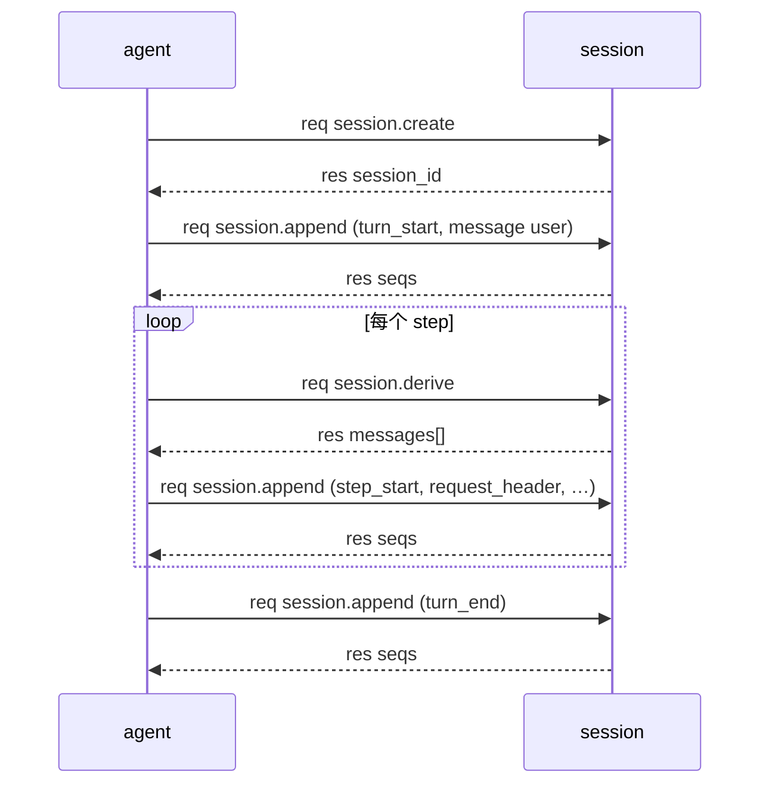

# session 通信流程

本文是 session 的通信规划：插件间调用、插件与 Host 交互。名词见 [CONTEXT.md](../../CONTEXT.md)，线契约见 [docs/protocol.md](../../docs/protocol.md)。能力清单与配置见 [README](README.md)。

## 通信总览

session 是会话真源。只被调用，不 Call 其它插件，不发 evt。

| 方向 | 对端 | 能力 | 说明 |
|------|------|------|------|
| 入站 | agent | `session.create`、`append`、`derive` | turn 写读 |
| 入站 | agent | `session.query`、`list`、`info` | 观测与导出 |
| 出站 | — | 无 | 纯存储 + 投影 |

## 入站能力

### session.create

显式创建，幂等。同 id 重复创建返回已有会话。

```json
{
  "session_id": "",
  "name": "",
  "workspace": "",
  "parent_session_id": "",
  "origin": "",
  "delegation_depth": 0
}
```

返回 `{"session_id": "...", "created_ts": 0}`。`session_id` 省略则自动生成。

### session.append

唯一写入口。payload：

```json
{
  "session_id": "...",
  "facts": [
    {"type": "message", "role": "user", "content": "hello"},
    {"type": "message", "role": "assistant", "content": "…", "tool_calls": []},
    {"type": "message", "role": "tool", "content": "…", "tool_call_id": "…", "meta": {"tool_name": "..."}}
  ]
}
```

返回 `{"session_id": "...", "seqs": [1, 2], "next_seq": 3}`。

- `facts` 必填且非空。`fact.type` 必填。
- `seq` 与 `ts` 由 session 分配，调用方不传。
- 未知 `session_id` 返回 `session_not_found`。

### session.derive

Model Context 投影。payload：

```json
{"session_id": "...", "full_tool_results": 0}
```

返回：

```json
{
  "messages": [{"role": "user", "content": "…"}],
  "covered_through_seq": 12,
  "summary_seq": 0,
  "truncated_tools": 0
}
```

投影规则：

- 只投影 `message` 类 fact 和生效中的 `context_summary`。
- `message` 带 `tool_calls` / `tool_call_id` 时原样带上，形状为 OpenAI chat。
- 工具结果按 `full_tool_results` 截断。省略取配置，缺省 8。

### session.query / list / info

| 能力 | payload | 返回 |
|------|---------|------|
| `session.query` | `{"session_id", "after_seq", "limit", "types"}` | `{"facts", "next_seq", "total"}` |
| `session.list` | `{}` | `{"sessions": [...]}` |
| `session.info` | `{"session_id"}` | 元数据与计数 |

## Fact 模型

Fact 是追加日志的一行。字段：`seq`、`type`、`role`、`content`、`tool_calls`、`tool_call_id`、`meta`、`ts`。

| type | 写入方 | 用途 |
|------|--------|------|
| `session_start` | session | 会话元数据，重建缓存 |
| `turn_start` / `turn_end` | agent | turn 边界 |
| `step_start` / `step_end` | agent | step 边界 |
| `request_header` | agent | 请求头占位 |
| `message` | agent | 模型可见消息 |
| `context_summary` | context-manager（后续） | 摘要投影 |
| `llm_usage` | 预留 | 用量记录 |

不变量：只追加；无 update、无 delete。损坏尾行跳过并告警。

## 时序

一轮 turn 里的写读循环：



## 与 Host 的交互

| 项 | 约定 |
|----|------|
| 启动上报 | `Serve()` 时经 `host.register` 上报 handler 键 |
| 出站 Call | 无 |
| 发 evt | 无 |
| 数据目录 | `SESSION_DATA_DIR`，缺省 `./sessions`；跟随进程工作目录 |
| 并发 | 多 session 并行；同 session 写入串行 |

## 错误码

| code | 触发 |
|------|------|
| `bad_arguments` | `session_id` 缺失、`facts` 空、`fact.type` 缺失、payload 非法 |
| `session_not_found` | 未知 `session_id` |
| `handler_error` | 读写失败等内部错误 |
