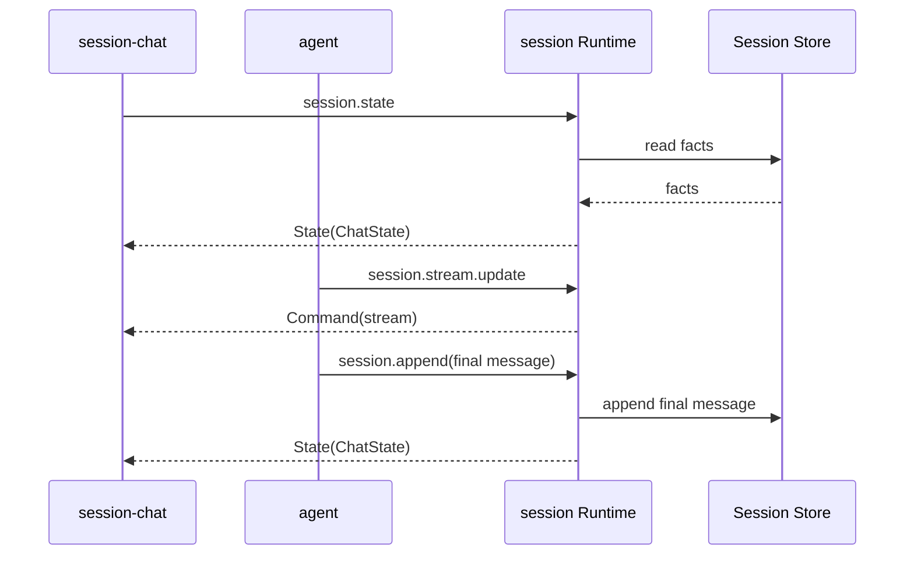

# session 通信契约

跨插件 JSON 的规范来源是 [Core Plugin Contracts](../../contracts/README.md)。本文 payload 示例须与 Schema 一致。

本文记录 `session` 的方法、Fact、payload、投影和 WebUI 通信。

## 1. 对外方法

| 方法 | 用途 | 状态 |
|---|---|---|
| `session.create` | 创建 Session | 当前实现 |
| `session.append` | 批量写入 Fact | 当前实现 |
| `session.query` | 查询 Fact | 当前实现 |
| `session.derive` | 投影模型上下文 | 当前实现 |
| `session.list` | 列出 Session | 当前实现 |
| `session.info` | 读取 Session 元数据 | 当前实现 |
| `session.state` | 读取可重建 UI State | 当前实现 |
| `session.select` | 切换 UI Mount 展示的会话 | 当前实现 |
| `session.stream.update` | 更新临时 Stream 状态 | 当前实现 |

## 2. Fact

```json
{
  "seq": 12,
  "type": "message",
  "role": "assistant",
  "content": "最终正文",
  "tool_calls": null,
  "tool_call_id": "",
  "meta": {
    "turn_id": "t-1",
    "step_id": "st-2",
    "reasoning": "最终推理"
  },
  "ts": 1760000000000
}
```

| 字段 | 说明 |
|---|---|
| `seq` | Session 内顺序 |
| `type` | Fact 类型 |
| `role` | 消息或过程角色 |
| `content` | 正文或描述 |
| `tool_calls` | assistant 工具调用 |
| `tool_call_id` | tool 消息关联 |
| `meta` | 插件定义的关联信息 |
| `ts` | 毫秒时间戳 |

### Fact type

| Type | 用途 | 进入模型上下文 |
|---|---|---|
| `session_start` | Session 元数据 | 否 |
| `turn_start` | Turn 开始 | 否 |
| `turn_end` | Turn 终态 | 否 |
| `step_start` | Step 开始 | 否 |
| `step_end` | Step 终态 | 否 |
| `request_header` | LLM 请求摘要 | 否 |
| `llm_usage` | Token 使用量 | 否 |
| `message` | 用户、assistant、tool、system | 是 |
| `context_summary` | 上下文摘要 | 激活时是 |

v1 不保存 `stream_chunk`。Agent 累计 stream，最终写 `message` Fact。

### Role

| Role | 用途 |
|---|---|
| `system` | 系统上下文 |
| `user` | 用户输入 |
| `assistant` | 模型输出 |
| `tool` | 工具结果 |
| `host` | 过程元数据 |

## 3. session.create

输入：

```json
{
  "session_id": "s-123",
  "name": "项目分析",
  "workspace": "E:/project",
  "parent_session_id": "s-parent",
  "origin": "subagent",
  "delegation_depth": 1
}
```

输出：

```json
{
  "session_id": "s-123",
  "created_ts": 1760000000000
}
```

`session_id` 可省略。创建是幂等的。`append` 不会隐式创建 Session。

## 4. session.append

输入：

```json
{
  "session_id": "s-123",
  "facts": [
    {
      "type": "message",
      "role": "user",
      "content": "分析项目",
      "timestamp": 1760000000000
    }
  ]
}
```

输出：

```json
{
  "session_id": "s-123",
  "seqs": [12],
  "next_seq": 13
}
```

`session.append` 保证批内输入顺序。所有 Fact 在同一把 Session 锁下分配 seq 并写入。

## 5. session.query

输入：

```json
{
  "session_id": "s-123",
  "after_seq": 10,
  "limit": 100,
  "types": ["message"]
}
```

输出：

```json
{
  "facts": [],
  "next_seq": 20,
  "total": 20
}
```

`after_seq` 是开区间。`limit` 为 0 时不限制数量。`types` 为空时返回所有类型。

## 6. session.derive

输入：

```json
{
  "session_id": "s-123",
  "full_tool_results": 8
}
```

输出：

```json
{
  "messages": [
    {
      "role": "user",
      "content": "分析项目",
      "timestamp": 1760000000000
    }
  ],
  "covered_through_seq": 5,
  "summary_seq": 3,
  "truncated_tools": 1
}
```

投影规则：

1. 找到最新激活的 `context_summary`；
2. 读取其后的 `message` Fact；
3. 只保留最后一个 `system` message；
4. 将摘要作为 system message 插入；
5. 旧 tool result 替换为摘要。

`derive` 是纯投影。它不是 UI View，不返回所有 Fact 元数据。

## 7. session.list

输出：

```json
{
  "sessions": [
    {
      "session_id": "s-123",
      "name": "项目分析",
      "workspace": "E:/project",
      "fact_count": 20,
      "created_ts": 1760000000000,
      "last_ts": 1760000010000
    }
  ]
}
```

## 8. session.info

输入：

```json
{
  "session_id": "s-123"
}
```

输出：

```json
{
  "session_id": "s-123",
  "name": "项目分析",
  "workspace": "E:/project",
  "parent_session_id": "",
  "origin": "",
  "delegation_depth": 0,
  "created_ts": 1760000000000,
  "fact_count": 20,
  "next_seq": 21
}
```

## 9. Stream 更新

当前方法：

```text
session.stream.update
```

输入：

```json
{
  "session_id": "s-123",
  "turn_id": "t-1",
  "step_id": "st-2",
  "update_id": 17,
  "message": {
    "role": "assistant",
    "content": "当前累计正文",
    "reasoning": "当前累计 reasoning",
    "tool_calls": []
  },
  "status": "streaming"
}
```

`status` 当前支持 `streaming`、`cancel_requested`、`complete`、`cancelled` 和 `error`。
Session Runtime：

1. 按 `session_id` 暂存当前快照；
2. 同一 `(turn_id, step_id)` 内丢弃较旧的 `update_id`；
3. 仅当该会话是选中会话时，发送 `Command("stream", snapshot)`；
4. 不写 JSONL；
5. `cancel_requested` 会立即推送 ChatState；最终 `turn_end` 后清除临时状态。
`turn_start.meta.plugin` 标记 Turn 属主。属主插件不可用时，State bootstrap 或页面重建会补写 `turn_end(error)`。

## 10. session.state 与 session.select

### session.state

输入：

```json
{
  "session_id": "s-123"
}
```

`session_id` 可省略。显式给出时，返回该 Session 的 ChatState 和 Trace State。省略时按以下顺序解析：

1. 使用 Runtime 记录的当前选中会话；
2. 尚无选中会话时，取 `last_ts` 最新的会话，并记为选中会话；
3. 仍无会话时，只返回 History State。

输出：

```json
{
  "history": {},
  "chat": {},
  "trace": {}
}
```

该方法读取 JSONL 并重建状态，同时初始化缺失的选中会话。它是 UI State bootstrap，不是纯只读查询。

### session.select

输入：

```json
{
  "session_id": "s-123"
}
```

输出：

```json
{
  "session_id": "s-123"
}
```

选中会话属于 Runtime。浏览器不保存也不推导当前会话。调用成功后，Runtime 立即向 `history`、`chat`、`trace` 三个 Mount 各推送一次 State。

选中态只影响 UI 展示，不写入 Session Log。

`session_id` 不存在时返回 `session_not_found`。

## 11. WebUI State

### ChatState

```json
{
  "session_id": "s-123",
  "revision": 21,
  "messages": [
    {
      "seq": 12,
      "turn_id": "t-1",
      "role": "user",
      "content": "分析项目",
      "timestamp": 1760000000000
    }
  ],
  "turn": {
    "turn_id": "t-1",
    "status": "running",
    "step": 2,
    "cancel_requested": false
  },
  "error": null
}
```

ChatState 由 Session Fact 投影。assistant 消息可携带 `reasoning`。`timestamp` 来自 Fact。

`session.state` 可在页面刷新后重建 ChatState、History State 和 Trace State。每个 Mount 的 `revision` 单调递增。Component 丢弃同 Session 的旧 revision。

### HistoryState

```json
{
  "sessions": [
    {
      "session_id": "s-123",
      "name": "项目分析",
      "fact_count": 20,
      "created_ts": 1760000000000,
      "last_ts": 1760000010000
    }
  ],
  "selected_id": "s-123",
  "revision": 3
}
```

`sessions` 按 `last_ts` 降序排列，`last_ts` 相同时按 `created_ts` 降序。`selected_id` 是 Runtime 的当前选中会话，`history` Mount 只用它决定高亮。

### 推送时机

Runtime 只在以下时机推送 State：

| 时机 | 推送的 Mount |
|---|---|
| append 影响选中会话 | `history`、`chat`、`trace` |
| append 只影响其他会话 | `history` |
| create 且尚无选中会话 | `history`、`chat`、`trace` |
| create 且已有选中会话 | `history` |
| select | `history`、`chat`、`trace` |
| stream.update 属于选中会话 | `chat` 的 `Command("stream")` |

append、create 都不会改变已有选中会话。否则后台写入其他会话时会抢占用户正在看的视图。

### Component 交互

| Component | 上行 | 下行 |
|---|---|---|
| `session-history` | `session.state`、`session.create`、`session.select` | History State |
| `session-chat` | `session.state`、`loop.turn/cancel` | ChatState、Stream Command |
| `session-trace` | `session.state` | Trace State |

三个 Component 都不保存当前会话，也不互相传值。选中会话只在 Runtime 中维护。



## 12. 前端消息规则

`session-chat` 分别维护：

```text
durable messages
draft assistant message
```

`Command("stream")` 只更新 draft 节点。durable 列表只在 `State(ChatState)` 到达时重建，流式每条命令不做整列表重绘。

对账规则：

1. `State(ChatState)` 中出现 role 为 `assistant`、且 `(turn_id, step_id)` 与 draft 相同的消息，清除 draft；
2. `turn.status` 进入终态时，一并清除 draft。

第 1 条保证最终正文落地后立即清除草稿，不会在 `message` 与 `turn_end` 之间闪现重复内容。第 2 条兜底。

刷新时 draft 可以丢失。最终正文始终由 `message` Fact 恢复。

选中会话不放在浏览器。`session-history` 的点击只发一次 `session.select`，`session-chat` 与 `session-trace` 只渲染 Runtime 推送的 State。

切换 Session 时，`session-chat` 按 Session ID 保留未发送输入。搜索只过滤 History 列表，不改变当前选中会话。

Composer 固定在消息区底部。用户离开底部后不强制滚动。`回到最新` 由用户主动触发。

消息正文和代码块支持复制。assistant reasoning 与工具调用使用折叠区。正文仍由 DOM 节点构造，不执行插件 HTML。

Component 的主题变量由插件自己拥有，统一使用 `--session-*` 前缀，例如 `--session-border`、`--session-surface`、`--session-accent`。未定义时使用内置回退值，不依赖 Host Shell 的令牌。

## 13. 错误

| 场景 | 错误码 |
|---|---|
| 缺少 `session_id` | `bad_arguments` |
| Fact 类型为空 | `bad_arguments` |
| Session 不存在 | `session_not_found` |
| JSONL 写失败 | `handler_error` |
| JSON 解码失败 | `bad_arguments` |

Session append 失败应终止当前 Turn。UI 投递失败不回滚 Fact 写入。

## 14. 结构体索引

| Go 类型 | 角色 |
|---|---|
| `Fact` | 持久日志单元 |
| `Meta` | Session 元数据 |
| `summaryMeta` | 摘要投影参数 |
| `chatMessage` | derive 输出 |
| `createIn/createOut` | 创建方法 |
| `appendIn/factIn/appendOut` | 写入方法 |
| `queryIn/queryOut` | 查询方法 |
| `deriveIn/deriveOut` | 派生方法 |
| `listIn/listOut` | 列表方法 |
| `infoIn/infoOut` | 元数据方法 |
| `selectIn/selectOut` | 选中会话方法 |
| `store` | 单 Session 内存索引和文件写入 |
