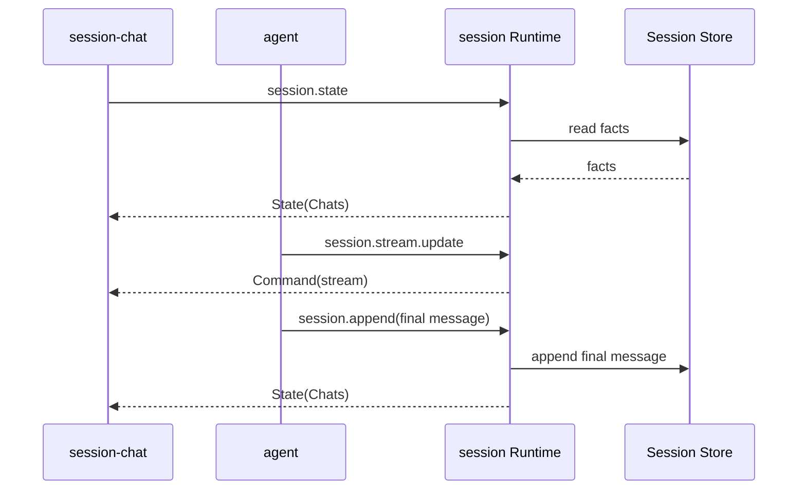

# session 通信契约

本文是该插件跨插件 JSON 的规范来源。调用方按本文维护自己的适配类型。

本文记录 `session` 的方法、Fact、payload、投影和 WebUI 通信。

## 1. 对外方法

| 方法 | 用途 | 状态 |
|---|---|---|
| `session.create` | 创建 Session | 当前实现 |
| `session.append` | 批量写入 Fact | 当前实现 |
| `session.query` | 查询 Fact | 当前实现 |
| `session.derive` | 投影模型上下文 | 当前实现 |
| `session.list` | 列出 Session | 当前实现 |
| `session.info` | 读取 Session 元数据 | 当前实现 |
| `session.state` | 读取可重建 UI State | 当前实现 |
| `session.select` | 打开并切换到指定会话 | 当前实现 |
| `session.close` | 关闭一个打开的会话标签 | 当前实现 |
| `session.refresh` | Workspace 切换后重新同步并发布 UI State | 当前实现 |
| `session.update` | 更新 Session 名称 | 当前实现 |
| `session.workspace.list` | 列出 Workspace 和当前选择 | 当前实现 |
| `session.workspace.create` | 注册并选择 Workspace | 当前实现 |
| `session.workspace.select` | 切换当前 Workspace | 当前实现 |
| `session.workspace.current` | 读取当前 Workspace | 当前实现 |
| `session.workspace.rename` | 重命名 Workspace | 当前实现 |
| `session.workspace.remove` | 移除 Workspace 注册 | 当前实现 |
| `session.stream.update` | 更新临时 Stream 状态 | 当前实现 |

## 2. Fact

```json
{
  "seq": 12,
  "type": "message",
  "role": "assistant",
  "content": "最终正文",
  "tool_calls": null,
  "tool_call_id": "",
  "meta": {
    "turn_id": "t-1",
    "step_id": "st-2",
    "reasoning": "最终推理"
  },
  "ts": 1760000000000
}
```

| 字段 | 说明 |
|---|---|
| `seq` | Session 内顺序 |
| `type` | Fact 类型 |
| `role` | 消息或过程角色 |
| `content` | 正文或描述 |
| `tool_calls` | assistant 工具调用 |
| `tool_call_id` | tool 消息关联 |
| `meta` | 插件定义的关联信息 |
| `ts` | 毫秒时间戳 |

### Fact type

| Type | 用途 | 进入模型上下文 |
|---|---|---|
| `session_start` | Session 元数据 | 否 |
| `turn_start` | Turn 开始 | 否 |
| `turn_end` | Turn 终态 | 否 |
| `step_start` | Step 开始 | 否 |
| `step_end` | Step 终态 | 否 |
| `request_header` | LLM 请求摘要 | 否 |
| `llm_usage` | Token 使用量 | 否 |
| `message` | 用户、assistant、tool、system | 是 |
| `context_summary` | 上下文摘要 | 激活时是 |
| `session_meta` | 名称更新或旧 Workspace 绑定补齐 | 否 |

`step_end`、`request_header` 和 `llm_usage` 由 agent 插件写出，Session 只声明词汇、不解释其内容。
`meta` 的结构由写入方定义，见 `plugins/agent/communication.md`。

v1 不保存 `stream_chunk`。Agent 累计 stream，最终写 `message` Fact。

### Role

| Role | 用途 |
|---|---|
| `system` | 系统上下文 |
| `user` | 用户输入 |
| `assistant` | 模型输出 |
| `tool` | 工具结果 |
| `host` | 过程元数据 |

## 3. session.create

输入：

```json
{
  "session_id": "s-123",
  "name": "项目分析",
  "workspace_id": "ws-123",
  "workspace": "E:/project",
  "parent_session_id": "s-parent",
  "origin": "subagent",
  "delegation_depth": 1
}
```

输出：

```json
{
  "session_id": "s-123",
  "created_ts": 1760000000000
}
```

`session_id` 可省略；省略时由 Session 生成。给出时必须是单一路径名：不能是 `.`、`..`，
不能含 `/`、`\` 或任何一段 `..`，否则返回 `bad_arguments`——`session_id` 直接决定 `.jsonl` 的落盘位置。
创建是幂等的。`append` 不会隐式创建 Session。

`workspace_id` 必须存在于 Session 自己维护的 Workspace Registry。只提供 `workspace` 时，Session 规范化路径并自动注册。两者同时提供时必须指向同一目录。缺少 Workspace 时返回 `workspace_required`。

## 4. session.append

输入：

```json
{
  "session_id": "s-123",
  "facts": [
    {
      "type": "message",
      "role": "user",
      "content": "分析项目",
      "timestamp": 1760000000000
    }
  ]
}
```

输出：

```json
{
  "session_id": "s-123",
  "seqs": [12],
  "next_seq": 13
}
```

`session.append` 保证批内输入顺序。所有 Fact 在同一把 Session 锁下分配 seq 并写入。

## 5. session.query

输入：

```json
{
  "session_id": "s-123",
  "after_seq": 10,
  "limit": 100,
  "types": ["message"]
}
```

输出：

```json
{
  "facts": [],
  "next_seq": 20,
  "total": 20
}
```

`after_seq` 是开区间。`limit` 为 0 时不限制数量。`types` 为空时返回所有类型。

## 6. session.derive

输入：

```json
{
  "session_id": "s-123",
  "full_tool_results": 8
}
```

输出：

```json
{
  "messages": [
    {
      "role": "user",
      "content": "分析项目",
      "timestamp": 1760000000000
    }
  ],
  "covered_through_seq": 5,
  "summary_seq": 3,
  "truncated_tools": 1
}
```

投影规则：

1. 找到最新激活的 `context_summary`；
2. 读取其后的 `message` Fact；
3. 只保留最后一个 `system` message；
4. 将摘要作为 system message 插入；
5. 旧 tool result 替换为摘要。

`derive` 是纯投影。它不是 UI View，不返回所有 Fact 元数据。

## 7. session.list

输出：

```json
{
  "sessions": [
    {
      "session_id": "s-123",
      "name": "项目分析",
      "workspace_id": "ws-123",
      "workspace": "E:/project",
      "fact_count": 20,
      "created_ts": 1760000000000,
      "last_ts": 1760000010000
    }
  ]
}
```

## 8. session.info

输入：

```json
{
  "session_id": "s-123"
}
```

输出：

```json
{
  "session_id": "s-123",
  "name": "项目分析",
  "workspace_id": "ws-123",
  "workspace": "E:/project",
  "parent_session_id": "",
  "origin": "",
  "delegation_depth": 0,
  "created_ts": 1760000000000,
  "fact_count": 20,
  "next_seq": 21
}
```

## 9. Stream 更新

当前方法：

```text
session.stream.update
```

输入：

```json
{
  "session_id": "s-123",
  "turn_id": "t-1",
  "step_id": "st-2",
  "update_id": 17,
  "message": {
    "role": "assistant",
    "content": "当前累计正文",
    "reasoning": "当前累计 reasoning",
    "tool_calls": []
  },
  "status": "streaming"
}
```

`status` 当前支持 `streaming`、`cancel_requested`、`complete`、`cancelled` 和 `error`。
Session Runtime：

1. 按 `session_id` 暂存当前快照；
2. 同一 `(turn_id, step_id)` 内丢弃较旧的 `update_id`；
3. 只要该会话位于某个打开的标签中，就发送 `Command("stream", snapshot)`；
4. 不写 JSONL；
5. `cancel_requested` 会立即推送 Chat Panes State；最终 `turn_end` 后清除临时状态。
6. 当前 Workspace 之外的 Tab 保留但不在 Chat Panes State 中返回。
`turn_start.meta.plugin` 标记 Turn 属主。属主插件不可用时，State bootstrap 或页面重建会补写 `turn_end(error)`。

## 10. session.state 与 session.select

### session.state

输入：

```json
{
  "session_id": "s-123"
}
```

`session_id` 可省略。显式给出时，返回该 Session 的 ChatState、当前 Workspace 的打开会话 `chats` 和 Trace State。省略时按以下顺序解析：

1. 使用当前 Workspace 记录的选中会话；
2. 尚无选中会话时，取该 Workspace 内 `last_ts` 最新的会话，并记为选中会话；
3. 仍无会话时，清空 Chat 和 Trace，只返回 History State。

输出：

```json
{
  "history": {},
  "chat": {},
  "trace": {}
}
```

该方法读取 JSONL 并重建状态，同时初始化缺失的选中会话。它是 UI State bootstrap，不是纯只读查询：
传入的 `session_id` 必须已存在，否则返回 `session_not_found`。

### session.select

输入：

```json
{
  "session_id": "s-123"
}
```

输出：

```json
{
  "session_id": "s-123"
}
```

选中会话属于 Runtime。浏览器不保存也不推导当前会话。调用成功后，Runtime 立即向 `history`、`chat`、`trace` 三个 Mount 各推送一次 State。

`select` 同时把会话加入打开列表。重复选择只切换当前标签，不重复打开。

打开一个属于其他 Workspace 的 Session 时，Runtime 同时切换 Workspace 选择。

### session.close

```json
{"session_id": "s-123"}
```

关闭不会取消运行中的 Turn。关闭当前标签后，Runtime 选择相邻打开会话。输出：

```json
{"session_id": "s-123", "closed": true, "selected_id": "s-124"}
```

被关闭的会话如果正好是它所属 Workspace 的选中项，选中项必须落到该 Workspace 仍打开的某个会话上，
没有则清空——不会留下指向已关闭会话的悬空 id。

### session.update

```json
{"session_id": "s-123", "name": "项目分析"}
```

`name` 可省略。Workspace 绑定不可修改；传入 `workspace` 或 `workspace_id` 返回 `bad_arguments`。名称更新写入 `session_meta` Fact。

### session.refresh

输入空对象。Session 把当前选中的 Workspace、会话和打开列表原样向 `history`、`chat`、`trace` 发布一遍 State。该方法是 Workspace 选择后的 UI 同步入口；它不接受输入，也不改变任何选择。

### session.workspace.*

Workspace 方法属于 `session` Capability：

```json
{"path": "E:/project", "name": "可选名称"}
```

```json
{"workspace_id": "ws-123"}
```

`session.workspace.list` 输出：

```json
{"workspaces": [], "selected_id": "ws-123"}
```

`workspace.create` 会注册并选择目录，重复路径返回已有记录。`workspace.remove` 只删除注册，不删除目录或 Session。

选中态只影响 UI 展示，不写入 Session Log。

`session_id` 不存在时返回 `session_not_found`。

## 11. WebUI State

### ChatState

```json
{
  "session_id": "s-123",
  "name": "项目分析",
  "workspace_id": "ws-123",
  "workspace": "E:/project",
  "revision": 21,
  "messages": [
    {
      "seq": 12,
      "turn_id": "t-1",
      "role": "user",
      "content": "分析项目",
      "timestamp": 1760000000000
    }
  ],
  "turn": {
    "turn_id": "t-1",
    "status": "running",
    "step": 2,
    "cancel_requested": false
  },
  "stream": null,
  "error": null
}
```

ChatState 由 Session Fact 投影。assistant 消息可携带 `reasoning`。`timestamp` 来自 Fact。`stream` 存在时表示当前进程内仍有 Stream Draft。

`session.state` 可在页面刷新后重建 ChatState、History State 和 Trace State。每个 Mount 的 `revision` 单调递增。Component 丢弃同 Session 的旧 revision。插件重启后 revision 仍须递增，否则重连 resync 会被页面当成旧状态丢弃。

### HistoryState

```json
{
  "sessions": [
    {
      "session_id": "s-123",
      "name": "项目分析",
      "workspace_id": "ws-123",
      "workspace": "E:/project",
      "fact_count": 20,
      "created_ts": 1760000000000,
      "last_ts": 1760000010000
    }
  ],
  "selected_id": "s-123",
  "workspace_id": "ws-123",
  "selected_workspace_id": "ws-123",
  "workspaces": [
    {
      "workspace_id": "ws-123",
      "name": "项目分析",
      "path": "E:/project",
      "created_ts": 1760000000000,
      "updated_ts": 1760000000000
    }
  ],
  "open_ids": ["s-123", "s-124"],
  "revision": 3
}
```

`sessions` 只包含当前 Workspace 的 Session，并按 `last_ts` 降序排列。`selected_id` 是当前 Workspace 的选中会话。`workspaces` 供左侧选择器使用。

`workspace_id` 跟随本次请求解析出的会话（可为空），`selected_workspace_id` 是 Registry 当前的 Workspace。
两者不一定相同：按 `session_id` 读另一个 Workspace 的会话时，前者会切到那个会话的 Workspace，
后者仍报告 Registry 的选择。左侧选择器用后者高亮，不再需要额外发一次 `workspace.current`。

### 推送时机

Runtime 只在以下时机推送 State：

| 时机 | 推送的 Mount |
|---|---|
| append 影响当前 Workspace | `history`、`chat`、`trace` |
| append 只影响其他 Workspace | `history`、`chat`（内容不变） |
| create 且当前 Workspace 尚无选中会话 | `history`、`chat`、`trace` |
| create 且已有选中会话 | `history` |
| select 或 Workspace 切换 | `history`、`chat`、`trace` |
| stream.update 属于选中会话 | `chat` 的 `Command("stream")` |

append、create 都不会改变已有选中会话。否则后台写入其他会话时会抢占用户正在看的视图。

### Component 交互

| Component | 上行 | 下行 |
|---|---|---|
| `session-history` | `session.workspace.list/create/select`、`session.refresh/state` | History State |
| `session-chat` | `session.state`、`session.select/close`、`loop.turn/cancel` | Chat Panes State、Stream Command |
| `session-trace` | `session.state` | Trace State |

三个 Component 都不保存当前会话，也不互相传值。打开列表和选中会话只在 Runtime 中维护。



## 12. 前端消息规则

`session-history` 分别维护：

```text
workspace selector
workspace add form
session query
```

`session-chat` 分别维护 durable messages、draft assistant message、当前 Workspace 的 open tabs 和输入草稿。

对账规则：

1. `State(ChatState)` 中出现 role 为 `assistant`、且 `(turn_id, step_id)` 与 draft 相同的消息，清除 draft；
2. `turn.status` 进入终态时，一并清除 draft。

第 1 条保证最终正文落地后立即清除草稿，不会在 `message` 与 `turn_end` 之间闪现重复内容。第 2 条兜底。

刷新时 draft 可以丢失。最终正文始终由 `message` Fact 恢复。Workspace 选择由 Session 插件保存，页面刷新后恢复。

选中会话不放在浏览器。`session-history` 的点击只发一次 `session.select`，`session-chat` 渲染 Runtime 推送的打开列表与当前标签，`session-trace` 只渲染当前标签。

切换 Session 时，`session-chat` 按 Session ID 保留未发送输入。多个标签可以同时存在；后台标签收到完成或错误 State 后更新状态点。搜索只过滤 History 列表，不改变当前选中会话。

没有选中 Workspace 时，“新建会话”和发送按钮禁用。Session 的 Workspace 在创建后只读。

Composer 固定在消息区底部。用户离开底部后不强制滚动。`回到最新` 由用户主动触发。

消息正文和代码块支持复制。assistant reasoning 与工具调用使用折叠区。正文仍由 DOM 节点构造，不执行插件 HTML。

Component 的主题变量由插件自己拥有，统一使用 `--session-*` 前缀，例如 `--session-border`、`--session-surface`、`--session-accent`。未定义时使用内置回退值，不依赖 Host Shell 的令牌。

## 13. 错误

| 场景 | 错误码 |
|---|---|
| 缺少 `session_id` | `bad_arguments` |
| `session_id` 含路径分隔符或 `..` | `bad_arguments` |
| Fact 类型为空 | `bad_arguments` |
| Session 不存在 | `session_not_found` |
| Workspace 不存在 | `workspace_not_found` |
| Workspace 路径不合法 | `workspace_invalid` |
| Session Workspace 与 Workspace ID 不一致 | `workspace_mismatch` |
| 修改已有 Session 的 Workspace | `bad_arguments` |
| JSONL 写失败 | `handler_error` |
| JSON 解码失败 | `bad_arguments` |

Session append 失败应终止当前 Turn。UI 投递失败不回滚 Fact 写入。

## 14. 结构体索引

| Go 类型 | 角色 |
|---|---|
| `Fact` | 持久日志单元 |
| `Meta` | Session 元数据 |
| `summaryMeta` | 摘要投影参数 |
| `chatMessage` | derive 输出 |
| `createIn/createOut` | 创建方法 |
| `appendIn/factIn/appendOut` | 写入方法 |
| `queryIn/queryOut` | 查询方法 |
| `deriveIn/deriveOut` | 派生方法 |
| `listIn/listOut` | 列表方法 |
| `infoIn/infoOut` | 元数据方法 |
| `selectIn/selectOut` | 选中会话方法 |
| `store` | 单 Session 内存索引和文件写入 |
| `workspaceRecord` | Workspace Registry 记录 |
| `workspaceStore` | Workspace 注册、选择和持久化 |
