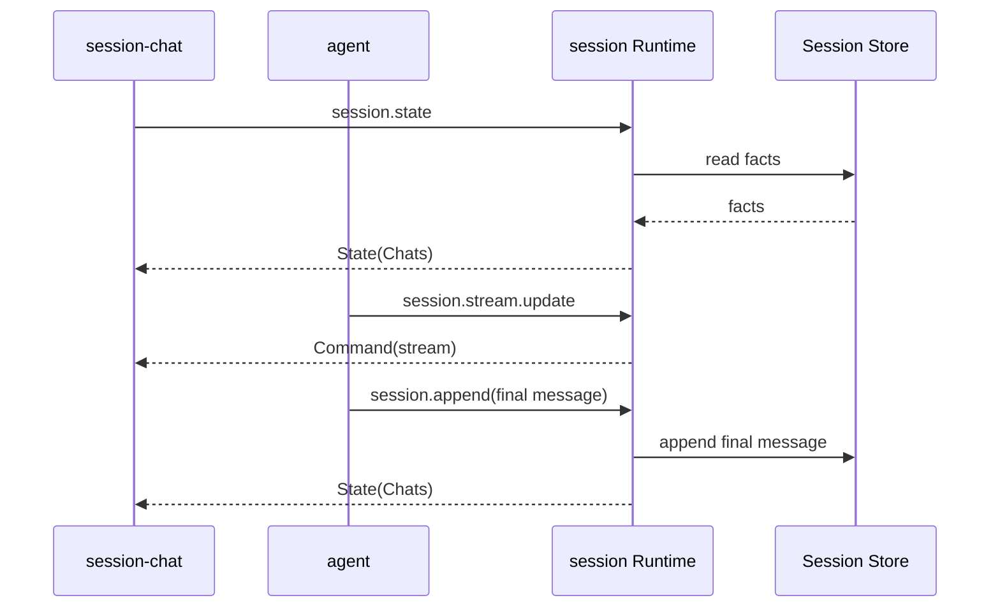

# session 通信契约

本文是该插件跨插件 JSON 的规范来源。调用方按本文维护自己的适配类型。

本文记录 `session` 的方法、Fact、payload、投影和 WebUI 通信。

## 1. 对外方法

| 方法 | 用途 | 状态 |
|---|---|---|
| `session.create` | 创建 Session | 当前实现 |
| `session.append` | 批量写入 Fact | 当前实现 |
| `session.query` | 查询 Fact | 当前实现 |
| `session.derive` | 投影模型上下文 | 当前实现 |
| `session.list` | 列出 Session | 当前实现 |
| `session.info` | 读取 Session 元数据 | 当前实现 |
| `session.state` | 读取可重建 UI State | 当前实现 |
| `session.dock` | 读取 bottom dock 投影 | 当前实现 |
| `session.select` | 打开并切换到指定会话 | 当前实现 |
| `session.close` | 关闭一个打开的会话标签 | 当前实现 |
| `session.refresh` | Workspace 切换后重新同步并发布 UI State | 当前实现 |
| `session.update` | 更新 Session 名称 | 当前实现 |
| `session.workspace.list` | 列出 Workspace 和当前选择 | 当前实现 |
| `session.workspace.create` | 注册并选择 Workspace | 当前实现 |
| `session.workspace.select` | 切换当前 Workspace | 当前实现 |
| `session.workspace.current` | 读取当前 Workspace | 当前实现 |
| `session.workspace.rename` | 重命名 Workspace | 当前实现 |
| `session.workspace.remove` | 移除 Workspace 注册 | 当前实现 |
| `session.stream.update` | 更新临时 Stream 状态 | 当前实现 |

## 2. Fact

```json
{
  "seq": 12,
  "type": "message",
  "role": "assistant",
  "content": "最终正文",
  "tool_calls": null,
  "tool_call_id": "",
  "meta": {
    "turn_id": "t-1",
    "step_id": "st-2",
    "reasoning": "最终推理"
  },
  "ts": 1760000000000
}
```

| 字段 | 说明 |
|---|---|
| `seq` | Session 内顺序 |
| `type` | Fact 类型 |
| `role` | 消息或过程角色 |
| `content` | 正文或描述 |
| `tool_calls` | assistant 工具调用 |
| `tool_call_id` | tool 消息关联 |
| `meta` | 插件定义的关联信息 |
| `ts` | 毫秒时间戳 |

### Fact type

| Type | 用途 | 进入模型上下文 |
|---|---|---|
| `session_start` | Session 元数据 | 否 |
| `turn_start` | Turn 开始 | 否 |
| `turn_end` | Turn 终态 | 否 |
| `step_start` | Step 开始 | 否 |
| `step_end` | Step 终态 | 否 |
| `request_header` | LLM 请求摘要 | 否 |
| `llm_usage` | Token 使用量 | 否 |
| `message` | 用户、assistant、tool、system | 是 |
| `context_summary` | 上下文摘要 | 激活时作为 system 消息 |
| `context_compaction` | 压缩审计 | 否 |
| `context_snapshot` | 单步模型输入快照 | 否 |
| `session_meta` | 名称更新或旧 Workspace 绑定补齐 | 否 |

`step_end`、`request_header`、`llm_usage` 和 `context_snapshot` 由 agent / model-context 写出，Session 只声明词汇、不解释其内容。
`context_summary` 的 `meta` 至少包含 `active`、`covers_through_seq`；新实现同时使用 `shadowed_from_seq` 与 `shadowed_to_seq`。
`meta` 的结构由写入方定义，见 [agent](../agent/communication.md) 与 [model-context](../model-context/communication.md) 文档。

v1 不保存 `stream_chunk`。Agent 累计 stream，最终写 `message` Fact。

### Role

| Role | 用途 |
|---|---|
| `system` | 系统上下文 |
| `user` | 用户输入 |
| `assistant` | 模型输出 |
| `tool` | 工具结果 |
| `host` | 过程元数据 |

## 3. session.create

输入：

```json
{
  "session_id": "s-123",
  "name": "项目分析",
  "workspace_id": "ws-123",
  "workspace": "E:/project",
  "model": "deepseek-chat",
  "context_window": 65536,
  "parent_session_id": "s-parent",
  "origin": "subagent",
  "delegation_depth": 1
}
```

输出：

```json
{
  "session_id": "s-123",
  "created_ts": 1760000000000
}
```

`session_id` 可省略；省略时由 Session 生成。给出时必须是单一路径名：不能是 `.`、`..`，
不能含 `/`、`\` 或任何一段 `..`，否则返回 `bad_arguments`——`session_id` 直接决定 `.jsonl` 的落盘位置。
创建是幂等的。`append` 不会隐式创建 Session。

`workspace_id` 必须存在于 Session 自己维护的 Workspace Registry。只提供 `workspace` 时，Session 规范化路径并自动注册。两者同时提供时必须指向同一目录。缺少 Workspace 时返回 `workspace_required`。

`model` 与 `context_window` 是可选的会话级模型选择。它们写入 `session_start` 的 `meta`，创建后不再变化。
`context_window` 为负数时按 `0` 保存。Session 不校验模型是否存在；模型目录属于 llm 插件。

## 4. session.append

输入：

```json
{
  "session_id": "s-123",
  "facts": [
    {
      "type": "message",
      "role": "user",
      "content": "分析项目",
      "timestamp": 1760000000000
    }
  ]
}
```

输出：

```json
{
  "session_id": "s-123",
  "seqs": [12],
  "next_seq": 13
}
```

`session.append` 保证批内输入顺序。所有 Fact 在同一把 Session 锁下分配 seq 并写入。

## 5. session.query

输入：

```json
{
  "session_id": "s-123",
  "after_seq": 10,
  "limit": 100,
  "types": ["message"]
}
```

输出：

```json
{
  "facts": [],
  "next_seq": 20,
  "total": 20
}
```

`after_seq` 是开区间。`limit` 为 0 时不限制数量。`types` 为空时返回所有类型。

## 6. session.derive

输入：

```json
{
  "session_id": "s-123",
  "full_tool_results": 8
}
```

输出：

```json
{
  "messages": [
    {
      "seq": 3,
      "role": "system",
      "content": "You are an AI agent powered by LiteAgent...",
      "meta": {
        "source": "model-context",
        "kind": "system_prompt",
        "hash": "..."
      }
    },
    {
      "seq": 2,
      "role": "user",
      "content": "分析项目"
    }
  ],
  "covered_through_seq": 1,
  "summary_seq": 9,
  "truncated_tools": 1,
  "truncated_seqs": [4]
}
```

`seq` 与 `meta` 是审计字段。LLM 适配器忽略它们；model-context 用它们识别自己的 system prompt / runtime context。

投影规则：

1. 找到最新 `active=true` 的 `context_summary`，读取 `shadowed_from_seq` / `shadowed_to_seq`；没有区间字段时回退 `covers_through_seq`。
2. 普通 `message` 在遮蔽区间内的不进入投影；区间外保留。
3. 最新 `kind=system_prompt` 的 message 放到头部；没有时保留旧规则：最新可见 system message 放到头部。
4. 最新 `kind=runtime_context` 的 message 保留一条，放在摘要之后。
5. 摘要作为 system message 插在系统提示之后。
6. system prompt 与 runtime context 不受遮蔽区间影响。
7. 旧 tool result 按 `full_tool_results` 替换为确定性 stub，并计入 `truncated_tools`；被替换的 Fact `seq` 写入 `truncated_seqs`。
8. 修复孤立的 tool message：前面 assistant 的 `tool_calls` 不包含它的 `tool_call_id` 时，投影为 `role=user`，正文加 `[recovered tool result; original tool_call_id="..."]` 前缀。旧版本日志只存了 tool result、没存 assistant `tool_calls`，供应商会拒绝这类序列。

`derive` 是纯投影，不修改 Fact 日志。它不是 UI View，不返回所有 Fact 元数据。日志顺序不等于模型顺序，`context_snapshot.surface` 记录实际模型顺序。

## 7. session.list

输出：

```json
{
  "sessions": [
    {
      "session_id": "s-123",
      "name": "项目分析",
      "workspace_id": "ws-123",
      "workspace": "E:/project",
      "fact_count": 20,
      "created_ts": 1760000000000,
      "last_ts": 1760000010000
    }
  ]
}
```

## 8. session.info

输入：

```json
{
  "session_id": "s-123"
}
```

输出：

```json
{
  "session_id": "s-123",
  "name": "项目分析",
  "workspace_id": "ws-123",
  "workspace": "E:/project",
  "model": "deepseek-chat",
  "context_window": 65536,
  "parent_session_id": "",
  "origin": "",
  "delegation_depth": 0,
  "created_ts": 1760000000000,
  "fact_count": 20,
  "next_seq": 21
}
```

`model` 与 `context_window` 来自 `session_start`。旧会话没有这两个字段时省略，agent 使用 llm 的默认模型。

## 9. Stream 更新

当前方法：

```text
session.stream.update
```

输入：

```json
{
  "session_id": "s-123",
  "turn_id": "t-1",
  "step_id": "st-2",
  "update_id": 17,
  "message": {
    "role": "assistant",
    "content": "当前累计正文",
    "reasoning": "当前累计 reasoning",
    "tool_calls": []
  },
  "status": "streaming"
}
```

`status` 当前支持 `streaming`、`cancel_requested`、`complete`、`cancelled` 和 `error`。
Session Runtime：

1. 按 `session_id` 暂存当前完整快照；
2. 同一 `(turn_id, step_id)` 内丢弃较旧的 `update_id`；
3. 只更新内存快照并入 latest-value outbox；后台约每 33 ms 合并发送一次
   `Command("stream", delta)`。delta 只携带新增的 `content_delta` / `reasoning_delta`；
   合并多帧时 `coalesced=true`，`update_id` 取最新值；`reset=true` 时携带当前完整正文，
   用于新 Step 或断点恢复；
4. ChatState 的 `stream` 仍保存完整快照，页面重连 resync 时一次性恢复；
5. 客户端按 `update_id` 连续性合并。`coalesced=true` 时允许 `update_id` 跳变，
   因为服务端已合并中间增量；其他断点表示 Command 丢失或服务端重建，客户端重新读取
   `session.state`；
6. 不写 JSONL；
7. `cancel_requested` 会立即推送 Chat Panes State；最终助手消息或 `turn_end` 到达后，
   清除临时流状态并丢弃 outbox 中尚未发送的增量。
8. 当前 Workspace 之外的 Tab 保留但不在 Chat Panes State 中返回。
`turn_start.meta.plugin` 标记 Turn 属主。属主插件不可用时，State bootstrap 或页面重建会补写 `turn_end(error)`。

## 10. session.state 与 session.select

### session.state

输入：

```json
{
  "session_id": "s-123"
}
```

`session_id` 可省略。显式给出时，返回该 Session 的 ChatState、当前 Workspace 的打开会话 `chats` 和 Trace State。省略时按以下顺序解析：

1. 使用当前 Workspace 记录的选中会话；
2. 尚无选中会话时，取该 Workspace 内 `last_ts` 最新的会话，并记为选中会话；
3. 仍无会话时，清空 Chat 和 Trace，只返回 History State。

输出：

```json
{
  "history": {},
  "chat": {},
  "trace": {}
}
```

该方法读取 JSONL 并重建状态，同时初始化缺失的选中会话。它是 UI State bootstrap，不是纯只读查询：
传入的 `session_id` 必须已存在，否则返回 `session_not_found`。

### session.select

输入：

```json
{
  "session_id": "s-123"
}
```

输出：

```json
{
  "session_id": "s-123"
}
```

选中会话属于 Runtime。浏览器不保存也不推导当前会话。调用成功后，Runtime 立即向 `history`、`chat`、`trace` 三个 Mount 各推送一次 State。

`select` 同时把会话加入打开列表。重复选择只切换当前标签，不重复打开。

打开一个属于其他 Workspace 的 Session 时，Runtime 同时切换 Workspace 选择。

### session.close

```json
{"session_id": "s-123"}
```

关闭不会取消运行中的 Turn。关闭当前标签后，Runtime 选择相邻打开会话。输出：

```json
{"session_id": "s-123", "closed": true, "selected_id": "s-124"}
```

被关闭的会话如果正好是它所属 Workspace 的选中项，选中项必须落到该 Workspace 仍打开的某个会话上，
没有则清空——不会留下指向已关闭会话的悬空 id。

### session.update

```json
{"session_id": "s-123", "name": "项目分析"}
```

`name` 可省略。Workspace 绑定不可修改；传入 `workspace` 或 `workspace_id` 返回 `bad_arguments`。名称更新写入 `session_meta` Fact。

### session.refresh

输入空对象。Session 把当前选中的 Workspace、会话和打开列表原样向 `history`、`chat`、`trace` 发布一遍 State。该方法是 Workspace 选择后的 UI 同步入口；它不接受输入，也不改变任何选择。

### session.workspace.*

Workspace 方法属于 `session` Capability：

```json
{"path": "E:/project", "name": "可选名称"}
```

```json
{"workspace_id": "ws-123"}
```

`session.workspace.list` 输出：

```json
{"workspaces": [], "selected_id": "ws-123"}
```

`workspace.create` 会注册并选择目录，重复路径返回已有记录。`workspace.remove` 只删除注册，不删除目录或 Session。

`workspace.select` 同时协调选中会话。新 Workspace 有记录的选中会话时恢复它；
否则选择该 Workspace `last_ts` 最新的会话；没有会话时清空选中。
其他 Workspace 的 Tab 仍保留，但不会进入当前 Chat Panes State。

选中态只影响 UI 展示，不写入 Session Log。

`session_id` 不存在时返回 `session_not_found`。

## 11. WebUI State

### ChatState

```json
{
  "session_id": "s-123",
  "name": "项目分析",
  "workspace_id": "ws-123",
  "workspace": "E:/project",
  "model": "step-5-preview",
  "context_window": 65536,
  "revision": 21,
  "through_seq": 12,
  "first_seq": 3,
  "has_more": true,
  "messages": [
    {
      "seq": 12,
      "turn_id": "t-1",
      "role": "user",
      "content": "分析项目",
      "timestamp": 1760000000000
    }
  ],
  "turn": {
    "turn_id": "t-1",
    "status": "running",
    "step": 2,
    "cancel_requested": false
  },
  "turns": [
    {
      "turn_id": "t-1",
      "status": "running",
      "step": 2,
      "started_ts": 1760000000000,
      "message_count": 6,
      "tool_count": 2
    }
  ],
  "usage": {
    "prompt_tokens": 3702,
    "completion_tokens": 36,
    "total_tokens": 3738,
    "requests": 3,
    "last_prompt_tokens": 1234,
    "model": "step-5-preview",
    "context_window": 65536
  },
  "context": {
    "model_context_id": "mc-...",
    "turn_id": "t-1",
    "step_id": "t-1-s1",
    "message_count": 3,
    "token_estimate": 1308,
    "model": "step-5-preview",
    "context_window": 65536,
    "warnings": []
  },
  "request": {
    "turn_id": "t-1",
    "step_id": "t-1-s1",
    "mode": "tool_calling",
    "scheme": "tool_calling",
    "model": "step-5-preview",
    "context_window": 65536
  },
  "stream": null,
  "error": null
}
```

ChatState 由 Session Fact 投影。assistant 消息可携带 `reasoning`。`timestamp` 来自 Fact。`stream` 存在时表示当前进程内仍有 Stream Draft。

`turns` 按 Fact 首次出现顺序列出 Turn 摘要：`status`、`step`、`started_ts`、`ended_ts`、
`message_count`、`tool_count` 和可选 `error`。`error` 来自 `turn_end.meta.error`。
没有过程消息的失败或取消 Turn 也用它显示可见状态行。它不改变 Fact Log。

`message` 项可选携带 `tool_name`、`is_error`、`truncated`，来自 tool message 的 `meta`。
`session-chat` 用它们显示工具结果摘要和状态。

`usage` 只聚合 `llm_usage` 中的 API 返回值。`prompt_tokens/completion_tokens/total_tokens` 是会话累计，
`last_prompt_tokens` 是最近一次请求的输入用量，`requests` 是已完成的请求数。
`context` 是最近一条 `context_snapshot` 的摘要，`token_estimate` 是本地估算，只用于明细展示。
`request` 是最近一条 `request_header` 的摘要。`model` 优先取会话元数据；
`context_window` 优先取最近一次 usage 的窗口，保证与分子来自同一请求，缺失时回退到会话元数据或快照。

`message` 项新增 `source` 与 `kind`，取自 Fact 的 `meta`。`session-chat` 把 `kind=system_prompt`、`kind=runtime_context` 和普通 `role=system` 渲染为可折叠上下文块，不显示为用户气泡。`session-trace` 为 `context_snapshot` 与 `context_compaction` 增加标签。

取消提示 Fact 的 `kind=turn_cancelled`。
`session-chat` 不把它渲染为气泡；它仍保留在 Fact Log 与模型上下文中。

`session.state` 可在页面刷新后重建 ChatState、History State 和 Trace State。每个 Mount 的 `revision` 单调递增。Component 丢弃同 Session 的旧 revision。插件重启后 revision 仍须递增，否则重连 resync 会被页面当成旧状态丢弃。

`through_seq` 是该 State 覆盖的最后一条 Fact。它是增量 Command 的游标：append 产生的增量必须从 `through_seq` 继续。TraceState 同样携带 `through_seq` 与 `total`；`facts` 是完整或按窗口截取的事实列表。

ChatState 只返回最近 200 条消息，且窗口正文约不超过 2 MiB。`first_seq` 是窗口第一条消息的 seq，`has_more` 表示更早还有消息。更早的消息通过 `session.messages` 分页读取。TraceState 只返回最近 200 条 Fact，并受同样的 2 MiB 预算约束；`first_seq` 与 `has_more` 的含义相同，更早的 Fact 通过 `session.facts` 分页读取。

### TraceState 窗口

```json
{
  "session_id": "s-123",
  "revision": 22,
  "through_seq": 140,
  "first_seq": 20,
  "has_more": true,
  "total": 140,
  "facts": []
}
```

`total` 是完整 Fact 数，`facts` 只包含窗口。`session-trace` 默认显示窗口内最新的 60 条，向上加载本地更早记录；本地窗口耗尽后再调用 `session.facts`。

### Append Commands

append 不再推送完整 Chat、Trace、Dock State。Runtime 发送三个增量 Command；完整 State 只用于挂载、选择、刷新和重连 resync。

Chat Append：

```json
{
  "session_id": "s-123",
  "revision": 22,
  "after_seq": 12,
  "through_seq": 14,
  "messages": [
    {
      "seq": 14,
      "turn_id": "t-1",
      "role": "tool",
      "content": "工具输出",
      "tool_name": "file_read"
    }
  ],
  "turn": {"turn_id": "t-1", "status": "completed", "step": 2, "error": "可选错误信息"}
}
```

`turn.error` 来自 `turn_end.meta.error`，用于增量失败状态行。

Trace Append：

```json
{
  "session_id": "s-123",
  "revision": 23,
  "after_seq": 12,
  "through_seq": 14,
  "total": 14,
  "facts": [{"seq": 13}, {"seq": 14}]
}
```

Dock Append 只携带本次变化的字段：

```json
{
  "session_id": "s-123",
  "revision": 24,
  "turn": {"turn_id": "t-1", "status": "running", "step": 2},
  "usage": {
    "prompt_tokens": 100,
    "completion_tokens": 10,
    "total_tokens": 110,
    "requests": 1,
    "last_prompt_tokens": 100,
    "model": "step-5-preview",
    "context_window": 65536
  },
  "context": {"message_count": 3, "token_estimate": 1308},
  "request": {"turn_id": "t-1", "step_id": "t-1-s1", "model": "step-5-preview"}
}
```

`dock.usage` 是增量：Component 把它累加到本地 usage。`context` 与 `request` 是最新完整摘要；缺省字段保持不变。

接收方必须校验 `after_seq === 本地 through_seq`。不一致表示中间丢了 Command 或发生了并发重建，Component 直接调用 `session.state` / `session.dock` 重新读取完整 State。Command 不重放，State 是唯一恢复手段。

### Chat 消息折叠

`session-chat` 只按 `turn_id` 做展示分组，不改变消息顺序：

- 用户消息、`role=system` 的消息和无 `turn_id` 的上下文块始终可见。
- 最终回答是该 Turn 中最后一条有正文且没有 `tool_calls` 的 assistant 消息，始终可见。
- 其余 assistant / tool 消息视为过程，折叠时隐藏。
- 已完成、已取消、出错和达到步数上限的 Turn 默认折叠；运行中的 Turn 默认展开且不可折叠。
- Turn 头显示轮次、状态、过程条数、工具数和时长（起止时间都存在时）。
- 没有过程行的 Turn 在最终消息后显示状态行；状态为 `completed` 且工具数为零时追加「未调用工具」。
- 单个工具结果、reasoning 和 tool_calls 仍各自可折叠。
- 折叠选择只存在浏览器内存中，按 Session + Turn 记住；刷新后回到默认状态。

### DockState

```json
{
  "session_id": "s-123",
  "name": "项目分析",
  "workspace_id": "ws-123",
  "workspace": "E:/project",
  "revision": 41,
  "model": "step-5-preview",
  "context_window": 65536,
  "turn": {
    "turn_id": "t-1",
    "status": "running",
    "step": 2,
    "cancel_requested": false
  },
  "usage": {
    "prompt_tokens": 3702,
    "completion_tokens": 36,
    "total_tokens": 3738,
    "requests": 3,
    "last_prompt_tokens": 1234,
    "model": "step-5-preview",
    "context_window": 65536
  },
  "context": {
    "model_context_id": "mc-...",
    "message_count": 3,
    "token_estimate": 1308,
    "warnings": []
  },
  "request": {
    "turn_id": "t-1",
    "step_id": "t-1-s1",
    "mode": "tool_calling",
    "scheme": "tool_calling"
  }
}
```

DockState 是 ChatState 的轻量投影，不携带消息正文。`session-dock` 用 `usage.last_prompt_tokens / context_window`
计算上下文百分比；`context.token_estimate` 只显示在明细里。明细面板通过 `model-context.inspect`
读取实际发送消息，通过 `model-context.build` 预览下一次请求。没有选中会话时，State 只有 `revision`，
组件隐藏；Host 的 bottom Slot 在全子元素隐藏时一并隐藏。

### session.dock

输入可省略，或指定 `session_id`：

```json
{ "session_id": "s-123" }
```

输出 DockState。省略时按 `session.state` 的规则解析当前会话。该方法是 `session-dock` 首次挂载和重连 resync 的入口，
不推送其他 Mount。

### session.messages

读取更早的 Chat 消息页：

```json
{ "session_id": "s-123", "before_seq": 3, "limit": 200 }
```

`before_seq` 不包含在结果中；省略或为 0 时从最新一页开始。`limit` 默认 200，最大 500。

```json
{
  "session_id": "s-123",
  "messages": [],
  "first_seq": 2,
  "has_more": false,
  "total": 40
}
```

返回结果按时间正序排列，`first_seq` 是页内第一条消息的 seq，`has_more` 表示该页之前还有消息。

### session.facts

读取更早的审计 Fact 页：

```json
{ "session_id": "s-123", "before_seq": 20, "limit": 200 }
```

字段语义与 `session.messages` 相同；`total` 是完整 Fact 数。`session-trace` 用它实现“加载更早”。

### HistoryState

```json
{
  "sessions": [
    {
      "session_id": "s-123",
      "name": "项目分析",
      "workspace_id": "ws-123",
      "workspace": "E:/project",
      "fact_count": 20,
      "created_ts": 1760000000000,
      "last_ts": 1760000010000
    }
  ],
  "selected_id": "s-123",
  "workspace_id": "ws-123",
  "selected_workspace_id": "ws-123",
  "workspaces": [
    {
      "workspace_id": "ws-123",
      "name": "项目分析",
      "path": "E:/project",
      "created_ts": 1760000000000,
      "updated_ts": 1760000000000
    }
  ],
  "open_ids": ["s-123", "s-124"],
  "revision": 3
}
```

`sessions` 只包含当前 Workspace 的 Session，并按 `last_ts` 降序排列。`selected_id` 是当前 Workspace 的选中会话。`workspaces` 供左侧选择器使用。

`workspace_id` 跟随本次请求解析出的会话（可为空），`selected_workspace_id` 是 Registry 当前的 Workspace。
两者不一定相同：按 `session_id` 读另一个 Workspace 的会话时，前者会切到那个会话的 Workspace，
后者仍报告 Registry 的选择。左侧选择器用后者高亮，不再需要额外发一次 `workspace.current`。

### 推送时机

Runtime 只在以下时机推送 State：

| 时机 | 推送的 Mount |
|---|---|
| append 影响当前 Workspace | `history` State；`chat` / `trace` / `dock` 的 `append` Command |
| append 只影响其他 Workspace | `history` State；`chat` 的 `append` Command（后台 pane） |
| create 且当前 Workspace 尚无选中会话 | `history`、`chat`、`trace`、`dock` State |
| create 且已有选中会话 | `history` State |
| select 或 Workspace 切换 | `history`、`chat`、`trace`、`dock` State |
| stream.update 属于选中会话 | `chat` 的 `Command("stream")` |
| stream.update 状态为 `cancel_requested` | `chat` 和 `dock` State |

append、create 都不会改变已有选中会话。否则后台写入其他会话时会抢占用户正在看的视图。

增量 Command 的 `after_seq` 必须等于目标 Mount 当前的 `through_seq`。不一致时 Component 重新读取完整 State，而不是猜测缺失内容。

`dock` State 每次分配独立的单调 revision，Component 跨会话只比较 revision，不比较 `session_id`。

### Component 交互

| Component | 上行 | 下行 |
|---|---|---|
| `session-history` | `session.workspace.list/create/select`、`session.refresh/state`、`LiteAgent.pickDirectory`、`llm.models.list` | History State |
| `session-chat` | `session.state`、`session.messages`、`session.select/close`、`loop.turn/cancel` | Chat Panes State、Chat Append Command、Stream Command |
| `session-trace` | `session.state`、`session.facts` | Trace State、Trace Append Command |
| `session-dock` | `session.dock` | Dock State、Dock Append Command |

`session-history` 在 llm 能力可用时读取模型目录，供“新建会话”选择使用；能力不可用时隐藏模型行，
创建会话仍可成功。模型目录的编辑在插件中心设置页完成，Host 保存成功后派发 `liteagent:settings-saved`，
`session-history` 收到后重新读取 `llm.models.list`。Session 只把选中的 `model/context_window` 写入 `session_start`。

三个 Component 都不保存当前会话，也不互相传值。打开列表和选中会话只在 Runtime 中维护。



## 12. 前端消息规则

`session-history` 分别维护：

```text
workspace selector
workspace folder picker
session query
```

`session-chat` 分别维护 durable messages、draft assistant message、当前 Workspace 的 open tabs 和输入草稿。

对账规则：

1. `State(ChatState)` 中出现 role 为 `assistant`、且 `(turn_id, step_id)` 与 draft 相同的消息，清除 draft；
2. `turn.status` 进入终态时，一并清除 draft。

第 1 条保证最终正文落地后立即清除草稿，不会在 `message` 与 `turn_end` 之间闪现重复内容。第 2 条兜底。

刷新时 draft 可以丢失。最终正文始终由 `message` Fact 恢复。Workspace 选择由 Session 插件保存，页面刷新后恢复。

选中会话不放在浏览器。`session-history` 的点击只发一次 `session.select`，`session-chat` 渲染 Runtime 推送的打开列表与当前标签，`session-trace` 只渲染当前标签。

切换 Session 时，`session-chat` 按 Session ID 保留未发送输入。多个标签可以同时存在；后台标签收到完成或错误 State 后更新状态点。搜索只过滤 History 列表，不改变当前选中会话。

没有选中 Workspace 时，“新建会话”和发送按钮禁用。Session 的 Workspace 在创建后只读。
添加 Workspace 时，`session-history` 调用 Host 的 `LiteAgent.pickDirectory`。用户取消选择不改变当前 Workspace。

Composer 固定在消息区底部。用户离开底部后不强制滚动。`回到最新` 由用户主动触发。

消息正文和代码块支持复制。assistant reasoning 与工具调用使用折叠区。正文仍由 DOM 节点构造，不执行插件 HTML。

Component 的主题变量由插件自己拥有，统一使用 `--session-*` 前缀，例如 `--session-border`、`--session-surface`、`--session-accent`。未定义时使用内置回退值，不依赖 Host Shell 的令牌。

## 13. 错误

| 场景 | 错误码 |
|---|---|
| 缺少 `session_id` | `bad_arguments` |
| `session_id` 含路径分隔符或 `..` | `bad_arguments` |
| Fact 类型为空 | `bad_arguments` |
| Session 不存在 | `session_not_found` |
| Workspace 不存在 | `workspace_not_found` |
| Workspace 路径不合法 | `workspace_invalid` |
| Session Workspace 与 Workspace ID 不一致 | `workspace_mismatch` |
| 修改已有 Session 的 Workspace | `bad_arguments` |
| JSONL 写失败 | `handler_error` |
| JSON 解码失败 | `bad_arguments` |

Session append 失败应终止当前 Turn。UI 投递失败不回滚 Fact 写入。

## 14. 结构体索引

| Go 类型 | 角色 |
|---|---|
| `Fact` | 持久日志单元 |
| `Meta` | Session 元数据 |
| `summaryMeta` | 摘要投影参数 |
| `chatMessage` | derive 输出 |
| `createIn/createOut` | 创建方法 |
| `appendIn/factIn/appendOut` | 写入方法 |
| `queryIn/queryOut` | 查询方法 |
| `deriveIn/deriveOut` | 派生方法 |
| `listIn/listOut` | 列表方法 |
| `infoIn/infoOut` | 元数据方法 |
| `selectIn/selectOut` | 选中会话方法 |
| `store` | 单 Session 内存索引和文件写入 |
| `workspaceRecord` | Workspace Registry 记录 |
| `workspaceStore` | Workspace 注册、选择和持久化 |
