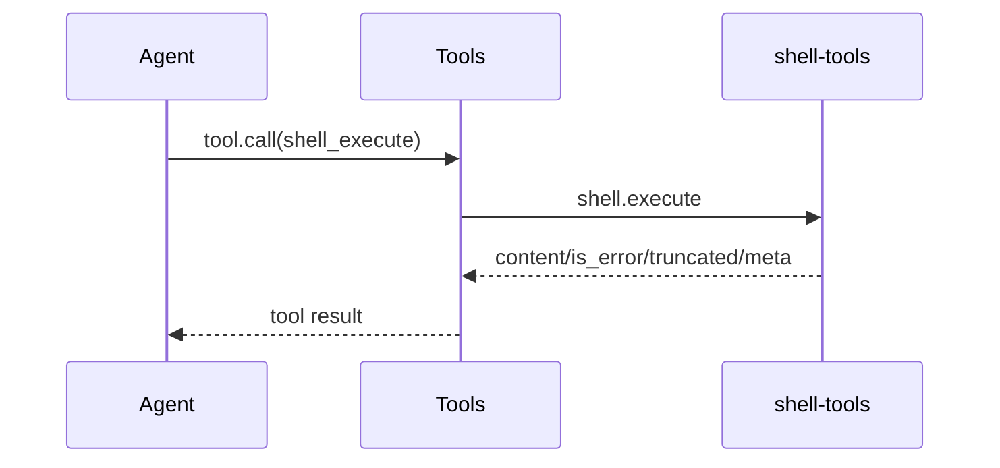

# shell-tools 通信契约

本文定义 `shell-tools` 通过 `shell` Capability 暴露的方法和结果。

## 1. 方法

| 方法 | 说明 |
|---|---|
| `shell.info` | 返回 `shell_execute` 的工具定义 |
| `shell.execute` | 同步执行一个进程 |

`shell_execute` 的 `method` 是 `execute`。

## 2. Provider 输入

`tools.call` 转发的输入：

```json
{
  "arguments": {
    "command": "go",
    "args": ["test", "./..."],
    "cwd": ".",
    "env": {"CGO_ENABLED": "0"},
    "stdin": "",
    "timeout_ms": 120000,
    "max_output_bytes": 1048576
  },
  "session_id": "s-1",
  "workspace": "E:/project",
  "call_id": "call-1",
  "meta": {}
}
```

`command` 必填，是可直接执行的文件名或路径。不经过 Shell 解析；需要 Shell 语义时显式调用解释器。
`cwd` 默认 `.`，相对路径以 `workspace` 为基准。工具层不检查路径越界。
`env` 覆盖继承的环境变量。`stdin` 原样写入子进程标准输入。
`timeout_ms` 默认 120000，最大 600000。`max_output_bytes` 是单流上限，默认 1048576，最大 4194304。

## 3. 结果

`content`：

```text
exit_code: 0
stdout:
...
stderr:
...
```

`meta`：

```json
{
  "exit_code": 0,
  "stdout_bytes": 123,
  "stderr_bytes": 0,
  "stdout_truncated": false,
  "stderr_truncated": false,
  "started_at": "RFC3339",
  "finished_at": "RFC3339",
  "duration_ms": 123,
  "timed_out": false,
  "stdin_bytes": 0
}
```

`stdin_bytes` 只在提供了非空 `stdin` 时出现。

## 4. 取消与超时

父 Context 取消时返回 `call_cancelled` 或 `call_deadline_exceeded`。
内部超时返回业务结果，`is_error=true`，`meta.timed_out=true`，`meta.code=process_timeout`。
两种情况都会终止整个进程树。

## 5. 错误码

| 错误码 | 场景 |
|---|---|
| `bad_arguments` | 缺少 command、参数含 NUL、stdin 超限、timeout/max_output 非法 |
| `cwd_invalid` | `cwd` 不可访问或不是目录 |
| `env_invalid` | 环境变量名或值不合法 |
| `command_not_found` | 可执行文件不存在 |
| `process_start_failed` | 进程启动失败 |

## 6. 调用关系



`python` 也会调用 `shell.execute`，把解释器命令交给本插件执行。

## 7. 实现状态

当前实现为同步执行；不提供后台任务、流式输出或 `shell.status` / `shell.cancel`。
